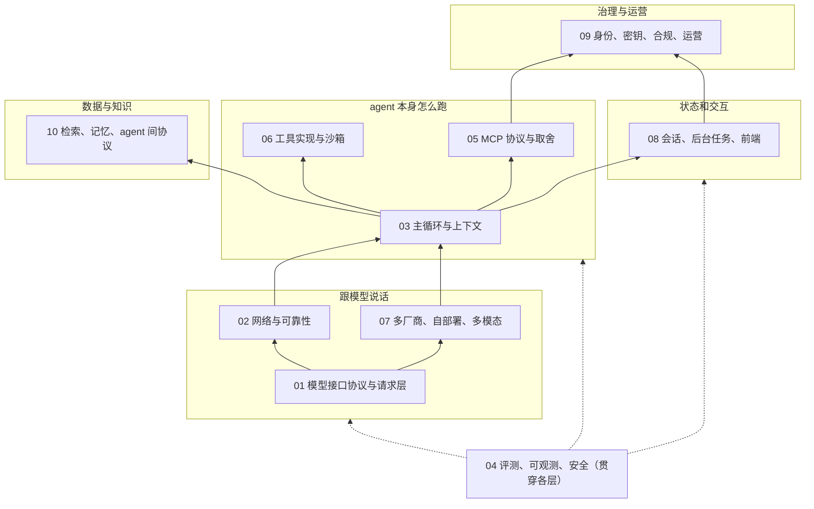

# Agent 工程基础：做过才知道的那些事

这是一份中文的 agent 工程知识库，讲的是把一个 LLM agent 从「能跑」做到「能上线、能长期运营」时，工程上绕不开的组件和要拿的主意。

只收两类东西：

- **做过才知道的隐含知识**：官方文档里藏得深、文章很少写、但踩过一次就忘不掉的事（比如反向代理默认缓冲 SSE、推理签名不能跨模型回传、钩子脚本出错默认放行）。
- **会影响设计决定的知识**：每个主题都围绕「你要决定什么 → 有哪些选项 → 各自代价 → 什么时候选哪个」来写。

不收：某个框架的花哨功能介绍、只讲概念没有工程细节的文章、同一件事的重复资料。

## 适合谁

- 已经会调模型 API、写过简单 agent，准备把它做成产品的工程师；
- 要自己写 agent 框架、网关、或 coding agent 的人；
- 要评审 agent 系统设计、做技术选型的负责人。

不需要你先读过任何框架的文档。英文术语第一次出现时都会用大白话解释。

## 每章的结构

每一章都是同样的五节：

1. **知识拆解**：这一块由哪些部件组成，每个部件的原理和关键数字。
2. **文章很少讲但常碰到的事**：线上真实会碰到的坑，以及原因。
3. **要拿的主意**：一条条设计决定，每条写清选项、代价和怎么选。
4. **资料清单**：每份资料标了类型、该读哪一部分、为什么值得读。
5. **阅读顺序**：按什么顺序读最省时间。

带具体数字的地方（默认值、上限、价格）都注明了核对日期（多数是 2026-10-09）。厂商文档改得很勤，用之前请再看一眼原文。标「(经验)」的条目是工程常识，没找到一篇官方资料专门讲；标「(推断)」的是从源码读出来、但代码里没明说意图的。

## 知识地图

从下往上：最底下是「跟模型说话」，中间是「agent 本身怎么跑」，往上是「状态和交互」，外围是「数据与知识」和「治理与运营」，评测、可观测和安全贯穿所有层。

## 各章一句话

| 章 | 一句话 |
|---|---|
| [01 模型接口协议与请求层](docs/01-llm-protocols.md) | 三家接口的消息结构、流式 SSE、结束原因、结构化输出、计费和 prompt caching（提示缓存）的前缀规则，决定你怎么拼请求、怎么存历史。 |
| [02 网络与可靠性](docs/02-reliability.md) | 哪些错该重试、退避怎么做、限流怎么数、超时怎么分层、流断了怎么续、副作用怎么只执行一次；各章讲到重试都以这一章为准。 |
| [03 Agent 主循环与上下文](docs/03-agent-loop-context.md) | while 循环里真正难的部分：孤儿工具调用、用户中途插话、完成判定、指令文件分层、中途提醒、窗口满了怎么办、什么时候值得拆多 agent。 |
| [04 评测、可观测、安全](docs/04-eval-observability-security.md) | 从「本地能跑」到「线上敢放」：评测怎么判断差异不是噪声、trace 记什么不记什么、提示注入为什么要靠架构而不是检测。 |
| [05 MCP 协议与设计取舍](docs/05-mcp-design-choices.md) | MCP（让 agent 统一接外部工具的协议）的基础和 2026-07-28 版的变化，以及做成 tool 还是 resource、本地还是远程、凭证谁持有这些决定。 |
| [06 工具实现与执行环境](docs/06-tools-sandbox.md) | 改文件、跑命令、搜代码、抓网页、操作浏览器这些工具怎么做才不出事，以及沙箱、网络出口、权限规则、工作区隔离和撤销。 |
| [07 多厂商、自部署、多模态](docs/07-providers-selfhost-multimodal.md) | 一套内部消息格式怎么接多家厂商、工具 schema 怎么适配、自部署推理引擎的静默坑、图片和文件怎么传最省。 |
| [08 会话、后台任务与前端](docs/08-sessions-jobs-frontend.md) | 会话怎么存、怎么迁移和分叉，长任务和持久化执行（durable execution），等人审批几天，事件协议、断线续流和多端同步。 |
| [09 身份、合规与运营治理](docs/09-identity-compliance-ops.md) | 凭证放哪、谁的身份在干活、数据被留了多久、ZDR（零数据保留）和驻留的冲突、组织策略下发、钩子和预算的语义。 |
| [10 检索、记忆与 agent 间协议](docs/10-retrieval-memory-a2a.md) | embedding 和向量库的生命周期、提前检索还是让 agent 自己搜、记忆的读写与纠错、A2A/ACP 协议、子 agent 的权限和失败。 |

## 推荐阅读

📚 **[推荐阅读：8 份可以直接对着读的体系化资料](docs/recommended-reading.md)**：书、系列教程和带讲解的源码解读，每份写了强在哪、缺什么、重点章节。页里有一张覆盖表，标出每份资料覆盖知识地图的哪些板块，以及合起来仍然缺、要回到本仓库对应章节补的部分。

## 阅读路径

**入门（先建立整体感）**

1. [03](docs/03-agent-loop-context.md) 第一节：先搞清楚 agent 就是一个循环，以及循环里要处理哪些事；
2. [01](docs/01-llm-protocols.md) 第一节和第二节：请求和响应长什么样；
3. [06](docs/06-tools-sandbox.md) 第 1–3 节：最常用的三类工具怎么做；
4. [04](docs/04-eval-observability-security.md) 第二节：上线前必须知道的坑；
5. 回到 [03](docs/03-agent-loop-context.md) 第三节，把要拿的主意过一遍。

**做产品上线（要给真实用户用）**

1. [02](docs/02-reliability.md) 全章：可靠性是上线后最先出问题的地方；
2. [03](docs/03-agent-loop-context.md) 第二、三节；
3. [08](docs/08-sessions-jobs-frontend.md)：会话存储、长任务、前端事件和断线续流；
4. [04](docs/04-eval-observability-security.md)：评测、trace、安全；
5. [09](docs/09-identity-compliance-ops.md)：凭证、多租户、数据保留和预算；
6. 用到外部工具时读 [05](docs/05-mcp-design-choices.md)，用到知识库和记忆时读 [10](docs/10-retrieval-memory-a2a.md)。

**自部署（模型自己跑、或要接很多家厂商）**

1. [01](docs/01-llm-protocols.md) 第一节：先知道各家原生协议的差别；
2. [07](docs/07-providers-selfhost-multimodal.md) 全章：内部消息格式、工具 schema 适配、vLLM / SGLang / llama.cpp / Ollama 的选择和静默坑；
3. [02](docs/02-reliability.md) 决定 4 和决定 10：多厂商备份和过载处理；
4. [09](docs/09-identity-compliance-ops.md) 第 3 节和第 8 节：数据驻留和企业网络；
5. [06](docs/06-tools-sandbox.md) 第 7、8 节：沙箱和网络出口。

## 资料从哪来

每一章的资料清单都尽量用一手资料：厂商官方文档、协议规范、RFC，以及开源 agent 的源码（OpenAI Codex、opencode、Goose、Gemini CLI、Aider、Cline、OpenHands、pydantic-ai、Vercel AI SDK、LangGraph、vLLM 等），源码链接多数固定到具体提交。工程经验类文章只保留有独家内容的。

想找成体系、可以从头读到尾的书和教程，见[推荐阅读](docs/recommended-reading.md)，李博杰《深入理解 AI Agent》的介绍和重点章节也在那一页。这本书里独有的一线经验，已经吸收进本仓库相关章节并注明出处。

## 许可

本仓库内容以 [CC BY 4.0](LICENSE) 发布：可以自由转载、修改、商用，注明出处即可。所引用的外部资料版权归原作者。
