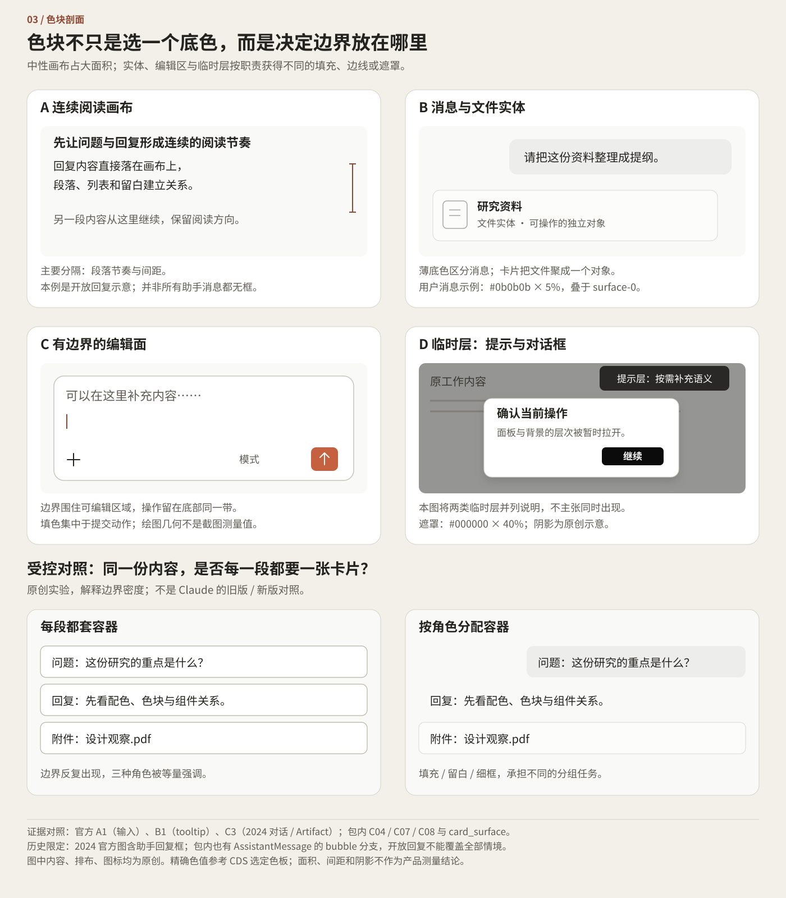
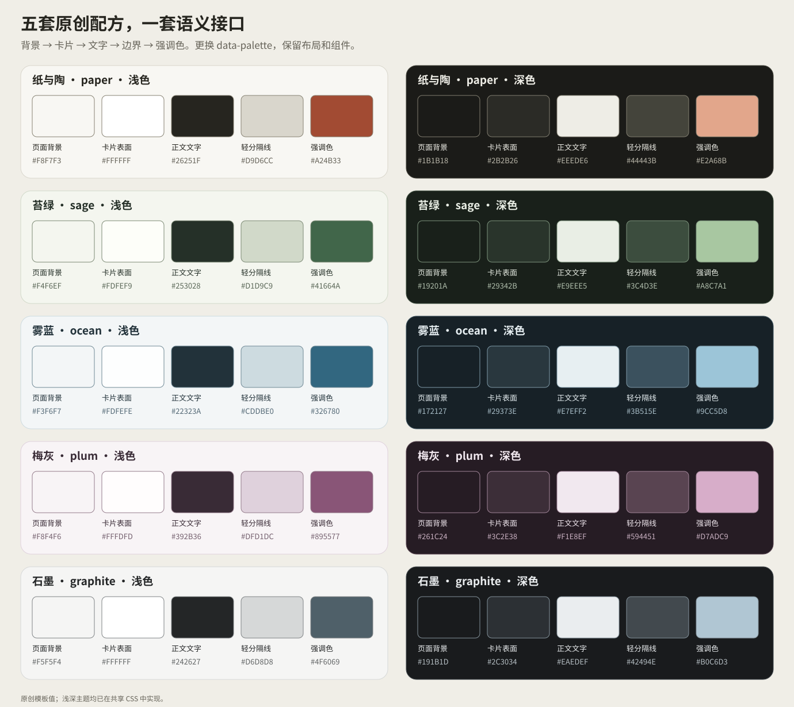
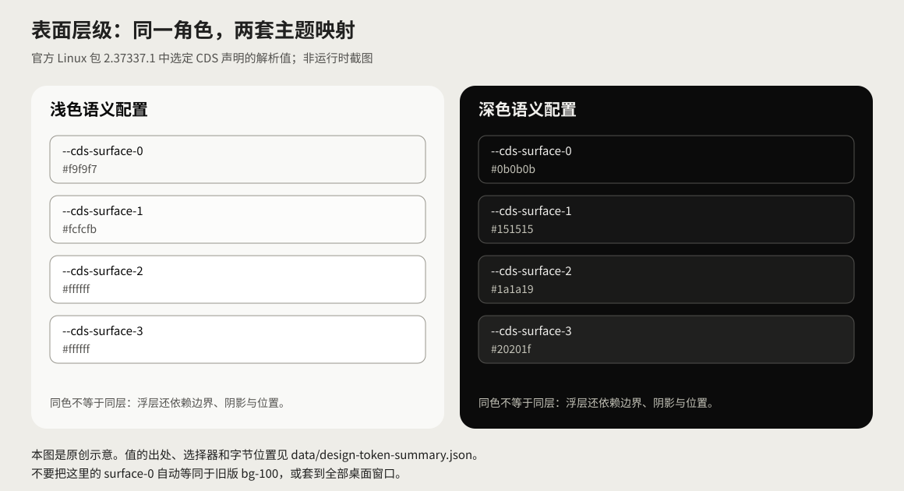
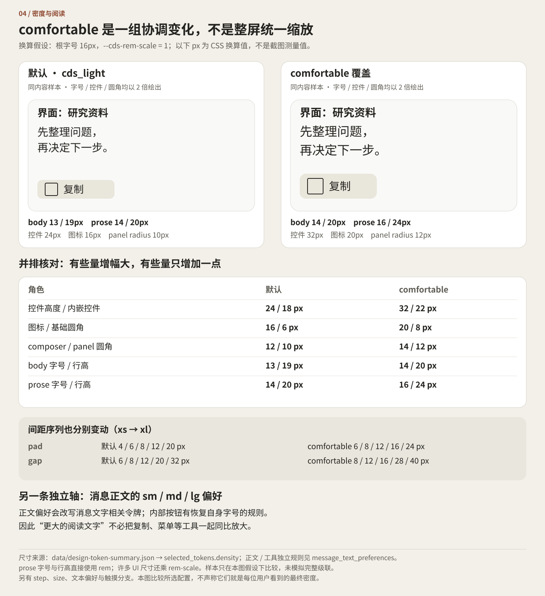
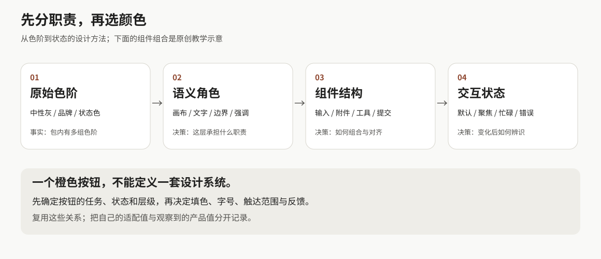

# Claude 视觉设计图谱

从暖中性色块到可切换的组件系统

Claude App 逆向研究 · 视觉设计分册 · 研究基准日 2026 年 10 月 14 日

Claude 的视觉识别由几种关系共同组成：接近纸张的浅色大面、与阅读文本分开的工具文字、边界明确的输入区域，以及少量承担具体动作的实色控件。安装包里的证据又揭示了更细的一层：表面会随主题重新映射，正文大小与控件密度分开调整，触摸设备会改变操作区的显现方式，卡片的按压反馈由多个绘制层协同完成。

本章把这些关系拆成可查用的色板、尺寸表和组件图谱。主样本是 Claude Desktop Linux 2.37337.1 的静态产物，辅以有出处的官方图片、历史设计访谈和一个独立实现。重点是解释这套外观怎样成立，以及哪些部分已经能够转成自己的代码。同版本的[三平台对照](../02-Illustrated-Deep-Dive-Book/18-Versions-And-Cross-Platform/README.md)进一步确认 Linux、Windows、macOS 的 3,847 个 ion-dist 文件逐一字节相同，支持共享发布资源的判断；各平台的实际加载与渲染仍需分别验证。

*图 1　原创色块剖面。展示阅读、消息、输入与临时浮层的关系，不拼接多个年代的官方截图，也不表示某个当前账号的完整屏幕。*

先看四个具体发现：

- **浅色层级十分接近，深色层级逐层变亮。** CDS 的浅色 surface-2 与 surface-3 同为白色；深色则分别为 `#1a1a19`、`#20201f`。浅色里的空间层级更依赖边界、阴影与位置。
- **发送、保存与停止有不同的强调方式。** 官方图片中的聊天发送使用暖橙，设置 Save 使用黑底白字，活跃语音 Stop 使用浅蓝底蓝字。动作的重要性没有被压缩成一种品牌色。
- **完整 composer 与 Quick Entry 是两种组织方式。** 前者将写作区域放在工具行上方；后者把输入、会话上下文与发送收束在同一水平轴上。
- **“舒适”不是把所有东西同比放大。** 在根字号 16px、rem-scale=1 的换算下，CDS 控件高度从 24 变为 32px，prose 字号从 14 变为 16px、行高从 20 变为 24px；同时还有独立的消息文字大小和触摸规则。

## 本章地图

[01 色板与主题](#01-色板与主题) · [02 色块与边界](#02-色块与边界) · [03 字体与密度](#03-字体与密度) · [04 组件解剖](#04-组件解剖) · [05 微观交互](#05-微观交互) · [06 从证据到代码](#06-从证据到代码) · [07 验证与研究入口](#07-验证与研究入口)

只需一页回顾，可读[设计速查](quick-reference.md)。代码入口是[原创交互示例](interactive-study/index.html)及[组件说明](styles/README.md)。

### 参数与代码的读法

本章的产品参数取自 2.37337.1 随包前端；历史图像按其来源年代解释。图谱和示例代码是供独立开发使用的工程化表达。每节保留影响实现的主题、密度、平台和变体条件，详细定位统一放在[资料附录](../04-Extracted-Core-Code-And-Scripts/evidence/README.md)。

## 直接拿来做网站

[五套浅深配色配方](palette-recipes/README.md) · [六套 HTML 模板与实景](templates/README.md) · [完整产品色表](color-catalog/README.md)

## 证据图例

S：包内静态值；V：官方画面观察；A：本书原创示意或实现。三者各自说明参数来源，不能互换。

## 01 色板与主题

### 从一套明确的 CDS 配置开始

下面选取包内 CDS 浅色与显式深色声明，先解析语义别名，再并排比较。表中省略共同前缀 `--cds-`，完整记录见[颜色与字体数据](../04-Extracted-Core-Code-And-Scripts/evidence/data/design-token-summary.json)。

*图 2　S 值、A 编排。透明色保留原色与 alpha，并在指定底色上展示；色样不是从客户端截图取色。*

| 表面与文字角色 | 浅色 | 深色 |
|---|---|---|
| surface-0 / page-bg | `#f9f9f7` | `#0b0b0b` |
| surface-1 | `#fcfcfb` | `#151515` |
| surface-2 / surface-panel | `#ffffff` | `#1a1a19` |
| surface-3 / surface-popover | `#ffffff` | `#20201f` |
| text-primary | `#0b0b0b` | `#f0efec` |
| text-secondary | `#52514e` | `#c3c2b7` |
| text-muted | `#898781` | `#898781` |

这套映射有两个值得细看的地方。第一，浅色 surface-0 的红绿通道都为 249，蓝为 247，温度来自极轻的偏移；大面积使用时仍有可辨的纸色感。第二，深色主要文字没有直接反成纯白，而是 `#f0efec`。中性色阶固定，neutral 别名和文字角色各自参与主题映射，因而“反色”不足以描述它。

*图 3　S 值、A 示意。边框为图表辅助线。浅色中同为白色的两个角色仍有不同用途；图表的框线不是它们的组件样式。*

### Primary、Clay 与 Accent 的分工

| 动作与强调角色 | 浅色 | 深色 |
|---|---|---|
| fill-primary / on-primary | `#0b0b0b` / `#ffffff` | `#ffffff` / `#0b0b0b` |
| clay | `#d97757` | `#d97757` |
| clay-emphasized / fill-brand | `#c6613f` | `#c6613f` |
| on-brand | `#ffffff` | `#ffffff` |
| fill-accent / on-accent | `#2a78d6` / `#ffffff` | `#2a78d6` / `#ffffff` |
| fill-accent-hover | `#3987e5` | `#3987e5` |
| text-accent | `#184f95` | `#6da7ec` |

令牌名已经把“中性主动作”“品牌填充”“交互强调”分成不同角色。官方图像提供了相邻的视觉印证：通用输入框将橙色集中在发送箭头；Cowork instructions 的 Save 通过黑白反差建立主次；活跃语音的 Stop 则把浅蓝底、蓝点与文字组合起来。三张图来自不同样本，不能由此给某个 token 与某个按钮做未经验证的一对一绑定，但足以否定“所有主动作都沿用同一橙色”的归纳。[官方图片观察 A1、A3、B2](../04-Extracted-Core-Code-And-Scripts/evidence/data/official-image-observations.md)

历史设计意图也有清楚的来源。品牌团队把衬线与书面阅读联系起来，将无衬线与技术感相联系，并把 clay 解释为未烧制的黏土；原设计师 Kyle Turman 则谈到暖底与衬线回复如何共同塑造更有人情味的阅读环境。这些第一手说明解释了气质来源。它们没有规定今天每个按钮的颜色、每个卡片的半径。[品牌访谈](https://www.thesubtext.online/all/anthropic-interview)，[设计师访谈](https://www.youtube.com/watch?v=EwtCO5jwvQs)

### 透明层也是配色的一部分

| 透明角色 | 浅色原值 | 深色原值 |
|---|---|---|
| border | `#0b0b0b` × 10% | `#ffffff` × 10% |
| border-strong | `#0b0b0b` × 20% | `#ffffff` × 20% |
| fill-ghost-hover | `#0b0b0b` × 5% | `#ffffff` × 7.5% |
| fill-ghost-selected | `#0b0b0b` × 10% | `#ffffff` × 15% |
| bg-user-message | `#0b0b0b` × 5% | `#ffffff` × 5% |
| backdrop | `#000000` × 40% | `#00000080`，alpha 为 128/255 |

深色 ghost 的覆盖量比浅色更强，用户消息却仍保持 5%。这说明 hover、selected 和消息底色不是一组可互换的“淡灰”。透明色还随承托表面改变：同一条 10% 黑线落在白色卡片与暖灰画布上，结果并不相同。图 2 的合成色样仅是选定底色上的展示，保留 alpha 才能将关系带入别的表面。

backdrop 是另一个容易损失精度的例子。深色声明的末尾 `80` 是十六进制 alpha，等于 128/255，约 50.196%，并非数学上恰好 50%。它通常不影响肉眼判断，却影响“忠实记录值”与“自己选一个近似值”的区别。

| 状态角色 | 浅色前景 / 背景 | 深色前景 / 背景 |
|---|---|---|
| danger | `#8e2626` / `#fad6d6` | `#ec7e7e` / `#3c0e0e` |
| success | `#006300` / `#caeac7` | `#0ca30c` / `#11260f` |
| warning | `#734500` / `#f9dca4` | `#db9300` / `#311a00` |

这张表记录状态文字与底色的成对声明。它不意味着所有错误都要填满红色面板；面积、说明文字和恢复动作仍由实际组件决定。

### 低饱和外观的对比度成本

静态值的假设配对计算中，浅色 primary 对 surface-0 为 18.67:1，secondary 为 7.53:1，muted 为 3.41:1；白色 on-brand 对 `#c6613f` 为 4.05:1。前两组有充分亮度差，后两组若用于通常尺寸的必要文字就值得复查。组件验收应按最终字号、状态、透明叠加与承托表面计算；这组配对用于定位需要进一步检查的文字角色。[计算记录](../04-Extracted-Core-Code-And-Scripts/evidence/data/design-token-summary.json)

原创示例据此做了主动适配：普通动作采用中性色，辅助文字加深，表单边界独立加强，Clay 留给有限装饰。所检色值与新的用途分开记录，后续改动就能知道自己是在更换原始值，还是重做角色映射。

## 02 色块与边界

### 哪些地方形成一个面

官方图像与组件证据呈现出四种不同的分隔手段。

| 区域 | 面积与边界 | 证据里的具体区别 |
|---|---|---|
| 连续阅读区 | 大面积承托，主要由文本节奏与间距分段 | transcript 有独立宽度；助手消息拥有正文、操作和可选变体 |
| 用户消息或文件实体 | 局部填充，边界贴近一个对象 | 用户消息及指定助手气泡分支共享气泡几何；Card 又有独立填充和内容层 |
| Composer | 清晰的外轮廓，内部留给输入的大面 | 官方图中输入区在上、工具行在下；包内有多个独立槽位 |
| Tooltip 与 Dialog | 临时覆盖层，靠阴影、反差或遮罩脱离底面 | 语音入口 tooltip 为深色小层；Dialog 有居中面板与 backdrop |

“哪里不画框”必须按变体讨论。2024 年 Projects 图里可见助手回复容器；包内同时有特定的 AssistantMessage bubble 和 bubble-stack 分支。将所有助手回复概括为“永远开放、永远无框”，会抹掉这些差异。更稳妥的结论是：作者角色、内容类型和变体都能决定容器，而不是每条消息共享同一外壳。[C03、C04、C07](../04-Extracted-Core-Code-And-Scripts/evidence/data/component-trace.json)，[message_bubble_geometry](../04-Extracted-Core-Code-And-Scripts/evidence/data/design-component-rules.json)

图 1 还包含一个原创对照思路：当所有内容都使用同样的卡片，正文、用户输入和可打开文件会拥有接近的视觉重量。按对象分配填充后，文件入口获得可操作的边界，正文则借段落连续展开。这是用受控构图解释信息层级，不是宣称已经做过用户实验，也不是 Claude 旧版与新版的比较。

### 卡片的白不是一整块白

Card 普通填充使用 surface-1；含 CardLink 时，hover 填充转为 surface-2。浅色数值只是从 `#fcfcfb` 到 `#ffffff`，变化很小。真正的结构还包含圆角外框、装饰填充层、带 padding 的 body、media 与 link overlay。键盘焦点可落在卡片边界，内容里的辅助动作仍有自己的位置。

因此 Card 更接近一组协作的绘制层与交互区域。原语可以托住文件、预览或其他内容，但仅凭 Card 的存在，尚不能把一整套“工具结果组件”称为已恢复。不同工具的日志、运行状态、错误恢复仍属于更上层的业务结构。[C07](../04-Extracted-Core-Code-And-Scripts/evidence/data/component-trace.json)，[card_surface](../04-Extracted-Core-Code-And-Scripts/evidence/data/design-component-rules.json)

### 细边界与抬升感

浅色 CDS 的 outer ring 基值为 1px、inner 为 0；深色交换为 outer 0、inner 1px。small、medium、large 阴影由近距离小阴影与较宽的柔影叠加，popover 则拥有专用配方。比如浅色 popover 的两层为 `0 8px 24px #0000001f` 与 `0 2px 6px #00000014`；深色提高到 `#00000052` 和 `#0003`。这些声明把轮廓、贴近边缘的遮挡与扩散阴影分开处理。[elevation 数据](../04-Extracted-Core-Code-And-Scripts/evidence/data/design-token-summary.json)

这解释了一种常见的视觉误读：看起来“很淡”的边界，可能同时由填色差、细线和两层投影建立。只复制其中一条 box-shadow，放到不同背景上，面板会像丢掉了一部分外轮廓。深色表面虽然更容易靠明度分层，依然需要自己的 ring 和阴影映射。

## 03 字体与密度

### 阅读字与工具字有两条几何路径

历史品牌案例记录过 Styrene 与 Tiempos；本次包内则可见 `anthropic-sans`、`anthropic-serif`、`anthropic-mono`。两组名字属于不同时间和材料范围，可以作为演变线索，不宜拼成一套当前字体栈。用于制作品牌材料的字体指南，也不直接等于 App 的运行字体。[早期品牌案例](https://geist.co/work/anthropic)，[字体声明与元数据](../04-Extracted-Core-Code-And-Scripts/evidence/data/design-token-summary.json)

| 所检字体样本 | 可变轴 | 已知覆盖边界 |
|---|---|---|
| Anthropic Sans Variable Text | wght 300–800；opsz 16–48 | 样本无 CJK 统一表意文字映射 |
| Anthropic Serif Variable Text | wght 300–800；opsz 16–48 | 样本无 CJK 统一表意文字映射 |
| Anthropic Mono Web | wght 300–800 | 样本无 CJK 统一表意文字映射 |
| Anthropicons RVRN | wght 400–700；opsz 12–32；ANIM / ANM2 0–100 | 图标字体，不作为正文替代 |

Sans、Serif、Mono 样本都不包含测试字符“中”“日”“한”。中文最终要由回退字体承担；这是所检文件的事实，不表示整个产品没有东亚支持。本次未登录网页的计算字体栈甚至在名为 serif 的角色后列出 PingFang SC、Microsoft YaHei、Noto Sans CJK SC 等家族。字体栈说明候选顺序，具体字符由哪款字体绘制还要测量。[网页观察](../04-Extracted-Core-Code-And-Scripts/evidence/data/web-login-observation.json)

因此本书 demo 的宋体式中文阅读是 **A 选择**。它使用设备已有字体，不分发 Anthropic 字体，也不宣称复现了 Claude 中文字形。迁移这套阅读分工时，要同时观察“Claude / 中文 / 2026 / API”的混排：拉丁字母与汉字的视觉大小、标点宽度、数字基线及粗体的黑度会共同决定一行的节奏。单独对齐 CSS 的 16px，不能保证同样的换行与高度。

### 默认与 comfortable 的实数对照

下表统一假设根字号 16px、`--cds-rem-scale = 1`；是静态声明换算，不是屏幕测量。

*图 4　S 参数、A 试样。对照使用同类内容说明比例变化；不是官方组件截图，字体为合法系统替代。*

| 参数 | 默认 | comfortable |
|---|---:|---:|
| 控件高度 / 嵌套控件高度 | 24 / 18px | 32 / 22px |
| 图标 | 16px | 20px |
| body 字号 / 行高 | 13 / 19px | 14 / 20px |
| prose 字号 / 行高 | 14 / 20px | 16 / 24px |
| code / footnote 字号 | 12px | 13px |
| caption 字号 / 行高 | 11 / 17px | 12 / 17px |
| heading 字号 | 14px | 15px |
| title 字号 / 行高 | 20 / 25px | 22 / 28px |
| 常规 / composer / panel 圆角 | 6 / 12 / 10px | 8 / 14 / 12px |
| padding xs → xl | 4、6、8、12、20px | 6、8、12、16、24px |
| gap xs → xl | 6、8、12、20、32px | 8、12、16、28、40px |

这里没有一个共同放大倍率：caption 行高不变，控件高度增幅明显，prose 则增加行距。更细的区别是 prose 直接使用 rem，而不少工具相关值还乘 rem-scale。它们使阅读与操作能沿不同几何路径变化。[density 数据](../04-Extracted-Core-Code-And-Scripts/evidence/data/design-token-summary.json)

消息正文另有 sm / md / lg 偏好。相应选择器覆盖 AssistantMessage、UserMessage 与 QueuedMessages 内的正文令牌，同时为内部按钮、输入和工具栏恢复各自字号。这个机制特别适合阅读型产品：用户放大长文，不必连带放大每个复制按钮或模型选择器。[message_text_preferences](../04-Extracted-Core-Code-And-Scripts/evidence/data/design-component-rules.json)

Code 的 Normal、Thinking、Verbose 则是 **transcript 详情显示模式**，决定展示哪些工具调用与思考详情，和上述几何密度属于不同维度。把它们统称为紧凑或宽松模式，会把“看多少信息”和“信息占多大空间”混为一谈。[Code 桌面文档](https://code.claude.com/docs/en/desktop)

### 深色字重的第二条通道

CDS 的常规 font-weight 声明为 400 / 500 / 580 / 600。深色分支还在变量字体通道提供 wght 360 / 460 / 540 / 560；浅色该通道为 normal。这里的发现是同一字重角色存在额外的主题调节，而不是所有深色文字都能直接认定为 360 或 460。最终是否生效取决于组件消费、实际字体和浏览器。[font_weights 数据](../04-Extracted-Core-Code-And-Scripts/evidence/data/design-token-summary.json)

对系统字体的原创适配可以先保留角色，不照搬轴值。某个回退字体没有相同轴，或者中文粗体的黑度不同，直接套入数值也不会得到同样的视觉结果。

## 04 组件解剖

### 用三层图谱找到研究对象

| 层级 | 对象 | 核心职责 | 证据入口 |
|---|---|---|---|
| 基础控件 | Button、字段、菜单与浮层 | 单次操作、输入值、临时选择 | CDS 尺寸与颜色；官方输入和 tooltip 图 |
| 基础容器 | Card、Dialog | 定义对象边界或临时任务范围 | C07、C08 |
| 复合组件 | ChatComposer | 编辑、上下文、动作与提交 | C05、C06 |
| 复合组件 | UserMessage、AssistantMessage、MessageActions | 作者内容与对应操作 | C04；消息 CSS 规则 |
| 工作表面 | Frame、Sidebar、Transcript | 导航、工作区与阅读宽度 | C01–C03 |
| 工作表面 | Artifact、Settings | 持续操作的对象或配置任务 | C09、C10 |
| 独立窗口 | Quick Entry | 跨工作上下文的短输入 | C11、C12 |

这张图谱没有把基础按钮、完整设置页和本地窗口放在同一抽象层。某些菜单已能从文档确认功能位置，但本章没有取得足够证据还原每种菜单的完整结构与尺寸；这里将其保留为缺口。

*图 5　A 解剖图，依据 S 部件与 V 关系重新绘制。可选槽位表示组件能力，不代表默认同时可见；官方图标、专有字体和应用源码未进入图形。*

### Composer 的七个部件与一个 Dock

静态组件追踪列出 Header、Attachments、Actions、PrimaryAction、Chin、Overlay、Tray，外部另有 ChatComposerDock。主编辑器与 Tiptap / ProseMirror 相关。包内还暴露 new / reply form、multiline、busy、disabled、drag-over、variant 等状态。[C05、C06](../04-Extracted-Core-Code-And-Scripts/evidence/data/component-trace.json)

| 部件 | 在结构中的作用 | 本章能确认到哪里 |
|---|---|---|
| Header | 输入区域的上部附加内容 | 部件存在；具体内容依分支变化 |
| Attachments | 已加入输入上下文的附件区 | 有独立槽位，不等于已恢复上传流程 |
| Actions | 辅助动作组 | 与主动作分离 |
| PrimaryAction | 发送等主要动作 | 独立部件，状态由上层协调 |
| Chin | 输入面下部的控制区域 | 有触摸尺寸分支与补偿规则 |
| Overlay | 覆盖输入区域的内容 | 状态与具体布局需按分支追踪 |
| Tray | 附加托盘区域 | 不是每次输入都要出现 |
| Dock | 承托 composer 的外部定位容器 | 与编辑表面分开 |

官方 composer 图像让结构更容易理解：白色圆角输入面占主要面积，提示位于左上；底部左边是附加工具，右边是模型与发送，中间留下显著空白。模型与主动作在同一水平带，提供内容后的下一步集中在右侧。[官方输入框样本](https://support.claude.com/en/articles/8114491-get-started-with-claude)

本书实现只取其中一个较小切面：textarea、工具行、主动作、错误区、外部 Dock。它没有 Tiptap、附件上传、拖放、模型菜单、Tray 或 Overlay 的完整行为。读者可以从 `.composer` 与 `setState()` 看见结构和状态如何接合，再按自己的输入任务增设槽位。将图谱里的每个名字照搬进 DOM，却没有对应任务，反而会让 API 比界面更复杂。

### 消息的作者与变体

UserMessage 与 AssistantMessage 在静态组件中分开，各有对齐、排版、操作与 busy 钩子。用户气泡和指定助手气泡分支的最大 measure 为 85%，圆角由基础 radius 加 `0.25rem × scale` 派生。按本章尺寸假设，默认为 10px，comfortable 为 12px。这个关系只属于选定气泡分支，不能替代整个 transcript 宽度。[C04](../04-Extracted-Core-Code-And-Scripts/evidence/data/component-trace.json)，[message_bubble_geometry](../04-Extracted-Core-Code-And-Scripts/evidence/data/design-component-rules.json)

助手长文还需要容纳标题、列表、代码、链接与作品入口。于是“作者是谁”“是否用气泡”“正文有多宽”“操作何时出现”成为四个可以独立决定的属性。demo 采用用户局部色块与开放助手阅读区，是本书自己的组合；它并未声称当前 Claude 的全部回复都按这一方式绘制。

### 卡片与作品工作区

卡片负责把一个结果变成可识别、可打开的对象。Artifact 则有自己的标题、切换按钮和头部拖动区域；会话里的卡片提供打开、隐藏、分享等动作。两者对应“入口”和“工作对象”两个尺度。[C07、C10](../04-Extracted-Core-Code-And-Scripts/evidence/data/component-trace.json)

2024 年 Projects 官方图已经展示对话与 Artifact 并排：左侧保留讨论与输入，右侧有 Preview / Code 切换、关闭与底部工具；深色代码内面处在浅色 App 外壳中。这证明那时存在相邻工作面的构造，也提示作品内部主题要与宿主主题分开。图片外围的紫色纹理、放大光标属于演示包装，不进入 App 色板。[2024 Projects](https://www.anthropic.com/news/projects)

本书 demo 的结果入口打开原生 dialog，右侧另有研究注释区。它没有实现 Artifact 的可调分屏、版本切换、编辑保存、代码运行或分享。注释区看起来像一个侧面板，也不能据此称为 Artifact 工作区复刻。

### 导航框架与阅读宽度

Frame 的 root、sidebar body 与 main content 分开，根状态包含 collapsed、density、web / desktop variant 和侧栏宽度变量。侧栏内可见 Pinned、Projects、Recents、加载占位与 hover / peek 线索。独立 `df` 样式的基值包括侧栏 288px、header 48px、行高 26px、行字 13px、图标 16px和卡片圆角 8px。代码 compact 列表又有 28px 行，特定非 web、非 phone 的固定列表为 26px。[C01、C02](../04-Extracted-Core-Code-And-Scripts/evidence/data/component-trace.json)，[frame_defaults 与 frame_compact_list](../04-Extracted-Core-Code-And-Scripts/evidence/data/design-component-rules.json)

这些参数属于不同选择器层级，共同把“导航密度”和“内容阅读宽度”分开控制：普通 transcript 的回退值为 48rem，desktop 外层宽度增加 2.5rem，并结合断点内边距。条件分支中的 840px 不是全局聊天宽度。[C03](../04-Extracted-Core-Code-And-Scripts/evidence/data/component-trace.json)

### Dialog 与 Settings

Dialog 与 ConfirmationDialog 共享居中面板、backdrop、焦点处理和减少动效分支。包内尺寸表是 400 / 520 / 720 / 880 / 1024 / 1152px 的最大宽度档位；这是声明上限，不是实测窗口矩形。Settings / customization 又支持模态和页面两种承载形式，保留关闭按钮区域、可滚动内容与骨架状态。[C08、C09](../04-Extracted-Core-Code-And-Scripts/evidence/data/component-trace.json)

Dialog 的过渡声明还包含起始 scale 0.98 与透明度变化，配合减少动效分支处理出现过程。其尺寸、遮罩与过渡属于同一个组件语境，不能只凭跨文件搜索相似数值就合并不同浮层的行为。

官方 instructions 设置裁切将说明、textarea、确认行自上而下排列；Cancel 是白底细边框，Save 是黑底白字。组件的视觉重量由编辑面积与动作等级形成。demo 可以演示原生 `showModal()`、关闭与焦点恢复的实现逻辑；完整设置导航、apply / cancel 草稿事务并未实现。

### Quick Entry 的单轴输入

Quick Entry 是本地独立 HTML 表面。所检声明包含 16px 胶囊半径、56px 输入行最小高度、16px 字号与 150% 行高。静态处理分支中有普通 Enter 提交、特定修饰 Enter 变体、Escape / 外部交互关闭，以及随文本增长请求调整尺寸。[C11、C12](../04-Extracted-Core-Code-And-Scripts/evidence/data/component-trace.json)

Mac 官方图片呈现低矮横条：左端符号，中央输入，右侧 New Chat 与发送。整组控件在一条垂直居中的轴线上，外部柔和阴影把它作为完整浮层托起。它没有完整 composer 的第二层工具栏。图片的 1702×302 是资产像素尺寸；56px 的最小行高则来自另一条静态证据，两者不宜互相反推缩放。[Mac Quick Entry](https://support.claude.com/en/articles/12626668-use-quick-entry-with-claude-desktop-on-mac)

这一形态适合短路径输入：保持文本目标最大，把会话上下文紧邻提交。完整聊天则还要容纳附件和长草稿，不能仅把横条等比放大。交互工作台提供独立的横向 Quick Entry 试样，支持本地捕获、上下文选择和键盘操作；系统快捷键与置顶属于桌面壳层。

## 05 微观交互

下面六项发现来自[组件 CSS 规则](../04-Extracted-Core-Code-And-Scripts/evidence/data/design-component-rules.json)。它们解释了静态截图通常看不到的设计工艺。

### 卡片按下时变化的是多个层

`card_press` 同时控制填充层缩放与内容裁剪。按下使用 fast，释放使用 slow 与弹簧曲线；CDS 时间档分别是 60、120、200、300、450ms。容器形变、边缘和内容可见范围被协调，而不只是给整张卡片连同文字加一个 scale。

这种实现分层让研究者有了具体问题：内容会不会跟着变模糊，圆角附近会不会漏出背景，内嵌按钮是否仍能独立操作？demo 的 `.study-card` 目前只有常规容器样式，没有复制这套按压与裁切机制。

### 消息操作按输入设备改变可见性

MessageActions 的 reveal 分支组合透明度与 scale，也有 always-visible 和 instant 状态。在 `pointer: coarse` 或 `hover: none` 条件下，操作区改为可见并取消显隐过渡。这里改变的是发现操作的方式，触摸适配不止是放大按钮。

这一规则与 selected、hover、focus 的区分相呼应：某条消息可以是当前工作对象，用户的键盘焦点又在它的复制按钮上。选中底色负责位置，焦点轮廓负责正在操作的目标，二者可以同时存在。

### Chin 在视觉行之外补偿触达

composer 底部的 touch-size 分支继承控件尺寸令牌，并用补偿变量扩大视觉行之外的触达空间。因此“看起来只有一条很紧的工具行”和“只能点中可见图标”不是同一个判断。最终命中范围仍需实际 DOM、布局和指针测试才能得到。

另一个独立规则仅在粗指针条件下，将文字输入字号设为至少 16px，再与 body 字号取最大值。它没有把所有桌面输入框统一规定成 16px。

### 高像素密度细线

hairline 在分辨率至少 2x、3x、4x 时分别声明 0.5px、`1px / 3`、`1px / 4`。设计在 CSS 像素和设备像素之间保留了分工：一条精细分隔线可以比 1 CSS px 更薄，但不会要求文字、外框和命中区域都一起缩小。

这也使“截图里这一条像是 1px”成为有条件的观察。截图缩放、设备像素比与浏览器栅格化都会改变其外观；静态声明说明机制，真实渲染才能确认效果。

### 减少动效有组件级分支

消息操作区对系统 `prefers-reduced-motion` 和产品 `data-reduce-motion` 都有规则，移除相关过渡与缩放。全局分支还压缩动画时长、停止欢迎动画，让图标的 ANIM / ANM2 轴回到 0。但全局片段没有统一关闭每条 transition，不能据此宣称产品全部动态都已移除。

本书 demo 使用自己的方案：减少动效时取消逐字呈现，组件时长变量置零。它表达了类似的适配目标，执行路径并不是原产品代码。

### 读者偏好不侵入操作密度

消息 sm / md / lg 与按钮字号恢复规则，是本次最有迁移价值的结构之一。它允许“放大正文”只改变阅读对象；控件密度由另一组 token 保持。结合输入设备、主题与减少动效，界面事实上有多条配置轴，而非一个从紧凑到宽松的总开关。

原创实现若要增加这项能力，可先给消息内容建立阅读变量作用域，再让 toolbar 消费固定的控件字号。当前 demo 尚无密度和阅读大小切换，这条路径是后续实现方案。

## 06 从证据到代码

### 一个 REA 研究闭环

以“聊天正文究竟有多宽”为例，研究路径可以收敛成六步。

1. **问题。** 截图留白无法区分正文上限、外框宽度和窗口宽度。
2. **REA 清点。** 识别本地壳、ion-dist 主内容和共享脚本；选定 UI 文件做有限的 JavaScript 分析。工具范围与预算保留在报告中。
3. **补充定位。** 对选定压缩文件做有限文本检查，在 `shared-2-SYzsATg-.js` 找到 C03 的三个锚点：变量名、48rem 加 2.5rem 的外层表达式、desktopFrame 组件入口。
4. **判断语境。** 将普通 transcript 分支与条件性的 840px 分支区分，避免把搜索命中的一个数字写成统一宽度。
5. **设计解释。** 阅读列与外部控件空间可以独立变化；两层宽度为不同内容保留各自的边界。
6. **原创落地。** demo 使用自己的阅读宽度与响应式布局；用 `.composer-dock`、对话滚动区与研究注释区展示层级，而不抄写原表达式或宣称恢复整套布局。

REA 在这里提供清点、提取和有限分析的路径；组件锚点与设计解释还来自后续人工交叉检查。可信度来自可复核的证据链，不来自一个笼统的“逆向完成率”。完整锚点、文件哈希及分析限制见[组件追踪](../04-Extracted-Core-Code-And-Scripts/evidence/data/component-trace.json)。

### 原创实现的四个入口

*图 6　A 方法图。数据中的某个颜色进入示例时，还经过了本书自己的用途分配；值相同不代表组件相同。*

| 文件 | 负责什么 | 从哪里改起 |
|---|---|---|
| [tokens.css](styles/tokens.css) | 浅深色、字体、尺寸、形状、时长 | `--study-canvas`、`--study-ink` 等角色 |
| [components.css](styles/components.css) | 按钮、字段、卡片、开关、dialog | `.study-button`、`.study-field`、`.study-card` |
| [demo.css](interactive-study/demo.css) | 页面布局与组合 | `.composer`、`.composer-dock`、消息和侧区 |
| [demo.js](interactive-study/demo.js) | 本地状态和事件 | `setState`、`startReply`、`cancelTimer`、`openDialog` |

语义变量与主要类名有 `study` 前缀，但组件 CSS 仍含 `*`、`body`、`button`、`p`、`:focus-visible` 等全局规则。嵌入现有 App 前应把 reset 与基础样式拆开或作用域化。只靠前缀不能保证不影响原页面。

### 配方一 更换一组浅深主题

先打开 demo 的“语义变量”，切换浅深，观察画布、内容面与抬升面。修改主题时，至少同时处理下列配对：

- `canvas / surface / raised` 与 `ink / ink-secondary / ink-muted`
- `action / on-action` 与 hover 状态
- `field-border` 与输入框背景
- `error / error-soft`、`success / success-soft`
- `focus` 与可能出现焦点的各类表面

观察值来自 CDS 的只有选定字面值；sidebar、hover、selected、辅助文字、动作和错误配色有本书新增决定。改完后查看“组件图谱”的输入错误与模态窗口，能比只看一排色块更快发现角色配错。

加载自己的页面时，顺序为 tokens 在前、components 在后。根元素设置 `data-theme="light"` 或 `data-theme="dark"`；局部主题依赖 CSS 变量继承，还须在实际嵌套场景检查覆盖。

### 配方二 分离阅读字号与控件密度

交互工作台提供原创的 40 / 48px 控件密度，以及独立的 14 / 16 / 18px 消息阅读字号。它们用于演示两套尺度如何分开工作；包内 CDS 的 24 / 32px 是另一组产品参数，不能混用名称或数值。

控件成组改变图标、padding、gap 和圆角，消息正文只改变自己的字号与行高。验收时先放大中文正文，再检查复制按钮、工具栏和输入区：阅读变大，不应让每个操作控件跟着膨胀。

### 配方三 装配输入状态

demo 的最小结构由 `.composer-dock` 包住表单 `.composer`，表单内是 `#message-input` 和 `.composer-toolbar`，主按钮为 `#send-button`，错误提示在同一输入上下文中。状态为 idle、generating、complete、stopped、error。

`setState()` 同步更新按钮名称、是否可用和状态文字；`cancelTimer()` 除清理计时器，还递增 generation，使旧回调失效。重试复用已有的用户消息，失败时保留提交内容，新写的草稿也有独立保护。这样，视觉上的“停止”和“错误”有不同的数据含义。

中文输入的组合状态由 composition 事件、isComposing 和兼容键码检查保护；Shift + Enter 保留换行。当前验证只使用合成事件，真实输入法仍待测试。接入模型服务还要自行提供网络请求、取消、超时、身份与持久化；附件、模型选择、上传错误和拖放也都需要补齐业务行为。

## 07 验证与研究入口

### 机制与 demo 覆盖矩阵

| 研究机制 | 原产品证据 | 原创 demo 当前覆盖 | 仍缺什么 |
|---|---|---|---|
| 浅深语义映射 | CDS colors | 有，两套原创映射与实时色板 | 实际浏览器级联与全状态渲染 |
| 中性动作与 Clay 分工 | CDS + 官方图像 | 有，原创用途 | 不等于官方按钮状态复刻 |
| 多种密度与阅读大小 | density + message_text_preferences | 原创 40/48px 密度试样与独立 14/16/18px 阅读字号 | 产品 24/32px 参数作为独立对照 |
| 中文回退 | 字体元数据 + login 字体栈 | 系统字体替代 | 真实各平台字形与排版 |
| Composer 复合结构 | C05、C06 | textarea、工具行、主动作、错误、Dock | 附件、模型菜单、Tiptap、Tray、Overlay、拖放 |
| 生成停止与错误恢复 | 本书原创任务模型 | 有，本地预置回复 | 真实请求取消、超时、持久化 |
| 气泡与助手阅读区 | C04 + 气泡规则 | 原创用户色块与助手内容 | 全部产品变体、正文大小偏好 |
| 消息操作 reveal / touch | 消息 CSS 规则 | 有复制动作 | 产品式显隐与触摸分支 |
| Card 填充和按压裁切 | C07 + card_press | 常规静态卡片 | 分层缩放、裁切、弹簧回弹 |
| Dialog | C08 | 原生 dialog 与焦点管理逻辑 | 真实 top layer、Tab、Esc、辅助技术 |
| Settings | C09 | 字段验证试样 | 完整设置页与 apply / cancel |
| 导航框架 | C01、C02 | 收合、窄屏导航、研究注释 | 真实会话、Projects、peek、持久化 |
| Artifact 工作区 | C10 + 2024 图像 | 结果卡打开模态预览 | 调宽分屏、编辑、切换、运行、分享 |
| Quick Entry | C11、C12 | 横向输入、上下文、提交、Esc 草稿保留 | 独立窗口、系统集成、快捷键 |
| 减少动效 | 组件专用规则 | 原创时长与回复替代 | 真实呈现和系统设置验证 |
| 高 DPR hairline / 触达补偿 | density_hairline / composer_touch_chin | 无对应实现 | 栅格化、实际命中范围 |

覆盖矩阵既标明可拿走的代码，也保留本书还没有实现的机制。按这个索引选择代码，可以避免把页面控件与桌面系统集成混成一个任务。

### 如何验收自己的实现

先运行状态与静态检查，再逐项检查真实浏览器中的布局、输入和焦点。当前交互工作台有 46 项基础状态检查、32 项新增机制检查，以及 16 项静态检查；[测试入口](../04-Extracted-Core-Code-And-Scripts/README.md)提供命令与明细。

真实浏览器首轮检查发现了一个典型问题：按钮在点击后变成 disabled 或从页面隐藏，焦点会落回 body。Stop、模拟启动与 Retry 都需要在用户主动触发时将焦点交回输入框，而后台生成完成不能随意抢焦点。这个区别已加入示例与回归测试。

截至本次核验，官方 Docs 帮助还列出一个具体的 Desktop 限制：使用 VoiceOver 在文档内输入或导航时，文档文字不会被读出，并给出较新 Chrome / Safari 的网页替代路径。这是特定编辑器与辅助技术组合的已知问题，也说明视觉完成度需要与可操作性分别验收。[Claude Docs 已知限制](https://support.claude.com/en/articles/16923645-get-started-with-claude-docs)

### 系统与表面的定位表

本书精确值的另一个坐标是“它来自哪套系统”。这些层并非一条简单的年代进化线。

| 轴 | 本章遇到的范围 | 代表差异 |
|---|---|---|
| 运行表面 | 本地窗口壳、托管主内容、包内 ion-dist、Quick Entry、Artifact / Code 工作面 | 主窗口壳与内容视图分开加载；Quick Entry 有独立入口 |
| 样式体系 | 旧 HSL、v2 条件桥接、CDS、df 框架 | v2 重映射旧变量名；df 有自己的几何与阴影 |
| 配置 | 主题、密度、阅读大小、字体偏好、输入设备、减少动效 | 各轴可能共同影响同一个组件 |
| 证据 | S / V / H / W / A / T | 静态声明、画面关系、意图与实现验证分别记录 |

一个最短的版本对照就能看出必要性：旧 HSL 的 bg-100 为浅色 `#faf9f5`、深色 `#262624`；v2 桥接同名变量变为 `#f9f9f7`、`#151515`；CDS 的 surface-0 则为 `#f9f9f7`、`#0b0b0b`。名字相近或某个值相同，都不能证明消费者与语义等价。[legacy_comparison](../04-Extracted-Core-Code-And-Scripts/evidence/data/design-token-summary.json)

### 继续阅读

- [设计速查](quick-reference.md)：六个具体发现与一个起步配方
- [选定设计数据](../04-Extracted-Core-Code-And-Scripts/evidence/data/design-token-summary.json)：颜色、字体、密度、层次与动效
- [微观组件规则](../04-Extracted-Core-Code-And-Scripts/evidence/data/design-component-rules.json)：触摸、卡片、气泡、细线和文字偏好
- [组件追踪](../04-Extracted-Core-Code-And-Scripts/evidence/data/component-trace.json)：C01–C12 与本地壳 / 主内容关系
- [官方图像观察](../04-Extracted-Core-Code-And-Scripts/evidence/data/official-image-observations.md)：按来源和年代区分的可见事实
- [原创示例说明](interactive-study/README.md)：运行、行为、复用和来源范围

本章最值得带走的是一组能具体实现的关系：暖中性表面如何成层，品牌与动作怎样分工，输入区域如何组合，正文偏好如何避开工具密度，以及同一个组件如何响应主题、指针与动态效果设置。后续的真实桌面核验将决定哪些静态分支确实进入当前界面；本章已经提供了可追溯的起点和一份范围明确的原创代码。
