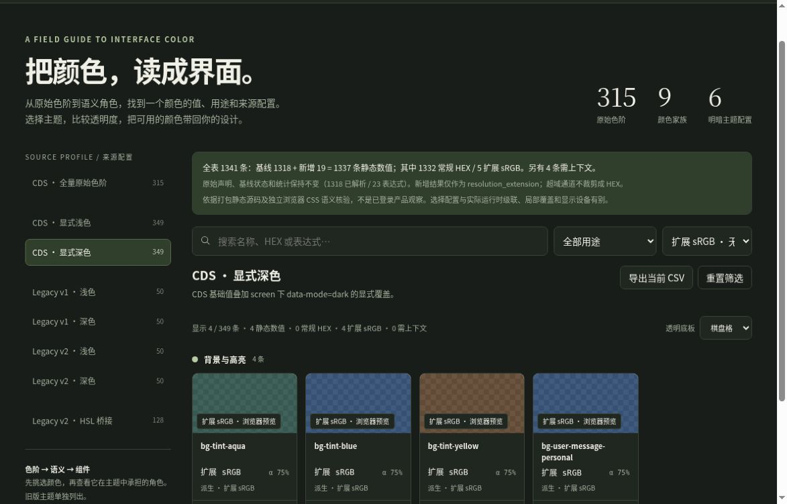

# 全量色表：先找色，再读主题

打开 [离线色表浏览器](index.html)，即可按色族、用途和主题筛选，查看色块并复制 HEX + alpha 或未裁剪的派生 color(srgb)。文件内置全部数据，不需服务器或网络。

## 这份色表有多少颜色

- **315 个原始色阶**：gray、red、orange、yellow、green、aqua、blue、violet、magenta，每族 35 档。原始声明和值全部保留。
- **1026 条主题 / 桥接记录**：覆盖表面、文字、边界、填充、强调、状态、图表、协作、Git 和组件用色，同名项按上下文分开。
- **3234 个声明定位**：机器目录保留 843 个相关名称的全部选择器和来源；浏览页只展开所选项的来源。

| 来源配置 | 记录 | 基线已解析 | 基线表达式 |
|---|---:|---:|---:|
| CDS · 全量原始色阶 | 315 | 315 | 0 |
| CDS · 显式浅色 | 349 | 337 | 12 |
| CDS · 显式深色 | 349 | 338 | 11 |
| Legacy v1 · 浅色 | 50 | 50 | 0 |
| Legacy v1 · 深色 | 50 | 50 | 0 |
| Legacy v2 · 浅色 | 50 | 50 | 0 |
| Legacy v2 · 深色 | 50 | 50 | 0 |
| Legacy v2 · HSL 桥接 | 128 | 128 | 0 |

## 三层读法

1. **原始色阶**回答“有哪些颜色”：`--cds-blue-600` 是固定档位，主题切换不改变这一原始值。
2. **CDS 语义色**回答“放在哪里”：`--cds-text-primary`、`--cds-surface-0` 和 `--cds-border` 会映射到对应主题下的色阶或透明色。
3. **Legacy v1 / v2**用于读懂旧命名：v1 直接使用 HSL 分量；v2 用 `--_` 和 `--cds-hsl-*` 连接新版值。两套不能按同名直接互换。v2 表包含未被桥接覆盖的 v1 项。

“显式浅色”采用 CDS 基础声明；“显式深色”叠加 screen 条件下 data-mode=dark 覆盖。每个配置是命名的静态声明组合，不等于某张产品截图的最终 computed style。系统深色、局部 dark-scope、组件 / 工具类覆盖与特性查询保留在机器目录，不混入主表。

## 先看这九个语义色

| 名称 | CDS 浅色 | CDS 深色 |
|---|---|---|
| `--cds-surface-0` | #f9f9f7 | #0b0b0b |
| `--cds-surface-panel` | #ffffff | #1a1a19 |
| `--cds-text-primary` | #0b0b0b | #f0efec |
| `--cds-text-secondary` | #52514e | #c3c2b7 |
| `--cds-text-muted` | #898781 | #898781 |
| `--cds-clay` | #d97757 | #d97757 |
| `--cds-fill-brand` | #c6613f | #c6613f |
| `--cds-border` | #0b0b0b · α=0.1 | #ffffff · α=0.1 |
| `--cds-bg-user-message` | #0b0b0b · α=0.05 | #ffffff · α=0.05 |

## 透明度怎么用

`#ffffff80` 的 alpha 是 128/255（约 50.1961%），不是精确 50%。`#0006` 的 alpha 是 40%。色块用棋盘格展示未合成的透明色，复制按钮同时保留 HEX 与 alpha；需要落在实际表面上时再进行合成。HEX 是 8-bit 显示值；原始 HSL 分量和表达式可在详情中查看。

## 表达式区

原始基线的 23 条表达式记录及其 status、declared、HEX/alpha 空值完全保留。新增解析写在独立的 resolution_extension 中：19 条已经静态求值，另 4 条依赖消费处的 initial fallback 或 currentColor。

全表仍是 **1,341 条记录**，其中 **1,318 基线数值 + 19 新增派生 = 1,337 静态数值**：**1,332 常规 HEX、5 扩展 sRGB**；另有 **4 条需上下文**。19 条新增派生含 14 条常规 HEX 与 5 条超域通道值。

| 配置 | 总记录 | 基线数值 | 新增派生 | 常规 HEX（含基线） | 扩展 sRGB | 需上下文 |
|---|---:|---:|---:|---:|---:|---:|
| CDS 显式浅色 | 349 | 337 | 10 | 346 | 1 | 2 |
| CDS 显式深色 | 349 | 338 | 9 | 343 | 4 | 2 |

其他配置不变。顶部统计明确区分新旧两套口径；筛选可单看静态数值、常规 HEX、扩展 sRGB、上下文、追加派生或原基线表达式。

派生项默认复制 color(srgb)，保留未裁剪通道；有常规 HEX 的派生项也有独立的 HEX + alpha 按钮。详情保留原始声明、展开表达式、精确分数通道及推导。小数字符串是精确分数的序列化近似，色块由浏览器渲染，实际预览取决于色域映射与显示设备。超域值不提供冒充原值的裁剪 HEX。

上下文项没有固定色块、HEX 或 alpha。initial 的 fallback 仅作有条件的消费者示例；currentColor 的输出 alpha 是消费元素颜色的 alpha 乘 0.18/0.22，不能当作固定透明度。所有结果均来自打包静态源码与独立 CSS 语义核验，不是已登录产品的观察。

## 可复用入口

- `color-catalog/index.html`：单文件、离线、原创交互色表。
- `color-catalog.json`：紧凑色值导出；按 `columns` 解读每条记录，包含原配置、变量名、声明、HEX、alpha 与基线解析状态。附加 resolution_extension.records 以 profile:name 为键提供派生值、上下文说明和来源；原六列数组及 statistics 不变。适合自动生成自己的设计变量。
- `build_color_catalog.py`：重新生成目录和页面；输入来自已解析的包内 CSS。

CSV 前八列沿用原语义，后追加 extension_status、derived_hex_srgb_8bit、derived_alpha、derived_color_srgb、derived_rgb_255_exact 与 context_dependency。导出时不会把新增值写回基线列。

本目录基于 Claude Desktop Linux 2.37337.1 包内静态颜色事实；交互页面与组织方式为原创实现。

## 相对色与上下文值

[原创浏览器核验页](relative-color-fixture.html)用隔离的19个静态派生表达式和5个上下文例子检查相对RGB、initial回退与currentColor。它保留超范围sRGB通道，不把裁剪HEX冒充原值；只检查浏览器CSS语义，不加载产品样式文件或执行产品脚本。页面会直接显示各项计算结果与通过/失败。

## 相对颜色与组件用途

[扩展 sRGB、上下文颜色与组件消费条件](relative-colors/README.md)：解释五条超范围颜色、四条上下文记录，以及 Badge、用户消息和快捷键边框如何使用它们。

## 扩展颜色实屏

2026-10-15，云 Chrome 154 检查提交 `9d6d606`：深色筛出四条、浅色筛出一条扩展 sRGB；详情保留负数与大于 1 的通道，未提供裁剪 HEX。深色上下文筛选显示两条无固定值记录，主题切换和原生详情弹窗正常。截图展示原创色表工具。

复制按钮收到了浏览器 API 成功响应，但本次云端剪贴板读取和粘贴未得到新值，因此端到端复制仍待独立浏览器复核；详情可直接选取原始表达式及序列化色值。

## 自动复制与手动选取

详情中的只读“待复制文本”框始终可用，默认显示当前色值；点击复制名称、原始声明或其他复制按钮后，会同步显示这次待复制的完整字符串。可直接选取，也可点“全选待复制文本”后按 Ctrl+C / ⌘C。

自动复制优先调用浏览器标准写入API，不读取剪贴板，也不申请剪贴板读取权限。提示报告浏览器请求结果，不能证明远程环境已同步到你最终粘贴的位置。旧式复制兼容路径将临时文本框放入当前打开的详情对话框，操作结束或抛错后都会清理并恢复焦点。
