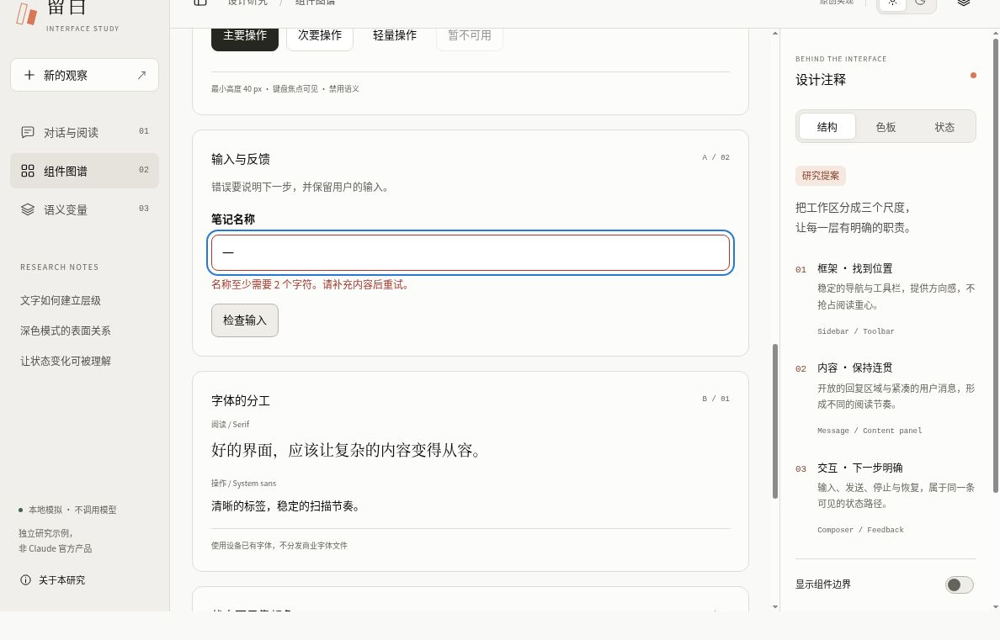
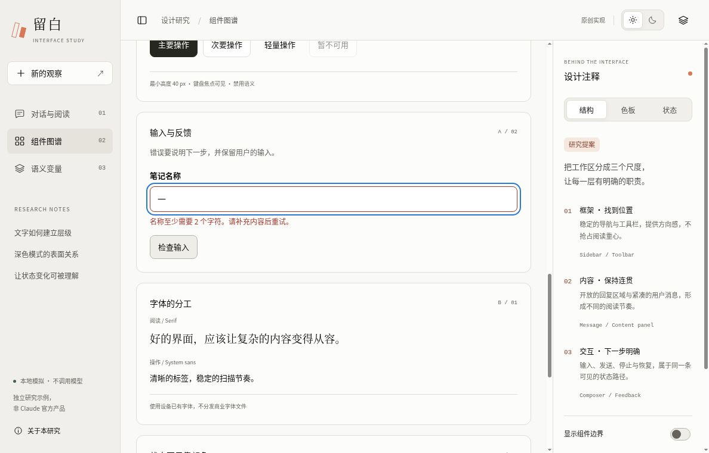
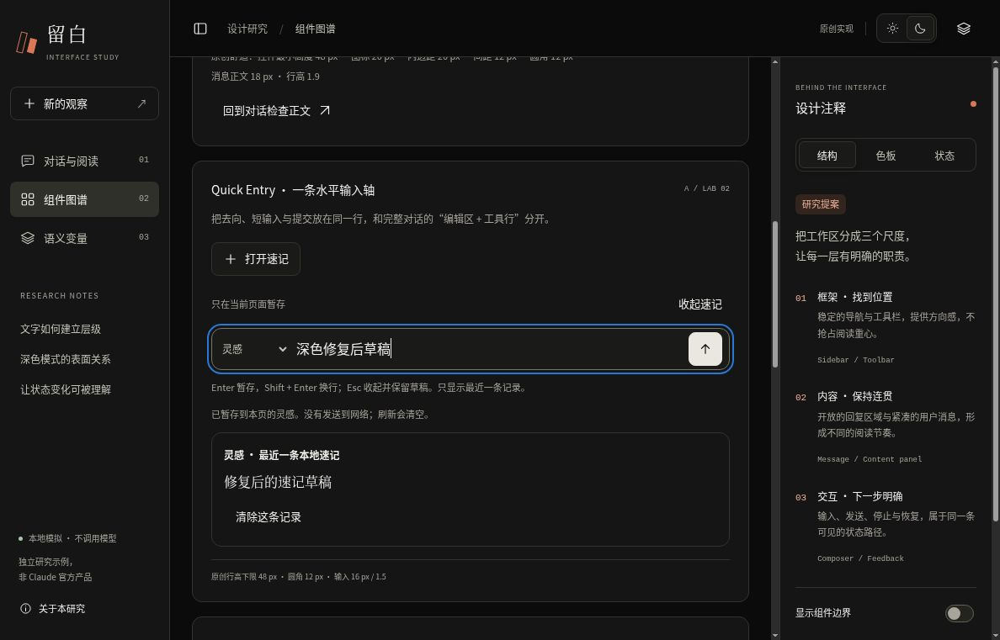

# 原创交互工作台：桌面浏览器验证

2026-10-15 在 Chrome、1188 × 761 CSS 像素视口中完成验证。对象为原创 `interactive-study/index.html`，不包含六套独立 HTML 模板，也不代表 Claude 官方客户端。

## 结果与版本

- 完整交互检查：`5f7c02b118c9eb55264e80fda7448a0e498c1b37`。
- 修复后复验：`3166d2d2d1fcba59909c25d5256aa5e913a27479`。[打开固定版本预览](https://htmlpreview.github.io/?https://github.com/aiyinyuedejustin/agent-engineering-fundamentals/blob/3166d2d2d1fcba59909c25d5256aa5e913a27479/books/claude-app/01-Frontend-Design-And-HTML-Templates/interactive-study/index.html)
- 桌面范围内通过。首次检查发现的顶部工具栏与标识裁切已修复：修复前页面外层 scrollY 达 34 px；修复后六种组合均为 0，页面高度保持 761 px，内部面板仍可随键盘焦点滚动。

## 已验证

- 紧凑／舒适 × 14／16／18 px 的六种组合：试样控件为 40／48 px，内边距为 12／20 px；正文行高为字号的 1.9 倍，两条轴互不干扰，完整输入框草稿保留。
- 浅深主题、可见键盘焦点、输入错误后的内容保留与有效输入恢复。
- Quick Entry：Shift+Enter 换行、Enter 暂存、修饰键 Enter 不暂存、Esc 收起后保留草稿与去向、重新打开聚焦、最新记录替换、清除记录不删新草稿、超长输入拒绝并保留、类似 HTML 的文本按原文显示。
- 首次完整检查还验证了显式模拟／停止／重试的焦点、失败保留输入、重试不重复用户消息、异步完成不抢焦点、重置与刷新规则。修复后没有重复全部行为，只复验了六种组合、浅深主题、键盘滚动、草稿、Quick Entry 与下方输入错误路径。

## 前后截图

### 修复前：页面外层被滚动，顶部工具栏遭到裁切

### 修复后：内层滚动，顶部保持可见

这三张原始浏览器截图记录各自固定提交的可见状态。[机器可读记录](browser-validation.json)列出两轮测试范围与这三张公开图片的校验值。

## 尚未验证

窄屏／移动端、短视口、200% 缩放、文字间距覆盖、强制颜色、减少动态效果、真实中文 IME、屏幕阅读器与跨平台字形、Firefox／Safari、存储禁用、剪贴板回退、file:// 与冷缓存离线、输入网络传输审计、首段生成前停止、其他输入获得焦点时的异步失败。未进行完整对比度或 WCAG 合规审计。

301 字符检查使用填入的超长内容验证拒绝与保留，不能证明逐键输入时原生 maxlength 的执行方式。固定视口中的通过不等于其他尺寸或全部交互状态都通过。
