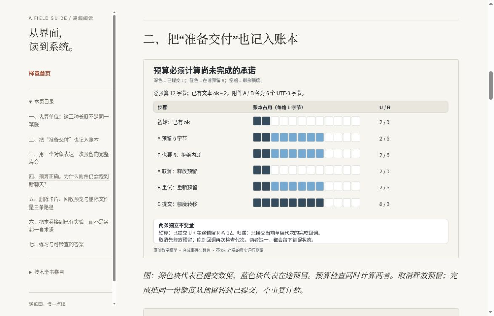

# 离线书页

把《拆开 Claude App》的 Markdown、图和示例文件生成为更适合浏览器阅读的静态书页。正文仍只有一份来源；更新原文后重新构建，不手工维护另一套内容。

阅读页沿用「纸与陶」的暖色纸面、系统字体和长文排版。桌面有侧目录，窄屏有可展开目录；深色随系统切换。没有运行时 JavaScript、账号、遥测、远程字体或模型请求。

## 先看排版样章

本目录提供两种相同内容的排版样章，均收录卷五附件预算实战推演与它实际引用的一张 SVG。首页明确标注为样章，未收录的本地引用保留为文字。

- `preview/index.html`：多文件样章，适合下载后保持目录结构阅读，或由同一个 HTTPS 域名提供全部文件。
- `preview-single.html`：自包含单文件样章，适合第三方 HTML 预览服务。CSS、图、目录、阅读说明和原文均包含在这一文件中，不依赖相对资源路径。第三方服务如果重写或移除页面内容，仍需实际验证其行为。

多文件样章共有 14 个文件，必须保持相对位置。它也可以作为一个完整静态目录托管到 HTTPS 服务上。样章内容直接由书中的 Markdown 生成，没有另外维护一份正文。

多文件样章使用严格同源 CSP。会把相对资源改到其他域名的 HTML 预览服务，可能无法加载其 CSS 与图片；这种情况下使用单文件入口，无需放宽外部资源权限。

## 生成完整书页

需要 Node.js 20+ 与 Python 3.9+，无需安装 npm 或 Python 包。marked 16.4.2 已包含在 `vendor/`，只在构建时用于语法识别。

从本书根目录运行：

```sh
node 01-Frontend-Design-And-HTML-Templates/offline-reader/build.mjs --source .
```

也可从任何目录运行构建器，并显式指定书根目录。书根目录应包含 README.md、五个编号分区和 assets。

```sh
node /path/to/offline-reader/build.mjs --source /path/to/books/claude-app
```

构建完成后会打印一个全新的系统临时目录。打开其中的 `index.html`。需要固定输出位置时，可指定一个尚不存在的新目录，且它的父目录必须已经存在：

```sh
node /path/to/offline-reader/build.mjs \
  --source /path/to/books/claude-app \
  --out /path/to/new-reader-output
```

已有输出目录一律拒绝，包括以前生成的目录。构建器不删除、不覆盖，也不会把 marker 文件视为删除授权。输出必须在源树之外，显式输出路径不能经过符号链接。默认临时路径会先解析为实际路径，以兼容系统 `/tmp` 别名。

移动、压缩或分享生成物时应保留整个输出目录；只复制单个 HTML 会丢失图片或样式。支持本地文件的桌面浏览器无需服务器即可阅读。手机文件管理器对本地 HTML 的支持各异；尚未在真实 iOS/Android 设备验证本地文件打开行为。

## 重新生成样章

```sh
node /path/to/offline-reader/build.mjs \
  --source /path/to/books/claude-app \
  --preview \
  --out /path/to/new-preview
```

`--preview` 使用构建器中的固定输入清单，不接受任意章节路径：

- `02-Illustrated-Deep-Dive-Book/05-Context-And-File-Pipeline/worked-case.md`
- `assets/figures/context-budget-ledger.svg`

扫描阶段就限定这两个文件及其祖先目录，不读入其他章节、代码或图片。未收录的相对链接显示为不可点击的文字，并记入 manifest；不生成死链，也不猜测外部来源地址。

## 重新生成单文件样章

```sh
node /path/to/offline-reader/build-preview-single.mjs \
  --source /path/to/books/claude-app \
  --out /path/to/new-preview-single.html
```

它复用相同的固定两输入与安全渲染器，再将可信 CSS 和已白名单验证的 SVG 组合到一个 HTML 中。只允许精确 CSS SHA-256 hash 与 `img-src data:`；没有 `unsafe-inline`、网络资源白名单或运行时脚本。目录、原文和阅读说明链接全部转为同页锚点。原文中的外部来源链接只在主动点击时打开。

输出必须是尚不存在的 `.html` 文件，位于源树外。构建过程中只清理自己刚创建的临时目录，不修改完整书或多文件样章的生成方式。单文件中可展开生成记录，核对两项输入、构建器、CSS 与 SVG 哈希。

## 阅读方式

- 桌面左侧可切换分区、查看本页目录和技术卷目；顶部还有完整目录。
- 窄屏顶部的原生目录可以用 Enter 或空格展开。
- 第一个键盘链接可直接跳到正文，Tab 焦点保持可见。
- 长代码和宽表格可以获得焦点，使用方向键横向滚动。
- 浏览器自带的 Ctrl / ⌘ F 查找当前页，缩放和打印仍可使用。
- 每篇可打开原始 Markdown 只读视图，核对排版与原文。

## 渲染范围

支持 ATX/Setext 标题、段落、强调、删除线、行内代码、围栏和缩进代码、引用、分隔线、有序/无序/嵌套/任务列表、行内和引用式链接/图片、普通管道表格及左右/居中对齐。标题生成可去重的 Unicode 锚点；嵌套标题和模板保留 ID 的冲突也会处理。

这不是完整 GFM 实现。不提供脚注扩展、数学排版、语法高亮、浏览器 Mermaid 渲染或完整规范一致性。Mermaid 保留语言标签与源码，已有 SVG 和截图继续显示。常用 amp/lt/gt/quot/apos/nbsp 与数字实体可规范化，其他命名实体不保证完整支持。输入按 UTF-8 文本处理，单文件限制为 5 MiB。

原始 HTML 不直接通过。仅无属性的字面 `<br>`、`<br/>`、`<br />` 被识别为本工具生成的换行。另识别精确空锚点 `<a id="旧锚点"></a>`：仅接受双引号、唯一 id 属性及 1–200 个 Unicode 字母/标记/数字、下划线或连字符，转换为工具生成的空 span，不透传 HTML。标题保持原 ID 分配并优先解析同名片段；空锚点与标题、main 或重复锚点冲突时另分配唯一 ID，重复旧锚点链接指向第一个。其他原始 HTML，包括带内容或其他属性的 a、details、iframe、script 和嵌入 SVG，都显示为转义文字。无法渲染的内容可在原文视图完整核对。

### 链接与来源

- 相对 Markdown 链接转到对应阅读页；普通目录链接优先其 README，否则显示文件列表。
- HTML 模板、JavaScript、Python、JSON、CSS 等打开只读源码视图，不运行教学代码。
- SVG/截图链接打开图像或源码视图，不直接打开活动 SVG 文档。
- http、https、mailto 来源链接保留，只有主动点击才打开。远程图片不自动载入，只保留说明与原始链接。
- javascript、data、file、协议相对链接、带凭证 URL、控制字符、反斜杠和逃离书根目录的路径均拒绝。
- 完整书模式中，阅读器自身 README 与 preview/index.html 的无片段链接精确转到内置构建说明；不读取或递归打包阅读器目录。其他 compiler 文件、图片用法及带片段入口仍按未收录目标处理。
- 未收录目标与不支持内容显示为非活动文字，详细原因写入 manifest。

## 安全边界

只扫描根 README.md、五个已知公开分区和 assets。隐藏文件、缓存、node_modules、阅读器自身和符号链接均跳过，不进入书外研究目录。构建器的发布排除清单在读取前生效；命中的文件不复制、不生成内容哈希，manifest 只记录路径和排除原因。

正文、标题、属性、代码和来源文件严格转义。输出没有 script、iframe、object、事件处理属性或动态插入点。完整书与多文件样章的 CSP 默认拒绝所有资源，只放行同源样式与图片；单文件样章仅授权精确 hash 的内联 CSS 与 data 图像。两种模式都禁用脚本、网络连接、字体、框架和表单。CSP 是补充防护，不替代渲染白名单。

SVG 先严格解码为 UTF-8（可带 BOM），拒绝非 UTF-8 编码声明和零字节，再检查 DTD 与处理指令。Python 标准库 XML 解析后，按静态标签、属性和 CSS 白名单校验：不允许脚本、foreignObject、动画、外部 href、事件处理、外部 URL、CSS import 或转义；只允许形状、文本、有限滤镜和本地片段引用。

SVG 校验接收内存中的原始文件快照，不重复读取磁盘路径。精确匹配的标准 Graphviz SVG 1.1 DOCTYPE 作为已知声明移除，其他 DTD/实体声明拒绝。CSS 使用单向游标解析，校验子进程最多运行 15 秒。输出图片由验证后的 XML 重新序列化，不含 DOCTYPE、处理指令或注释；原始 SVG 只在转义源码视图中保留。拒绝的 SVG 不进入图片目录。

此工具服务于已知公开研究书的离线构建，不是多租户 Markdown 托管服务。它没有针对并发恶意文件改写提供文件系统沙盒，也不替代部署环境的权限与来源审核。

## 验证与可重复构建

在本阅读器目录运行：

```sh
node --test tests/*.mjs
python3 tests/audit_html.py /path/to/generated-reader
python3 tests/audit_single.py /path/to/preview-single.html
```

测试覆盖确定性、原文更新、HTML/代码转义、危险协议与实体、路径穿越、符号链接、SVG 脚本/动画/CSS/编码攻击、相对链接与重复锚点、表格/列表/键盘容器、已有输出保护，以及样章输入筛选。独立 HTMLParser 审计会扫描活动标签、事件属性、外链资源、每个本地链接和标题锚点。

`build-manifest.json` 记录收录输入和构建器的 SHA-256、源指纹、输出模式、明确排除及降级提示。不含构建时间或绝对路径；同一源快照与构建器应产生逐文件相同的输出。

完整书页是派生物，建议作为生成包交付，而不把数百个 HTML 重复提交到仓库。保留构建器、测试、vendor 和小型排版样章即可；正文修改仍在原 Markdown 中进行。

## 浏览器样章实景

2026-10-15，Chrome，1188 × 761 CSS px、DPR 1，固定提交 `db4f4ae60a91439a76b203a72f79bd9867bae132`。单文件样章在HTTPS预览中实际显示暖纸样式，目录可跳转第二节并返回正文，内嵌预算SVG完成加载（原图1120 × 704）。实际正文背景为 rgb(248,247,243)，字体采用声明的系统衬线回退。

[打开已验证的单文件样章](https://htmlpreview.github.io/?https://github.com/aiyinyuedejustin/agent-engineering-fundamentals/blob/db4f4ae60a91439a76b203a72f79bd9867bae132/books/claude-app/01-Frontend-Design-And-HTML-Templates/offline-reader/preview-single.html)



这次浏览器检查覆盖上述桌面样章路径；没有验证手机、本地file URL、系统深色切换或屏幕阅读器。多文件版本需要保持同源资源关系；第三方HTML预览器的跨源资源改写不适合它，单文件样章专门避免该依赖。
