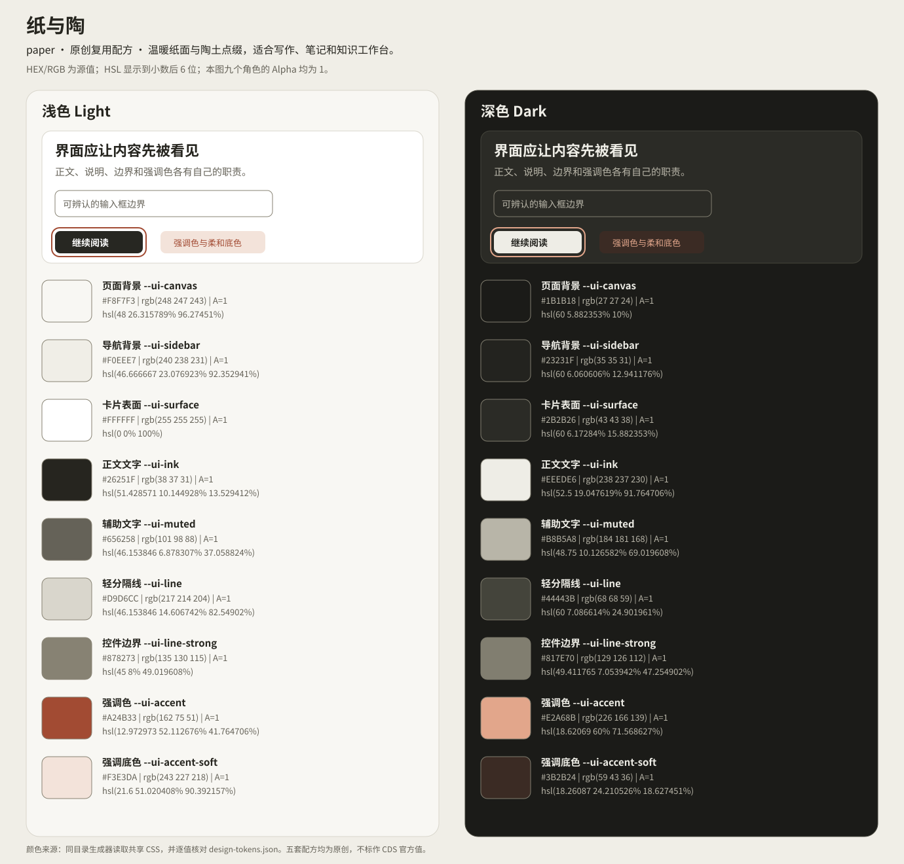
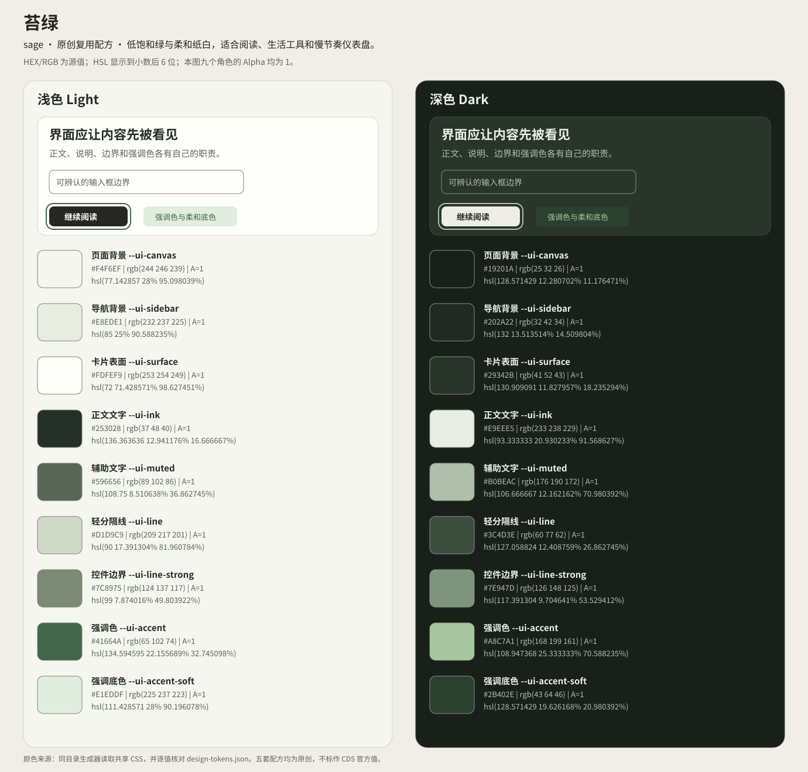
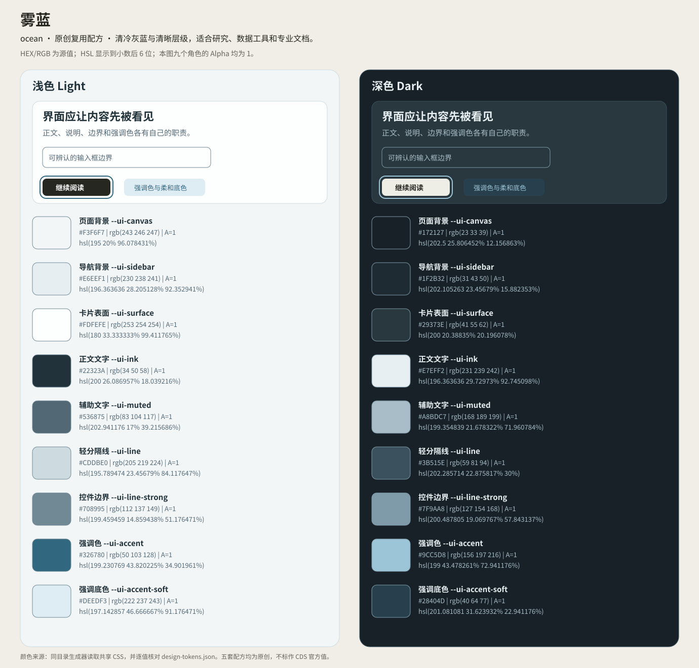
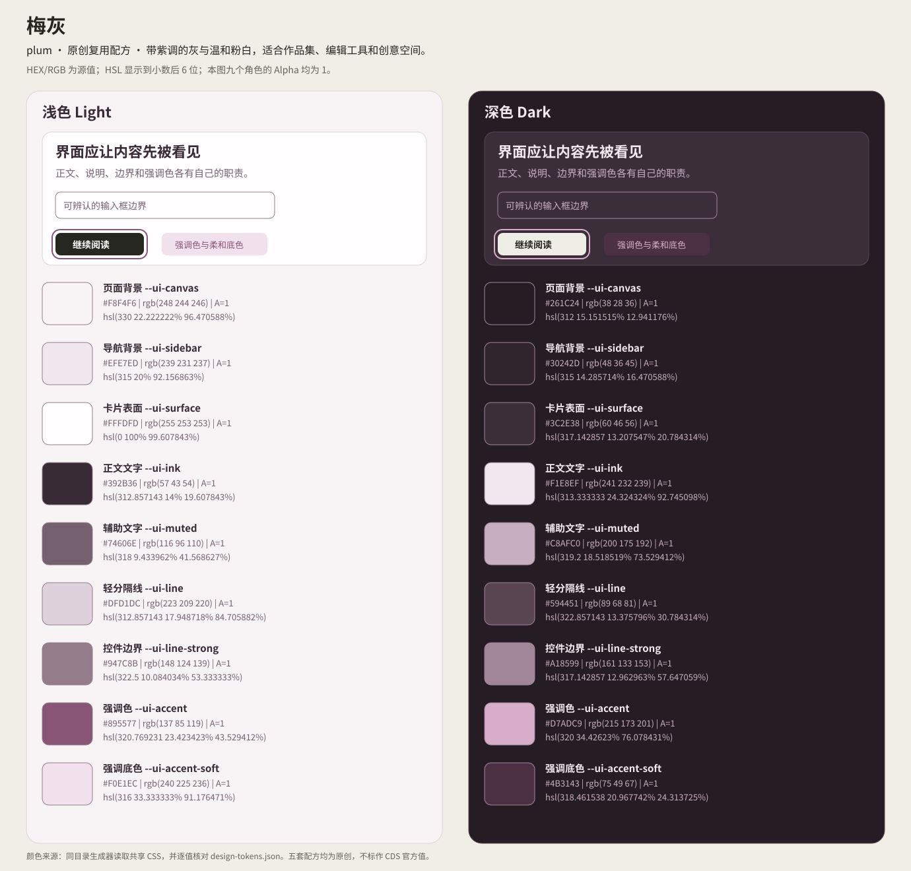
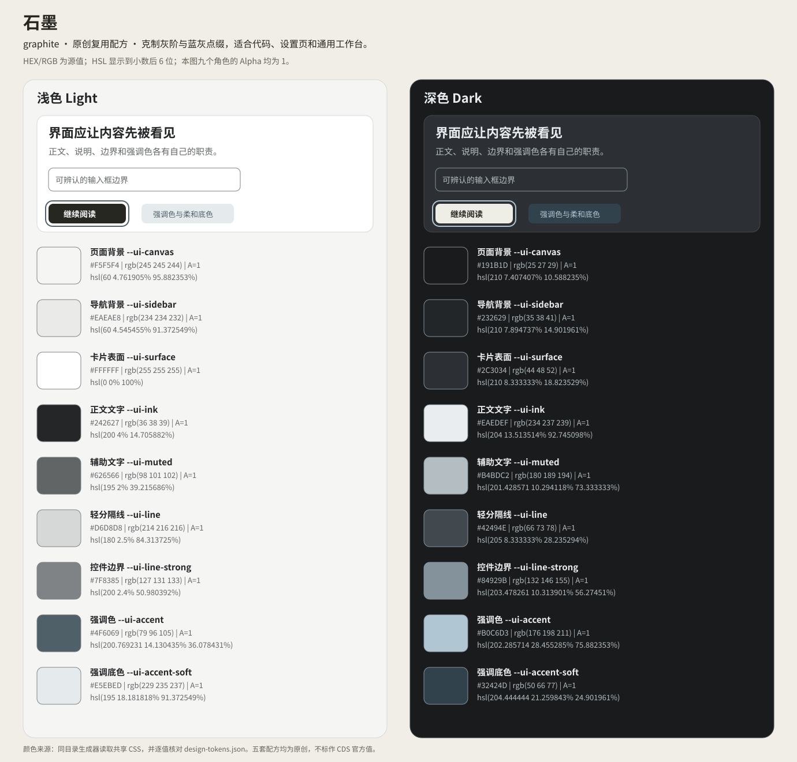
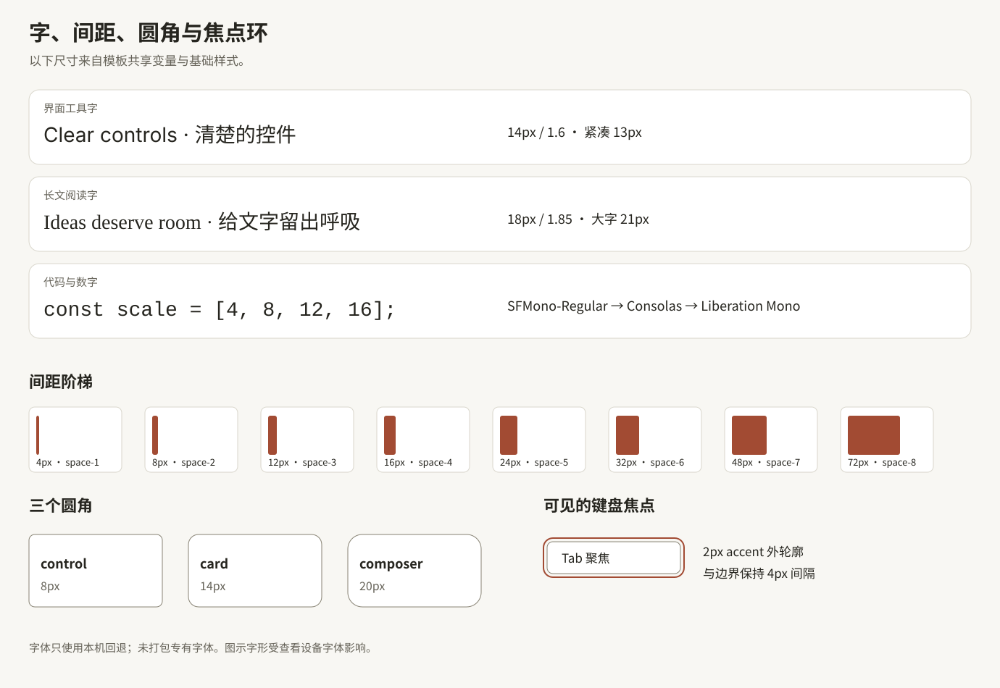

# 五套原创网站配色与排版配方

直接复用已经在六个前端模板中实现的纸与陶、苔绿、雾蓝、梅灰、石墨。每套都包含浅色与深色：页面背景、卡片、文字、边界、强调色各自独立，切换主题不需要重写组件。

**本页是原创复用配方。** 色值与尺寸来自模板实际 CSS；CDS 静态观测属于另一组有版本与选择器边界的证据，不把二者混成“官方精确主题”。


## 先复制这一段

复制 [claude-tokens.css](../styles/claude-tokens.css) 与 [claude-reset-and-base.css](../styles/claude-reset-and-base.css) 到网站同一目录。按以下顺序引入；三个属性放在同一个容器上。

```html
<link rel="stylesheet" href="./claude-tokens.css">
<link rel="stylesheet" href="./claude-reset-and-base.css">

<main data-ui="atelier" data-palette="paper" data-theme="light">
  <article class="recipe-card">
    <h1>给内容留出空间</h1>
    <p class="recipe-note">清楚的正文、安静的底面、必要时才出现的强调色。</p>
    <a class="recipe-link" href="#next">继续阅读</a>
    <button class="recipe-button" type="button">保存</button>
    <p id="next">从这张卡片开始，再接入自己的内容和保存逻辑。</p>
  </article>
</main>

<style>
[data-ui="atelier"] .recipe-card {
  padding: var(--ui-space-5);
  color: var(--ui-ink);
  background: var(--ui-surface);
  border: 1px solid var(--ui-line);
  border-radius: var(--ui-card-radius);
  box-shadow: var(--ui-shadow);
}
[data-ui="atelier"] .recipe-note { color: var(--ui-muted); }
[data-ui="atelier"] .recipe-link { color: var(--ui-accent); }
[data-ui="atelier"] .recipe-button {
  min-height: var(--ui-control);
  padding: var(--ui-space-2) var(--ui-space-4);
  border: 1px solid var(--ui-action);
  border-radius: var(--ui-radius);
  background: var(--ui-action);
  color: var(--ui-on-action);
}
[data-ui="atelier"] input {
  border: 1px solid var(--ui-line-strong);
  background: var(--ui-surface);
}
</style>
```

将 `data-palette` 改为 `paper` / `sage` / `ocean` / `plum` / `graphite`；将 `data-theme` 改为 `dark` 即可使用对应深色。主按钮使用 `--ui-action`，不会随 `--ui-accent` 自动变成彩色。

## 颜色读法

- `canvas` 是页面背景，`sidebar` 是导航底面，`surface` 是卡片与浮层。
- `ink` / `muted` 分别承担正文与辅助文字；`accent` / `accent-soft` 成对使用。
- `line` 是安静的装饰性分隔；必须辨认的输入框、控件轮廓使用 `line-strong`。
- HEX 与 RGB 是源文件的精确 8 位 sRGB 值。HSL 显示到小数后 6 位，已验证转回相同 8 位 RGB；需要无舍入值时，使用 [tokens-expanded.json](tokens-expanded.json) 中的分数及 `hslExactCss`。
- 8 位 HEX 的末两位是 Alpha。例如 `#26251f40` 的 Alpha 为 `64/255`，不是精确的 `0.25`；`#00000080` 为 `128/255`，不是精确的 `0.5`。

## 纸与陶 `paper`

温暖纸面与陶土点缀，适合写作、笔记和知识工作台。



### 浅色 `light`

| 角色与变量 | HEX | RGB | HSL | Alpha |
|---|---|---|---|---|
| 页面背景<br>`--ui-canvas` | `#f8f7f3` | `rgb(248 247 243)` | `hsl(48 26.315789% 96.27451%)` | 1 |
| 导航背景<br>`--ui-sidebar` | `#f0eee7` | `rgb(240 238 231)` | `hsl(46.666667 23.076923% 92.352941%)` | 1 |
| 卡片表面<br>`--ui-surface` | `#ffffff` | `rgb(255 255 255)` | `hsl(0 0% 100%)` | 1 |
| 正文文字<br>`--ui-ink` | `#26251f` | `rgb(38 37 31)` | `hsl(51.428571 10.144928% 13.529412%)` | 1 |
| 辅助文字<br>`--ui-muted` | `#656258` | `rgb(101 98 88)` | `hsl(46.153846 6.878307% 37.058824%)` | 1 |
| 轻分隔线<br>`--ui-line` | `#d9d6cc` | `rgb(217 214 204)` | `hsl(46.153846 14.606742% 82.54902%)` | 1 |
| 控件边界<br>`--ui-line-strong` | `#878273` | `rgb(135 130 115)` | `hsl(45 8% 49.019608%)` | 1 |
| 强调色<br>`--ui-accent` | `#a24b33` | `rgb(162 75 51)` | `hsl(12.972973 52.112676% 41.764706%)` | 1 |
| 强调底色<br>`--ui-accent-soft` | `#f3e3da` | `rgb(243 227 218)` | `hsl(21.6 51.020408% 90.392157%)` | 1 |

### 深色 `dark`

| 角色与变量 | HEX | RGB | HSL | Alpha |
|---|---|---|---|---|
| 页面背景<br>`--ui-canvas` | `#1b1b18` | `rgb(27 27 24)` | `hsl(60 5.882353% 10%)` | 1 |
| 导航背景<br>`--ui-sidebar` | `#23231f` | `rgb(35 35 31)` | `hsl(60 6.060606% 12.941176%)` | 1 |
| 卡片表面<br>`--ui-surface` | `#2b2b26` | `rgb(43 43 38)` | `hsl(60 6.17284% 15.882353%)` | 1 |
| 正文文字<br>`--ui-ink` | `#eeede6` | `rgb(238 237 230)` | `hsl(52.5 19.047619% 91.764706%)` | 1 |
| 辅助文字<br>`--ui-muted` | `#b8b5a8` | `rgb(184 181 168)` | `hsl(48.75 10.126582% 69.019608%)` | 1 |
| 轻分隔线<br>`--ui-line` | `#44443b` | `rgb(68 68 59)` | `hsl(60 7.086614% 24.901961%)` | 1 |
| 控件边界<br>`--ui-line-strong` | `#817e70` | `rgb(129 126 112)` | `hsl(49.411765 7.053942% 47.254902%)` | 1 |
| 强调色<br>`--ui-accent` | `#e2a68b` | `rgb(226 166 139)` | `hsl(18.62069 60% 71.568627%)` | 1 |
| 强调底色<br>`--ui-accent-soft` | `#3b2b24` | `rgb(59 43 36)` | `hsl(18.26087 24.210526% 18.627451%)` | 1 |

## 苔绿 `sage`

低饱和绿与柔和纸白，适合阅读、生活工具和慢节奏仪表盘。



### 浅色 `light`

| 角色与变量 | HEX | RGB | HSL | Alpha |
|---|---|---|---|---|
| 页面背景<br>`--ui-canvas` | `#f4f6ef` | `rgb(244 246 239)` | `hsl(77.142857 28% 95.098039%)` | 1 |
| 导航背景<br>`--ui-sidebar` | `#e8ede1` | `rgb(232 237 225)` | `hsl(85 25% 90.588235%)` | 1 |
| 卡片表面<br>`--ui-surface` | `#fdfef9` | `rgb(253 254 249)` | `hsl(72 71.428571% 98.627451%)` | 1 |
| 正文文字<br>`--ui-ink` | `#253028` | `rgb(37 48 40)` | `hsl(136.363636 12.941176% 16.666667%)` | 1 |
| 辅助文字<br>`--ui-muted` | `#596656` | `rgb(89 102 86)` | `hsl(108.75 8.510638% 36.862745%)` | 1 |
| 轻分隔线<br>`--ui-line` | `#d1d9c9` | `rgb(209 217 201)` | `hsl(90 17.391304% 81.960784%)` | 1 |
| 控件边界<br>`--ui-line-strong` | `#7c8975` | `rgb(124 137 117)` | `hsl(99 7.874016% 49.803922%)` | 1 |
| 强调色<br>`--ui-accent` | `#41664a` | `rgb(65 102 74)` | `hsl(134.594595 22.155689% 32.745098%)` | 1 |
| 强调底色<br>`--ui-accent-soft` | `#e1eddf` | `rgb(225 237 223)` | `hsl(111.428571 28% 90.196078%)` | 1 |

### 深色 `dark`

| 角色与变量 | HEX | RGB | HSL | Alpha |
|---|---|---|---|---|
| 页面背景<br>`--ui-canvas` | `#19201a` | `rgb(25 32 26)` | `hsl(128.571429 12.280702% 11.176471%)` | 1 |
| 导航背景<br>`--ui-sidebar` | `#202a22` | `rgb(32 42 34)` | `hsl(132 13.513514% 14.509804%)` | 1 |
| 卡片表面<br>`--ui-surface` | `#29342b` | `rgb(41 52 43)` | `hsl(130.909091 11.827957% 18.235294%)` | 1 |
| 正文文字<br>`--ui-ink` | `#e9eee5` | `rgb(233 238 229)` | `hsl(93.333333 20.930233% 91.568627%)` | 1 |
| 辅助文字<br>`--ui-muted` | `#b0beac` | `rgb(176 190 172)` | `hsl(106.666667 12.162162% 70.980392%)` | 1 |
| 轻分隔线<br>`--ui-line` | `#3c4d3e` | `rgb(60 77 62)` | `hsl(127.058824 12.408759% 26.862745%)` | 1 |
| 控件边界<br>`--ui-line-strong` | `#7e947d` | `rgb(126 148 125)` | `hsl(117.391304 9.704641% 53.529412%)` | 1 |
| 强调色<br>`--ui-accent` | `#a8c7a1` | `rgb(168 199 161)` | `hsl(108.947368 25.333333% 70.588235%)` | 1 |
| 强调底色<br>`--ui-accent-soft` | `#2b402e` | `rgb(43 64 46)` | `hsl(128.571429 19.626168% 20.980392%)` | 1 |

## 雾蓝 `ocean`

清冷灰蓝与清晰层级，适合研究、数据工具和专业文档。



### 浅色 `light`

| 角色与变量 | HEX | RGB | HSL | Alpha |
|---|---|---|---|---|
| 页面背景<br>`--ui-canvas` | `#f3f6f7` | `rgb(243 246 247)` | `hsl(195 20% 96.078431%)` | 1 |
| 导航背景<br>`--ui-sidebar` | `#e6eef1` | `rgb(230 238 241)` | `hsl(196.363636 28.205128% 92.352941%)` | 1 |
| 卡片表面<br>`--ui-surface` | `#fdfefe` | `rgb(253 254 254)` | `hsl(180 33.333333% 99.411765%)` | 1 |
| 正文文字<br>`--ui-ink` | `#22323a` | `rgb(34 50 58)` | `hsl(200 26.086957% 18.039216%)` | 1 |
| 辅助文字<br>`--ui-muted` | `#536875` | `rgb(83 104 117)` | `hsl(202.941176 17% 39.215686%)` | 1 |
| 轻分隔线<br>`--ui-line` | `#cddbe0` | `rgb(205 219 224)` | `hsl(195.789474 23.45679% 84.117647%)` | 1 |
| 控件边界<br>`--ui-line-strong` | `#708995` | `rgb(112 137 149)` | `hsl(199.459459 14.859438% 51.176471%)` | 1 |
| 强调色<br>`--ui-accent` | `#326780` | `rgb(50 103 128)` | `hsl(199.230769 43.820225% 34.901961%)` | 1 |
| 强调底色<br>`--ui-accent-soft` | `#deedf3` | `rgb(222 237 243)` | `hsl(197.142857 46.666667% 91.176471%)` | 1 |

### 深色 `dark`

| 角色与变量 | HEX | RGB | HSL | Alpha |
|---|---|---|---|---|
| 页面背景<br>`--ui-canvas` | `#172127` | `rgb(23 33 39)` | `hsl(202.5 25.806452% 12.156863%)` | 1 |
| 导航背景<br>`--ui-sidebar` | `#1f2b32` | `rgb(31 43 50)` | `hsl(202.105263 23.45679% 15.882353%)` | 1 |
| 卡片表面<br>`--ui-surface` | `#29373e` | `rgb(41 55 62)` | `hsl(200 20.38835% 20.196078%)` | 1 |
| 正文文字<br>`--ui-ink` | `#e7eff2` | `rgb(231 239 242)` | `hsl(196.363636 29.72973% 92.745098%)` | 1 |
| 辅助文字<br>`--ui-muted` | `#a8bdc7` | `rgb(168 189 199)` | `hsl(199.354839 21.678322% 71.960784%)` | 1 |
| 轻分隔线<br>`--ui-line` | `#3b515e` | `rgb(59 81 94)` | `hsl(202.285714 22.875817% 30%)` | 1 |
| 控件边界<br>`--ui-line-strong` | `#7f9aa8` | `rgb(127 154 168)` | `hsl(200.487805 19.069767% 57.843137%)` | 1 |
| 强调色<br>`--ui-accent` | `#9cc5d8` | `rgb(156 197 216)` | `hsl(199 43.478261% 72.941176%)` | 1 |
| 强调底色<br>`--ui-accent-soft` | `#28404d` | `rgb(40 64 77)` | `hsl(201.081081 31.623932% 22.941176%)` | 1 |

## 梅灰 `plum`

带紫调的灰与温和粉白，适合作品集、编辑工具和创意空间。



### 浅色 `light`

| 角色与变量 | HEX | RGB | HSL | Alpha |
|---|---|---|---|---|
| 页面背景<br>`--ui-canvas` | `#f8f4f6` | `rgb(248 244 246)` | `hsl(330 22.222222% 96.470588%)` | 1 |
| 导航背景<br>`--ui-sidebar` | `#efe7ed` | `rgb(239 231 237)` | `hsl(315 20% 92.156863%)` | 1 |
| 卡片表面<br>`--ui-surface` | `#fffdfd` | `rgb(255 253 253)` | `hsl(0 100% 99.607843%)` | 1 |
| 正文文字<br>`--ui-ink` | `#392b36` | `rgb(57 43 54)` | `hsl(312.857143 14% 19.607843%)` | 1 |
| 辅助文字<br>`--ui-muted` | `#74606e` | `rgb(116 96 110)` | `hsl(318 9.433962% 41.568627%)` | 1 |
| 轻分隔线<br>`--ui-line` | `#dfd1dc` | `rgb(223 209 220)` | `hsl(312.857143 17.948718% 84.705882%)` | 1 |
| 控件边界<br>`--ui-line-strong` | `#947c8b` | `rgb(148 124 139)` | `hsl(322.5 10.084034% 53.333333%)` | 1 |
| 强调色<br>`--ui-accent` | `#895577` | `rgb(137 85 119)` | `hsl(320.769231 23.423423% 43.529412%)` | 1 |
| 强调底色<br>`--ui-accent-soft` | `#f0e1ec` | `rgb(240 225 236)` | `hsl(316 33.333333% 91.176471%)` | 1 |

### 深色 `dark`

| 角色与变量 | HEX | RGB | HSL | Alpha |
|---|---|---|---|---|
| 页面背景<br>`--ui-canvas` | `#261c24` | `rgb(38 28 36)` | `hsl(312 15.151515% 12.941176%)` | 1 |
| 导航背景<br>`--ui-sidebar` | `#30242d` | `rgb(48 36 45)` | `hsl(315 14.285714% 16.470588%)` | 1 |
| 卡片表面<br>`--ui-surface` | `#3c2e38` | `rgb(60 46 56)` | `hsl(317.142857 13.207547% 20.784314%)` | 1 |
| 正文文字<br>`--ui-ink` | `#f1e8ef` | `rgb(241 232 239)` | `hsl(313.333333 24.324324% 92.745098%)` | 1 |
| 辅助文字<br>`--ui-muted` | `#c8afc0` | `rgb(200 175 192)` | `hsl(319.2 18.518519% 73.529412%)` | 1 |
| 轻分隔线<br>`--ui-line` | `#594451` | `rgb(89 68 81)` | `hsl(322.857143 13.375796% 30.784314%)` | 1 |
| 控件边界<br>`--ui-line-strong` | `#a18599` | `rgb(161 133 153)` | `hsl(317.142857 12.962963% 57.647059%)` | 1 |
| 强调色<br>`--ui-accent` | `#d7adc9` | `rgb(215 173 201)` | `hsl(320 34.42623% 76.078431%)` | 1 |
| 强调底色<br>`--ui-accent-soft` | `#4b3143` | `rgb(75 49 67)` | `hsl(318.461538 20.967742% 24.313725%)` | 1 |

## 石墨 `graphite`

克制灰阶与蓝灰点缀，适合代码、设置页和通用工作台。



### 浅色 `light`

| 角色与变量 | HEX | RGB | HSL | Alpha |
|---|---|---|---|---|
| 页面背景<br>`--ui-canvas` | `#f5f5f4` | `rgb(245 245 244)` | `hsl(60 4.761905% 95.882353%)` | 1 |
| 导航背景<br>`--ui-sidebar` | `#eaeae8` | `rgb(234 234 232)` | `hsl(60 4.545455% 91.372549%)` | 1 |
| 卡片表面<br>`--ui-surface` | `#ffffff` | `rgb(255 255 255)` | `hsl(0 0% 100%)` | 1 |
| 正文文字<br>`--ui-ink` | `#242627` | `rgb(36 38 39)` | `hsl(200 4% 14.705882%)` | 1 |
| 辅助文字<br>`--ui-muted` | `#626566` | `rgb(98 101 102)` | `hsl(195 2% 39.215686%)` | 1 |
| 轻分隔线<br>`--ui-line` | `#d6d8d8` | `rgb(214 216 216)` | `hsl(180 2.5% 84.313725%)` | 1 |
| 控件边界<br>`--ui-line-strong` | `#7f8385` | `rgb(127 131 133)` | `hsl(200 2.4% 50.980392%)` | 1 |
| 强调色<br>`--ui-accent` | `#4f6069` | `rgb(79 96 105)` | `hsl(200.769231 14.130435% 36.078431%)` | 1 |
| 强调底色<br>`--ui-accent-soft` | `#e5ebed` | `rgb(229 235 237)` | `hsl(195 18.181818% 91.372549%)` | 1 |

### 深色 `dark`

| 角色与变量 | HEX | RGB | HSL | Alpha |
|---|---|---|---|---|
| 页面背景<br>`--ui-canvas` | `#191b1d` | `rgb(25 27 29)` | `hsl(210 7.407407% 10.588235%)` | 1 |
| 导航背景<br>`--ui-sidebar` | `#232629` | `rgb(35 38 41)` | `hsl(210 7.894737% 14.901961%)` | 1 |
| 卡片表面<br>`--ui-surface` | `#2c3034` | `rgb(44 48 52)` | `hsl(210 8.333333% 18.823529%)` | 1 |
| 正文文字<br>`--ui-ink` | `#eaedef` | `rgb(234 237 239)` | `hsl(204 13.513514% 92.745098%)` | 1 |
| 辅助文字<br>`--ui-muted` | `#b4bdc2` | `rgb(180 189 194)` | `hsl(201.428571 10.294118% 73.333333%)` | 1 |
| 轻分隔线<br>`--ui-line` | `#42494e` | `rgb(66 73 78)` | `hsl(205 8.333333% 28.235294%)` | 1 |
| 控件边界<br>`--ui-line-strong` | `#84929b` | `rgb(132 146 155)` | `hsl(203.478261 10.313901% 56.27451%)` | 1 |
| 强调色<br>`--ui-accent` | `#b0c6d3` | `rgb(176 198 211)` | `hsl(202.285714 28.455285% 75.882353%)` | 1 |
| 强调底色<br>`--ui-accent-soft` | `#32424d` | `rgb(50 66 77)` | `hsl(204.444444 21.259843% 24.901961%)` | 1 |

## 主动作与状态色

以下变量由 CSS 定义，并由五套配色共同使用；它们没有列在当前精简版 design-tokens.json 的 palettes 中。错误与成功除了用颜色，还应提供文字或图标。

### 浅色共用颜色

| 角色与变量 | HEX | RGB | HSL | Alpha |
|---|---|---|---|---|
| 主要动作底色<br>`--ui-action` | `#272722` | `rgb(39 39 34)` | `hsl(60 6.849315% 14.313725%)` | 1 |
| 主要动作文字<br>`--ui-on-action` | `#ffffff` | `rgb(255 255 255)` | `hsl(0 0% 100%)` | 1 |
| 错误文字／图标<br>`--ui-danger` | `#9c332c` | `rgb(156 51 44)` | `hsl(3.75 56% 39.215686%)` | 1 |
| 错误底色<br>`--ui-danger-soft` | `#fbeae5` | `rgb(251 234 229)` | `hsl(13.636364 73.333333% 94.117647%)` | 1 |
| 成功文字／图标<br>`--ui-success` | `#386043` | `rgb(56 96 67)` | `hsl(136.5 26.315789% 29.803922%)` | 1 |
| 成功底色<br>`--ui-success-soft` | `#e4efe5` | `rgb(228 239 229)` | `hsl(125.454545 25.581395% 91.568627%)` | 1 |
| 遮罩<br>`--ui-scrim` | `#26251f40` | `rgb(38 37 31 / calc(64 / 255))` | `hsl(51.428571 10.144928% 13.529412% / calc(64 / 255))` | 64/255 ≈ 0.25098 |

### 深色共用颜色

| 角色与变量 | HEX | RGB | HSL | Alpha |
|---|---|---|---|---|
| 主要动作底色<br>`--ui-action` | `#eeede6` | `rgb(238 237 230)` | `hsl(52.5 19.047619% 91.764706%)` | 1 |
| 主要动作文字<br>`--ui-on-action` | `#24241f` | `rgb(36 36 31)` | `hsl(60 7.462687% 13.137255%)` | 1 |
| 错误文字／图标<br>`--ui-danger` | `#f1ada5` | `rgb(241 173 165)` | `hsl(6.315789 73.076923% 79.607843%)` | 1 |
| 错误底色<br>`--ui-danger-soft` | `#422c29` | `rgb(66 44 41)` | `hsl(7.2 23.364486% 20.980392%)` | 1 |
| 成功文字／图标<br>`--ui-success` | `#a9d1b0` | `rgb(169 209 176)` | `hsl(130.5 30.30303% 74.117647%)` | 1 |
| 成功底色<br>`--ui-success-soft` | `#283e2c` | `rgb(40 62 44)` | `hsl(130.909091 21.568627% 20%)` | 1 |
| 遮罩<br>`--ui-scrim` | `#00000080` | `rgb(0 0 0 / calc(128 / 255))` | `hsl(0 0% 0% / calc(128 / 255))` | 128/255 ≈ 0.501961 |

### 阴影的透明度

| 模式 | `--ui-shadow` | 精确 Alpha |
|---|---|---|
| 浅色 | `0 12px 40px #0000000c, 0 2px 5px #00000006` | 4/85；2/85 |
| 深色 | `0 12px 40px #00000040, 0 2px 5px #00000030` | 64/255；16/85 |

阴影与遮罩颜色必须先与实际底色合成，再测量文字或边界对比度。不要拿带透明度的 HEX 直接当作不透明颜色。

## 字体与中文回退



以下是 CSS 实际字体栈。按字符覆盖和本机已安装字体回退，不下载字体。拉丁字与汉字可能由不同字体完成。

```css
--ui-font: -apple-system, BlinkMacSystemFont, "Segoe UI", "PingFang SC", "Microsoft YaHei", sans-serif;
--ui-reading: Georgia, "Times New Roman", "Songti SC", "STSong", serif;
--ui-mono: "SFMono-Regular", Consolas, "Liberation Mono", monospace;
```

| 用途 | 拉丁字回退 | 中文回退 |
|---|---|---|
| 界面与控件 | -apple-system → BlinkMacSystemFont → Segoe UI | PingFang SC → Microsoft YaHei → sans-serif |
| 长文阅读 | Georgia → Times New Roman | Songti SC → STSong → serif |
| 代码与数字 | SFMono-Regular → Consolas → Liberation Mono → monospace | 原栈未指定中文等宽字体，由系统补字；中英字符宽度不保证统一 |

中文代码注释需要固定字宽时，可在自己的工程中把已安装的 `"Noto Sans Mono CJK SC"` 放到通用 `monospace` 之前；这是可选扩展，不是模板已启用的字体。不要把系统回退栈写成官方字体名称。

### 字号与密度

| 模式 | 界面字号 | 控件最小高度 | 阅读字号／行高 |
|---|---|---|
| 未设置 density | 14px | 40px | 18px / 1.85 |
| `data-density="compact"` | 13px | 36px | 不改变阅读字号 |
| `data-density="comfortable"` | 14px | 44px | 不改变阅读字号 |
| `data-reading="large"` | 不改变界面字号 | 不改变控件高度 | 21px / 1.85 |

基础界面行高是 `1.6`；阅读正文需要显式使用阅读变量。改变控件密度与放大阅读正文是两个独立开关。

```css
[data-ui="atelier"] .reading-body {
  font-family: var(--ui-reading);
  font-size: var(--ui-reading-size);
  line-height: var(--ui-leading);
}
[data-ui="atelier"] :is(code, pre) { font-family: var(--ui-mono); }
```

## 间距与圆角

| 变量 | 实际值 |
|---|---|
| `--ui-space-1` | 4px |
| `--ui-space-2` | 8px |
| `--ui-space-3` | 12px |
| `--ui-space-4` | 16px |
| `--ui-space-5` | 24px |
| `--ui-space-6` | 32px |
| `--ui-space-7` | 48px |
| `--ui-space-8` | 72px |

```css
--ui-radius: 8px;          /* 控件 */
--ui-card-radius: 14px;    /* 卡片 */
--ui-composer-radius: 20px; /* 输入面 */
```

可从 `space-2` 做控件内部的小间隔、`space-4` 做区块内间距、`space-5` 做卡片内边距、`space-6` 或 `space-7` 做章节间距。这是使用建议；变量本身不强制布局。

## 边界 焦点环与动态

基础样式已提供键盘焦点：2px 的强调色外轮廓，向外偏移 4px。不要用 `outline: none` 覆盖。容器的 `overflow` 也不能把焦点环裁掉。

```css
:where([data-ui="atelier"]) :where(:focus-visible) {
  outline: 2px solid var(--ui-accent);
  outline-offset: 4px;
}
```

动画节奏是 `--ui-fast: 140ms` 与 `--ui-ease: cubic-bezier(.2,.7,.3,1)`。系统设置减少动态效果时，时长归零，基础样式关闭动画、过渡与平滑滚动。

## 已计算的对比度

以下取 `canvas`、`sidebar`、`surface` 三个底面上的最低值。正常字号文字按 4.5:1 检查，必要的非文字边界按 3:1 检查；判定使用未四舍五入的值。规则见 [W3C 文字对比度](https://www.w3.org/WAI/WCAG22/Understanding/contrast-minimum.html) 与 [W3C 非文字对比度](https://www.w3.org/WAI/WCAG22/Understanding/non-text-contrast.html)。

| 配方／模式 | 正文 ink | 辅助 muted | 强调 accent | 强边界 line-strong |
|---|---:|---:|---:|---:|
| 纸与陶／浅 | 13.23:1 | 5.26:1 | 5.04:1 | 3.31:1 |
| 纸与陶／深 | 12.12:1 | 6.92:1 | 6.82:1 | 3.49:1 |
| 苔绿／浅 | 11.51:1 | 5.10:1 | 5.47:1 | 3.10:1 |
| 苔绿／深 | 11.00:1 | 6.67:1 | 7.00:1 | 3.96:1 |
| 雾蓝／浅 | 11.27:1 | 4.96:1 | 5.27:1 | 3.13:1 |
| 雾蓝／深 | 10.54:1 | 6.30:1 | 6.66:1 | 4.15:1 |
| 梅灰／浅 | 11.01:1 | 4.76:1 | 4.77:1 | 3.14:1 |
| 梅灰／深 | 10.69:1 | 6.31:1 | 6.53:1 | 3.86:1 |
| 石墨／浅 | 12.62:1 | 4.88:1 | 5.43:1 | 3.18:1 |
| 石墨／深 | 11.31:1 | 6.96:1 | 7.51:1 | 4.16:1 |

共 190 组阈值检查，190 组通过，还包括主按钮文字、强调色配强调底色、错误与成功状态文字。详细未舍入数值见 [contrast-report.json](contrast-report.json)。

**轻分隔线 `line` 没有达到控件辨认所需的 3:1。** 它用于装饰性分隔；必要边界用 `line-strong`。以上是令牌配对测试，页面仍须验收实际相邻颜色、文字大小、焦点可见性与裁剪。

## 从实际令牌重新生成

源文件：[claude-tokens.css](../styles/claude-tokens.css)、[design-tokens.json](../styles/design-tokens.json)、[claude-reset-and-base.css](../styles/claude-reset-and-base.css)。生成器逐个核对 CSS 与 JSON 中的 90 个配色值，并从 CSS 补充状态色、字体、透明度与焦点规则。

```bash
python generate_palette_guide.py
python -m unittest discover -p "test_*.py" -v

# 调整交付目录后，可明确指定共享文件目录：
python generate_palette_guide.py --source-dir ../styles

# 只确认生成物与源文件仍一致，不改文件：
python generate_palette_guide.py --check
```

目录包含五张浅深色卡、总览与基础尺寸图（均为可缩放 SVG）、扩展颜色 JSON、对比度报告，以及无第三方依赖的生成器和测试。HEX、RGB、Alpha 与分数 HSL 都由实际源值计算，没有手工维护另一套颜色表。
