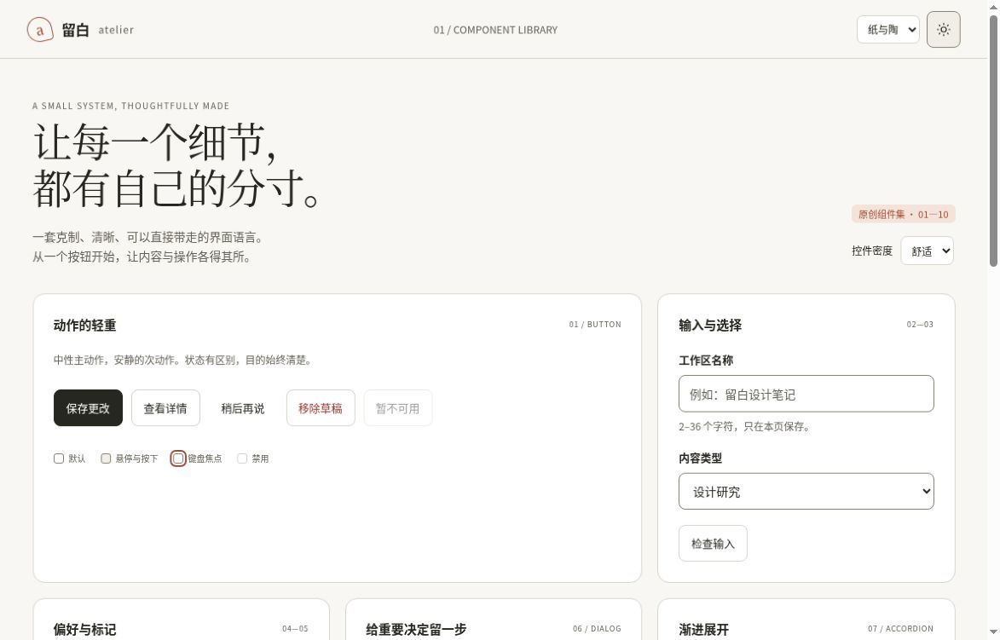
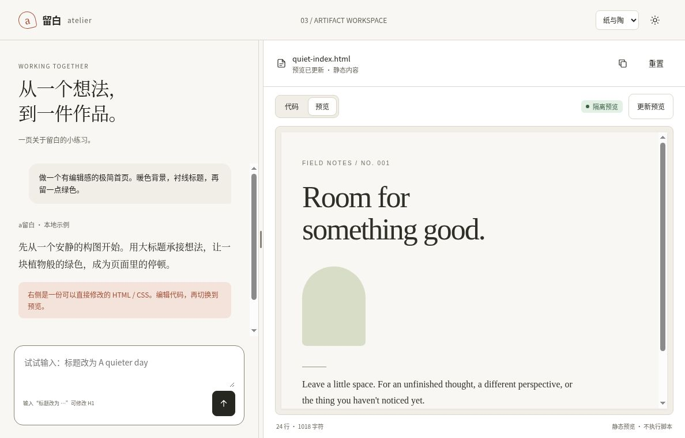
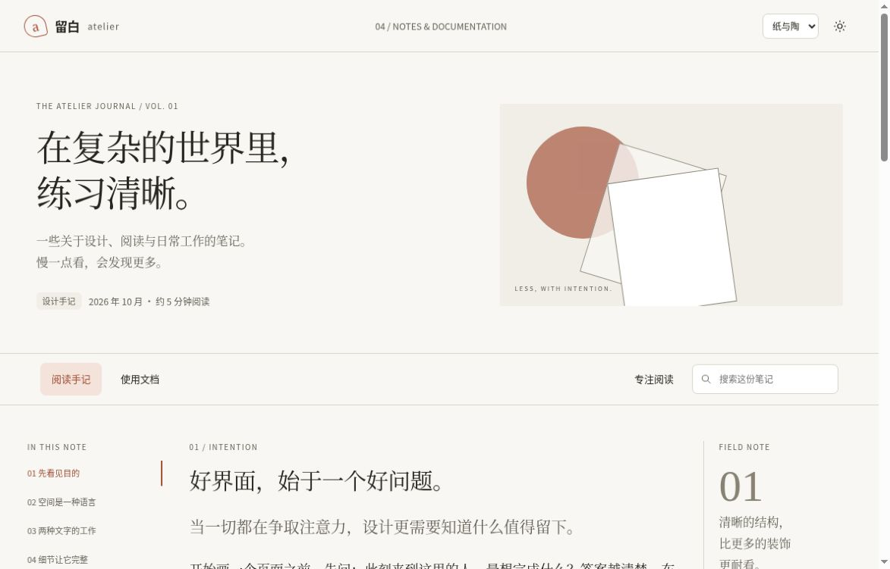
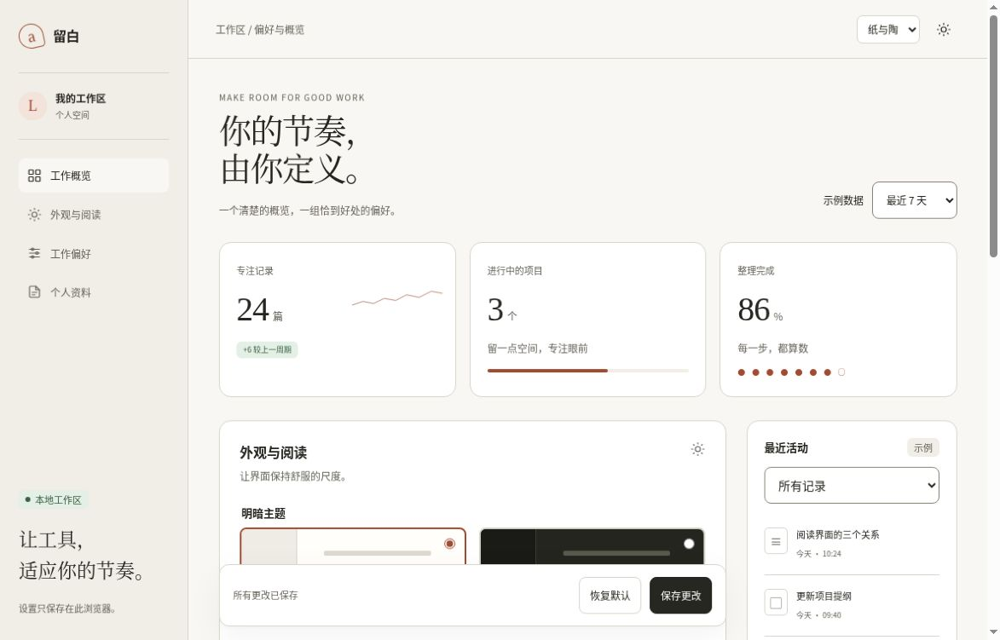
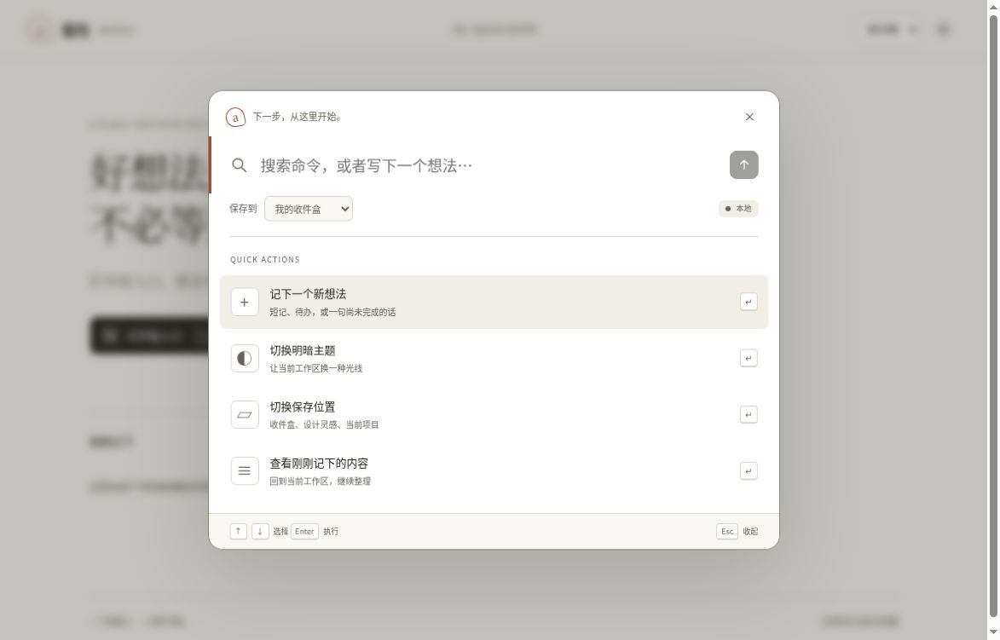
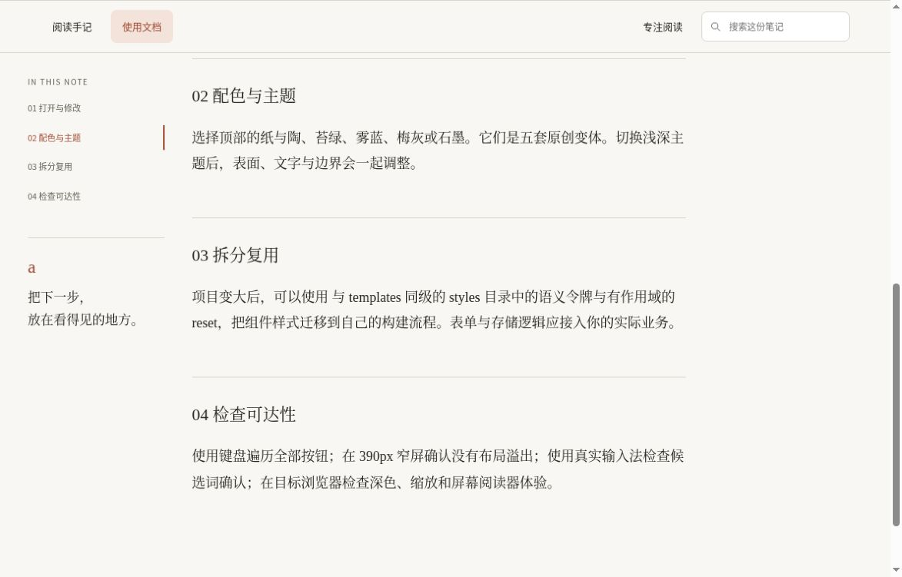

# 六个可以直接打开的前端模板

用暖中性色、阅读节奏与清楚的动作层级，建立自己的产品界面。

每个 HTML 都内联了全部 CSS 和 JavaScript，不需要安装依赖、连接模型或加载字体。顶部提供五套原创配色与浅深主题。

[下载与本地打开](#下载与本地打开) · [复制局部组件](component-extraction/README.md) · [选五套浅深配色](../palette-recipes/README.md)

## 在线预览

手机阅读可先点下面的在线预览；桌面也可直接试用。预览固定在版本 `f240c99`，下方表格保留当前源码入口。

- [组件交互画廊](https://htmlpreview.github.io/?https://github.com/aiyinyuedejustin/agent-engineering-fundamentals/blob/f240c99f7abcbda760b12eea5dafbb0fa6b91f86/books/claude-app/01-Frontend-Design-And-HTML-Templates/templates/01-component-gallery.html)
- [对话工作台](https://htmlpreview.github.io/?https://github.com/aiyinyuedejustin/agent-engineering-fundamentals/blob/f240c99f7abcbda760b12eea5dafbb0fa6b91f86/books/claude-app/01-Frontend-Design-And-HTML-Templates/templates/02-chat-workspace-template.html)
- [分屏代码与预览](https://htmlpreview.github.io/?https://github.com/aiyinyuedejustin/agent-engineering-fundamentals/blob/f240c99f7abcbda760b12eea5dafbb0fa6b91f86/books/claude-app/01-Frontend-Design-And-HTML-Templates/templates/03-split-artifact-ide-template.html)
- [技术博客与文档](https://htmlpreview.github.io/?https://github.com/aiyinyuedejustin/agent-engineering-fundamentals/blob/f240c99f7abcbda760b12eea5dafbb0fa6b91f86/books/claude-app/01-Frontend-Design-And-HTML-Templates/templates/04-editorial-blog-and-doc-template.html)
- [设置与数据看板](https://htmlpreview.github.io/?https://github.com/aiyinyuedejustin/agent-engineering-fundamentals/blob/f240c99f7abcbda760b12eea5dafbb0fa6b91f86/books/claude-app/01-Frontend-Design-And-HTML-Templates/templates/05-settings-and-dashboard-template.html)
- [Quick Entry 指令面板](https://htmlpreview.github.io/?https://github.com/aiyinyuedejustin/agent-engineering-fundamentals/blob/f240c99f7abcbda760b12eea5dafbb0fa6b91f86/books/claude-app/01-Frontend-Design-And-HTML-Templates/templates/06-floating-launcher-template.html)

HTMLPreview 是需联网的第三方预览服务；涉及私有内容时，请下载后在本地打开。已有浏览器记录覆盖桌面 HTTPS 路径，手机与原生 file:// 模式尚未实测。

## 从需要的界面开始

| 模板 | 适合做什么 | 已实现的交互 |
|---|---|---|
| [01 组件图谱](01-component-gallery.html) | 组件库与设计起步页 | 按钮加载/禁用/焦点、输入校验、原生下拉框、开关、徽章、确认对话框、折叠说明、短提示、表格双向排序、代码高亮与复制 |
| [02 对话工作区](02-chat-workspace-template.html) | 聊天、助理与知识工作台 | 收起导航、移动端抽屉、示例对话、预设思路折叠、自适应输入、Enter 发送、停止并保留草稿、上下文标签、新对话、作品卡片 |
| [03 作品与代码工作区](03-split-artifact-ide-template.html) | 左侧讨论、右侧作品的编辑体验 | HTML/CSS 编辑、代码/预览切换、拖动或键盘调整分栏、更新预览、复制、标题替换指令、错误保留上一版、重置与恢复 |
| [04 编辑式博客与文档](04-editorial-blog-and-doc-template.html) | 设计手记、产品文档与阅读页 | 本地章节目录、博客/文档切换、全文段落搜索、搜索结果定位、专注阅读、回到开头 |
| [05 设置与概览](05-settings-and-dashboard-template.html) | 产品设置、个人工作区与仪表盘 | 周/月示例数据、活动筛选、主题预览、密度与阅读字号独立调节、活动显示开关、减少动画、资料校验、保存、恢复默认 |
| [06 浮动轻入口](06-floating-launcher-template.html) | 快速记录、命令面板与搜索入口 | 模糊文本匹配、方向键导航、命令执行、保存位置选择、输入提交、关闭后保留草稿、最近八条记录、移除记录 |

模板 02 的回复与“思路”是预先编写的本地内容。模板 05 的指标明确标为示例数据。模板 06 首次打开即显示命令面板，关闭后可查看记录区。

## 下载与本地打开

1. 点击上表中的模板名，进入 GitHub 源码页。
2. 用文件页的下载按钮保存 Raw HTML；也可点 Raw 后另存为原来的 `.html` 文件名。不要保存带 GitHub 导航栏的源码网页。
3. 在电脑上用浏览器打开下载的 `.html` 文件。每页已内联所需样式与脚本，无需额外启动服务器。

## 单页与整包复制

只需要某个页面时，单独复制该 HTML 即可，运行时不会读取相邻文件。连同说明与复用样式一起带走时，请保留 `templates/` 与 `styles/` 两个同级目录：本说明、六个 HTML、`QA-CHECKLIST.md` 和 `tests/` 放入 `templates/`，下面四份共享文件放入 `styles/`。本说明的 `../styles/` 链接按这个交付结构书写。研究章节链接是可选出处，不参与页面运行。

## 从整页走到局部组件

单 HTML 整页复制即用；共享 tokens/reset 可用于局部容器；完整业务 CSS/JS 仍按整页编写，不能把两份 script 直接并排粘贴。仅加 IIFE 也不能消除全局主题、重复 ID、快捷键与存储冲突。

[可照抄的拆分教程](component-extraction/README.md) 先把模板 02 拆成外链文件、保留原行为，再给一个原创双实例最小组件，逐项演示容器查询、唯一 ID/ARIA、storage namespace、活动实例快捷键与卸载取消。附边界图、六页迁移表、运行脚本及独立测试；最小组件不表示六页已全面组件化。

## 四份共享文件

单文件已经包含同一套基础变量，不会在运行时读取这些文件。需要拆分到工程里时，按顺序引入：

1. [claude-tokens.css](../styles/claude-tokens.css)：有作用域的语义变量，五套原创浅深配色、间距、圆角、字体、控件密度与阅读字号。
2. [claude-reset-and-base.css](../styles/claude-reset-and-base.css)：只作用于 `data-ui="atelier"` 容器及子树的基础重置。
3. [tailwind.config.js](../styles/tailwind.config.js)：可选的 Tailwind CSS 3.4 配置，映射相同 CSS 变量；独立 HTML 不依赖 Tailwind。
4. [design-tokens.json](../styles/design-tokens.json)：机器可读的原创角色映射与尺寸档，便于转换到其他工具。

```html
<main data-ui="atelier"
      data-palette="sage"
      data-theme="light"
      data-density="comfortable"
      data-reading="default">
  <!-- 你的内容 -->
</main>
```

`data-palette` 支持 `paper` 纸与陶、`sage` 苔绿、`ocean` 雾蓝、`plum` 梅灰和 `graphite` 石墨。配色决定表面与强调色，`--ui-action` 仍独立承担主要动作。密度使用 `compact` / `comfortable`，阅读使用 `default` / `large`，两个尺度互不绑定。 `--ui-control` 是采用该token的控件最小高度：无密度属性40px、紧凑36px、舒适44px。内容、padding、边框与原生控件布局可以撑高；特殊工具栏和多行输入另有尺寸规则。

Tailwind v4 已转向 CSS-first，JavaScript 配置不会自动发现，需要用 `@config` 显式加载；暗色变体应按 v4 配置方式设置。这里提供的是标注版本的 v3.4 起点，迁移前请对照[官方升级指南](https://tailwindcss.com/docs/upgrade-guide#using-a-javascript-config-file)。配置的 content 路径相对于配置文件，复制到自己的工程后需调整。

## 快捷键与数据

- 通用：Tab / Shift + Tab 遍历控件；原生对话框使用 Esc 关闭并恢复触发按钮焦点。
- 对话：Enter 发送，Shift + Enter 换行；Ctrl / ⌘ + K 新建本地对话。
- 作品：Ctrl / ⌘ + Enter 更新预览；分隔条聚焦后左右键调整，Home / End 到达边界。
- 轻入口：Ctrl / ⌘ + K 打开或收起；上下键选择，Enter 执行；关闭保留尚未提交的文字。
- 输入法：组合输入期间不会把候选词确认当成发送；实际操作仍需在目标输入法验收。
- 本地存储：六页共用 `atelier-theme` 与 `atelier-palette`；聊天草稿、设置、轻入口记录分别使用 `atelier-chat-draft`、`atelier-settings`、`atelier-captures`。同源下共享键会互相影响；局部组件需明确 namespace 与同步策略。浏览器禁用存储时，页面继续工作并在需要时说明无法持久保存。不要用示例存储敏感数据。
- 复制：优先使用浏览器剪贴板；不可用时尝试旧式本地复制，仍失败则提示手动选择复制。

## 作品预览的边界

模板 03 只预览静态 HTML/CSS。编辑内容先在惰性模板中解析，仅保留静态元素与有限属性，再进入 `sandbox=""` iframe。预览 CSP 禁止脚本、网络、图片、字体、嵌入、表单与基址；没有同源权限，也没有通向父页面的消息桥。外链和导航元素、事件属性、脚本、表单、SVG 与 iframe 都被移除。

这适合布局练习。若要运行第三方脚本或连接真实服务，请另外设计独立源、权限与通信协议，不要直接放宽这里的 sandbox。错误时保留最后一份成功预览，修复后再次更新。

## 设计来源与原创范围

模板借鉴[视觉设计章节](../README.md)中有出处的关系：暖中性表面、工具字与阅读字分工、内容宽度、输入面层级、低噪声状态反馈。六个页面、五套配色、布局、图形、文字与交互代码均为原创适配；没有官方标志、专有字体或应用代码，也不表示某个版本的逐像素复刻。完整静态颜色记录由本书的颜色目录单独提供，不与这里的原创语义令牌混为一套。

## 检查与截图

[交互检查与截图清单](QA-CHECKLIST.md)给出每页的入口、桌面/窄屏规格，以及实际浏览器需要确认的事项。[tests/results.json](tests/results.json)记录静态与模拟 DOM 检查，不能替代真实布局、CSP 执行、中文输入法和辅助技术测试。


## 浏览器实景

以下为本书原创模板在 Chrome 中的实际渲染，视口 1188 × 761，版本 d63d0f4。通过公开 HTTPS 预览页面加载；离线 file:// 是另一项验证条件。

### 组件画廊



### 对话工作台


### 分屏代码与预览



### 技术博客



### 设置与看板



### Quick Entry



### 博客目录同步复验

2026-10-15，固定提交 `6cab7830e0356770225fd4ec96ee8b89bedcf85d`，Chrome，1188 × 761 CSS px、DPR 1。搜索“主题”后，正文焦点、URL 与目录当前项一致，延迟观察保持不变；继续滚动、点击页尾章节、切换文档/手记与专注阅读后，目录会按可见文章重新选择。截图为原始返回尺寸1173 × 751像素。



普通滚动只更新当前项，不重写最近一次导航的URL片段。此次为单一桌面视口的针对性复验，不包括file URL、窄屏、缩放、真实输入法或辅助技术。

## 内嵌令牌同步

[令牌同步检查器](token-parity/README.md)核对六页内嵌声明与共享CSS/JSON，覆盖60个配色与主题单元。它与交互、浏览器绘制分别验证；检查器有独立95项自测，不计入203项模板交互检查。

## 窄容器布局检查

[固定源检查页与构建器](narrow-layout-lab/README.md)把六份模板放入375、768、1024 CSS px的iframe内容框，保留源摘要与沙盒边界；用于布局检查，不等同移动设备或持久化测试。

[查看六份375px真实浏览器截图与三档尺寸记录](narrow-layout-lab/BROWSER-REVIEW.md)。

[设置页保存与重置实测](settings-browser-review.md)：正常刷新恢复、确认取消与默认值持久化，以及min-height和控件实高的区别。

[组件画廊实际交互与焦点边界](gallery-browser-review.md)：表单、排序、开关与关闭回焦，以及未满足的严格Tab循环目标。
