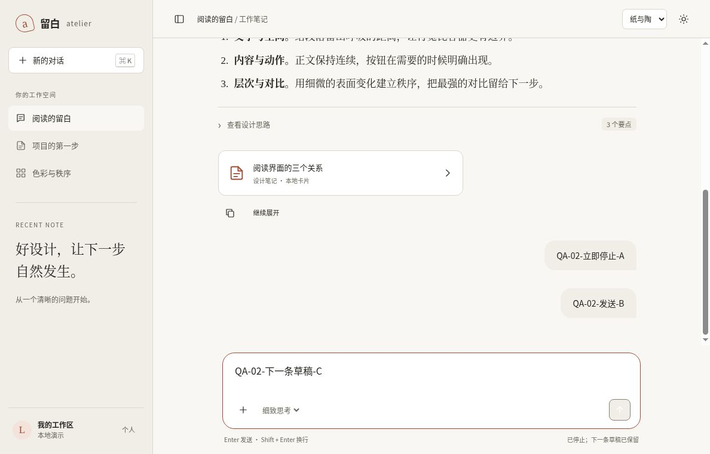

# 聊天页：停止后保留哪一条草稿

2026-10-15 08:55:07–08:56:01 UTC，在自有云端 Chrome、1188×761 CSS px、DPR 1 下，检查02聊天模板的[固定版本页面](https://htmlpreview.github.io/?https://github.com/aiyinyuedejustin/agent-engineering-fundamentals/blob/f240c99f7abcbda760b12eea5dafbb0fa6b91f86/books/claude-app/01-Frontend-Design-And-HTML-Templates/templates/02-chat-workspace-template.html)。两条停止路径均通过；这里验证的是本页确定性演示回复。

## 两种输入状态，两种恢复结果

1. 输入合成消息A「QA-02-立即停止-A」，在同批普通界面动作中发送并立即点击停止。输入框恢复A，状态为「已停止；原输入已恢复」，按钮回到「发送消息」。后续回查已超过原定时器窗口，仍只有两条初始示例和一条新增user消息，没有新增assistant回复。
2. 输入合成消息B「QA-02-发送-B」，在同批动作中发送、填写下一条草稿C「QA-02-下一条草稿-C」并点击停止。输入框保留C，状态为「已停止；下一条草稿已保留」。再次超过原定时器窗口回查，pending提示不存在，消息仍为两条初始示例与A、B两条user消息，没有晚到的assistant回复。

停止不会撤回已发送的user消息；它终止这一次本地示例回复，并根据当前输入框是否已有内容决定恢复原输入还是保留下一条草稿。

## 证据与边界

本次使用普通UI填写与点击、只读DOM观察；未改动源码、定时器或隐藏状态，未使用DevTools。900ms是源码中本地回复的计划延时，不是本次浏览器测得的停止延迟；同批动作实际进入停止分支，不代表验证了899/900ms边界竞态。

源码检查确认：busy时发送处理转入stopChat；stopChat清除pendingTimer、移除pending提示，并优先保留非空下一条草稿。现有edge.cjs的CONTROL-01/02/03另覆盖模拟时钟边界与重复操作，本次只查阅该测试，未重新运行。浏览器证据与模拟DOM测试分别记录，不互相替代。

[机器记录](../../04-Extracted-Core-Code-And-Scripts/evidence/data/chat-cancel-browser-review.json)列出每次观察时间、输入与消息计数、源码检查身份和截图校验值。浏览器固定提交为f240c99f7abcbda760b12eea5dafbb0fa6b91f86；通过GitHub提交树核对，该版本02文件的blob与本次查阅的当前源码一致。

此前浏览器QA中停止操作未得出结论的记录仍保留；本页是新增的固定版本证据。未验证真实网络或模型取消、跨浏览器、真实移动设备、停止后的刷新持久化或console/网络状态。不能将本页结果外推为实际产品的生成取消合同。

结束时通过「新的对话」和界面填写恢复前次自有合成草稿「焦点修复后的草稿」，来源可核对已发布的template-keyboard-focus-browser.json；测试标签页已关闭。

[返回模板目录](README.md) · [完整验收清单](QA-CHECKLIST.md)
