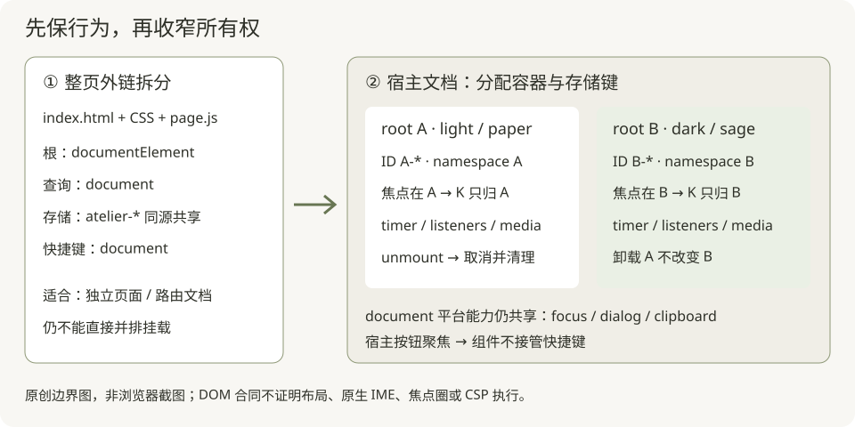
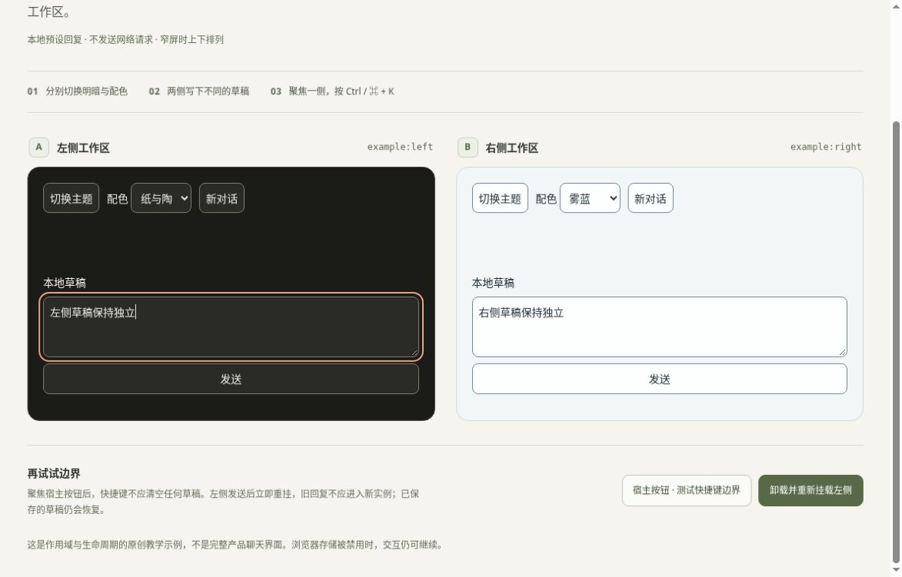

# 把整页拆成文件，再把功能拆成组件

本教程只解释本目录上一级的六个原创模板。目标不是介绍新框架，而是给出可以直接运行、逐条验收的迁移路线。

**先选承诺：**单 HTML 可以独立离线打开；共享 tokens/reset 可以放在局部容器；六页完整业务 CSS/JS 仍是整页实现。把两份 script 包进 IIFE 只能避免顶层 `const $` 重复声明，不能解决 ID、主题、快捷键或存储冲突。本例仅实现一个原创最小聊天组件，**没有把六个完整模板改成多实例组件**。



图：第一次拆分只移动文件；第二次迁移才改变资源所有权。右侧是教学合同，不是产品运行截图。

## 给 HTML 预览器的单文件入口

[preview-single.html](preview-single.html) 仅供会重写外链脚本加载顺序的 HTML 预览器使用。它由 [build-preview.cjs](build-preview.cjs) 从现有 demo.html、四份 CSS（含仅装饰宿主的 demo-host.css）和 scoped-chat.js 原样内联生成，初始化脚本仍在组件源码之后；没有第二份手写业务逻辑。日常嵌入和原生同源/file 路径验证仍使用 [demo.html](demo.html)。预览器失败不能直接推断原生页面失败。

生成物不手工编辑。在本目录运行下列命令，输出父目录须存在、文件须不存在；工具以 wx 创建，不覆盖已有文件或链接：

```sh
node build-preview.cjs . /tmp/atelier-component-preview.html
NODE_PATH="$PWD/../tests/node_modules" node --test test-preview.cjs
node --test test-host-contrast.cjs
```

[test-host-contrast.cjs](test-host-contrast.cjs) 从实际宿主 CSS 读取所有显式文字颜色及其背景，检查默认/hover 按钮和辅助文本至少 4.5:1，并检查 namespace、辅助说明及页脚在各断点至少 12px。此检查不覆盖组件内部颜色，也不等于整页可访问性认证。

固定四条 CSS 路径、一个组件 script 路径和出现次数都受检查；CSS 或 JS 含对应 HTML 结束标记时拒绝生成，避免把源码意外变成新 HTML 节点。[test-preview.cjs](test-preview.cjs) 检查内联内容及顺序、双实例初始化、关闭标签反例、重复/未知资源，以及输出抢占时内容保留。模拟 DOM 通过不代替实际预览器、布局或原生 file URL 验收。

## 1. 先对模板 02 做“行为不变”的文件拆分

从 `templates/` 目录运行以下命令（Node.js 20+，输出目录必须不存在，其父目录必须已存在）：

```sh
node component-extraction/split-page.cjs . /tmp/atelier-chat-split
```

得到可以单独带走的目录：

```text
atelier-chat-split/
  index.html
  page.css
  page.js
  styles/claude-tokens.css
  styles/claude-reset-and-base.css
  source.json
```

[split-page.cjs](split-page.cjs) 不是一段模糊的“把 CSS 拆出去”建议，它执行以下精确规则：

1. 读取 [02-chat-workspace-template.html](../02-chat-workspace-template.html)，要求恰有一个无属性 `<style>` 和一个无属性 `<script>`。不使用会撞到字符串中 `<script>` 的逐行切割。
2. `<style>` 内从开头到 `/* 有边界的 reset 与基础样式。` 之前是 tokens；从该注释到 `/* 原创组件层：` 之前是 reset。分别与现有两份共享 CSS 做去首尾空白后的严格相等检查。不相等就停止，不能悄悄覆盖新版本差异。
3. 从 `/* 原创组件层：` 到 `</style>` 的全部内容写入 `page.css`。这包括通用控件与页面业务样式，暂不修改选择器。
4. 将内联样式替换为依次加载 tokens → reset → page.css 的三个 link。完整 script 内容原样写入 `page.js`，原 script 位置替换为 `<script defer src="page.js"></script>`。只做此替换，不改成 async，不改变 HTML ID、根上的 data 属性或 DOM 顺序。
5. `source.json` 保留原 HTML 的 SHA-256。输入页从不改写；使用非 recursive mkdir 独占创建输出目录，所有输出文件以 wx 创建，拒绝在创建期间出现的同名文件或硬链接。父目录须已存在。失败后保留已产生的目录/文件供检查，不做可能误删并发内容的清理。这里防止意外竞争覆盖，不把普通路径 API 当成对恶意同权限进程替换祖先目录的安全隔离。

此时仍然允许 `document.documentElement` 和 document 全局选择器，因为它仍拥有完整文档。把生成的 index.html 用作独立路由文档是合理的；把其 body 粘贴进现有 SPA 的某个 div 不是这一步的承诺。不要只搬 HTML 忘掉相邻 CSS/JS；服务器 CSP 也需要允许相应本地脚本/样式路径。

### 原页与副本怎么比较

安装既有测试依赖后，在 `templates/` 运行：

```sh
npm --prefix tests install
NODE_PATH="$PWD/tests/node_modules" node component-extraction/test-split.cjs .
NODE_PATH="$PWD/tests/node_modules" node --test component-extraction/test-output-safety.cjs
NODE_PATH="$PWD/tests/node_modules" node component-extraction/run-existing-contracts.cjs .
```

[test-split.cjs](test-split.cjs) 检查外链路径、顺序、defer 和 script 原样保留，在模拟 HTTPS 与 file URL/存储拒绝环境分别加载原页、外链副本，比较主题、配色、草稿、IME 防误提交、停止恢复与完成后的消息状态。CSS 只比较文本内容，不声称渲染等价。

[run-existing-contracts.cjs](run-existing-contracts.cjs) 在临时目录复制现有六页和 tests，把拆分副本重新内联后运行原有五个测试入口，仍使用现有的聊天/停止/IME 合同。重新内联是为了复用原测试的“单文件无外链”前置约束，**它不验证浏览器外链加载**。临时目录结束即删除，报告打印至 stdout，不写原 tests/results.json。

真实浏览器还须分别打开生成的 file:// 页面与 HTTPS 页面：检查资源是否加载、刷新是否恢复、原生输入法、对话框焦点、窄屏导航与剪贴板。这些不能由 jsdom 的通过结果代替。

## 2. 第二次迁移：root 不再等于整份 document

对照 [scoped-chat.js](scoped-chat.js)、[scoped-chat.css](scoped-chat.css) 和 [双实例演示](demo.html)。保留 `templates/component-extraction/` 与 `styles/` 在同一个前端根目录下的现有结构，即可打开 demo；其共享样式路径是 `../../styles/`。若只带走教程目录，应按下面片段重设三个样式路径。示例使用经典 script，不依赖框架、打包器或网络服务。

```html
<link rel="stylesheet" href="styles/claude-tokens.css">
<link rel="stylesheet" href="styles/claude-reset-and-base.css">
<link rel="stylesheet" href="scoped-chat.css">
<section id="left" aria-label="左侧工作区"></section>
<section id="right" aria-label="右侧工作区"></section>
<script src="scoped-chat.js"></script>
<script>
const a = AtelierScopedChat.mount(document.getElementById('left'), {
  namespace: 'my-app:project-a'
});
const b = AtelierScopedChat.mount(document.getElementById('right'), {
  namespace: 'my-app:project-b'
});
// 路由退出前调用；之后允许在原空容器重新 mount。
// a.unmount(); b.unmount();
</script>
```

以上片段假定三个 CSS 与 JS 放到所示相对路径；本目录 demo 已用自己的正确路径。只允许空容器；宿主对容器子树的写操作须发生在卸载之后。最小例子含主题/五配色、草稿、文本消息、本地延时回复、停止、IME 与新对话；不含原页导航抽屉、作品卡、对话框或附件。

### 六项必须一起变更的边界

| 原整页假设 | 本例可照抄的处理 | 忘改会怎样 |
|---|---|---|
| `root = document.documentElement` | `mount(root, options)`，仅写传入 root 的 dataset；卸载恢复原属性 | 某个嵌入模块改整个宿主主题 |
| `$` 默认 document | 闭包内 `const $ = s => root.querySelector(s)`；通过 root.ownerDocument 创建节点 | 点击右边，却改到左边第一项 |
| 固定 `chat-input` / `pending-response` | 挂载生成唯一前缀；label.for 与 aria-controls 同时生成；内部查询使用 data-role | 重复 ID 令标签/辅助技术指错元素 |
| `'atelier-'+key` | namespace 必传，访问 storage 包 try/catch，验证恢复值类型 | 项目 A 读到项目 B 草稿；存储拒绝直接崩溃 |
| document 接管快捷键 | 在 root 上监听冒泡，检查 root 包含 activeElement、defaultPrevented、IME 及修饰键 | 02 和 06 同时响应 Ctrl/⌘+K |
| 页面永不卸载 | AbortController 管监听；clearTimeout + generation/ disposed 双保护；撤回 media 订阅 | 旧请求/计时器修改新挂载状态 |

根上 `data-ui="atelier"` 的 tokens/reset 有范围，但**原业务 CSS 没有因此自动获得范围**。例如 `.btn`、`.container`、`kbd`、`details > summary` 仍会命中宿主；`[data-theme=dark] .btn` 也可能读取宿主祖先的主题。本例全部业务规则以 `[data-scoped-chat]` 开头，只使用所需的原创小样式。完整迁移应逐条处理选择器列表、伪元素和 media 内规则，不要用字符串全局替换假装完成 CSS 解析。根自身用 `[data-scoped-chat][data-theme=dark]`，后代才用空格。

### 走一次“旧 timer 不得碰新页面”

1. 左侧输入“第一条”，发送；此时挂起一个 timer。
2. 卸载时先设 disposed、增加 generation，再 clearTimeout、abort 所有监听、移除 media 回调、清空拥有的子树。
3. 在同一个 root 重新挂载。新实例使用新的闭包与 ID；旧实例的引用不再拥有 root。
4. 即使测试故意调用已捕获的旧回调，它仍因 disposed / ticket 不匹配退出。本例测试真的这样做，而不只是检查 clearTimeout 被调用。

“clearTimeout 足够”只适用于尚未开始的 timer；Promise/网络结果没有这条保证。以后接真实请求时，取消请求并在 await 后检查是否仍为当前实例/请求；不要把本地预设回复当作生产请求管理器。

### 主题和 storage 应该共享吗？

原六页都读写 `atelier-theme`、`atelier-palette`，同源下有意共用；并非六份互不影响的独立键。02 额外用 `atelier-chat-draft`，05 用 `atelier-settings`（其中还含 theme），06 用 `atelier-captures`。01 的 density 仅本页应用；03 的代码与04阅读模式也未持久化。file URL 的持久化语义需在目标浏览器确认。

选择一：同一个应用希望统一皮肤，可由宿主保存一个 theme/palette 状态，显式把状态分发给各 root；草稿、设置、记录按项目 namespace 隔离。选择二：预览两个独立方案时，像 demo 一样 namespace 全隔离。本例没有主题订阅总线，两个实例故意使用同 namespace 只意味着读写同一组键；后挂载会恢复新值，**不会立即同步已挂载实例**，同页写 storage 也不应被当成自己的实时通知。

本例额外实现“未手动选择主题时跟随系统”，原页仅启动时读 prefers-color-scheme。这个新增订阅用于示范卸载，不要误记为原模板既有功能。

## 3. 六页逐一迁移，不凭共同前缀猜依赖

以下依据六份当前源码的函数名/选择器，行号会漂移，按名字查找更稳。共同部分都含全局 `$`/`$$`、root、toastTimer、theme/palette、初始化 dialog 扫描、clipboard 辅助函数。部分页没有实际使用某个辅助函数；迁移时先删不用的代码，不能把“有定义”当成“有运行调用”。

| 页面及定位点 | 额外的整页依赖 | 局部迁移决定 |
|---|---|---|
| [01 组件图谱](../01-component-gallery.html)：save-demo / density / publish-dialog | 保存按钮另有延时；density 改全局 root；原生 dialog 还原 document.activeElement | density 写局部 root；跟踪保存与 toast 两类 timer；实例化确认框 ID，卸载前关闭拥有的 dialog |
| [02 对话](../02-chat-workspace-template.html)：sidebar / pendingTimer / new-chat | document 的 Tab/Escape/K；matchMedia(max-width:760px) change；聊天草稿；initialMessages 字符串含原 ID | root 内查询；保存并移除媒体回调；取消生成；重建 initialMessages 时也用实例 ID；抽屉 inert 只覆盖明确拥有的内容，嵌入宽度不等于 viewport 宽度 |
| [03 作品](../03-split-artifact-ide-template.html)：resize / endDrag / mountStaticPreview | root.dragging、pointer capture；编辑器级 Ctrl/⌘+Enter；新 iframe 替换旧节点 | dragging class 移至局部根；卸载结束拖动并释放仍持有的 pointer capture；保留 sandbox=""、CSP、清洗和替换语义，不加 allow-same-origin / allow-scripts |
| [04 文档](../04-editorial-blog-and-doc-template.html)：sectionURL / markSectionNavigation / updateCurrentSection | window.location/history、window scroll/resize、requestAnimationFrame、IntersectionObserver；根 searching / reading-mode | 先决定宿主是否允许写 URL；否则回调通知宿主导航。容器滚动改观察 root 与位置算法，不能保留 window.scrollY；保存 RAF/observer 句柄，卸载 cancel/disconnect |
| [05 设置](../05-settings-and-dashboard-template.html)：collect / apply / fill | root 的 density/reading/user-reduced-motion；settings.theme 与全局 theme 重叠；radio name=appearance、锚点导航、reset-dialog | 设唯一 radio name/form 归属；root 属性与 CSS 一起收窄；明确设置页是应用全局偏好还是局部预览，避免 fill(saved) 覆盖另一模块主题；保存与重置同一个 namespace |
| [06 轻入口](../06-floating-launcher-template.html)：openLauncher / selectCommand | document 的 K；启动即 showModal；command-N 动态 ID 与 aria-activedescendant；captures 记录；滚动记录区域 | 不在每个实例 mount 时抢 modal；由宿主协调打开；命令 ID 与 aria-activedescendant 同步加前缀；快捷键限活动实例或交宿主统一分发；卸载关闭面板 |

对 04 的模式 class 请以实际源码为准，迁移包含 `reading-mode` 与 `searching` 两条状态；定位函数不能只改 CSS。对 03，iframe 的独立文档边界用于隔离预览内容，不是借此声称整个编辑器已组件化。

### 哪些 document/body 交互可以保留

- `ownerDocument.createElement` 是创建节点的正确文档，不是全局查找。用容器所属文档还能避免跨 iframe 的构造器/AbortSignal 混用。
- 原生 dialog 的 top layer 是文档级能力，但节点可保留在组件子树，从而继承主题。宿主应协调同时只能打开哪个 modal。记录 opener，关闭时先检查 opener.isConnected；卸载不能把焦点恢复到已经移除的旧按钮。不要为躲 CSS 而随意把 dialog 搬到 body 丢掉变量继承。
- clipboard fallback 可能需要临时 textarea 放到文档 body 并获取选择区。这是一次受控平台交互：使用 ownerDocument、try/finally 移除临时节点，恢复仍连接的焦点；await clipboard 后确认实例尚活着再发 toast。本最小例子不带剪贴板，六页原 copyText 不具备卸载保护，不能直接抄进去。
- 真要全局 K 时，让宿主只注册一处 document 监听，再把动作分发给显式活动实例。不要六个实例各自宣称自己“全局唯一”。

## 4. 用反例验收，不用“看起来能点”验收

在 `templates/` 运行：

```sh
NODE_PATH="$PWD/tests/node_modules" node --test component-extraction/test-component.cjs
```

[test-component.cjs](test-component.cjs) 的 11 个独立测试覆盖：双实例唯一 ID/ARIA、局部主题/配色、焦点快捷键/宿主不接管、namespace 恢复、真实事件序列形式的 IME 模拟、停止/下一条草稿、新对话作废旧回调、卸载重挂旧回调与旧节点监听、媒体订阅撤回、存储异常/损坏值、重复挂载拒绝与根属性恢复。使用 node:test + jsdom 26.1.0，无浏览器与网络请求。

预测题：两个组件用了不同 ID，但都注册 document Ctrl+K，是否已安全？没有。ID 只解决查找与关联，动作所有权仍冲突。第二题：两个实例用相同 namespace，左边切主题，右边一定立刻变吗？本例不会；共享持久化和实时同步是两个合同。

最后手动执行：宿主聚焦按 K；各实例分别聚焦按 K；两侧不同主题；发送后立即卸载重挂；真实中文输入法候选确认；Tab/Shift+Tab 与屏幕阅读器 label；200% 缩放及窄屏；file URL/HTTPS 的外链资源加载。没有做真实验收时保留“待验”，不要把 jsdom 报告写成浏览器截图或可访问性认证。

### 输出抢占反例

[test-output-safety.cjs](test-output-safety.cjs) 在独占创建前插入别人的输出目录，在文件写入前插入同名普通文件、硬链接或符号链接，并检查拒绝写入且原内容保持不变。另检查 styles 目录抢占、已存在输出、缺失父目录和 source.json 元数据写入的同名竞争。测试只清理自己创建的临时 fixture；拆分工具不删除任何失败输出。

## 双实例的实际浏览器检查



云 Chrome 154、1188×761视口：两列各536.5px，无页面横向溢出；辅助文字为12px。已验证主题/配色/草稿分别保存、Ctrl+K只重置聚焦实例、卸载重挂恢复本实例草稿，以及旧延时回复不写入新实例。这里运行的是生成的单文件预览；原生file外链加载、真实IME与200%缩放仍需单独验收。

## 焦点也是组件资源

[焦点生命周期小课](focus-lifecycle.md)：模态内的背景快捷键、隐藏面板的焦点交接、真实 opener 的归还，以及节点失效后的回落。配有状态图、代码骨架与三条真实浏览器反例。
