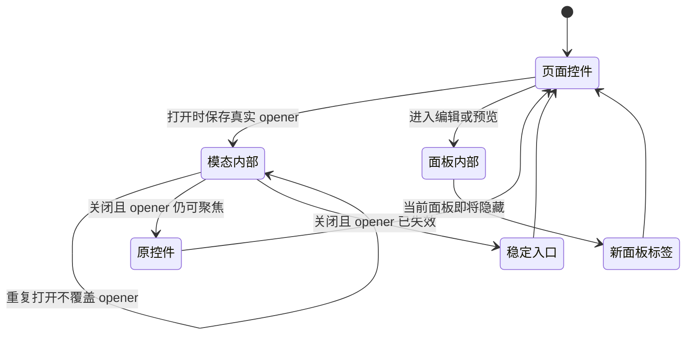

# 焦点也是组件资源

组件拥有的不只是 DOM、监听器与请求，还包括用户接下来从哪里继续操作。打开、隐藏、替换和卸载都会改变这个位置，因此每次状态转换都要交代焦点去向。
本文从本书原创 [02 对话](../02-chat-workspace-template.html)、[03 作品编辑器](../03-split-artifact-ide-template.html)、[06 轻入口](../06-floating-launcher-template.html) 提炼规则；下面骨架是教学改写，不是 Claude 源码。
已有[组件拆分教程](README.md)讲资源所有权，这里只补焦点边界，不重复挂载、主题和存储迁移。

## 先画出交接关系



这里的“拥有”指负责交接，而非永久锁住焦点。用户主动切换与后台完成是不同事件；异步完成不应随意把正在别处输入的用户拉回来。

## 1 模态边界也要挡住背景动作

原生 `showModal()` 处理模态背景与焦点，但窗口里的 `keydown` 仍可冒泡到应用的 document 监听器。背景不可点击，不代表背景快捷键逻辑自动停用。

| 反例 | 用户看到什么 | 应守的合同 |
|---|---|---|
| 笔记窗口中按 Ctrl/⌘+K，document 仍执行新对话 | 窗口还开着，背景草稿却没了 | 当前模态优先，禁止背景重置 |
| 只判断一个固定 dialog ID | 换一个对话框又发生串台 | 从统一模态状态判断边界 |
| 只 `return`，不处理已接管的快捷键 | 浏览器默认动作可能接着发生 | 明确这个组合键由谁消费 |

02 在新对话分支发现任意 `dialog[open]` 后，调用 `preventDefault()` 并退出，保留草稿与原卡片节点。这个选择器是该模板的保守门禁；`open` 本身不证明窗口由 `showModal()` 打开。
组件化后，让宿主协调模态和全局快捷键；普通组件只处理自身活动区域。不要指望某个子节点 `stopPropagation()` 能修复所有已注册的全局业务动作。

## 2 隐藏前决定谁接住焦点

切换标签时，先读取旧面板是否包含 `activeElement`。如果是，焦点必须交给仍可见的新标签；如果用户点击的是面板外的更新按钮，就保留按钮焦点。

| 反例 | 为什么失效 | 应守的合同 |
|---|---|---|
| 编辑器 Ctrl/⌘+Enter 后直接隐藏代码面板 | 当前焦点随面板失去可见位置 | 有效更新后交给预览标签 |
| 每次更新都无条件 `previewTab.focus()` | 面板外按钮也被抢焦点 | 只迁移将被隐藏的焦点 |
| 输入无效也切换并移动焦点 | 用户离开了需要修正的编辑器 | 保留编辑器焦点与上一版预览 |

03 当前实现先记住“是否需要迁移”，再改 `hidden`、`aria-selected`、`tabIndex`，最后在同一次同步调用中聚焦新标签。不能等隐藏后再根据已经变化的焦点猜原位置。
下面骨架进一步把 `focus()` 放在隐藏旧面板之前；前提是两个标签始终在面板外且可见。若目标本身隐藏，须先显示目标，再完成交接。

## 3 归还真实 opener 并准备失效回落

opener 是“发起这次打开的节点”。指针打开取 `event.currentTarget`，快捷键打开取打开前的 `activeElement`；自动打开没有用户触发点，才显式指定稳定入口。

| 反例 | 为什么失效 | 应守的合同 |
|---|---|---|
| 所有关闭都回到固定打开按钮 | 从配色或主题控件唤起后回错位置 | 保存本次真实 opener |
| 已打开时再次保存 activeElement | 覆盖成窗口内部控件 | 重复打开先退出，再谈记录 |
| 列表重绘后仍向旧按钮 `focus()` | 原节点 detached，相同文字的新节点也不是它 | 检查有效性，失败转稳定入口 |

06 用 `isConnected` 处理记录列表重绘导致的旧按钮脱离文档，回落到 `open-launcher`；Escape、关闭按钮与提交都汇合到 `close` 事件。
嵌入组件时还应检查隐藏、禁用、inert 与实际聚焦结果。卸载前由宿主指定仍存在的接续位置，关闭窗口、撤回监听，再移除子树；不要把焦点归还给即将一起删除的节点。

## 可改写到组件中的短骨架

假定 `root` 包含窗口，`dialog`、`firstInput`、`fallback` 已绑定；`imeGuard` 与 `newChat` 是组件现有函数。`fallback` 必须稳定、可见、可聚焦。监听器应纳入组件既有的卸载清理。

```js
const doc = root.ownerDocument;
let opener = null;
function focusIfUsable(node) {
  if (!node?.isConnected || node.closest('[hidden],[inert]') ||
      node.matches(':disabled')) return false;
  node.focus();
  return doc.activeElement === node;
}
function openFrom(source = doc.activeElement) {
  if (dialog.open) return; // 不覆盖这一次打开的来源
  opener = source;
  dialog.showModal();
  firstInput.focus();
}
dialog.addEventListener('close', () => {
  const previous = opener;
  opener = null;
  if (!focusIfUsable(previous)) focusIfUsable(fallback);
});
root.addEventListener('keydown', event => {
  if (event.defaultPrevented || imeGuard(event) ||
      !root.contains(doc.activeElement)) return;
  if (!(event.ctrlKey || event.metaKey) || event.key.toLowerCase() !== 'k') return;
  event.preventDefault();
  if (doc.querySelector('dialog[open]')) return;
  newChat(); // 这里演示 02 的背景动作门禁，不是 06 的开关命令
});
function switchPanel(oldPanel, nextPanel, oldTab, nextTab) {
  const transfer = oldPanel.contains(doc.activeElement);
  nextPanel.hidden = false;
  oldTab.setAttribute('aria-selected', 'false'); oldTab.tabIndex = -1;
  nextTab.setAttribute('aria-selected', 'true'); nextTab.tabIndex = 0;
  if (transfer) nextTab.focus();
  oldPanel.hidden = true;
}
```

调用处也属于合同：点击用 `openFrom(event.currentTarget)`，快捷键用 `openFrom(doc.activeElement)`，自动打开用 `openFrom(fallback)`；预览校验成功才调用 `switchPanel`。
这段保留浏览器原生 dialog 的 Escape 与焦点处理，不另造 Tab 陷阱；多模态、Shadow DOM 与跨文档宿主需要各自明确的协调策略。

## 两种验证各自回答什么

[19 项回归](../tests/keyboard-focus.test.cjs)用模拟 DOM 检查动作合同：Ctrl/Meta 两条分支、草稿不变、opener 节点身份、隐藏前的焦点归属、无效预览、重复打开和 detached 回落。断言不仅要看弹窗开关，还要看数据与节点是否被意外替换。
测试替换了 `showModal()`、`close()`，因此人工派发事件通过，并不证明原生 Tab、Escape、inert 或布局成立。在 `templates/` 且已有测试依赖时运行 `node --test tests/keyboard-focus.test.cjs`。
[真实 Chrome 记录](../../../04-Extracted-Core-Code-And-Scripts/evidence/data/template-keyboard-focus-browser.json)覆盖固定 HTTPS 预览中三条修复前后路径：02 草稿保留且 Escape 返回卡片；03 编辑器快捷键后聚焦预览标签；06 从主题控件唤起后返回该控件。
这些浏览器结果没有覆盖全部 19 个分支；模拟 DOM 也不能替代目标浏览器、真实输入法与辅助技术检查。具体复验路径见[检查清单](../QA-CHECKLIST.md)。

迁移完成前再问一次：谁取得焦点、哪个动作会让它失效、正常关闭回哪里、原位置消失又回哪里？四个答案写清楚，焦点才真正进入组件的生命周期。

## 原生dialog与浏览器UI的焦点边界

[组件画廊真实记录](../gallery-browser-review.md)在首尾Tab时观察到activeElement=BODY，但没有看到背景控件获焦；严格两按钮逐键循环未满足。BODY既不能单独证明模态隔离失效，也不能证明焦点具体进入了浏览器地址栏。原生页面隔离、浏览器UI导航和APG首尾直接循环是不同合同；本模板继续保留原生处理。
