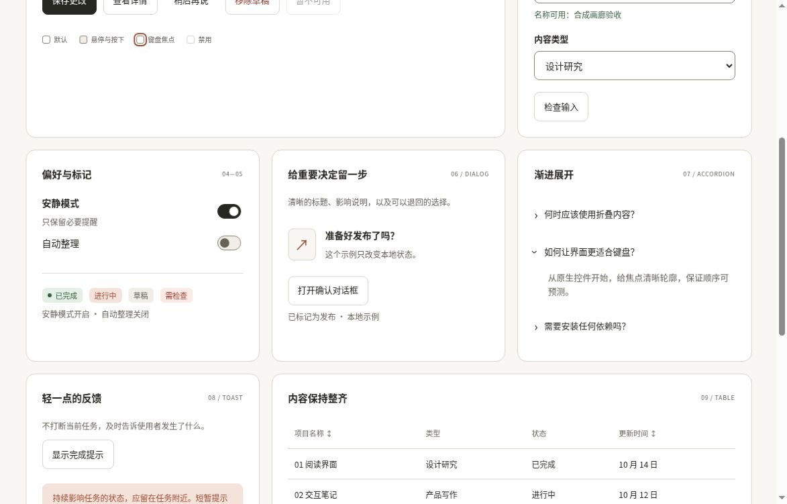
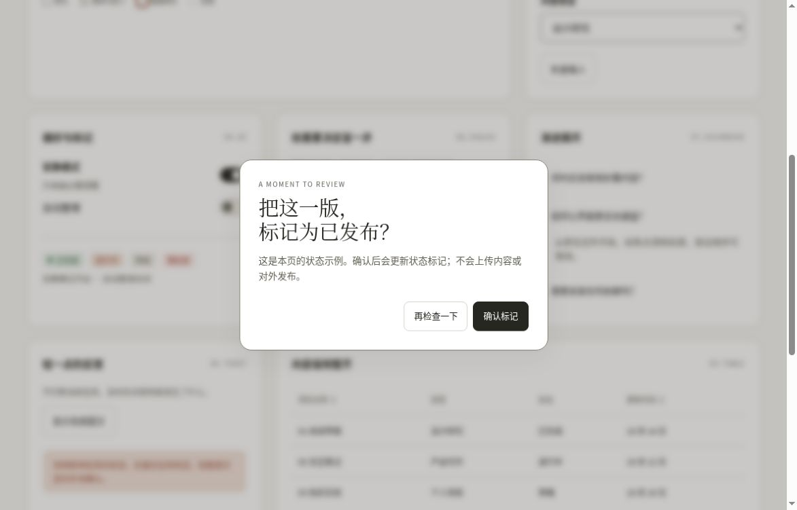

# 组件画廊：验证交互，也解释焦点边界

2026-10-15，自有云端Chrome，1188×761 CSS px、DPR 1，[固定f240c99页面](https://htmlpreview.github.io/?https://github.com/aiyinyuedejustin/agent-engineering-fundamentals/blob/f240c99f7abcbda760b12eea5dafbb0fa6b91f86/books/claude-app/01-Frontend-Design-And-HTML-Templates/templates/01-component-gallery.html)。输入仅使用合成名称，表格和发布标记都是原创本地演示数据。

## 校验、反馈与状态一致

- 空名称出现“请至少输入2个字符”的错误，aria-invalid=true，焦点回到名称字段；合成有效名称通过。
- 保存时实际观察到“保存中…”与disabled=true，随后恢复按钮并显示本页已保存的反馈；没有测量精确加载时长。
- 禁用按钮在可访问树与isEnabled检查中都为禁用，没有对它强行执行点击。
- 名称与日期各切换升/降序，实际行顺序、aria-sort和辅助说明同时一致。按日期升序为10月10日→12日→14日，降序反向。
- 两个switch切换后，选中状态与说明文字一致；两个details分别折叠和展开，对应正文可见性一致。

## 确认对话框：初始焦点、关闭与回焦

初始焦点在“再检查一下”。Escape、取消、确认均能关闭并回到触发按钮；只有确认将本地状态改为已标记发布。

双向Tab还揭示了一个需要保留的边界，不能把它抹成全绿：

| 实际按键轨迹 | 页面侧观察 |
|---|---|
| 打开→Tab | 取消→确认 |
| 确认→Tab | activeElement=BODY，AX中无聚焦按钮，dialog仍打开 |
| 上一步→Shift+Tab | 回到确认 |
| 重新打开→Shift+Tab | 取消→BODY |
| 上一步→Tab | 回到取消 |

因此，**两按钮逐键直接首尾循环未满足；背景控件获得焦点或可操作的情况未观察到。** 补读时dialog仍匹配`:modal`。本次没有继续沿同方向越过BODY，也没有确认焦点具体去了浏览器哪一处；截图本身不证明焦点归属，须结合[机器记录](../../04-Extracted-Core-Code-And-Scripts/evidence/data/gallery-browser-review.json)。

## 为什么没有立刻补一个Tab trap

本书采用原生showModal与浏览器键盘行为，[焦点寿命说明](component-extraction/focus-lifecycle.md)明确不另造Tab陷阱。需要分清三层：

1. HTML的[模态与inert规则](https://html.spec.whatwg.org/multipage/interaction.html#modal-dialogs-and-inert-subtrees)约束页面背景节点；元素没有显式inert属性，不能证明它没有原生模态隔离。
2. [顺序焦点导航算法](https://html.spec.whatwg.org/multipage/interaction.html#sequential-focus-navigation)允许导航抵达用户代理自身控件。页面焦点与浏览器UI焦点不是同一层；这只解释可能路径，不证明本次BODY状态的具体目的地。
3. WAI-ARIA Authoring Practices Guide（APG）的[模态对话框模式](https://www.w3.org/WAI/ARIA/apg/patterns/dialog-modal/#keyboardinteraction)描述首尾直接循环。当前实测没有满足这条更严格体验，不能称为完整APG验收，也不能仅据此宣称WCAG违规。

[activeElement的返回规则](https://developer.mozilla.org/en-US/docs/Web/API/Document/activeElement#value)也说明，BODY返回值不等于确定的实际交互目标。需要进一步判定时，应连同document.hasFocus、后续同方向按键和可见焦点一起观察。

本次保留原生处理，明确记录未通过的严格循环目标。若自建产品另行要求首尾逐键直达，应单独设计动态控件、禁用态和浏览器UI可达路径，不能只按固定的两个按钮写preventDefault。

[返回六模板](README.md) · [完整验收清单](QA-CHECKLIST.md)
