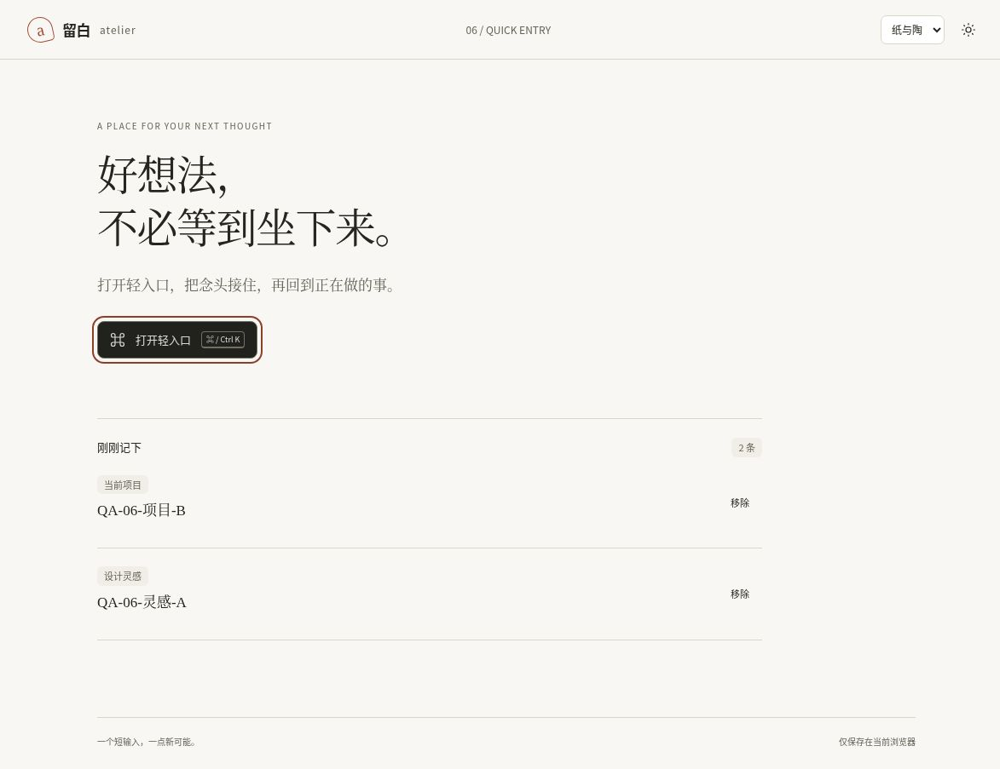

# 轻入口：记下以后，刷新还在吗？

2026-10-15 08:52:24–08:53:41 UTC，自有云端Chrome，[固定版本f240c99](https://htmlpreview.github.io/?https://github.com/aiyinyuedejustin/agent-engineering-fundamentals/blob/f240c99f7abcbda760b12eea5dafbb0fa6b91f86/books/claude-app/01-Frontend-Design-And-HTML-Templates/templates/06-floating-launcher-template.html)。视口1188×761 CSS px，DPR 1，页面内容宽1173 CSS px；浅色paper配色。本次只使用两条合成记录。

## 保存位置、顺序与刷新恢复

1. 开始时记录区为0条。输入「QA-06-灵感-A」，选择「设计灵感」，按Enter；面板关闭，记录区显示1条及正确标签。
2. 正常刷新，关闭自动打开的面板：A仍为1条，文字和「设计灵感」标签不变。
3. 输入「QA-06-项目-B」，选择「当前项目」并按Enter：B在上、A在下，共2条，两个位置标签正确。
4. 通过A的移除按钮删除A，再正常刷新：仅B保留，标签仍为「当前项目」。
5. 通过页面移除B并再次刷新：恢复0条。最终焦点在「打开轻入口」，本次合成记录已清理。

截图原始尺寸1173×903像素，不等于视口尺寸；它证明上述两条记录的可见状态，不能单独证明刷新恢复。[逐步DOM摘要与环境记录](../../04-Extracted-Core-Code-And-Scripts/evidence/data/launcher-browser-review.json)保留七个检查点。

## 存储边界与未覆盖项

页面使用localStorage键`atelier-captures`。在同一浏览器上下文内，`htmlpreview.github.io`源上的预览共享此键；不同仓库路径、提交或查询参数不构成存储隔离。本次开始时记录区为空，没有清空既有记录；只通过页面新增与移除合成记录，未直接改写底层存储。

本次证明这条Chrome桌面HTTPS路径中的保存、标签、两条记录顺序、刷新恢复与移除持久化。没有验证八条上限、损坏存储、存储拒绝或容量满，也不代表无痕模式、file://、离线、跨设备同步、真实输入法或辅助技术已经验收。既有jsdom检查与这次浏览器观察分别计数。

[返回六模板](README.md) · [验收清单](QA-CHECKLIST.md)
