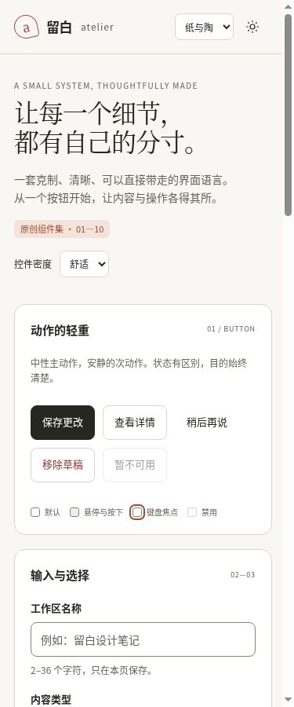
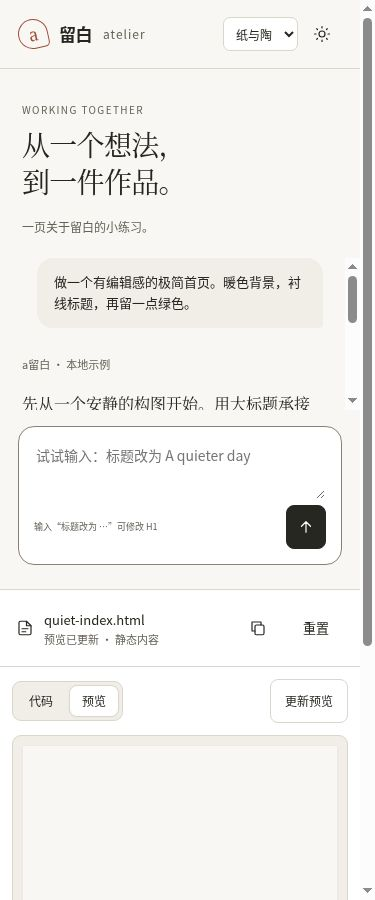
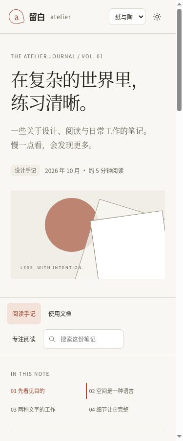

# 六份模板缩窄以后，哪些关系还成立？

这里记录六份原创模板在普通浏览器中的窄容器表现。内容框设为375 × 900 CSS px，截图直接截取iframe区域；不是生成图，也没有把宽屏画面缩小冒充窄屏。

## 先看实景

| 组件图谱 | 对话工作台 |
|---|---|
|  |  |

| 代码与预览 | 博客与文档 |
|---|---|
|  |  |

| 设置与概览 | Quick Entry |
|---|---|
|  |  |

截图是各模板的初始顶部。03在窄容器中上下堆叠，作品区需要继续向下滚动；01、04、05也保留自己的纵向内容，不把整页压缩进一张截图。

## 看图时值得留意的几处

- **组件图谱**：按钮自然换行，卡片与控件仍有明确的外内边界。
- **对话工作台**：阅读区滚动，输入面保持在底部；导航收成抽屉，正文没有被侧栏挤窄。
- **代码与预览**：窄容器采用上下关系，仍保留代码/预览切换和独立的静态作品区。
- **博客与文档**：目录变成紧凑的两列，编辑式大标题和抽象构图继续保留。
- **设置与概览**：指标卡纵向排列，保存操作留在可见位置。
- **Quick Entry**：弹层在窄宽度下保留输入、选择位置、命令列表和关闭动作。

这些是本组原创模板的实现选择，不代表 Claude 官方移动端的布局。

## 三档宽度的测量

在每份模板的基础视图测量375、768、1024 CSS px内容框，固定高度900。下表记录子文档的`documentElement.clientWidth`；存在经典垂直滚动条的页面会少15px，这不是图片缩放。

| 模板 | 框宽375 | 框宽768 | 框宽1024 | scrollWidth 与 clientWidth |
|---|---:|---:|---:|---|
| 01 | 360 | 753 | 1009 | 三档均相等 |
| 02 | 375 | 768 | 1024 | 三档均相等 |
| 03 | 360 | 753 | 1024 | 三档均相等 |
| 04 | 360 | 753 | 1009 | 三档均相等 |
| 05 | 360 | 753 | 1009 | 三档均相等 |
| 06 | 375 | 768 | 1024 | 三档均相等 |

18组基础视图测量均未出现根文档横向溢出。02同时保留一段合成草稿，用来核对改宽度时没有重载。这个结果不代替每个内部滚动区、所有文本长度和全部交互状态的布局检查；375px六份实景另经目视检查。

## 同时做了哪些本地交互

| 模板 | 直接观察到的结果 |
|---|---|
| 01 | 浅深主题切换生效；存储被拒绝时出现对应提示 |
| 02 | 输入的合成草稿在三档宽度之间保留；打开导航抽屉后关闭，焦点回到展开按钮 |
| 03 | 无文字CSS色块形成120×120布局；空输入被拒绝，切回预览后原色块尺寸仍保留 |
| 04 | 切换到使用文档后，选中态与对应内容同时变化 |
| 05 | 示例周期从7天改为30天，合成笔记计数由24变为92 |
| 06 | 查询后命令列表更新，选择切换主题命令后进入深色 |

以上只涉及模板中的演示数据。没有提交表单到外部服务，没有运行产品安装包。

## 可复核入口

- [在线打开这次实测的固定版本](https://htmlpreview.github.io/?https://github.com/aiyinyuedejustin/agent-engineering-fundamentals/blob/bc1674f59edf3e41aaa2869a695b077e496a75d5/books/claude-app/01-Frontend-Design-And-HTML-Templates/templates/narrow-layout-lab/fixture.html)
- [机器可读尺寸与交互记录](browser-results.json)
- [源集合与六文件摘要](source-lock.json) · [构建与测试合同](README.md)

记录日期为2026-10-15。环境为云端Chrome，外层视口1173×761 CSS px；截图按文档坐标截取375×900的iframe内容区域。固定源集合为`be68a58fb3ae9e3ec2a0c6b27b4c1351220e23e2fc1273e283aa2182031dc945`，实测提交为`bc1674f59edf3e41aaa2869a695b077e496a75d5`。

外层iframe只有`allow-scripts`，没有同源、表单或存储权限。此记录支持上述布局与选定交互，不涵盖持久化、剪贴板、独立页面导航、移动设备、触摸、IME、200%缩放或完整辅助技术验收；固定脚本能执行也不等于CSP全部防线已验证。
