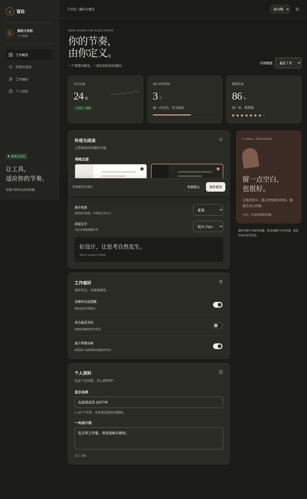
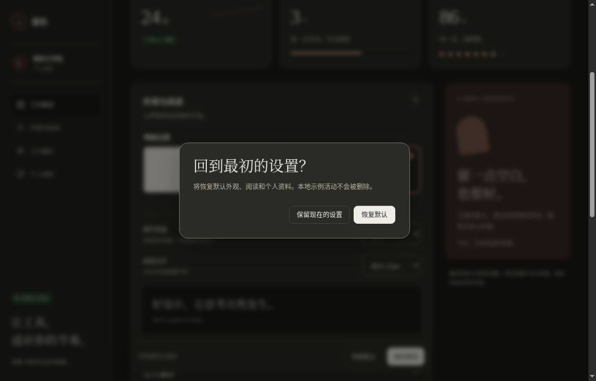

# 设置页：保存、恢复与控件密度

本页验证六模板中的05设置与概览。2026-10-15，自有云端Chrome，视口1188×761 CSS px，[固定版本在线页面](https://htmlpreview.github.io/?https://github.com/aiyinyuedejustin/agent-engineering-fundamentals/blob/f240c99f7abcbda760b12eea5dafbb0fa6b91f86/books/claude-app/01-Frontend-Design-And-HTML-Templates/templates/05-settings-and-dashboard-template.html)。该版本HTML与本次检查时main的文件blob一致；全部数据为本地原创演示值。

## 保存后刷新，确认恢复的是同一组偏好

先选择深色、紧凑控件和21px阅读文字，再隐藏最近活动、启用减少界面动画，并填入合成名称。保存后正常刷新，六类偏好和名称均恢复。空名称会被拒绝，显示明确错误并把焦点送回字段。

主题、控件密度与阅读字号分别变化：阅读从18px调至21px时，紧凑select的43px高度保持不变；活动隐藏后不再出现在可访问树中，减少动画开关使保存按钮的transition-duration变为0s。

## 重置先确认，取消不丢设置

打开重置对话框时，初始焦点在“保留现在的设置”。取消后偏好不变，焦点回到触发按钮。再次打开并确认，页面恢复light / comfortable / default、默认名称、活动显示与常规动画；再刷新仍保留这些默认值。

## 36px token 为什么会得到43px的输入控件

设计配置的字段叫 `controlMinHeight`。它声明最小高度，不声明最终盒子高度；模板通过 `--ui-control` 设置min-height。

| 控件 | 舒适实高 | 紧凑实高 | 影响最终高度的内容 |
|---|---:|---:|---|
| 密度select | 44px | 43px | 原生normal行高、上下各10px padding、1px边框 |
| 显示名称input | 44.390625px | 42.796875px | 14→13px字体、1.6行高、上下各10px padding、1px边框 |
| 保存button | 44px | 36px | 12px字体、15.6px行高、上下各8px padding、1px边框 |

以紧凑input为例，内容与边框约需13×1.6+20+2=42.8px，超过36px下限，浏览器保留了更高的盒子。这符合min-height合同。select的原生布局还取决于浏览器与系统，不能仅凭token推算其精确实高。

复用时要区分“整体更紧凑”和“所有单行控件统一高度”。后者需要一起设计行高与padding，不能只把min-height改小，也不要为追求数字一致直接固定height而裁掉大字或多行内容。本次未修改六模板CSS。

## 复核范围

[机器记录与完整几何读数](../../04-Extracted-Core-Code-And-Scripts/evidence/data/settings-browser-review.json)包含动作、源身份、尺寸和截图摘要。截图是原始浏览器结果；第一张为全页图，其画布高度不同于视口高度。

持久化发生在HTML Preview的浏览器origin，可能与同origin其他模板共享，不能解释为每个URL各自隔离；结束时已通过界面恢复默认。存储拒绝/容量满、系统级减少动态效果、真实设备/输入法、console、网络以及file://未在本次验证。当前正常刷新成功不替代这些检查。

[返回模板目录](README.md) · [完整验收清单](QA-CHECKLIST.md)
