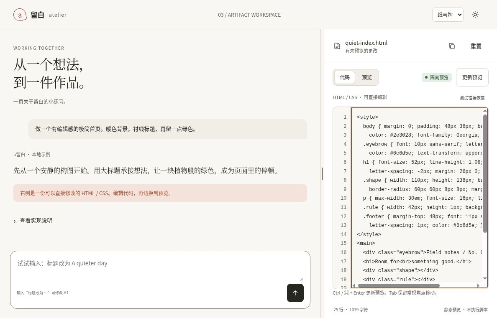

# 作品页：分隔条的边界与释放

2026-10-15 09:04–09:06 UTC，在自有云端 Chrome、1188×761 CSS px、DPR 1 下，检查03作品模板的[固定版本页面](https://htmlpreview.github.io/?https://github.com/aiyinyuedejustin/agent-engineering-fundamentals/blob/f240c99f7abcbda760b12eea5dafbb0fa6b91f86/books/claude-app/01-Frontend-Design-And-HTML-Templates/templates/03-split-artifact-ide-template.html)。普通键盘与鼠标操作均能到达分隔条边界；跨过预览区域拖动后释放，输入与代码编辑仍可使用。

## 实际走过的路径

1. 聚焦左侧输入框后按两次 Tab，焦点到达分隔条，初始比例为38。
2. Home 后再按左键，保持下限25；右键一次变为27。End 后再按右键，保持上限65；左键一次变为63。
3. 将分隔条拖向左边缘，再拖向右边缘并跨过预览区域，比例分别限制在25和65；两次释放后均观察到dragging类已移除。两个边界的文档宽度均为1188px，没有根文档横向溢出。
4. 释放后点击左侧输入框，比例仍为65；再进入代码页，追加原创合成HTML注释，编辑器正常接收输入，状态显示「有未预览的更改」。

这里的25与65是分隔条的比例值，不保证等于整个视口宽度的百分比。两栏还有最小宽度限制，中间分隔条占9px。

## 证据与边界

本次只用普通UI动作与只读DOM观察，没有使用DevTools或网络检测。释放后的移针由点击左侧输入框完成，没有单独做悬停移动测试；也没有独立验证pointercancel、lostpointercapture、触摸或跨浏览器行为。新增注释用于确认编辑恢复，不把它当作新一轮预览渲染验收。

[机器记录](../../04-Extracted-Core-Code-And-Scripts/evidence/data/splitter-browser-review.json)保存观察时间、边界尺寸、原始记录、源码身份与截图校验值。固定浏览器版本中的03文件已通过GitHub提交树核对，与本次本地源码一致。初始值及27、63等补充观察来自实际操作人的记录，与原始DOM记录分别标注。

较早固定入口曾显示空白，随后使用本页链接完成验收；不据此推断浏览器或源码故障。结束时恢复原代码并刷新，比例回到38，随后关闭测试标签页。最终刷新时预览仍在加载，因此不声称已验收该次刷新后的预览完成。

现有代码更新、错误恢复和预览生命周期记录保持原有范围，本页只补充分隔条交互。

[返回模板目录](README.md) · [完整验收清单](QA-CHECKLIST.md)
