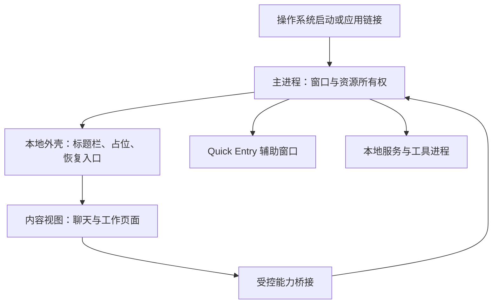
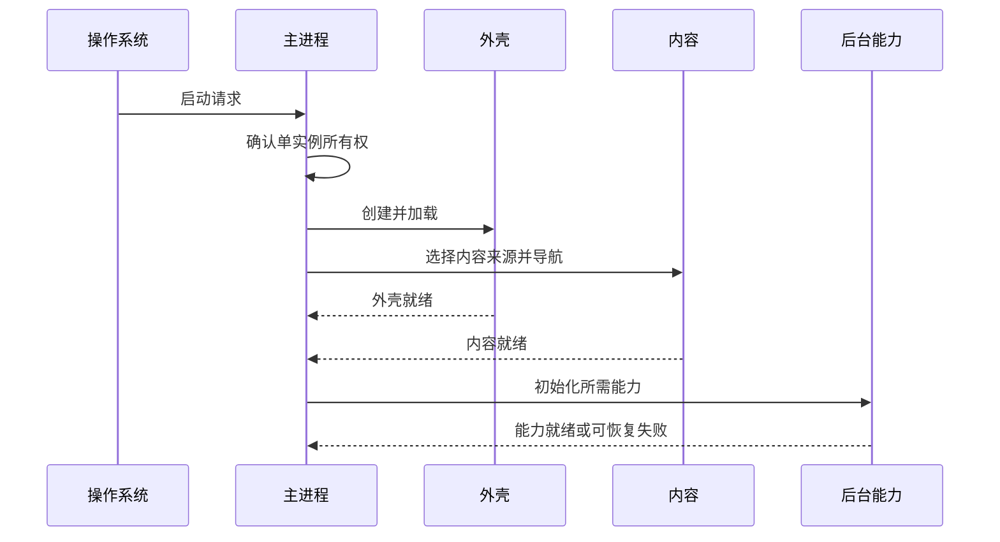
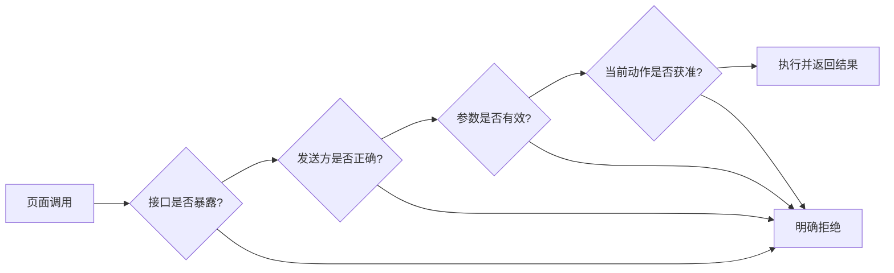
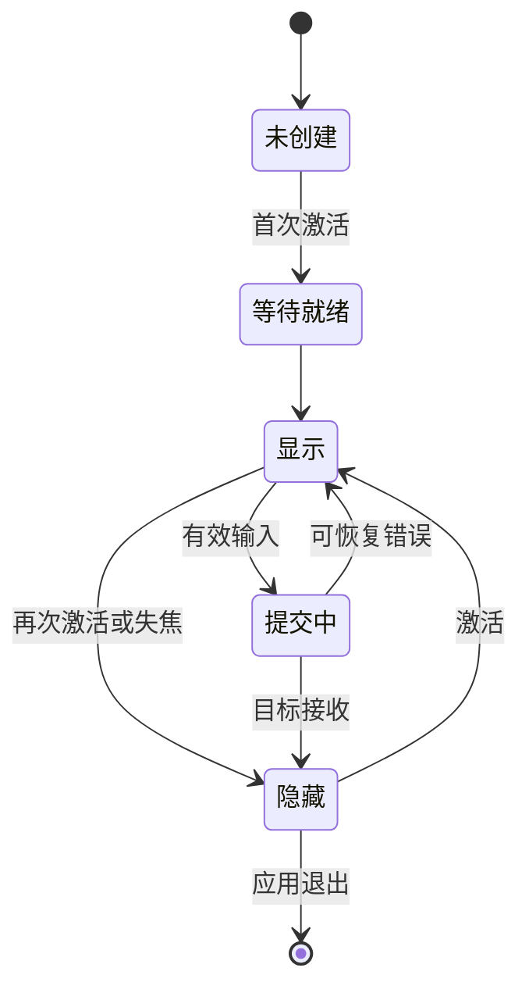

# 第 1 卷 · 系统架构：窗口、内容与能力分别拥有生命周期

Claude Desktop 的主窗口有两层职责：本地外壳管理标题栏、启动占位和加载错误，主内容视图承载聊天与工作页面。理解这两个生命周期，才能解释为什么内容加载失败后，应用仍能提供恢复入口。

版本范围：Desktop 2.37337.1。本文以原创图解和工程模型解释客户端结构；版本与来源记录集中在[证据附录](../../04-Extracted-Core-Code-And-Scripts/evidence/README.md)。

## 1. 外壳与内容分开，故障也能分开处理

Electron 的主进程管理窗口和本地资源。BrowserWindow 是操作系统里的顶层窗口；WebContentsView 是承载网页的视图。容器关系不等于操作系统进程数量。



标准部署加载托管内容；其他部署路线可以加载包内内容。于是，一个桌面包可以同时包含本地界面资源和访问托管页面的代码。研究样式或状态机时，应先确定它属于哪条内容路线。

| 层 | 拥有什么 | 失败后应保留什么 |
|---|---|---|
| 外壳 | 窗口、标题、错误呈现 | 重试、退出、诊断入口 |
| 内容 | 当前页面、对话与编辑状态 | 可恢复的草稿和导航位置 |
| 能力桥 | 类型化请求和订阅 | 明确的拒绝与取消结果 |
| 服务 | 文件、工具连接、子进程 | 可追踪的资源归属与清理结果 |

可复用的设计原则是：恢复入口不应完全依赖正在失败的那份文档。

## 2. 启动完成至少有三个时刻

外壳能响应、内容能操作、后台能力可用，是三个不同事件。单一“启动耗时”会把离线等待、页面加载和工具初始化混在一起。



单实例机制解决状态归属：第二次打开应用可以把请求交给已有实例。窗口显示事件、文档加载事件和业务就绪事件各有含义，不能互相替代。

原创的启动记录模型可以很小：

```js
// 教学实现：记录不同责任层的就绪时间，不运行产品代码。
export function createReadiness(clock = () => performance.now()) {
  const marks = new Map();
  return {
    mark(layer) {
      if (!['shell', 'content', 'capabilities'].includes(layer)) {
        throw new TypeError('未知就绪层');
      }
      if (!marks.has(layer)) marks.set(layer, clock());
    },
    snapshot() { return Object.fromEntries(marks); }
  };
}
```

## 3. 接口可见、消息有效、动作获准是三道门

preload 是页面与主进程之间的桥接脚本。把一个方法暴露给页面，不等于任何页面、任何时刻都能执行对应本地动作。



- 来源身份约束“谁在调用”；参数校验约束“消息长什么样”。
- 业务授权还要考虑窗口、部署、功能状态和具体动作。
- 订阅必须有取消路径，否则隐藏或重建视图会留下旧监听。
- 链接在哪里打开与新页面能调用什么，是两套独立决策。

对于自己的应用，优先暴露窄接口，例如“选择文件并返回授权引用”；避免向页面交出没有边界的通用执行入口。

## 4. Quick Entry：隐藏窗口与提交内容是两回事

Quick Entry 是独立的短交互入口。所见 Electron 路线缓存窗口实例；首次激活创建，再次激活可以隐藏，失焦也可触发收起。显示器变化后，位置恢复需要有回落策略。



这个图是适合独立开发的交互模型。产品的原生与 Electron 路线各有条件；构造尺寸不能直接当成所有平台输入条的最终尺寸。

若快捷入口失败，显示主窗口可以保留“开始输入”的意图，但还需要单独确认草稿是否已经交付。测试应覆盖首次加载时连按快捷键、提交时主窗正在关闭、显示器被拔出三类交界情况。

## 5. 关闭、隐藏和退出应分别命名

主窗关闭行为受托盘偏好与支持探测影响。探测没有明确判为不支持，不等于操作系统里已经出现了可用托盘。因此设计时要避免留下“应用还活着，但用户找不到”的状态。

退出则是一组资源清理任务，而不是一个同步函数：窗口状态、内容视图、辅助窗口、服务和工具进程都需要完成自己的收尾。


所见实现中的清理协调等待与后段退出 watchdog 分属不同阶段。等待期限到了，只说明协调者不再等待，不能推出每项任务都已经取消或释放资源。

## 6. 开发时直接使用的检查表

| 设计问题 | 应写入契约 | 回归测试 |
|---|---|---|
| 谁拥有窗口？ | 创建、隐藏、销毁的唯一归属 | 重复启动不生成冲突状态 |
| 哪一层已经就绪？ | 外壳、内容、能力分别记录 | 内容失败后恢复入口可用 |
| 谁能调用本地能力？ | 来源、参数、业务授权分别校验 | 旧视图与错误来源被拒绝 |
| 谁拥有草稿？ | 显示与交付分别确认 | 快捷入口失败不吞掉输入 |
| 谁负责退出？ | 具名任务、期限、持久化结果 | 一个任务卡住不遮蔽其他结果 |

继续阅读：[状态、恢复与更新](../11-State-Recovery-And-Updates/README.md) · [MCP 宿主](../06-MCP-Host-Internals/README.md) · [版本与跨平台](../12-Versions-And-Cross-Platform/README.md)
