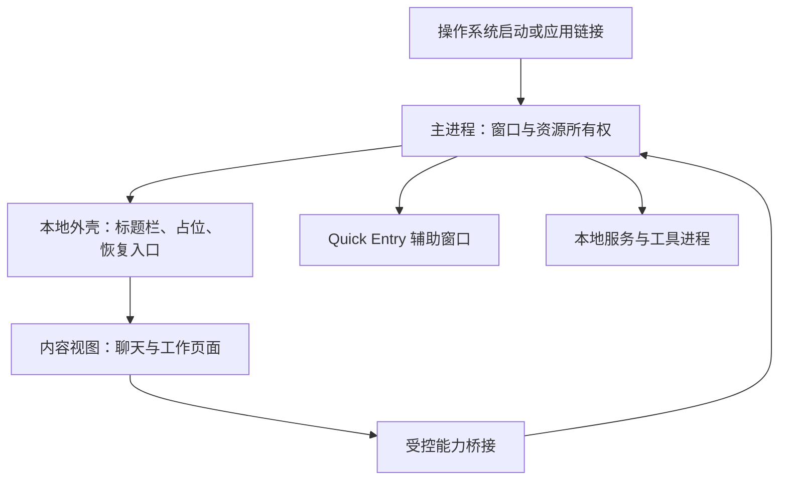
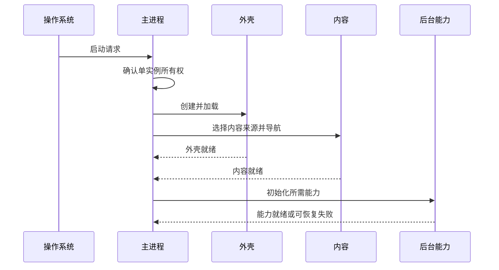
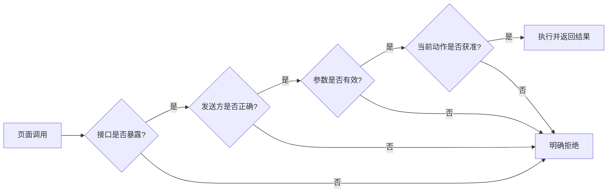
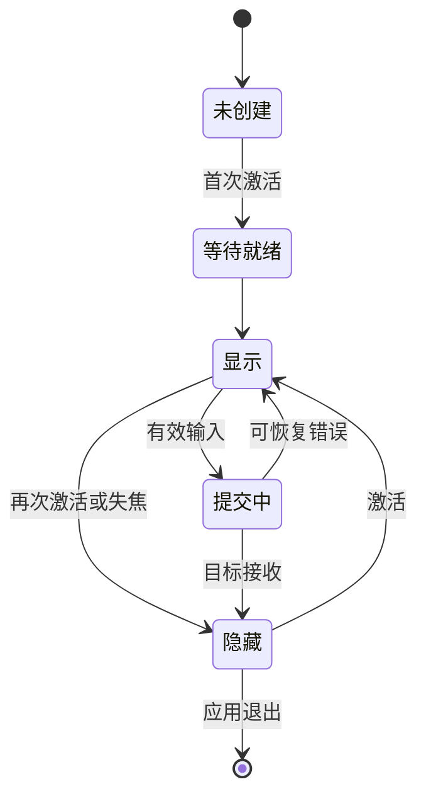
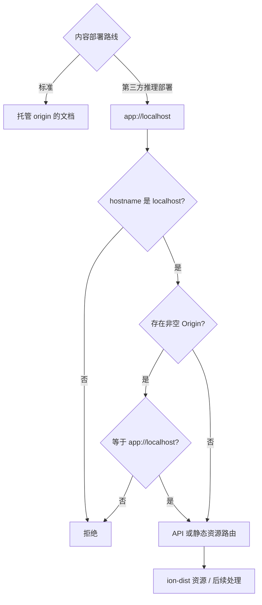

# 第 1 卷 · 系统架构：窗口、内容与能力分别拥有生命周期

Claude Desktop 的主窗口有两层职责：本地外壳管理标题栏、启动占位和加载错误，主内容视图承载聊天与工作页面。理解这两个生命周期，才能解释为什么内容加载失败后，应用仍能提供恢复入口。

版本范围：Desktop 2.37337.1。本文以原创图解和工程模型解释客户端结构；版本与来源记录集中在[证据附录](../../04-Extracted-Core-Code-And-Scripts/evidence/README.md)。

## 1. 外壳与内容分开，故障也能分开处理

Electron 的主进程管理窗口和本地资源。BrowserWindow 是操作系统里的顶层窗口；WebContentsView 是承载网页的视图。容器关系不等于操作系统进程数量。



标准部署加载托管内容；其他部署路线可以加载包内内容。于是，一个桌面包可以同时包含本地界面资源和访问托管页面的代码。研究样式或状态机时，应先确定它属于哪条内容路线。

| 层 | 拥有什么 | 失败后应保留什么 |
|---|---|---|
| 外壳 | 窗口、标题、错误呈现 | 重试、退出、诊断入口 |
| 内容 | 当前页面、对话与编辑状态 | 可恢复的草稿和导航位置 |
| 能力桥 | 类型化请求和订阅 | 明确的拒绝与取消结果 |
| 服务 | 文件、工具连接、子进程 | 可追踪的资源归属与清理结果 |

可复用的设计原则是：恢复入口不应完全依赖正在失败的那份文档。

## 2. 启动应分别记录三种就绪状态

外壳能响应、内容能操作、后台能力可用，是三个不同事件。单一“启动耗时”会把离线等待、页面加载和工具初始化混在一起。下图是原创的就绪记录模型，用于区分各层的测量点；箭头顺序不代表产品必须串行完成这些阶段。



单实例机制解决状态归属：第二次打开应用可以把请求交给已有实例。窗口显示事件、文档加载事件和业务就绪事件各有含义，不能互相替代。

原创的启动记录模型可以很小：

```js
// 教学实现：记录不同责任层的就绪时间，不运行产品代码。
export function createReadiness(clock = () => performance.now()) {
  const marks = new Map();
  return {
    mark(layer) {
      if (!['shell', 'content', 'capabilities'].includes(layer)) {
        throw new TypeError('未知就绪层');
      }
      if (!marks.has(layer)) marks.set(layer, clock());
    },
    snapshot() { return Object.fromEntries(marks); }
  };
}
```

## 3. 本地调用要分别检查暴露、来源、参数与授权

preload 是页面与主进程之间的桥接脚本。把一个方法暴露给页面，不等于任何页面、任何时刻都能执行对应本地动作。下图把接口暴露、发送方身份、参数校验与业务授权整理成一条原创设计流水线。样本中各接收端的实际检查位置见[第 6 节](#6-把桌面壳拆成可定位的对象)，不能由这张总图推定所有接口都按同一顺序经过全部检查。



- 来源身份约束“谁在调用”；参数校验约束“消息长什么样”。
- 业务授权还要考虑窗口、部署、功能状态和具体动作。
- 订阅必须有取消路径，否则隐藏或重建视图会留下旧监听。
- 链接在哪里打开与新页面能调用什么，是两套独立决策。

对于自己的应用，优先暴露窄接口，例如“选择文件并返回授权引用”；避免向页面交出没有边界的通用执行入口。

## 4. Quick Entry：隐藏窗口与提交内容是两回事

Quick Entry 是独立的短交互入口。所见 Electron 路线缓存窗口实例；首次激活创建，再次激活可以隐藏，失焦也可触发收起。显示器变化后，位置恢复需要有回落策略。



这个图是适合独立开发的交互模型。产品的原生与 Electron 路线各有条件；构造尺寸不能直接当成所有平台输入条的最终尺寸。

若快捷入口失败，显示主窗口可以保留“开始输入”的意图，但还需要单独确认草稿是否已经交付。测试应覆盖首次加载时连按快捷键、提交时主窗正在关闭、显示器被拔出三类交界情况。

## 5. 关闭、隐藏和退出应分别命名

在所检关闭分支中，托盘偏好关闭，或支持探测明确判为 unsupported，会请求退出；其余情况走隐藏主窗。Wayland 探测的 null 或约 500ms 超时路径也可能没有被归为 unsupported，因而继续隐藏。请求退出之后还有独立的清理协调流程。[SH-22 分支记录](../../04-Extracted-Core-Code-And-Scripts/evidence/data/shell-architecture.json)

主窗关闭行为受托盘偏好与支持探测影响。探测没有明确判为不支持，不等于操作系统里已经出现了可用托盘。因此设计时要避免留下“应用还活着，但用户找不到”的状态。

退出则是一组资源清理任务，而不是一个同步函数：窗口状态、内容视图、辅助窗口、服务和工具进程都需要完成自己的收尾。


所见实现中的清理协调等待与后段退出 watchdog 分属不同阶段。等待期限到了，只说明协调者不再等待，不能推出每项任务都已经取消或释放资源。

## 6. 把“桌面壳”拆成可定位的对象

同一个应用图标下面，至少要区分容器、文档、preload 和能力端点。它们之间并非一一对应：一个窗口可以拥有多个内容视图，一个内容视图的导航又可以替换文档而保留容器。

| 对象 | 固定样本中的关系 | 开发时容易误判的地方 |
|---|---|---|
| 主窗口外壳 | BrowserWindow 加载本地 HTML，并使用自己的 preload | 主窗出现不代表聊天页面已经可用 |
| 主内容视图 | WebContentsView 加入主窗口 contentView；使用另一份 preload | 把外壳与内容当成同一个 DOM 或同一组桥接能力 |
| 页内查找 | 独立子 WebContentsView 加本地 HTML | 误以为它只是聊天页面中的一个浮层 |
| About | 独立 BrowserWindow 加本地 HTML | 把小窗口生命周期绑在一次聊天导航上 |
| Quick Entry | Electron 路线有独立窗口、preload、HTML；另有原生覆盖层路线 | 将一个平台的窗口参数当作所有平台的统一规格 |

关系来自 [SH-03–05、17–20、28](../../04-Extracted-Core-Code-And-Scripts/evidence/data/shell-architecture.json)。这些对象名解释所有权，不用于推算实际 renderer 进程数量；站点隔离与 Chromium 的进程分配是另一层问题。

### 两种内容来源，改变的是部署边界

标准路线的内容地址来自注入的 origin，生产默认指向 claude.ai；第三方推理部署路线使用 app://localhost，并把本地协议绑定到 ion-dist。外壳仍可负责窗口与恢复，但内容从哪里加载、何时更新、使用哪组资源，已经不同。[SH-06–08](../../04-Extracted-Core-Code-And-Scripts/evidence/data/shell-architecture.json)



图中的 Origin 判断保留了一个重要条件：缺少该 header 不会被这一条件拒绝。它既不是“所有请求都通过同源认证”，也不能单独说明下游缺少授权。静态 HTML 响应另有内容安全策略；协议入口、资源寻址、接口权限仍应分别检查。

这也解释了为什么升级安装包与更新托管页面是两个不同动作。排查样式或接口变化时，需要记录“壳版本 + 内容来源 + 页面版本”，仅保留桌面版本号会把不同实验对象混在一起。

### 身份校验应落到真正收消息的位置

包内的具名桥接经 contextBridge 暴露；claude.web 路线在 preload 检查顶层 frame 和允许的 origin。主进程端又把 IPC 工厂绑定到具体 webContents.ipc，并检查 sender 与参数。部分返回值也经过校验。本地 UI 有另一组 namespace 与顶层 senderFrame 检查。[SH-12–15](../../04-Extracted-Core-Code-And-Scripts/evidence/data/shell-architecture.json)

把身份检查只写在页面按钮旁边，页面一旦被替换或绕过按钮就失去约束。这里更有价值的结构是：接收端知道请求属于哪个 WebContents；参数规则与业务授权继续在后面执行。开发环境允许 localhost 或开发域名还要满足对应开关，不能把域名字符串出现解释成默认放行。

导航也有三条入口：普通导航、重定向和 window.open。样本分别路由这些行为，创建子窗口时核对 opener 为主 frame。[SH-16](../../04-Extracted-Core-Code-And-Scripts/evidence/data/shell-architecture.json) 外链打开策略没有自动赋予新页面主窗的本地能力。

## 7. 两个小实验，抓住生命周期的硬边界

[导航与退出实验](../../04-Extracted-Core-Code-And-Scripts/shell-lifecycle/README.md)提供可直接运行的原创模型与 12 项测试。它们把本章的原则变成明确的输入、状态和验收结果。

### 实验 A：旧页面成功晚于新页面失败

先导航 A，再导航 B。B 先失败并显示恢复入口，随后 A 的成功回调才到。若只有一个全局 loading 布尔值，A 可能把 B 的错误清掉。模型让每次导航持有自己的 ticket，结算时核对 ticket 的对象身份；旧 ticket、伪造同值 ticket、重复结算和销毁后的回调全部失效。

```js
const page = new NavigationOwner();
const old = page.begin('page-a');
const current = page.begin('page-b');
page.settle(current, { ok: false, error: 'offline' });
page.settle(old, { ok: true }); // false：不能改写 page-b 的失败状态
```

实际接入 Electron 时，ticket 需要与导航事件、监听取消和窗口销毁一起管理。只检查 URL 不够：两次导航到同一 URL 也可能属于不同文档。

### 实验 B：退出到期与资源释放分开

一个清理项成功、一个抛错、一个永不返回。协调者需要继续记录前两者，并在期限到达后明确列出仍 pending 的任务。不能把 pending 改成 fulfilled，也不能让一个 rejection 跳过 store flush。

所见产品先并发结算具名任务，设置约 75 秒协调等待，再进行 store 收尾；打包模式的后段 watchdog 为约 15 秒，两者处于不同阶段。[SH-24–25](../../04-Extracted-Core-Code-And-Scripts/evidence/data/shell-architecture.json) 因此它不是“整个退出流程最多 15 秒”的承诺。

原创模型返回独立快照：报告交付以后，晚完成任务不会悄悄改写报告中的 pending；持久化结果单独记录。它还特意让 flush 成为独立阶段，便于测试“清理期限已经到达，但落盘仍未结束”。真正强制停止进程应由外层监督机制承担，不能由 Promise.race 的获胜分支代替。

## 8. 开发时直接使用的检查表

| 设计问题 | 应写入契约 | 回归测试 |
|---|---|---|
| 谁拥有窗口？ | 创建、隐藏、销毁的唯一归属 | 重复启动不生成冲突状态 |
| 哪一层已经就绪？ | 外壳、内容、能力分别记录 | 内容失败后恢复入口可用 |
| 谁能调用本地能力？ | 来源、参数、业务授权分别校验 | 旧视图与错误来源被拒绝 |
| 谁拥有草稿？ | 显示与交付分别确认 | 快捷入口失败不吞掉输入 |
| 谁负责退出？ | 具名任务、期限、持久化结果 | 一个任务卡住不遮蔽其他结果 |

继续阅读：[状态、恢复与更新](../17-State-Recovery-And-Updates/README.md) · [MCP 宿主](../06-MCP-Host-Internals/README.md) · [版本与跨平台](../18-Versions-And-Cross-Platform/README.md)

## 网络请求由谁负责

[网络分层补篇](network-ownership/README.md)：bridge 双 transport、MCP 子进程环境、预览专用 Session；用同一个请求失败，区分不同的代理、证书与重试边界。
