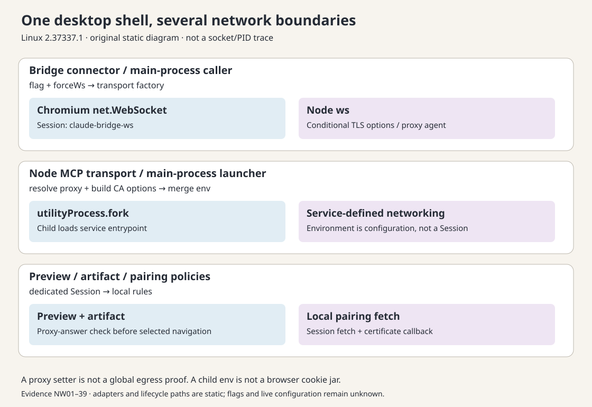

# 同一个桌面主进程，也可能有不同的网络所有者

一个桌面应用可以同时使用 Chromium 网络栈、Node WebSocket 和工具子进程自己的 HTTP 库。代理、证书、cookies 和重试因此各有归属；定位网络故障，第一步是找到实际调用路径。

本篇分析 Claude Desktop Linux amd64 2.37337.1 的静态调用结构，分为 bridge 双实现、子进程配置转换、专用 Session 策略三部分。[样本与定位附录](EVIDENCE-APPENDIX.md)记录核验方法。

先约定几个名称：bridge 指本篇追踪的主进程 WebSocket 连接器；transport 指它选择的网络传输实现；Electron Session 是管理浏览器网络会话与配置的对象，与 Agent 会话不是同一个概念。下文的 CA 指证书颁发机构及相关受信任证书，STT 指语音转文字。排查时先确定请求由谁发出，再寻找该请求实际采用的配置。



## 1. Bridge 的业务调用者没有变，网络实现可以换

主入口加载的主进程 chunk 同时导入 Electron 与 Node `ws`。工厂 `zer` 在 `forceWs` 为真或特性开关未打开时构造 Node `ws`；否则构造 Electron `net.WebSocket`。[NW01–08、33]

| 路径 | 代码中的网络对象 | 所见配置边界 |
|---|---|---|
| bridge 的 Electron 分支 | `net.WebSocket` | `session.fromPartition("claude-bridge-ws")`；`useSessionCookies: false`；显式 headers |
| bridge 的 Node 分支 | `ws` | 对 wss URL 构造 CA 选项与 `rejectUnauthorized: true`；有 HTTP(S) 代理时构造 `HttpsProxyAgent` |
| 主进程 STT helper | 动态导入 `ws` | 调用同一 CA/代理 helper；另有显式 Cookie/User-Agent/Origin headers |
| 所选 remote MCP tool helper | Electron `net.fetch` | 请求自己的 timeout/AbortController 与显式身份 headers；不能由 MCP 这个名称推断它跑在工具子进程 |

Electron 文档说明 `net.fetch` 使用 Chromium 网络实现，默认来自 default Session；它不同于 Node 的全局 fetch。`net.WebSocket` 是主进程入口到 Chromium 网络实现的 API。这里只把当前文档用作概念解释，不反推出样本所用 Electron 版本。[Electron net](https://www.electronjs.org/docs/latest/api/net)

`useSessionCookies: false` 的字面配置不能概括为“没有认证”，因为 headers 仍可显式传入。STT 的另一路 `ws` 还会显式设置 Cookie。两个调用点已经足以否定“全部 WebSocket 都继承同一浏览器 cookie jar”的概括，但不能枚举产品所有连接。[NW06、30–31]

### 切换不是直接给旧 socket 换一个字段

所选连接器启动时订阅 transport flag，回调到 `applyTransportFlag`；新 socket 接线后也再次检查期望 transport。[NW09–10]

仅在存在 socket 且期望 transport 与其不同时进入以下分支；没有 socket 或 transport 相同时，这个回调不重置连接。

- 当前 socket 未认证或未打开：调用 `resetSocket`，归零 reconnectAttempts，安排 planned reconnect。
- 已认证且打开：转入 `rotateOrDrain`。没有 in-flight 调用时直接 rotate；否则标记待轮换并设置有上限的 drain timer。已有 afterDrain、rotatePending 或 drainTimer 时，不再添加第二次轮换。
- `rotate` 再检查 closing/authenticated/readyState，调用 reset，再安排 planned reconnect。
- `resetSocket` 清理若干定时器与状态，尝试 `close()`，随后把持有的 socket 设为 null。[NW11–13]

这证明了可追踪的轮换路径；不证明底层旧连接已同步消失，也不证明并发回调永远不可能竞争。Node adapter 在未打开时用 terminate，而 Electron adapter 调用 close；二者 API 能力不同，协议 ping 支持也由 adapter 单独表示。选定连接器存在 host 配置时会强制 Node 分支。另一个明确回退发生在握手协议版本小于 1 且 adapter 不支持 protocol ping 时：连接器在标记 authenticated 之前设置 forceWsTransport，reset 并安排 planned reconnect。因此即使没有 host，flag 也不是覆盖所有 bridge 的总开关。[NW34–35]

## 2. MCP utility process 接收的是配置快照，不是 Electron Session

所选 Node MCP transport 的 start 路径调用 `I9e`，由后者构造 env，再调用 `utilityProcess.fork(nodeHostPath, ...)`。nodeHost 接入 MessagePort 后动态加载所选服务入口。[NW14–18]

构造过程可分为三步：

1. 解析启动时固定代理，或向 Electron default Session 查询目标的代理答案。HTTP(S) 结果转成 `HTTPS_PROXY`、`HTTP_PROXY`、`NO_PROXY`。解析器会跳过不支持的 SOCKS 项，仍可能选择后面的 HTTP 项。它表示的 trailing DIRECT 并未被原样编码为一份 PAC 程序，env 转换只输出所选 URL 与固定 NO_PROXY。指定 fallback 目标还有缓存：后续得到 direct、不支持或不可用的答案时，可能保留先前缓存的 HTTP 代理。因此结果不总是最新解析答案，也不能写成支持全部 PAC/代理形态。[NW27–29、39]
2. CA helper 尝试合并默认、系统及额外 CA，产生 bundle 路径。N9e 在 bundle 缺失时提供 `NODE_USE_SYSTEM_CA`，存在时提供 `NODE_EXTRA_CA_CERTS`；但 utility fork 包装 I9e 先补入父环境的额外 CA 候选，再展开仅用已预热结果的 N9e，最后总是提供 `NODE_USE_SYSTEM_CA` 的父值或默认值。因此最终 env 可同时存在这两个变量；N9e 得到的 bundle 候选会覆盖父环境额外 CA 候选，然后才执行 caller 优先的合并。[NW14、16、36]
3. 合并 helper 保留调用者已定义的值，空字符串也算已提供。Linux 检查原名与小写名，不把任意混合大小写都视为等价；Windows 分支另做不区分大小写比较。最终 env 传入 fork。[NW15–17]

这是“Electron 配置 → 子进程环境变量”的转换，不是共享浏览器 Session 的证明。服务实际采用哪种 HTTP 库、是否解释这些环境变量、启动后能否热更新，取决于服务运行时。

对于 Node bridge 的 CA/代理 helper，非 wss URL 直接返回；wss 路径也可能没有自定义 CA，没有代理答案时没有 agent。构造代理 agent 失败时返回已有 TLS 选项，而不是在该 helper 内硬失败。这是局部 fallback 事实，不能写成“所有受管流量一定经过指定代理”。[NW08]

## 3. 专用 Session 的局部策略：配对与预览不能混成全局开关

### 配对控制面

`local-pairing` Session 以 cache false 创建，配对配置把专用 fetch helper 传入调用者。该 helper 使用 `ses.fetch`，配置 credentials omit、redirect error、no-store 和超时。证书回调拒绝已经有验证错误的证书，返回 -3 的分支沿用 Chromium 验证结果，而不是 callback(0) 强制接受。样本内所见 pin 数组初始为空，只有读取引用；不能把比较 SPKI 的代码分支当作已启用证书 pinning。[NW25–26；Electron session](https://www.electronjs.org/docs/latest/api/session)

### Artifact 与文件预览

所见封网 helper 对传入 Session 设置固定无效代理目标，并移除 loopback 的隐式 bypass；随后轮询 `resolveProxy`，检查结果是否等于预期代理字符串。这个检查不是发出业务网络请求，也不是测量任意协议的实际不可达性。[NW19–20]

调用者分别是 `persist:cowork-file-preview`，以及带后缀的 `persist:cowork-artifact…` Session。文件预览的显示/导航路径会 await 检查，失败返回 preview_network_open；artifact 协议 handler 也在失败时返回 Response.error。初始化时另有不等待的调用，不能只看初始化 setter 就推出完整安全保证。[NW21–24]

封网 helper 不是 artifact 策略的全部。artifact 还注册 request filter，仅允许其自定义 scheme 与精确库 URL 白名单，并拒绝权限请求。HTTPS handler 将白名单 URL 映射到包内 resources/artifact-libs，再通过 file URL 读取。因此这些表面上的 HTTPS 库地址不必产生远程 HTTP 请求；这仅解释所选 handler，不能泛化所有 HTTPS 请求。[NW37–38]

官方文档提醒，更改代理设置后，已有连接池可能仍需关闭连接以避免复用旧路径。所见 helper 没有在自身内调用 closeAllConnections；连接池复用和协议覆盖需要单独测试。这里的静态边界是专用分区的配置、代理答案验证与调用者拒绝路径。[Electron session.setProxy](https://www.electronjs.org/docs/latest/api/session#sessetproxyconfig)

## 4. 调试时先问哪一层拥有失败

| 问题 | 应定位的层 | 不应直接借用的结论 |
|---|---|---|
| bridge 断线重连 | connector + 当前 adapter | 第 16 卷聊天 completion 的 retry budget |
| 远程 MCP HTTP 失败 | 所选主进程 fetch helper | 本地 MCP utility process 是否退出 |
| MCP 服务代理不符 | env 构造与服务库解释 | Electron 页面当前能联网 |
| 预览被拒绝 | 专用 Session 策略验证与导航前检查 | 用户账户的默认 Session 已断网 |
| 证书错误 | 当前 Session 或 Node TLS options | 应用只有一份全局信任配置 |

重试同样分层。所选事件上报 helper 自己循环 net.fetch，bridge 有 reconnectAttempts，聊天 completion 又有第 16 卷已研究的预算。这些不构成一份可以直接相加的“全局重试次数”。[NW32]

## 5. 原创最小示意：把网络配置与业务动作分开

下面仅表达接口边界，不是目标源码复刻或可运行联网工具：

```js
function describeRoute(kind) {
  if (kind === 'bridge-chromium')
    return { owner: 'main', stack: 'chromium', scope: 'bridge-session' };
  if (kind === 'bridge-node')
    return { owner: 'main', stack: 'node-ws', scope: 'explicit-tls-agent' };
  if (kind === 'tool-child')
    return { owner: 'utility', stack: 'service-defined', scope: 'spawn-env' };
  throw new Error('Route must be named before diagnosing it');
}
```

这不是产品全部流量图。它提示测试应该记录 route/owner/session/attempt 的身份，而不是只记录一句 network error。

[返回整体架构](../README.md) · [样本与定位附录](EVIDENCE-APPENDIX.md)
