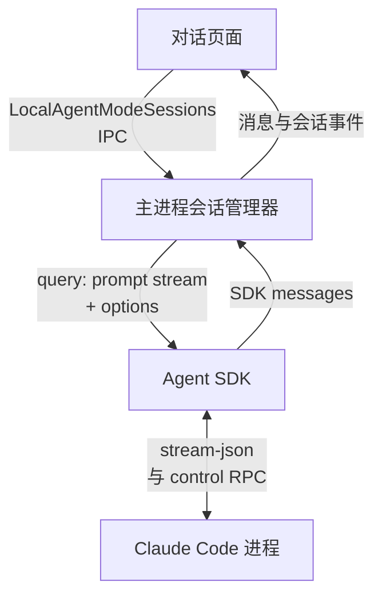
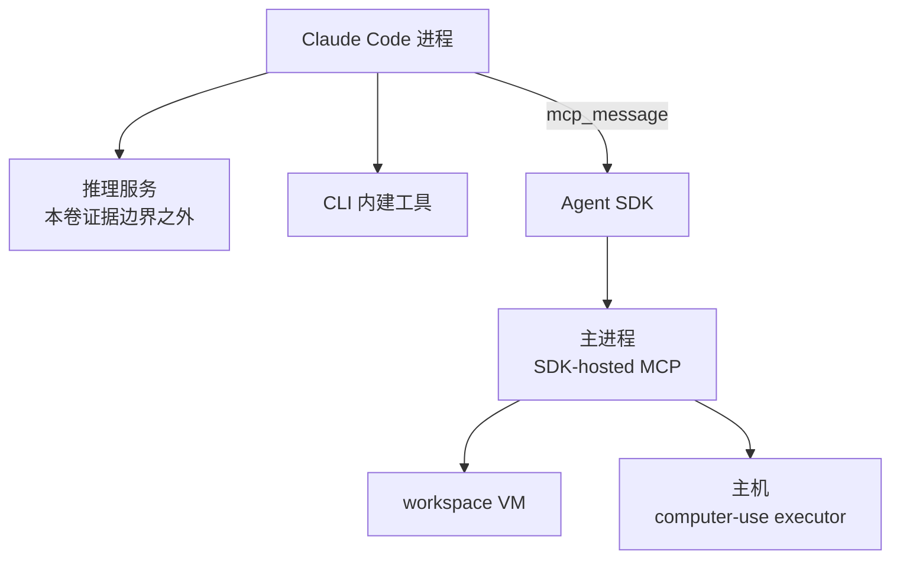
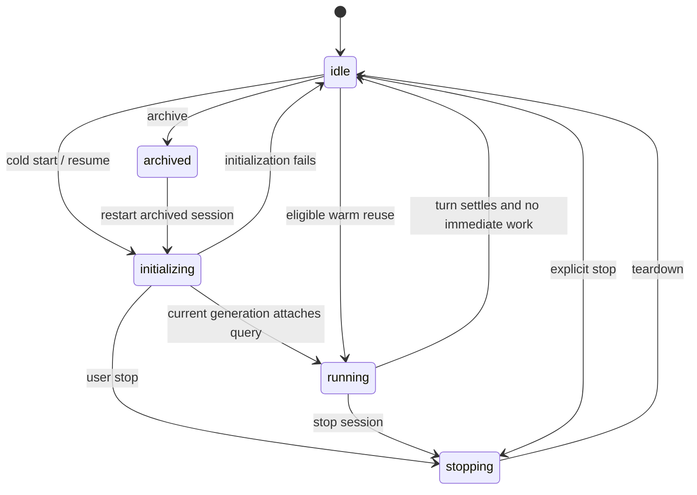
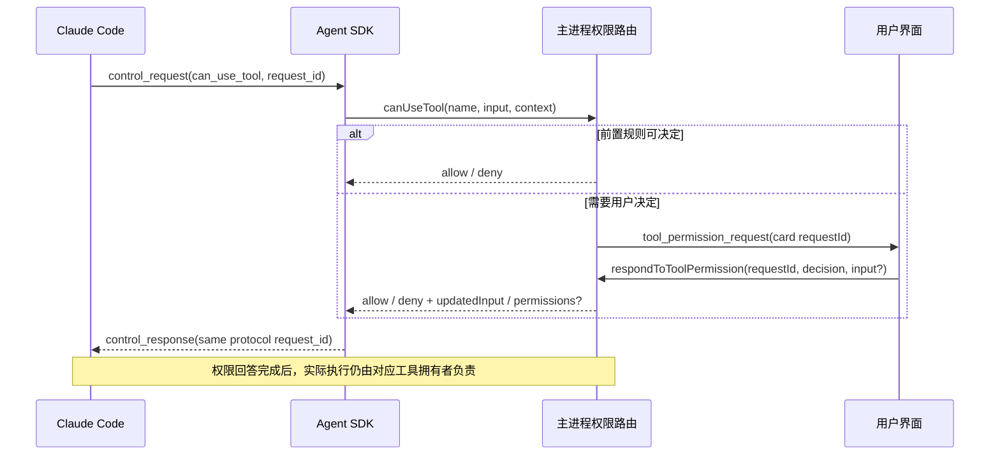

# Vol. 2 · AgentLoopEngine：把一次任务拆成可管理的回合

Claude Desktop 的本地代理由四层协作：页面发起会话，主进程管理会话与权限，Agent SDK 搬运双向消息，Claude Code 进程执行代理工作。主进程同时为一部分工具提供 MCP server，所以有些工具执行又会从 CLI 回到主进程。

本卷以 Linux amd64 2.37337.1 客户端为范围，用 AgentLoopEngine 解释这个协作层，并非原始类名；服务器生成逻辑不在此范围。版本与证据见[附录](#附录)。[AL-01]

## 1. 先画执行边界，再画循环

先看四层会话主链，再看工具执行路由。两图中的 Agent SDK 与 Claude Code 进程是同一组组件的两个视角，不是两套实例。

**会话主链：四层之间的双向消息**



**工具执行路由：CLI 内建工具与 SDK-hosted MCP**



这里有三个容易混淆的动作。

- 授权：`can_use_tool` 问主进程一个操作是否允许。回答是 allow/deny，以及允许时使用的输入和可选权限更新。
- 执行：CLI 自己运行内建工具，或者用 MCP 调到另一个执行方。收到授权请求，不表示主进程已经执行了工具。
- 展示：主进程把 SDK 消息投影为会话事件，页面再展示文本、工具记录、审批卡或错误。

原生窗口、CLI 进程与工作目录在哪台机器，是三个独立问题。尤其在 host-loop 模式，文件工具可以直接作用于主机的授权路径，而 Bash 别名仍进入 isolated workspace VM。用一个“本地运行”的标签覆盖它们，会把权限边界讲错。[AL-09..12；CU-17..21]

### 可见层级及其责任

| 层级 | 本次找到的入口 | 已确认的责任 | 不由本层证明的事 |
|---|---|---|---|
| Renderer/preload | `LocalAgentModeSessions.start`、`sendMessage`、`stop`、`respondToToolPermission` | IPC 包装、参数与返回接口 | 工具的实际执行机器 |
| 主进程 Cowork manager | `startSession`、`sendMessage`、`transitionTo`、`setupQueryHandlers` | 会话身份、生命周期、缓冲、授权路由、恢复、清理 | 模型推理实现 |
| Agent SDK | `query({prompt, options})`、Query、ProcessTransport | JSON 行流、控制 RPC、SDK MCP、进程收尾 | CLI 内每种工具的内部实现 |
| CLI/VM/native | spawn adapter、native executor | 接受命令、进程流或原生 API 调用 | 未分析二进制内部的完整隔离保证 |

IPC 的 sender/origin 校验已在外壳卷的 SH-12..15 解释，本卷不重新把“有 IPC”当作“页面可调用任何主机能力”。

## 2. 三种 ID，解决三种竞态

会话对象至少涉及三类身份。

| 身份 | 作用 | 为什么不能合并 |
|---|---|---|
| Desktop `sessionId` | UI、会话表、文件目录、事件路由中的会话身份；新建常见 `local_` 前缀 | 一条 Desktop 会话可冷启动不止一个进程 |
| CLI `session_id` / `cliSessionId` | SDK init 返回后映射到 CLI transcript 与 resume | 真实 CLI ID 在 init 前可能还没有，恢复也可能失败 |
| 消息 `uuid`、授权 `requestId` | 消息去重/在途跟踪，以及一次审批 Promise 的匹配 | 一条会话同时可以有多条消息和多次审批 |

还有一个不向用户展示的重要数值：`initGen`。一次初始化完成后，代码不直接把 query 塞回会话，而是检查当前对象是否仍是启动时的对象、代次是否一致。停止或重新开始后，旧初始化即使更晚完成，也会结束自己的输入流并关闭自己创建的 query，不能把已停止会话重新带到 running。[AL-02；AL-04]

它解决的是典型的异步失效问题：任务 A 的初始化慢，用户停止并发起 B，A 的回调最后返回。如果只有 session ID，没有代次，A 可能覆盖 B。

## 3. 五态生命周期与进程寿命

源码的合法转移表为：

| 当前状态 | 可转移到 |
|---|---|
| idle | initializing、archived、running、stopping |
| initializing | running、idle、stopping |
| running | stopping、idle |
| stopping | idle |
| archived | initializing |

相同状态的重复设置直接返回；不在表内的转移记日志并忽略。[AL-03]



这张图画的是 session 生命周期，不是 OS 进程状态。一次 result 成功后，session 可以变成 idle，但 query 和 inputStream 仍保留。是否保留，要看 idle grace、live workflow、是否为 dispatch child、是否发生错误，以及当前策略是否允许 hold。

下一条消息到来时，暖复用还要检查凭据是否过期、组织/合规状态是否变化。必要时先刷新凭据，再次确认期间进程和会话状态没有变化；不再合格就拆掉旧进程，走 cold resume。把 idle 解释成“CLI 已退出”，会误解后续消息为何没有完整初始化成本。[AL-17..18]

## 4. 一条新消息如何进入执行器

### 4.1 冷启动

可以把可见启动过程读成以下顺序，若干资源准备在内部并行进行：

1. 规范化模型选择，检查 token cap、session ID 形状与碰撞。
2. 确定当前账户和组织；如果启动期间身份变化，拒绝提交新会话。
3. 创建或恢复 session，决定是否需要新的 process name。
4. 建立第一条用户消息，把它放入 UI buffer，发出初始化状态。
5. 解析执行路线，准备授权目录、技能/插件、项目上下文、凭据和 system prompt 所需资料。
6. 组装 SDK options。host-loop 与 VM-loop 在此替换不同的 executable、cwd、spawn adapter、mounts 和工具配置。
7. 调用 SDK query，核对对象身份和 initGen，然后挂上 query/inputStream，转 running。
8. 启动消息消费器，再 enqueue 第一条用户消息，并排出初始化期间积累的新消息。

第一条消息出现在 UI buffer 的时刻，早于 query 已经成功开始运行的时刻。因此“页面看见用户消息”不能作为任务已进入 CLI 的证明。[AL-02；AL-04..09]

### 4.2 初始化期间再发消息

`sendMessage` 检查 session 是否仍在 initializing。如果是，常规消息被存入 `pendingStartMessages`，等待初始化结束。Share-screen 的 trailing content blocks 有另外的保留/拒绝规则，不能简单假设所有附件都与文本一样排队。

暖进程可用时，代码准备附件、提醒和上下文后，把消息 enqueue 到原有 inputStream。若进程已消失，则调用 startSession 恢复。准备过程中还会核对 `_deliberateStopGen`：用户的明确停止若与 token 检查、文件准备或 cold-resume 等待并发发生，这次发送可以被丢弃，而不是停止之后又偷偷发送。[AL-05..06；AL-20]

### 4.3 消息协议的最小形状

下例是按已观察字段重新写的合成例子，不是截取真实会话：

```json
{
  "type": "user",
  "uuid": "synthetic-message-id",
  "session_id": "synthetic-cli-session-id",
  "parent_tool_use_id": null,
  "client_platform": "desktop_app",
  "timestamp": "2026-01-01T00:00:00.000Z",
  "message": {"role": "user", "content": [{"type": "text", "text": "整理测试资料"}]}
}
```

UI 中保存的消息与真正送入 CLI 的消息可能不同：客户端可为后者附上系统提醒、待处理通知、窗口提示或其它上下文。这样的区别应明确命名为“显示记录”和“执行输入”，不要靠一份可变对象同时承担两种语义。[AL-06]

## 5. 权限是一条独立的往返通道

ProcessTransport 为 CLI 设置 stream-json 输入和输出。当配置 `canUseTool` 回调时，还设置 stdio permission prompt 路线。SDK 读取每一条 JSON 行，但不把所有行都当成对话文本。[AL-09..11]

| 消息类别 | SDK 的主要处理 |
|---|---|
| control_response | 按 request ID 完成某个待回复 RPC；暂时无法匹配的响应进入有界缓存 |
| control_request | 根据 subtype 调用权限、hook、SDK MCP、elicitation 等对应入口 |
| control_cancel_request | abort 指定在途控制请求 |
| keep_alive | 不进入普通应用消息流 |
| transcript_mirror | 交给 transcript mirror batcher |
| assistant / user / stream_event / result / system | 按其专门规则继续进入 SDK 的输出 stream |

### 5.1 审批握手



协议的 request ID 与 UI card 的 request ID 不一定是同一个东西。SDK 用协议 ID 管一次 control RPC；主进程的权限 router 可以新建自己的 UUID 管审批卡。两层通过 Promise 的调用关系连接。

主进程的前置路由包括工具类别、组织策略、会话类型、已有批准、浏览器/计算机权限，以及操作是否被升级为必须询问本人。到真正需要卡片时，它记录 toolName、input、suggestions、decisionReason、ownerSessionId 等，并返回待完成的 Promise。[AL-13]

### 5.2 一个回答如何消耗一个请求

| UI decision | 典型返回 | 额外限制 |
|---|---|---|
| deny | `behavior: deny`，可附反馈和 `interrupt: false` | 拒绝工具不必等于停止整个回合 |
| once | `behavior: allow`、`updatedInput` | 一次性分类 |
| always / scheduled | allow，并可能含 `updatedPermissions` | 工具种类、请求来源与组织策略可以剥离长期规则 |
| 未知值 | deny | 不默认放行 |

回应时先取出 pending 项，找不到就不再结算。SDK 也忽略关闭后的请求及同协议 ID 的在途重复投递。取消消息触发 AbortController；会话离开运行态则拒绝该会话仍挂着的审批。这几层共同避免“上一轮的 Allow 落到下一轮”的问题。[AL-14..15；AL-21]

更细的一条主机路径检查还会把允许决定钉在已判断的输入上，或检查 artifact 文件在等待审批期间的身份是否改变。不能因此推导为所有工具都采用完全相同的参数锁定策略。

## 6. 工具结果如何变成用户可见状态

主进程的 query consumer 使用异步迭代器。它先让专用 UI surface 处理可接管的事件，再把 SDK 消息经过转换、VM path context 处理后分流。[AL-16]

- init：建立 Desktop session 与 CLI session 的映射，更新 permissionMode、commands、MCP 状态等。
- stream_event：用于流式增量和首 token 等统计，通过 coalescer 推送，不按同一方式永久追加每一个 delta。
- assistant / user 等非 stream_event：进入 messageBuffer，必要时裁剪；同时进入相应审计/事件流程。
- result：判断本次回合结果，记录 usage、cost、duration、turn count 等可见结果元数据，清理回合级资源。

SDK 内部还维护 runEnded、resultReceived 和 sessionState。对需要双向交互的运行，它收到 result 后可能继续等 session_state_changed=idle；requires_action 会停止 run-end ceiling 的计时。SDK run、Desktop session 与 OS process 是三套相关但不同的寿命。[AL-25]

成功条件不只看 subtype 字符串：代码同时看 `is_error` 与 subtype。result 之后仍有输入流排队消息或在途消息时，消费循环继续。启用 prompt-suggestion gate 且不是 dispatch child 的一条分支会等 5 秒，再转 idle；新消息可打断这个等待。[AL-17]

result 后的资源清理尤其说明了“回合”的意义：CU 锁、隐藏应用、剪贴板暂存、工具统计和当前消息 UUID 属于回合边界，未必与 CLI 进程边界重合。[AL-21]

## 7. 恢复不是重新发送全部历史

cold resume 会把记录的 cliSessionId 传入 SDK。SDK 再把 resume 变成 CLI 启动选项。rewind 有两条分支：有目标消息时使用 `resumeSessionAt` 加 `forkSession`；回到第一条之前时可重新起始而保留工作空间身份。branch 则先复制 transcript 到新 CLI session 标识，再从该标识启动。[AL-08]

这些分支有明确失败处理。例如 CLI 返回找不到 conversation 时，manager 可以清掉过时的 CLI session 标识和 transcript 路径，让下一次尝试不要持续恢复同一个无效记录。不是所有 error 都清历史，更不能把 resume 写成“每次 UI 重新把整段历史拼给模型”。

主进程还区分已知当前 query 与 stale query。旧 query 的消息不得任意追加到新 query 的会话状态；某些 rewind 错误另作记录。做重建时，query identity 与 init generation 都应作为首要设计对象。

## 8. 五种结束，必须分别命名

| 事件 | 可见客户端处理 | 不应写成 |
|---|---|---|
| success result | 清回合状态，继续队列、等待 suggestion 或转 idle；可留暖进程 | “进程已退出” |
| iterator 无 result 结束 | 记录 `stream_ended_no_result`，给出失败结果 | “自然结束即成功” |
| SDK/transport 抛错 | 分 stale、暖保留、用户中断和真实运行错误 | “所有错误都是模型失败” |
| interruptTurn | 子会话相关处理后向活 running query 发 interrupt | “删除会话” |
| UI stop | stopSession 使启动代次失效，转 stopping/idle，结束输入流、清 pending 队列与运行资源 | “仅停止文字动画” |

特别注意：本包的 `LocalAgentModeSessions.stop` IPC 调的是 `stopSession`。远程桥的 interrupt 控制通道则可调用 `interruptTurn`。命名相近，不代表语义相同。[AL-19..20]

SDK ProcessTransport 的本地进程 close 也不是瞬间消失：它先结束 stdin，等待宽限；非 Windows 的这一分支随后发 SIGTERM，再按条件升级到 SIGKILL。SDK cleanup 同时取消控制回调、拒绝 pending RPC、关闭 SDK MCP transport。自定义 VM process adapter 必须按自己的实现解读，不能套用普通 Node child-process 的全部行为。[AL-24]

## 9. 时间预算属于哪一层

| 时间数值 | 所属机制 | 触发后的含义 |
|---|---|---|
| 5 秒 | 可选 prompt-suggestion 等待 | 之后转 idle，不是工具超时 |
| 默认 600 秒，60 秒 tick | 会话健康检测 | 先记录不活跃；符合无人值守 scheduled 条件才进入 reap 分支 |
| 300 秒 | 普通授权卡 stalled telemetry | 只记录等待过久，不在此定时器自动允许/拒绝 |
| 290 秒 | Computer Use binder 的 dialog signal | 取消相关等待，不能当成所有 executor 的硬停止保证 |
| 2 秒及后续 5 秒 | SDK 本地 ProcessTransport 收尾 | 进程关闭宽限与升级，受平台分支影响 |

健康检测还考虑 suspend/resume 和过晚 tick，普通 pending approval 可以阻止该回合按普通不活跃阈值判超时。这个细节很有工程价值：用户正在看审批卡，系统不应把这种等待与“模型无响应”混在同一计时器里。[AL-22..24]

## 10. 可直接练习的重建骨架

原创 [loop-cowork/model.py](../../04-Extracted-Core-Code-And-Scripts/core-code-lab/loop-cowork/model.py) 把四个概念做成无副作用模型：session 状态、spawn ticket、一次性审批关联、执行 owner。测试没有运行 Claude，也不需要任何账号。

这些票据绑定 `begin()` 时的 Session 实例；`attach_process` 和 `result` 同时检查对象身份与 epoch。替换对象即使从 epoch=1 重新计数，也不能接受旧实例票据。这里是原创本地合同加固，不是 Claude 漏洞；owner 不是跨进程认证标识。


以下片段调用本书原创模型，展示“回合结束但进程仍暖着”，随后停止使旧结果失效：

```python
from model import Phase, Session

session = Session()
ticket = session.begin()
session.submit("example-message")
assert session.attach_process(ticket)
assert session.consume() == "example-message"

outcome = session.result(ticket, success=True, keep_warm=True)
assert outcome == "idle"
assert session.phase == Phase.IDLE
assert session.process is True

assert session.resume_warm(policy_current=True)
session.stop()
assert session.result(ticket, success=True, keep_warm=True) == "stale"
```

建议按以下顺序练习：

1. 先通过 stale spawn 和 stale result 的测试。
2. 让 result 成功但进程仍保留；再让策略变化阻止暖复用。
3. 让用户停止与初始化完成乱序到达，确认停止不会被旧回调撤销。
4. 让审批被取消后再收到 Allow，确认它只得到 missing，而不会复活旧操作。
5. 最后才接一个你自己的 mock 模型与 mock tool runner。

真正值得迁移的不是某个 minified 函数名，而是四个分离：会话与进程、消息与控制、授权与执行、成功结果与可靠收尾。

## 本卷关联

AL-01..25 对应启动、权限、消息、恢复和结束机制。下一卷继续拆解 host-loop、workspace VM 与 Computer Use 的实际执行 owner。

## 附录

静态范围为 Claude Desktop Linux amd64 2.37337.1，包含随包分发的其他平台条件分支。AL/CU 编号见[结构化证据](../../04-Extracted-Core-Code-And-Scripts/evidence/data/agent-loop-cowork.json)。研究未运行目标应用或探测端点；客户端协作层不证明服务器模型生成实现。

[返回全书目录](../README.md) · [阅读前提与术语](../README.md#一页阅读准备) · [原创代码实验室](../../04-Extracted-Core-Code-And-Scripts/core-code-lab/README.md)

## 动手推演

[完整案例：状态表、可运行代码与预测练习](worked-case.md)把本卷的异步边界放到同一条时间线上。
