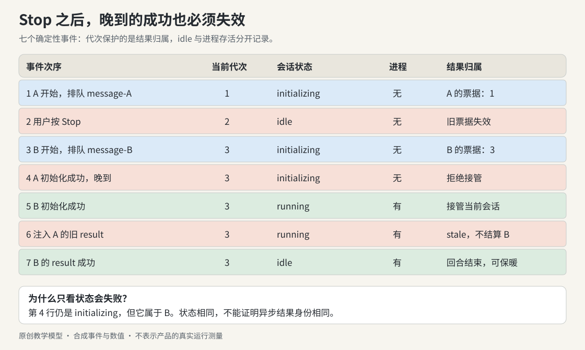

# 实战推演：Stop 之后，旧工作为什么还会回来？

用户发送“整理资料”，看到自己的消息出现在页面上。初始化还没完成，他按下 Stop，换成“只列出文件名”重新发送。第二次任务开始运行时，第一次的初始化回调才到达。几秒后，屏幕上先前的一张审批卡又收到 Allow。

这不是三个偶然的 bug。它们有共同结构：**一个异步结果产生时还有效，抵达时已经失去归属。** 解决方法不是让所有回调都检查一个 `stopped` 布尔值。重新开始后，这个布尔值又会变成 false，旧回调就有机会借用新任务的状态。

本例先复用本书现有的 `Session` 与 `ApprovalDesk`，把同一场景放进确定的事件顺序。它只模拟内存，不启动 CLI，不发送消息，也不执行文件操作。产品事实仍限于本卷 AL-02、04、14、15、19–21；以下编号、文字和更保守的审批条件是原创教学选择。

## 一、把状态按寿命摊开



*图：每次初始化拿到自己的代次票据。Stop 使旧票据失效；新初始化成功不会把旧票据重新变成有效。红色回调必须离开，不得写入绿色一轮。*

| 对象 | 活到什么时候 | 本例必须保留的身份 |
|---|---|---|
| 页面中的会话 | 用户仍在这条工作记录中 | session identity |
| 一次初始化尝试 | 成功接管、失败，或被停止/替换 | generation ticket |
| 一条新用户意图 | 被送入执行器、明确丢弃或失败 | message ID |
| 一次审批等待 | 允许、拒绝、取消或过期 | request ID + 已审查输入 |
| 运行进程 | 收尾完成；也可能跨过多个回合保暖 | process/query identity |

观察“会话还是那一条”，不足以批准初始化的结果；观察“工具还是那个名字”，也不足以消费审批。前者需要知道是哪次初始化，后者需要知道是哪份请求。

## 二、逐行算一次代次，而不是只读状态图

下面的 `epoch` 是原创模型的计数规则，数值不是产品日志。`begin()` 和 `stop()` 都递增它，所以第一轮是 1，停止后为 2，第二轮为 3。

| 次序 | 到达的事件 | 当前 epoch | session 状态 | 进程存在 | 允许的更新 |
|---|---|---:|---|---|---|
| 1 | 发送 A，开始初始化 | 1 | initializing | 否 | A 进入本地待送队列 |
| 2 | 用户 Stop | 2 | idle | 否 | 清掉 A 的待送队列；旧票据失效 |
| 3 | 发送 B，重新初始化 | 3 | initializing | 否 | 新消息 B 进入队列 |
| 4 | A 初始化成功，携带票据 1 | 3 | initializing | 否 | 拒绝接管；保留 B 的队列 |
| 5 | B 初始化成功，携带票据 3 | 3 | running | 是 | 接管当前会话，消费 B |
| 6 | 额外注入一条 A 的旧 result | 3 | running | 是 | 返回 stale；不能结算 B |
| 7 | B 成功 result 到达 | 3 | idle | 是 | 当前回合结束，可按策略保暖 |

第四行最值得停下来。A 的结果是真的成功，但“初始化成功”只证明它完成了自己的工作，不证明它现在有权替换会话。原产品中，旧初始化还应关闭自己创建的 query、结束自己的输入流；本模型没有真正的进程，只记录拒绝。

第六行是额外的防御性故障注入：测试主动投递一个旧代次结果，不表示第四行拒绝初始化后，真实流程必然还会产生 result。将它另放在“旧运行已启动、停止后结果迟到”的时序里，仍应得到 stale。

第七行也容易被读错。`idle` 表示当前没有继续执行的回合，不自动表示 CLI 已经退出。因此界面上的“已完成”、session 的 idle、process 的存活不能共享同一个 status 字段。

## 三、让读者亲自跑出这七行

完整场景在 [loop_timeline.py](../../04-Extracted-Core-Code-And-Scripts/worked-cases/loop_timeline.py)。它导入既有的 [loop-cowork/model.py](../../04-Extracted-Core-Code-And-Scripts/core-code-lab/loop-cowork/model.py)，没有复制状态机。

```python
old = session.begin()
session.submit("message-A")
session.stop()

new = session.begin()
session.submit("message-B")

assert session.attach_process(old) is False
assert session.attach_process(new) is True
assert session.consume() == "message-B"
assert session.result(old, success=True, keep_warm=True) == "stale"
assert session.result(new, success=True, keep_warm=True) == "idle"
assert session.process is True
```

这段检查没有靠 sleep 等待“通常会发生的竞态”。测试主动按最危险的顺序投递事件。同一个顺序每次都能复现，才能验证修复是否真的保护了状态，而不是碰巧没撞上。

## 四、晚到的 Allow 属于哪一张卡？

再放进两个并行会话：A 的审批卡请求写文件，B 的审批卡请求另一项工作。停止 A 应消费或拒绝 A 的等待，同时保留 B。用户随后点击旧 A 卡，返回 missing；B 卡仍能正常回答。

```python
desk.ask(Approval("card-A", "session-A", "write-note", "digest-A"))
desk.ask(Approval("card-B", "session-B", "write-note", "digest-B"))
assert desk.cancel_session("session-A") == 1
assert desk.decide("card-A", "once", "digest-A") == "missing"
assert desk.decide("card-B", "once", "digest-B") == "allow"
assert desk.decide("card-B", "once", "digest-B") == "missing"
```

`missing` 和 `deny` 不同。deny 是对一个仍存在的请求作出了拒绝决定；missing 表示这个请求已经不等待答案，重复点击不再有可消费的动作。界面可以关闭过期卡或提示“此请求已结束”，但不能创建新的工具调用来“补上”它。

产品里 SDK 协议 ID 与 UI 卡片 ID 还可能分属两层；本例只建了 UI 侧的关联表。更完整的宿主需要能从卡片找到对应的 Promise，再由 SDK 回答原协议 ID。用显示名称匹配这条关系，无法区分同名工具的两次并发请求。

## 五、停止保证与外部效果必须分别验收

考虑一个真实写入已经发给服务端，而回复在 Stop 后才到达。代次守卫能阻止旧回复改写当前 UI，不能撤销已经发生的写入。因此至少要记录两个问题：

| 问题 | 可接受的证据 |
|---|---|
| 旧结果是否还能写入当前会话？ | generation / query identity 检查，以及乱序回调测试 |
| 旧任务是否还消耗本地资源？ | 输入流结束、进程/transport 关闭与资源释放结果 |
| 外部写入到底有没有发生？ | 目标服务的结果查询、操作 ID 或其明确的幂等契约 |

如果网络断开使第三项未知，应显示“结果待确认”，不能把重新发送当作无害重试。GUI batch 同样如此：第三个动作失败，不会撤销前两个动作。参见[第 3 卷的非事务 batch](../03-Computer-Use-And-Cowork/README.md#5-batch-是顺序执行不是事务)。

## 六、练习：先预测，再运行

在书根目录运行：

```sh
python3 -B 04-Extracted-Core-Code-And-Scripts/worked-cases/loop_timeline.py
python3 -B -m unittest discover -s 04-Extracted-Core-Code-And-Scripts/worked-cases -p 'test_*.py' -v
```

1. 把 A 初始化成功放在 Stop 之前，哪些行的结果会变？
2. 去掉 generation 判断，只检查 `phase == initializing`。A 晚到时会不会接管 B？
3. 停止后用原 `message-A` ID 重发，和用新 ID 表达一次新意图是否等价？
4. 对 B 审批回答 deny，是否应把整个 session 变为 idle？

### 参考判断

1. A 可以先接管；Stop 仍会使它失效并清理。关键不变量是 Stop 之后它不能重新接管。
2. 会。第四行正处于 B 的 initializing，状态相等无法说明身份相等。
3. 在这个模型中不等价。`accepted_ids` 在 Stop 后保留，旧 ID 会被去重；真正的新意图需新 ID。这是模型的去重范围，不能倒推所有产品重试都必须换 ID。
4. 不必。工具拒绝与会话停止是两个事件；模型测试保持 session 为 running。真实执行器如何回应拒绝，仍由其后续协议决定。

本例把原有 `test_restarted_generation_wins`、`test_stale_result_ignored` 与审批一次消费测试连接成一个可读的故事。新增场景测试验证七行输出、队列归属和旧消息 ID 的边界；它们不证明真实进程已经退出。
