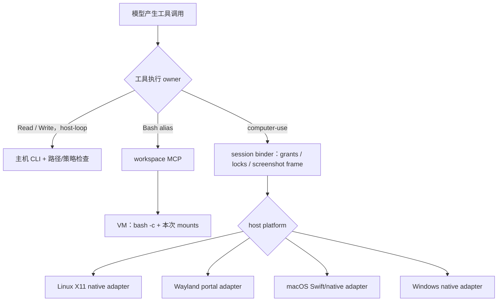
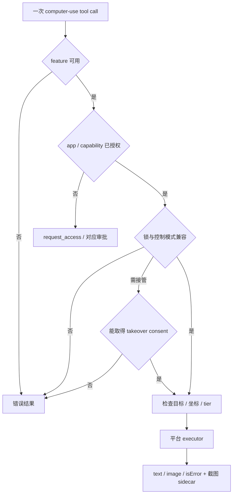
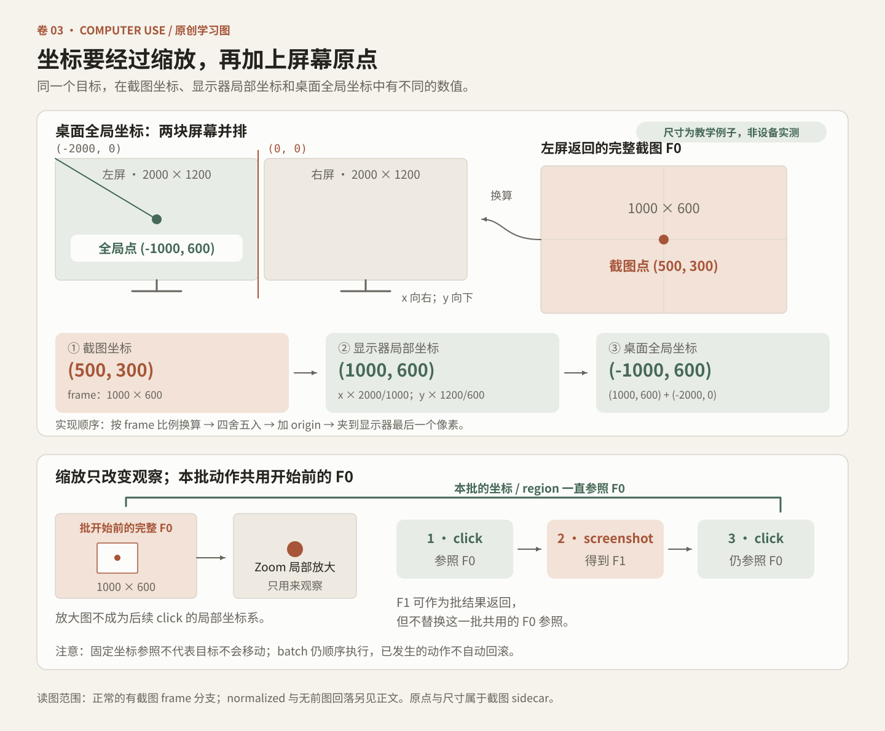

# Vol. 3 · Computer Use / Cowork：坐标、授权与工作空间

“看屏幕、点一下、再看结果”只是最外层的交互节奏。分发代码里真正支撑它的是 session grant、显示器坐标、操作锁、平台 executor、截图结果和独立的 workspace 路线。最重要的事实是：控制桌面的工具与运行 Bash 的工具不是同一个执行环境。

本卷以 Desktop 2.37337.1 Linux 包中的 JS 调用链为范围；Darwin/Windows 分支是静态分发证据。版本与证据见[附录](#附录)。

## 1. 四种“本地”，先分开

| 名称 | 实际意义 | 本卷观察到的边界 |
|---|---|---|
| Desktop 主进程 | Electron 应用所在主机 | 会话、审批、SDK-hosted MCP、原生适配器 |
| host-loop CLI | 主机上的 Claude Code 进程 | 可直接调用受约束的主机文件工具；Bash 可被 alias |
| workspace VM | 隔离 Linux 工作空间 | `bash -c`、mounts、独立 cwd/env 与输出收集 |
| Computer Use executor | 主机 OS 的屏幕/输入适配器 | native screenshot、mouse/keyboard、app/window 能力 |



在 host-loop 中，源码会拒绝把 `/sessions/...` VM 路径直接交给主机文件工具，并提示用真实主机路径，或让 Bash 在 VM 内处理。这不是一处 UI 文案差异，而是执行 owner 的实际区别。[CU-17..21]

## 2. 工具可见、工具启用和系统允许不是一回事

Computer Use 的启用链有多层：

1. 平台与系统版本支持。
2. rollout/gate 数据满足条件并按要求保持新鲜。
3. 组织/合规策略没有拒绝。
4. 用户的 Computer Use 设置已开启。
5. 当前 session 获得相应 apps 和附加能力。
6. 当前工具的模式、锁及目标检查通过。
7. 平台实际具有截图/输入所需系统能力。

`isComputerUseEnabled` 检查支持平台、合规 gate、rollout 与 `chicagoEnabled`。`isComputerUseRegisterable` 另有条件分支，可能允许先注册启用入口。因此，工具表中能看见一个名字，不等于任意动作已经被批准。[CU-01..02]

### 平台能力表

| 分支 | 截图过滤声明 | 目标检测 / 控制特点 | 激活条件的重要差异 |
|---|---|---|---|
| Linux X11 | native | native app list、隐藏未授权 apps、appUnderPoint 等 | Linux rollout；不是 Wayland 会话 |
| Linux Wayland | none | portal 共享整屏；hitTest 声明 none；native portal 输入 | 必须具备所需 portal 能力；共享屏幕不是逐 app 隔离 |
| macOS display scope | native | Swift computerUse namespace、前台应用、显示器截图、点击目标 | 普通 Computer Use 最低 macOS major 14 |
| macOS app scope | 依 app/window 捕获 | window snapshot、AX element index、app lock、后台写操作 | major 至少 15、未超配置上界、fresh gate、appScopedEnabled |
| Windows | mask | native apps、输入与 masking 配置 | Windows rollout；不能据 Linux 包源码证明实际运行 |

Linux 包里的共享 computer chunk 包含 `app_*` 工具代码。有效 app-scoped gate 却先检查 `process.platform === darwin`。如果只全文搜索到 `app_screenshot` 就写“Linux 支持后台 app 控制”，会犯可达性错误。[CU-03；CU-14..16]

## 3. 请求 app access 之后，还要请求什么

按已观察 schema，app access 输入可概括为：

```json
{
  "apps": ["Example Editor"],
  "reason": "填写这份测试表单",
  "clipboardRead": false,
  "clipboardWrite": false,
  "systemKeyCombos": false
}
```

`apps` 与 `reason` 是必填项。剪贴板读、剪贴板写和系统级快捷键是独立能力，不应隐藏在“允许操作这个 app”的模糊措辞里。[CU-04]

### app grant 与 takeover consent

授予后台访问 app，不等于允许立即接管整块屏幕。binder 分开管理 app grants、app locks、exclusive CU lock 和 takeover approval。

若 session 在后台模式工作，而下一步需要 display-scope 操作，系统可能要求单独的 takeover card。没有可询问用户的通道，或当前是无人值守会话而需要本人决定时，返回明确错误。这条拒绝不会因为反复请求同一 app access 就消失。[CU-06]



这些 gate 不是只检查一次。主机一旦有其它窗口抢焦点，下一次键盘输入的目标就变了。因此 frontmost app 与点击命中目标必须在实际动作附近检查。

### 三档 app tier

| Tier | 显示截图 | 未按住鼠标键的纯移动 | 普通点击 | 键盘输入及更强交互 |
|---|---|---|---|---|
| read | 可作为可见目标 | tier 判定允许 | 拒绝 | 拒绝 |
| click | 可 | tier 判定允许 | 有限制地允许 | typing、key、paste 等拒绝；修饰点击等另有限制 |
| full | 可 | tier 判定允许 | 仍需目标/系统规则通过 | 仍需附加能力与系统规则通过 |

纯移动走 `mouse_position` 分类；按住鼠标键的移动则走 `mouse`，并继续检查 `mouse_full` 目标。tier 允许不代表锁、几何或系统检查必定通过。

`full` 不是“任何动作免检”。系统快捷键、剪贴板、受保护目标、当前窗口及模式冲突仍可能单独阻止操作。[CU-05]

## 4. 截图结果含有两套尺寸



截图像素、显示器局部坐标与桌面全局坐标的原创双屏示例。图中数据为教学构造；产品分支条件以本节正文和证据编号为准。

成功的 display screenshot 返回 MCP image content，MIME 类型为 JPEG。除此之外，内部 sidecar 还保存：

| 字段 | 单位/作用 |
|---|---|
| width、height | 实际返回图像尺寸 |
| displayWidth、displayHeight | 对应显示器空间的尺寸 |
| originX、originY | 该显示器在桌面坐标空间的原点，可为负数 |
| displayId | 当前截图对应的显示器 |
| frameWidth、frameHeight | 某些缩放路径中保留的完整 coordinate frame |

binder 更新该 session 的 last screenshot 尺寸，并可把 frame 交给 live preview callback。屏幕图像与 UI 预览不要求是同一个 renderer 内直接采集；真正的像素来自平台 executor。[CU-07；CU-23]

### 像素模式的换算

对最近截图已有 frame 的正常分支：

- 横向坐标按 `x × displayWidth / coordinateFrameWidth` 换算。
- 纵向坐标按 `y × displayHeight / coordinateFrameHeight` 换算。
- 四舍五入后分别加显示器 originX/originY。
- 最终夹到该显示器的最后一个像素。

coordinate frame 优先使用 frameWidth/frameHeight，否则使用截图 width/height。normalized 模式则使用 0..100 的百分比，按显示器尺寸换算。

例如图像 frame 是 1000×600，实际显示器空间是 2000×1200，原点为 (-2000, 0)。图像中点 (500, 300) 对应桌面坐标 (-1000, 600)。如果忽略原点，点击会落到别的显示器。[CU-08..09]

分发实现还有“没有前一张截图时按 scaleFactor 回落”的路径，并记录警告。这条路径的存在不是推荐它作为默认做法。教学模型刻意要求有 frame，避免让无依据坐标看起来也能可靠执行。

### Zoom 与 batch 的坐标不变量

Zoom 是局部观察，不会把后续 click 的参照系切到局部放大图。batch 的 schema 更明确：该批的 region/coordinate 参照 batch 开始之前的 full-screen screenshot，既不是旧 zoom，也不是批内新截图。

实现也符合这个结构：batch 保存最新返回的 screenshot，留到整批结束返回，但没有把它替换进该批动作共享的 `lastScreenshot` context。因此一个批中的前后动作不能各自随意换坐标尺。[CU-10]

## 5. Batch 是顺序执行，不是事务

`computer_batch` 先检查 actions 数组非空、每项有 action，且 action 属于允许的 batch 集合。随后顺序执行：

1. 在每次迭代入口检查用户是否已经中断。
2. 记录当前动作，根据前后动作种类等插入必要等待。
3. 调用该动作的 dispatcher；具体 click/type 等仍走相应目标检查。
4. 收集 text/image 结果。
5. 遇到首个 `isError`，尝试释放按住的鼠标，返回已完成与未执行动作数量。

迭代入口检查之后还可能等待，再调用 dispatcher；停止与下一次 GUI 副作用并不原子互斥。停止落在这个间隙时，当前动作能否取消取决于该动作和 executor 的后续检查；可见的普通移动分支没有再查 abort。若这已是最后一项，循环也可能正常结束。这里描述 JS 分发边界，不推定原生 executor 的取消效果。

前两个动作已改变 UI，第三个失败后，不存在自动回滚。batch 减少往返次数，但没有把真实 GUI 变成数据库事务。[CU-11]

逐项重新检查目标，也不等于逐项从持久化设置重载 grants。display batch 复用一次 tool-call 的 context；源码明确的 readTheGrantsAfresh 使用点，出现在 app-scoped 等待用户暂停输入之后。重建时应把“目标是否仍正确”与“授权是否仍新鲜”作为两个检查。[CU-24]

| 假设场景 | 应怎样读结果 |
|---|---|
| 第 1 项点击成功，第 2 项 typing 被 tier 拒绝 | 第 1 项已经发生；第 2 项及之后未完成 |
| 第 2 项打开未授权 app，第 3 项继续输入 | 第 3 项应重新面对目标/授权检查，不能沿用最初窗口假设 |
| 迭代入口观察到 Stop | 返回已执行数量与 interrupted；若 Stop 在检查后的等待中到达，下一动作仍可能被 dispatch，不应据此重跑整个 batch |
| executor 抛错且鼠标处于按下 | catch 路径尝试释放 held mouse；不能宣称任意平台清理已成功 |

### 不要过度宣传 pixel validation

可见 `pixelValidation` 子 gate 的默认值为 false。batch 显式关闭这项校验。比较器在没有前图、带某些 scaled frame 标记、拿不到比较像素或发生异常时，可以返回 skipped。

所以正确结论是：存在屏幕变化检测机制及条件分支。错误结论是：每次点击都经过强制、fail-closed 的图像一致性校验。[CU-12]

## 6. 后台 app 控制为何需要 session snapshot

在启用 app scope 的平台上，`app_screenshot`、`app_ax_find` 和随后 app_* 操作可能共享窗口 snapshot、element_index 及最近目标点。若两个 session 共用这一缓存，A 看到的元素编号可能被 B 的截图重写。

binder 对此作了直接约束：executor 带 appScoped 时，必须提供 sessionId，否则抛错。缓存先按 session 分开，再按 app 和 window 键取 snapshot。[CU-13]

这一层与 display-scope 的全屏 CU lock 不同：它还有 app/window lock、写操作互斥及 takeover 同意。把“后台”理解成完全没有窗口竞争是不够的；要分别考虑元素快照的新鲜度、窗口归属、写操作串行和人正在输入时的协调。

app_* 层包含 unsupported、ineffective、错误等不同结果。支持一个 API 不代表目标应用真的响应了写入，因此动作之后的观察仍是闭环的一部分。

app_batch 还有独立的结果规则：出错或中断时，已积累的 image content 会被移除，并加入 image omitted 提示；正常完成才返回整批内容。不能把 display computer_batch 的结果组装方式直接搬过来。[CU-25]

## 7. Linux 的两条屏幕路线

### X11 adapter

Linux X11 executor 使用 native APIs 列出运行 app、隐藏未授权 app、取得前台 app 和 hit-test 目标。截图封装将捕获像素转换为 JPEG，再附上显示器几何。隐藏未授权窗口和截图过滤是相关但不同的步骤：代码会报告隐藏过哪些 app，回合结束时另尝试恢复。[CU-14]

### Wayland adapter

Wayland 判断优先看 XDG_SESSION_TYPE，未设置时才回落到 WAYLAND_DISPLAY。executor 使用 portal/native 会话：`cuWaylandStart` 建立共享，capture 读取选定 node，输入 API 发送 pointer/key 等操作。它的 capability 明确写 `screenshotFiltering: none`、`hitTest: none`。

这意味着应把它描述为“用户共享的屏幕”，不能借用 X11 或 macOS 的 app-isolated 截图保证。自家对话框打开时，输入 guard 还会直接拒绝点击、滚动或键盘输入，等待用户处理该对话框。[CU-15]

另一个易错点：`ensureOsPermissions` 在 Linux/Windows 分支返回 granted，只是这一层不做 macOS TCC 式检查。Wayland 的实际 portal 共享建立仍在 native start 路径，不能由此说 Linux 截屏不需要用户同意。

### Native 边界

macOS 代码动态加载 `@ant/claude-swift` 的 computerUse namespace；Linux/Windows 其它路径使用 `@ant/claude-native`。Linux 包内确有 ELF native binding。我们可以确认 JS 调用了哪些 native API，也可以记录二进制身份；本次没有恢复其内部实现，更没有从导出字符串推断完整权限保证。[CU-16]

## 8. Cowork 的 Bash 是另一个工作空间协议

host-loop options patch 为 Bash 和 WebFetch 设置 workspace 工具 alias。workspace MCP 的 bash schema 接受：

| 参数 | 约束 |
|---|---|
| command | 字符串，传给 `bash -c` |
| timeout_ms | 可选正整数；默认 120000，schema 最大 600000 |

每次调用都有独立 cwd/env，不携带上一条 shell 的 `cd` 或 shell 环境变化。传给后端的调用还带 processName、additionalMounts、allowedDomains 和 TZ。底层收集器把 stdout 与 stderr 合并到 `output`，并返回 `exitCode`；MCP 成功结果展示输出，不单独打印零退出码，非零退出则额外显示退出码并标为 `isError`。[CU-18]

### 工作空间尚未就绪时

workspace boot 与一次 bash call 的执行分开。调用先准备 mounts，并等待 VM ready，通常最多先等 5000ms。某个 gate 可让首次调用等 30000ms；下载状态也有独立分支。

若结果是 booting/downloading，该 command 尚未被执行。不能看见“Try again”就把它与“命令已执行但回包丢失”混为一谈。后者重试可能重复副作用，前者只是在等待执行环境。

传给 shell 包装器的 timeout 为 `min(请求值或默认值, max(1000ms, MCP cap − 已用准备时间 − 2000ms))`。预算项有 1000ms 下限，因此这个局部计算不是严格的端到端剩余预算保证，也不说明独立的外层 MCP 超时会怎样处理。schema 最大 600000ms，不意味着每个调用都拿到十分钟。[CU-19]

### 输出与挂载失败

成功返回的命令结果包含 output、exitCode，也可能有 failedMounts。manager 可以根据本次 mount generation 降级这些目录，并把缺失的连接目录解释给模型。没有 mount 成功证据的路径，不应被当成“已连接所以必定可读”。

可见的 workspace 运行包装还存在 resume → create → resume 的有限恢复序列，并识别不能这样重试的错误。这个序列属于 workspace 进程/用户容器的恢复，不是无限重试任意 shell 副作用的许可。

## 9. 文件夹授权贯穿恢复与每次调用

目录不只是一个字符串列表。

- 初次连接先解析目录类型和 canonical 路径，并核对允许的 roots、保护目录和会话内部存储。
- 恢复时重新解析。若 canonical 目标或网络盘目标变了，可以剔除旧 grant。
- host-loop 的 PreToolUse 检查具体文件参数，安全解析失败就阻止执行；读取、搜索和写入的限制并不完全相同。
- VM 的 additionalMounts 另指定 ro/rw/rwd 等 mode；uploads、项目内容和插件常有只读挂载，outputs 与用户目录受对应策略决定。

这里的可复用思想是“授权绑定资源身份和使用方式”。但 JS 中的 mode 字符串仅能证明向后端提交了该配置，真正底层 mount 和文件系统权限需要后端实现证据。[CU-20..22]

## 10. VM helper 与 Computer Use helper 不要混称

Linux 资源目录包括 `cowork-linux-helper`、`virtiofsd` 与 `smol-bin.x64.img`。可见 VM 路线会检查 QEMU、firmware、KVM/vsock 与 helper 路径等，并构建 process-like adapter，让 SDK 继续面对 stdin/stdout/exit 这套接口。[CU-21]

这与 Computer Use 的 native screenshot/input API 是两个边界。不能因为它们都叫 helper，就画成“Bash 和鼠标都交给一个原生进程”。也不能因为分发包包含 image 和 helper，就断定任意安装设备已经有可运行 VM。

helper、native binding 与 VM image 的文件身份及类型另列在配套证据中。

## 11. 一套可验证的原创教学模型

[loop-cowork 教学实验](../../04-Extracted-Core-Code-And-Scripts/core-code-lab/loop-cowork/README.md) 有 28 个测试，全部只用合成数据。它不是兼容客户端，而是让读者验证边界的最小练习：

- result 成功后，session idle 与 process retained 可以同时成立。
- 停止使旧 spawn/result 失效。
- 同一个审批只能被结算一次。
- 教学模型选择逐项读取 live grants，因此中途撤销会阻止下一项；这是比当前 display-batch context 更严格的原创设计选择。
- batch 已执行部分不会因为后续失败而撤销。
- frame 的缩放和负显示器原点得到正确坐标。
- host-loop 的文件工具与 workspace Bash 返回不同 execution owner。

下面的原创模型不需要真实桌面，就能检查一个缩放坐标和一个部分失败的 batch：

```python
from model import Action, FakeComputer, Frame, Tier

frame = Frame(1000, 600, 2000, 1200, origin_x=-2000)
assert frame.map_point(500, 300) == (-1000, 600)

computer = FakeComputer({"editor": Tier.CLICK})
result = computer.batch([
    Action("left_click", "editor"),
    Action("type", "editor"),
])
assert result == {"completed": 1, "error": "denied"}
assert computer.operations == ["left_click:editor"]
```

要把这套练习发展成自己的系统，下一步应实现明确的 executor 接口，再为每个平台提供自己的 adapter。不要先做“模型能点鼠标”的演示，再补充权限、取消和清理；这些条件决定的正是一次动作何时应当完全不发生。

## 本卷关联

CU-01..25 对应工具能力、授权、坐标和工作空间；AL-21..24 对应回合结束与时间预算。下一卷可在这套 execution-owner 表上增加持久化与项目状态，而不改变屏幕和 VM 的边界。

## 附录

静态范围为 Claude Desktop Linux amd64 2.37337.1。CU/AL 编号见[结构化证据](../../04-Extracted-Core-Code-And-Scripts/evidence/data/agent-loop-cowork.json)。Darwin、Windows 与原生 executor 的可见接线不代表本次实际运行或验证其系统效果；研究未运行目标应用或探测端点。

[返回全书目录](../README.md) · [阅读前提与术语](../README.md#一页阅读准备) · [原创代码实验室](../../04-Extracted-Core-Code-And-Scripts/core-code-lab/README.md)
