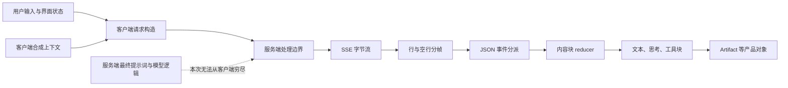
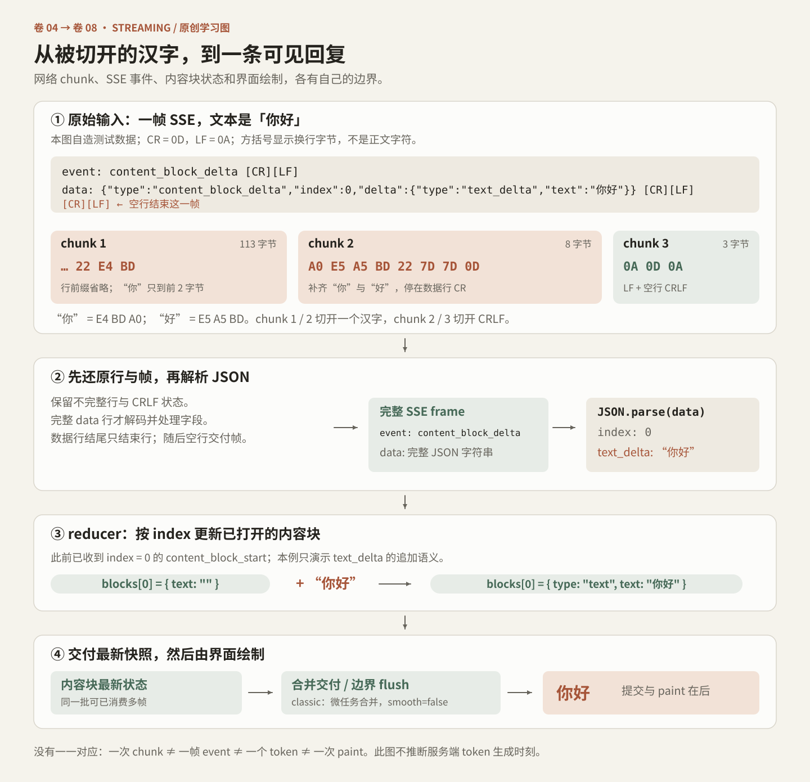
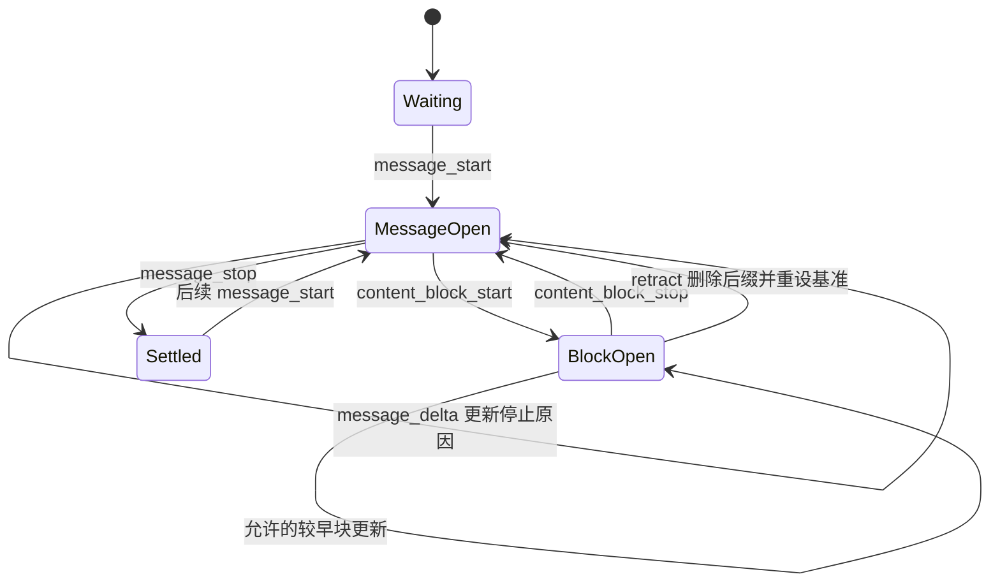

# 卷四：提示词是消息构造，协议是状态边界

## 1. 先拆开四种常被混写的东西

Claude 客户端中的“协议”不是一个巨大的 JSON Schema。至少需要区分四层：客户端向服务端提交的请求对象、传输层事件帧、逐步形成的内容块，以及从内容块中提取的产品对象。提示词又穿过这些层：它可以是用户文字，可以是客户端生成的上下文片段，也可以是一个请求字段；仅凭字符串里出现 `<system-reminder>`，不能判定该消息拥有 system 角色。

本卷范围是 Claude Desktop 2.37337.1 的 classic chat C1/C2、SSE 与相关解析路径。hub/C3、Code/Cowork、语音及服务端上下文另有边界；详见[证据索引](#证据索引)。[PT-05、PT-27、PT-54]



图中各层按职责排列，进程划分另有边界。网络 chunk、事件、token 与界面更新也各有自己的边界，并非一一对应。

## 2. 客户端能证明哪些提示词事实

### 2.1 同一个标签，可能装在 user 消息里

一个已核实的远程会话创建器会按顺序构造：可选的权限模式控制事件、可选的本地路径上下文事件、实际的用户任务事件。路径上下文的外层 `type` 是 `user`，内层 `message.role` 也是 `user`，并设定 `shouldQuery: false`。上下文正文使用 reminder 标签，但这没有改变外层角色。[PT-29–31]

因此，阅读这类代码时应回答三个不同的问题：

1. 字符串的边界标签是什么？
2. 这段字符串被放进哪一种消息角色与 envelope？
3. 谁解释它，谁真正授予文件访问或工具执行权限？

客户端提示文字可以解释已选择的文件或文件夹；它本身不是操作系统授权、远程文件访问控制或工具许可的替代物。

### 2.2 文件夹上下文与附件上下文有意分开

已核实的构造器区分两种语义：

| 上下文 | 构造目的 | 重要约束 |
|---|---|---|
| 用户连接的文件夹 | 告诉模型本次任务可用的根路径及相应文件工具 | 路径插入前检查长度、控制/格式字符、引号、尖括号、末尾反斜杠及 reminder 标签字样 |
| 用户明确附加的文件 | 告诉模型哪些具体文件是用户选择的上下文 | 文案明确区分所选文件与同目录其他文件；目录可能只为让文件可达而连接 |
| 文件夹和文件同时存在 | 拼接两个有不同语义的段落 | 不把“目录可达”自动扩大成“用户要求读取目录里的所有内容” |

文件夹路径单项上限为 1024 字符，集合检查包括最多 16 项，并拒绝重复项；文件附件路径另有名称段长度等检查。这些是客户端字符串构造的局部约束，不是所有文件系统的普遍规则。[PT-29–31]

一个可复用的设计原则是：**把权限、可达性与用户意图分别表示。** 三者在简单场景里经常重合，在远程电脑、挂载目录和附件选择器里却很容易分离。

### 2.3 Artifact 的实时界面状态被标为数据

另一条已核实路径使用 `artifact-view-context` 包裹一个 JSON 状态快照。客户端先将 JSON 规范化转义，特别处理尖括号、与号、`@` 和非 ASCII 字符，再插入固定 envelope。对应解析器要求结构与规范化表示吻合。生成的消息还会经过长度与 reminder 字样检查。[PT-32]

该内容提供 Artifact 页面运行中的界面状态，作为用户可能正在查看的内容线索；它不产生指令或权限。版本/编辑计数变化提示旧内容可能已过时。这里只概述提示词的职责。

发送 envelope 明确标为：`type: user`、`message.role: user`、`shouldQuery: false`、`isSynthetic: true`、`client_composed: true`，并带有 reminder 类别。这个例子尤其能说明，**合成上下文的来源和用途应成为结构化元数据，而不应只靠正文语气猜测。**[PT-33]

### 2.4 “System prompt” 编辑框不是生产系统提示词证据

包中存在受 gate 控制的自定义 system-prompt 编辑界面，保存值可通过客户端请求构造器进入 `custom_system_prompt` 字段。该界面的占位文字，只能证明客户端为这项功能提供了示例输入；它不能证明普通用户可见、当前账户启用，或其内容就是服务器在生产环境使用的系统提示词。[PT-27–28]

调试/内部界面、占位文案、客户端提示片段与最终模型系统提示词具有不同的证据范围。每项都须保留角色、版本、部署条件和服务端边界，才能准确解释其作用。

## 3. 请求对象：明确构造，不等于封闭 schema

### 3.1 classic chat 请求构造器的实际范围

已核实构造器以 `prompt`、`parent_message_uuid`、`timezone`、`locale` 为基本字段；locale 不在支持列表内时回落到默认值。之后按条件加入模型、思考模式、工具状态及消息 UUID 等字段。iframe 自定义提示词在对应条件下优先于普通本地自定义提示词。[PT-27]

| 字段组 | 本地构造出的字段 | 条件或含义 |
|---|---|---|
| 用户与分支 | `prompt`、`parent_message_uuid` | 文字及所接续的父节点；不要求服务器从一个纯线性 transcript 猜测分支 |
| 地域上下文 | `timezone`、`locale` | locale 经支持列表检查 |
| 自定义指令 | `custom_system_prompt` | 有非空自定义值时加入；不是服务器最终上下文的完整描述 |
| 模型与思考 | `model`、`paprika_mode`、`effort`、`thinking_mode` | model override 可覆盖 model；旧字段与新字段之间有兼容映射 |
| 输入来源 | `onboarding_chat_variant`、`input_mode` | 按本次输入状态加入 |
| 工具 | `tools`、`tool_states` | 非空时加入；不能由这些字段推导所有工具的服务端实现 |
| 其他产品上下文 | `compass_suggestion_accept`、`publish_file` | 后者构造 sandbox path 子对象 |
| 幂等与对账 | `turn_message_uuids` | 可含 human 和 assistant UUID；重试时可以只有 assistant UUID |
| 开放扩展 | `antOnlyFields` 合并进对象 | `Object.assign` 意味着此构造器本身不是“只允许以上字段”的封闭 schema |

随后 completion 发送层组合请求内容，设置 `rendering_mode: messages`，可加入请求 ID、会话创建参数或 inline-comparison 能力。C1/C2 的 endpoint helper 区分普通 completion 与 retry completion，并按条件选择带 `2` 后缀的变体。[PT-05、PT-08]

这些路径是包内源码中的字符串关系，属于私有接口实现信息，不构成第三方开发者可用的公开 API；接口行为仍在静态研究的验证范围之外。

### 3.2 三种“schema”要分别命名

| 证据类型 | 能证明什么 | 不能自动证明什么 |
|---|---|---|
| 请求对象构造代码 | 客户端在该分支可能发送哪些字段 | 服务端所有可接受字段、必填规则、最终消息结构 |
| 事件名枚举与 switch | 该消费者知道或处理哪些事件标签 | 每个事件 payload 都得到完整运行时验证 |
| 运行时解析器/validator | 被解析对象的字段、容错和部分约束 | 其他调用点、其他服务版本或隐藏服务端逻辑 |

尤其注意，SSE payload 的核心 helper 直接调用 `JSON.parse`，失败时抛出带事件类别的格式错误。它并不是对每种 payload 做一次完整 JSON Schema 验证。某些事件另有局部形状检查，例如 composer notice；另一些依赖后续分派与 reducer 的假定。[PT-07]

## 4. SSE：先解决分帧，再谈 JSON



UTF-8 分片、SSE 分帧、内容块更新与界面绘制的原创示例。图中数据为教学构造；产品分支条件以本节正文和证据编号为准。

### 4.1 字节 chunk 不是事件

所见 fetch-SSE reader 从 `ReadableStream` 读取字节。行解析器保留不完整行，识别 CR、LF 和 CRLF，并处理 CR 与后续 LF 落在不同 chunk 的情况。完整行之后才解释字段；空行结束一帧。[PT-01–03]

下面的原创测试数据用于演示分片边界：

```text
event: content_block_delta
data: {"type":"content_block_delta","index":0,"delta":{"type":"text_delta","text":"你好"}}

```

网络可能在 `data:` 中间、一个 JSON 字符串中间，甚至一个中文字符的 UTF-8 字节中间切开它。正确性来自增量状态，不来自“每次 read 后直接 JSON.parse”。

### 4.2 字段层与 JSON 层承担不同职责

| SSE 字段 | 所见处理 |
|---|---|
| `event` | 保存事件名 |
| `data` | 通常用换行合并；此实现以已累积字符串是否非空为条件，因此开头的空 data 行不会保留换行 |
| `id` | 同时交给连接层，维护后续请求的 `last-event-id` |
| `retry` | 解析为重连延迟；所见实现使用 `parseInt` |
| 空行 | 交付当前 frame 并重置 frame 状态 |
| 注释或未知字段 | 不成为业务内容字段 |

fetch-SSE wrapper 提供 open、message、chunk、close、error 回调，并维护自己的重连状态。但 classic completion 的 error 回调可能选择抛出，让外层产品级重试策略接管。不能从底层存在自动重连，就断言任何聊天断线都会安全地原样续传。[PT-04、PT-07]

### 4.3 本卷核实的事件名完整清单

下表完整列出这份本地事件枚举的 23 个值，范围限定于该枚举。`cmp_*` 比较响应事件由独立分支处理，未列入此枚举；`melange_edit_result` 同时出现在此枚举和另一个消费者中，枚举成员身份并不代表普通主聊天 reducer 会处理它。[PT-06、PT-52]

| 类别 | 实际标签 |
|---|---|
| 连接/旧格式 | `ping`、`completion`、`error` |
| 消息生命周期 | `message_start`、`message_delta`、`message_stop` |
| 内容块生命周期 | `content_block_start`、`content_block_delta`、`content_block_stop`、`content_block_retract` |
| 会话与模型状态 | `message_limit`、`compaction_status`、`conversation_ready`、`model_fallback`、`model_update` |
| 工具交互 | `tool_approval`、`mcp_auth_required`、`mcp_elicitation`、`mcp_elicitation_complete` |
| 产品附加信息 | `cache_performance`、`composer_notice`、`notice_poll_hint`、`melange_edit_result` |

`tool_approval` 在所选主循环中有显式 case，但该 case 本身不执行处理。出现一个枚举成员、出现一个空 case、实际更新了界面状态，是三个不同强度的事实。

## 5. 内容块 reducer：同一个 delta 名也不总是同一种操作

### 5.1 所选 classic reducer 的语义表

| 当前块 | 接受的主要 delta | 状态变化 |
|---|---|---|
| text | `text_delta` | 追加文字 |
| text | `citation_start_delta` / `citation_end_delta` | 按引用 UUID 关联开始/结束位置并增加 citation |
| connector_text | `connector_text_delta` | 追加 connector 文本 |
| thinking | `thinking_delta` | 追加 thinking 文字 |
| thinking | `thinking_summary_delta` | 追加摘要对象 |
| thinking | `thinking_cut_off_delta` | 更新 cut-off 状态 |
| tool_use | `input_json_delta` | 追加到 `partial_json` 字符串 |
| tool_use | `tool_use_block_update_delta` | 按存在字段更新 message / display content |
| tool_result | `input_json_delta` | 尝试把该 payload 当作完整内容数组替换；不符合形状或无法解析时转成一个文本项 |
| 多种块 | `flag_delta` | 合并去重标记，并处理对应附加信息 |

这里的关键反例是 tool result：在这个 reducer 中它是替换语义，而不是与 tool use 相同的无限字符串追加。语音消费者的工具结果处理又有自己的 JSON 累积缓冲。因此，以事件名为依据跨 surface 复制 reducer，会产生真实的数据错误。[PT-14、PT-17–18、PT-54]

### 5.2 生命周期不只是 start 和 stop

主循环记录当前服务器 block index。通常 delta 必须命中当前 index，stop 也必须一致；但 thinking summary 和 tool-use block update 允许回写较早的块。因此，“只允许修改最后一个块”太严格，“随便改任何 index”又太宽松。[PT-15]

`content_block_retract` 进一步说明内容不一定永远追加。它删除一个后缀，并重置缓冲 JSON、当前工具、相关思考块集合以及受影响的首段文字状态。generic buffer 还维护服务器 index 基准与本地 offset，以支持后续段落重新从某个服务器索引开始。[PT-16]



这是一张概念图。真实代码允许多个消息段累计到同一个交付缓冲，图中的 Settled 不是“连接必然已关闭”，也不是“数据库写入已经确认”。

## 6. 不完整 JSON 为什么不该过早升级成完整工具输入

工具参数会分批到达，第一段可能只有左花括号，第二段仍可能落在字符串或键值对中间。所见客户端先累积 `partial_json`，读取参数时优先使用已经非空的 `input` 对象，否则使用容错解析器，并按块对象和当前 partial 字符串缓存结果。[PT-17、PT-19–20]

这个容错解析器会对 token 化结果补齐未闭合容器；如果仍无法解析，会尝试舍弃不完整的尾部属性。它的目标是让界面及中间展示拿到当前可读的结构。**可展示的部分结构不等于已经收到一个完整、可执行、被批准的工具请求。**

工程上可以把状态显式分开：

```text
接收中的参数文本
    → 可选的“尽力解析”预览
    → 已结束的工具输入
    → 独立的权限/审批判断
    → 工具执行
```

配套原创实验采用更严格的数据模型：保留 partial 字符串，只在 JSON 完整可解析时产生 `parsed_input`。实验仅验证分块、顺序和闭合语义，不执行工具；其解析规则与目标容错解析器不同。

## 7. Artifact 有两条表示路径

### 7.1 旧式内嵌标签确实存在

本版本的兼容解析器包含 `antArtifact` 和 `antThinking`，并分别处理未完成前缀。[PT-21–22]

旧 Artifact 解析器识别 `identifier`、`type`、`title`、`language` 及可选闭合状态；缺失的标题与类型有默认值。Artifact body 可以一直匹配到输入末尾，因此一个尚未闭合的 Artifact 仍可成为当前版本，但要保留 `isClosed` 状态。文本转换 helper 可把非 Markdown 内容表示为代码围栏，或转换成专用链接占位。[PT-21]

thinking helper 会移除完整或未闭合的 legacy thinking 区段，并抑制尾部正在形成的开标签。另一个 Artifact detector 在相邻文本块之间保留短后缀，防止 `<antArtifact` 刚好被拆到两个块时漏检。[PT-22、PT-26]

这些是兼容处理，不意味着今天所有回答都在使用这些标签，更不意味着能由这些标签得到完整内部推理过程。

### 7.2 结构化 artifacts 工具路径

同一模块也消费名称为 `artifacts` 的 `tool_use`，从工具输入构造版本对象，并跳过已被取消的对应工具结果。这里的 Artifact 是产品对象，不是简单地把任何 HTML 文本放进 iframe。[PT-23]

已核实的输入字段及约束：

| 字段 | 本地 parser 的处理 |
|---|---|
| `version_uuid`、`id`、`title`、`language`、`content`、`old_str`、`new_str` | 字符串可为空缺或 null，并规范化为空缺 |
| `version_number` | 可选整数；无效值有容错回落 |
| `command` | `create`、`update`、`rewrite`；可选并容错 |
| `type` | 枚举中的 Artifact MIME 类别；可选并容错 |
| `source` | `c` 或 `w`；可选并容错；此处不猜字母的未证实含义 |
| `md_citations` | 可选附加数据；这个 parser 本身不细化其结构 |

核实的 Artifact 类型范围是 plain text、Markdown、HTML、SVG、代码、Mermaid 与 React 的七种 MIME 标识。该范围来自这个 parser 的枚举，不是 Claude 所有可生成文件类型的总表。[PT-24]

版本操作也有区别：create/rewrite 返回新的完整内容；update 在旧内容中替换匹配字符串，找不到原串时尝试 trim 后的旧串。结构化 update 如果带非空完整 content，还可能被规范化成 rewrite。[PT-25]

### 7.3 不要把 parsing、preview 和 execution 合成一步

一个安全且可测试的产品实现至少应保留以下边界：解析事件、形成 Artifact 数据、选择可显示版本、决定预览宿主、约束预览能力。解析成功只确认解析阶段；MIME 类型与 `isClosed` 描述内容类型和闭合状态，执行授权由独立的权限与 sandbox 机制决定，详见相关卷。

## 8. 可读代码与可复用实验

配套 [protocol-tree](../../04-Extracted-Core-Code-And-Scripts/core-code-lab/protocol-tree/README.md) 实验包含四个原创模块：

- `incremental-sse.mjs`：跨 UTF-8、CR/LF 与任意 chunk 边界的增量分帧，并展示 await 消费者的读取节奏
- `content-reducer.mjs`：一组明确限定的 block 事件、微任务合并交付、回撤与多段 index 处理
- `legacy-tags.mjs`：数据型的 legacy tag 状态机，绝不生成 HTML 或执行 Artifact
- `branch-manager.mjs`：单父消息树与版本切换，详见卷八

以下是原创测试驱动的组合方式：

```js
const reducer = new ContentReducer(snapshot => renderData(snapshot));
await consumeChunks(chunks, frame => {
  if (!frame.data || frame.event === 'ping') return;
  reducer.apply(JSON.parse(frame.data));
}, {
  afterChunk: async () => {
    reducer.flush();
    await workBudget();
  }
});
```

`renderData` 是使用者提供的回调；示例仅组合数据处理，不连接网络或真实账号，不导入目标 bundle，也不执行工具。实验独立增加资源上限、严格 retry 数字检查，并保留开头的空 data 值及其换行。这些规则与目标实现不同，用于验证机制的组合与测试方法。

## 9. 本卷结论

协议研究最有用的成果不是抄出一长串字段，而是给出每一条边界的消费者、状态变化和失败条件：

1. 先分帧，后解析 JSON；字节 chunk 与业务事件不能混为一谈。
2. 先确定消息角色，再解释标签；提示文本不授予权限。
3. `partial_json` 是接收中的文本，不是天然完整的工具调用。
4. 内容块可以被回写与回撤；纯 append 模型并不足够。
5. Artifact 的 legacy 标签与结构化工具路径并存。
6. 同名事件在不同 surface 的语义可能不同。
7. 客户端可见合同与服务器最终上下文必须保持明确边界。

卷八继续沿着同一条链，解释这些事件如何进入会话树、形成可见分支，并以受控节奏交付给界面。

### 证据索引

静态范围为 Claude Desktop Linux amd64 2.37337.1；研究未运行目标应用或探测端点。hub/C3、Code/Cowork 和语音不能仅凭共享事件名视为同一协议，服务端完整上下文与系统提示词不由这些客户端文件证明。PT 编号对应 [protocol-tree-streaming.json](../../04-Extracted-Core-Code-And-Scripts/evidence/data/protocol-tree-streaming.json)。该文件保存逐条主张、实际包内相对路径、短锚点与偏移；正文不重复哈希和分析日志。提示词正文仅作职责概述，没有发布完整专有提示词。

[返回全书目录](../README.md) · [阅读前提与术语](../README.md#一页阅读准备) · [原创代码实验室](../../04-Extracted-Core-Code-And-Scripts/core-code-lab/README.md)
