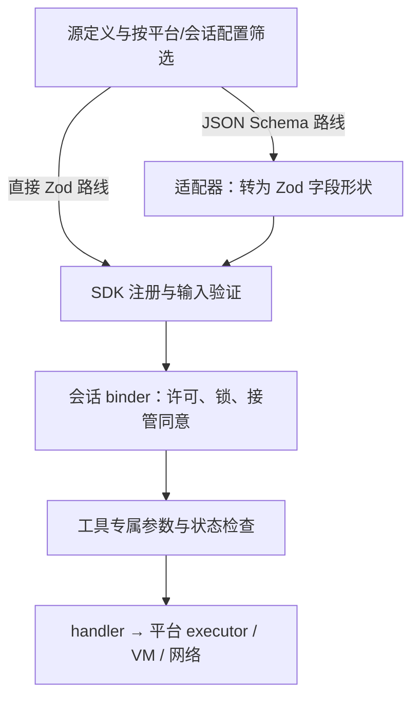

# 客户端工具合同：从声明表到执行边界

工具从 schema 声明出发，经过适配器、SDK 校验、会话权限和专属检查，最后才进入 executor；其中任一层存在，并不保证另一层表达了同样的约束。[TC-02–08]

本章限定于 Claude Desktop Linux amd64 2.37337.1 中可闭合的 59 个本地定义：44 个 computer-use、13 个 Framebuffer、2 个 workspace，不代表运行时全部可用工具。

## 1. 声明、验证与执行是不同的合同

给模型看的描述、声明的字段结构、SDK 真正执行的输入校验，以及权限/执行器的语义检查，是四份需要分别记录的事实。本包给出一个具体例子：内部 JSON Schema 先转换成 Zod 字段形状，转换只保留部分约束；后续工具处理器再补充坐标、整数、范围、快照、授权等检查。

## 2. 六层合同，而不是一张“工具列表”



这是静态调用关系的概念图。权限检查和具体参数检查有交错，不表示每一类参数错误都一定在请求用户授权前被发现，也不表示整个调用只有一次统一的许可判定。

内部服务器管理器可见的处理包括：CLI 信任条件、server `isEnabled`、静态与动态 tools 合并、逐工具开关筛选，随后才把 schema 送进适配器并注册 callback。callback 前还有策略拒绝、超时/abort、上下文与结果处理。`alwaysLoad` 是工具加载提示，不能解释为自动批准执行。[TC-02]

SDK 的 `validateToolInput` 校验转换后的输入，成功时把解析后的数据交给 handler；错误按工具错误返回。看到 SDK 使用了校验库，仍需问“校验库收到的是哪份 schema”，不能跳过前面的转换步骤。[TC-03]

## 3. Schema 转换具体保留了什么

| 声明特征 | 所见转换行为 | 应当怎样阅读 |
|---|---|---|
| string | string enum 被保留；无 enum 路径可把安全整数转成字符串 | handler 拿到的类型可能不同于传入 JSON 类型 |
| boolean | 字符串 `true` / `false` 可被预处理 | 不是严格 JSON boolean-only 合同 |
| number / integer | 共用 number 分支；映射 minimum / maximum | 这个转换步骤没有表达整数性 |
| array | 递归转换 items | minItems / maxItems 在这个步骤未被映射 |
| 数字 enum | number 分支没有读取 enum | 不能把原声明里的数值集合当作已落实的检查 |
| type 为数组 | 没有逐成员展开成 union | 例如 string/array/null 需继续看消费器 |
| nested object | 映射 properties / required，并使用 passthrough | 不要假定所有层级的未知键都会被拒绝；顶层 SDK 包装另有行为 |
| required / default | 根字段结合 required 与 default 决定可选性；default 使用 prefault | 默认值不是纯文档注释 |
| description | 可挂在转换后的节点上 | 描述里的范围、互斥关系仍不是可执行校验 |

以上只描述 `index.chunk-Dc4xQdhj.js` 中的有限转换器，不是对整个产品 JSON Schema 支持度的判决。workspace 的两个例子直接使用 Zod，不经过它。[TC-04–06、TC-13]

几个能迫使读者区分层次的反例：

1. `key.repeat` 声明为 1..100 的 integer。转换器的 integer 分支自身没有 `.int()`，但 `hi` 消费器明确重新检查整数性和范围。不能据此声称最终可发出半次按键。
2. `app_click.count` 声明为数值枚举 1/2/3。所见分派根据值为 2、3 或其他选择点击次数，其他数值走 1，而非由该分派抛出枚举错误。这里不是所有声明都一比一形成拒绝规则。
3. `wait.duration` 的 schema 只写 number；0..100 秒与有限数检查位于 `Ai`。把这个限制写成“schema minimum=0、maximum=100”会伪造字段结构。
4. `app_menu` schema 仅要求 app，path/list 的互斥和长度/成员类型在 `Mn` 检查。list 分支用 read tier，执行菜单项则用 full tier。分类表不是最终授权结果。
5. `zoom.region` 声明 items 为 integer，消费器首先检查长度、非负数及矩形方向，后续再检查截图坐标框。应分别记录声明与消费器，而不是用其中一层覆盖另一层。[TC-07–08]

这些静态差异不构成安全漏洞或成功利用的证明；没有提交畸形参数给真实应用。

## 4. computer-use 的完整有界字段表

表内 `str`、`num`、`int`、`bool` 分别对应声明里的 string、number、integer、boolean。`num[2]` 是长度恰为 2 的数组；`str[1..16]` 是数组长度范围；`num∈{1,2,3}` 是数值枚举。表中的“必填/可选”仅指声明，尚未包含 handler 添加的互斥与前置状态。消费器符号是固定包中的定位标签，不是稳定公开 API 名称。

### 4.1 显示器与基础控制：25 个定义

| 工具名 | Schema 必填字段 | Schema 可选字段 | 分派后的消费器 |
|---|---|---|---|
| `request_access` | `apps`: str[]；`reason`: str | `clipboardRead`: bool；`clipboardWrite`: bool；`systemKeyCombos`: bool | `Vr` |
| `screenshot` | 无 | `scale`: num；`save_to_disk`: bool | `li` |
| `zoom` | `region`: int[4] | `scale`: num；`save_to_disk`: bool | `fi` |
| `left_click` | `coordinate`: num[2] | `text`: str | `pi` |
| `double_click` | `coordinate`: num[2] | `text`: str | `pi` |
| `triple_click` | `coordinate`: num[2] | `text`: str | `pi` |
| `right_click` | `coordinate`: num[2] | `text`: str | `pi` |
| `middle_click` | `coordinate`: num[2] | `text`: str | `pi` |
| `type` | `text`: str | 无 | `mi` |
| `key` | `text`: str | `repeat`: int[1..100] | `hi` |
| `scroll` | `coordinate`: num[2]；`scroll_direction`: str∈{up,down,left,right}；`scroll_amount`: int[0..100] | 无 | `gi` |
| `left_click_drag` | `coordinate`: num[2] | `start_coordinate`: num[2] | `_i` |
| `mouse_move` | `coordinate`: num[2] | 无 | `vi` |
| `open_application` | `app`: str | 无 | `bi` |
| `switch_display` | `display`: str | 无 | `xi` |
| `list_granted_applications` | 无 | 无 | `Si` |
| `list_apps` | 无 | `query`: str；`running_first`: bool；`limit`: int[1..200]；`cursor`: str | `Ci` |
| `read_clipboard` | 无 | 无 | `Di` |
| `write_clipboard` | `text`: str | 无 | `ki` |
| `wait` | `duration`: num | 无 | `Ai` |
| `cursor_position` | 无 | 无 | `ji` |
| `hold_key` | `text`: str；`duration`: num | 无 | `Ii` |
| `left_mouse_down` | 无 | 无 | `Li` |
| `left_mouse_up` | 无 | 无 | `Ri` |
| `computer_batch` | `actions`: DAction[1..∞] | `save_to_disk`: bool | `Wi/Xi` |

声明条件必须与表一起保存：

- `list_apps` 只在 capabilities.appScoped 存在且 platform 为 darwin 时加入；其消费器仍核对平台能力与 gate。
- screenshot、zoom 的 `scale`，以及 computer_batch 内各 action 的 scale，受 adaptiveResolution 条件影响。
- `save_to_disk` 仅在 saveToDisk 不为 false 时出现。外层先把它从参数中取走，再调用 CU binder；截图持久化由外包装器处理，不能写成底层原生截图输入字段。
- batch-only 模式还能移除 17 个独立 display action 定义，保留 computer_batch 等入口。因此“源码定义有 44 个”与“本会话向模型提供 44 个”是不同判断。[TC-09–10]

### 4.2 app-scoped 控制：16 个定义

| 工具名 | Schema 必填字段 | Schema 可选字段 | 分派后的消费器 |
|---|---|---|---|
| `release_full_control` | 无 | 无 | `zn` |
| `request_full_control` | 无 | 无 | `In` |
| `app_list_windows` | `app`: str | 无 | `Nn` |
| `app_ax_find` | `app`: str | `window_id`: num；`role`: str；`title_contains`: str | `on` |
| `app_screenshot` | `app`: str | `window_id`: num；`scale`: num | `Un` |
| `app_zoom` | `app`: str；`region`: num[4] | `window_id`: num；`scale`: num | `Wn` |
| `app_click` | `app`: str | `window_id`: num；`coordinate`: num[2]；`element_index`: num；`target`: str∈{focused}；`button`: str∈{left,right}；`count`: num∈{1,2,3} | `X/rr` |
| `app_type` | `app`: str；`text`: str | `window_id`: num；`coordinate`: num[2]；`element_index`: num；`target`: str∈{focused}；`overwrite_existing`: bool；`mode`: str∈{insert,replace}；`disable_substitutions`: bool | `X/rr` |
| `app_key` | `app`: str；`combo`: str | `window_id`: num；`coordinate`: num[2] | `X/rr` |
| `app_scroll` | `app`: str；`dy`: num | `window_id`: num；`coordinate`: num[2] | `X/rr` |
| `app_focus` | `app`: str | `window_id`: num；`coordinate`: num[2]；`element_index`: num | `X/rr` |
| `app_drag` | `app`: str | `window_id`: num；`coordinate`: num[2]；`to_coordinate`: num[2]；`path`: num[2][2..20] | `X/rr` |
| `app_menu` | `app`: str | `path`: str[1..16]；`list`: str／str[0..16]／null | `jn/Mn` |
| `app_batch` | `app`: str；`actions`: AAction[1..∞] | `window_id`: num | `fr` |
| `app_release` | 无 | `app`: str；`window_id`: num | `pr` |
| `app_bring_to_current_space` | `app`: str；`window_id`: num | 无 | `Fn` |

这组由 appScoped capability 决定是否加入；app_drag 与 app_bring_to_current_space 另要求 supportsRawInput。Desktop 的供应函数还依赖有效的 macOS app-scoped gate。Linux 分发包包含共享代码，不表示 Linux 已开放这些接口。[TC-09；既有 CU-03]

几个 schema 表之外的合同尤其重要：

- `coordinate`、`element_index`、`target` 在共享输入消费器中按互斥关系检查；没有给出目标时，还可能依赖该窗口上一次动作的位置。不要把 description 所说的默认行为当成 JSON Schema default 字段。
- snapshot 按会话、应用与窗口关联。坐标与元素索引需要对应截图；window_id 的所有权和窗口是否仍存在会被再次核对。
- `app_drag.path` 必须与 coordinate/to_coordinate 等端点形式分开；路径长度和二维点也有 handler 检查。
- `app_release.window_id` 实际要求同时提供 app；这个依赖关系不在它的 required 数组中。
- `app_bring_to_current_space.window_id` 声明是 number，但 handler 进一步要求整数，核对窗口和屏幕状态。
- `app_batch` 分类可标为 read，但实际执行各 action 时仍进入对应分派和更高等级的检查。不能用批处理外层标签绕过各动作语义。[TC-08、TC-11]

### 4.3 teach：3 个定义

| 工具名 | Schema 必填字段 | Schema 可选字段 | 分派后的消费器 |
|---|---|---|---|
| `request_teach_access` | `apps`: str[]；`reason`: str | 无 | `Qr` |
| `teach_step` | `explanation`: str；`next_preview`: str；`actions`: DAction[] | `anchor`: num[2] | `ni/$r` |
| `teach_batch` | `steps`: TStep[1..∞] | 无 | `ri/$r` |

仅在 teachMode capability 打开时加入。teach_step 的 actions 可以为空，用于纯说明步骤；teach_batch 的 steps 则声明为非空。`$r` 对解释文本、下一步预览、action 列表和 anchor 逐项检查，具体动作仍走 CU 动作分派。它们不是“给普通 computer_batch 换个名字”。[TC-11]

### 4.4 四个嵌套结构

#### DAction：display batch 与 teach actions 共享的声明结构

| 字段 | 类型/声明限制 | 必填 |
|---|---|---|
| `action` | str∈{key,type,mouse_move,left_click,left_click_drag,right_click,middle_click,double_click,triple_click,scroll,hold_key,screenshot,zoom,cursor_position,left_mouse_down,left_mouse_up,wait} | 是 |
| `coordinate` | num[2] | 否 |
| `region` | int[4] | 否 |
| `scale` | num | 否 |
| `start_coordinate` | num[2] | 否 |
| `text` | str | 否 |
| `scroll_direction` | str∈{up,down,left,right} | 否 |
| `scroll_amount` | int[0..100] | 否 |
| `duration` | num | 否 |
| `repeat` | int[1..100] | 否 |

17 个 action 值就是本次 `Me` 集合的来源。每项 schema 只要求 action，并没有用 oneOf 对每种 action 分别声明必填字段；`scroll` 是否带方向/数量、`type` 是否带 text，要到具体消费器继续判断。只有 adaptiveResolution 开启时才有 scale 字段。[TC-11]

#### AAction：app_batch 的项

| 字段 | 类型/声明限制 | 必填 |
|---|---|---|
| `action` | str∈{click,type,key,scroll,screenshot,zoom,drag} | 是 |
| `coordinate` | num[2] | 否 |
| `element_index` | num | 否 |
| `scale` | num | 否 |
| `region` | num[4] | 否 |
| `target` | str∈{focused} | 否 |
| `button` | str∈{left,right} | 否 |
| `count` | num∈{1,2,3} | 否 |
| `text` | str | 否 |
| `overwrite_existing` | bool | 否 |
| `mode` | str∈{insert,replace} | 否 |
| `disable_substitutions` | bool | 否 |
| `combo` | str | 否 |
| `dy` | num | 否 |
| `to_coordinate` | num[2] | 否 |
| `path` | num[2][2..20] | 否 |

drag action 和 path 字段有 supportsRawInput 条件。动作通过 `app_` 前缀进入 app-scoped 分派。app_batch 的截图可改变后续动作使用的窗口快照；与 display batch 使用预批次全屏坐标上下文的规则不同。这个差别已经在既有 CU-10/CU-25 深入展开，不应合并为一份通用“截图后自动更新坐标”的批处理规则。

#### TStep：teach_batch 的项

| 字段 | 类型/声明限制 | 必填 |
|---|---|---|
| `explanation` | str | 是 |
| `next_preview` | str | 是 |
| `anchor` | num[2] | 否 |
| `actions` | DAction[] | 是 |

## 5. Framebuffer：定义存在，但所选聚合路线关闭

| 工具名 | Schema 必填字段 | Schema 可选字段 | 分派后的消费器 |
|---|---|---|---|
| `framebuffer_list` | 无 | 无 | `service.listSources` |
| `framebuffer_attach` | `name`: str | 无 | `requestOpenInRenderer` |
| `framebuffer_screenshot` | `name`: str | `scale`: num | `Ni` |
| `framebuffer_zoom` | `name`: str；`x`: num；`y`: num；`width`: num；`height`: num | `scale`: num | `Pi` |
| `framebuffer_cursor_position` | `name`: str | 无 | `Fi` |
| `framebuffer_click` | `name`: str；`x`: num；`y`: num | `button`: str∈{left,middle,right}；`count`: num∈{1,2,3}；`modifiers`: str[] | `Li` |
| `framebuffer_move` | `name`: str；`x`: num；`y`: num | 无 | `Ii` |
| `framebuffer_drag` | `name`: str | `button`: str∈{left,middle,right} | `Ri` |
| `framebuffer_scroll` | `name`: str；`x`: num；`y`: num；`direction`: str∈{up,down,left,right}；`amount`: num | 无 | `zi` |
| `framebuffer_type` | `name`: str；`text`: str | 无 | `Vi` |
| `framebuffer_key` | `name`: str；`chord`: str | `repeat`: num | `Hi` |
| `framebuffer_hold_key` | `name`: str；`key`: str；`durationMs`: num | 无 | `Ui` |
| `framebuffer_batch` | `name`: str；`actions`: FAction[1..10] | 无 | `Gi` |

这些定义来自另一套命名空间和预览会话模型，不能自动继承 host computer-use 的 app grants。[TC-12]

选定 `SS` 聚合器确实把这个服务器以 `isEnabled:()=>false` 加入；这条路线因此不启用它。`Qi` 又只在单独输入 gate 打开时拼上 8 个输入工具。我们能证明“有结构、有关联 handler、此聚合点关闭”，不能证明所有未来版本或其他调用点都永远关闭。

`la` handler 的主要边界是：名称对应已知 source、存在 session、用户预览面板正在显示该 source。非 read 类再要求输入 gate 和先前截图；坐标消费器用截图记录的 frame 进行有限性和边界检查。framebuffer_list 与 framebuffer_attach 是独立分支，不应被概括为都要求已有截图。

FAction 是刻意较开放的 envelope，`args` 只声明 object，没有在这里内联每种操作的全部参数结构：

| 字段 | 类型/声明限制 | 必填 |
|---|---|---|
| `action` | str∈{click,type,key,move,scroll,drag,hold_key} | 是 |
| `args` | object | 是 |

`framebuffer_batch.actions` 声明 1..10 项。读到这样的 envelope 时，正确动作是继续追踪 action→handler，并记录独立语义限制；不是把邻近的所有 properties 随意合并成“完整 batch schema”。

## 6. workspace：直接 Zod 的对照组

| 工具名 | Schema 必填字段 | Schema 可选字段 | 分派后的消费器 |
|---|---|---|---|
| `bash` | `command`: str | `timeout_ms`: int[−∞..600000]>0 | `bash -c; each call receives its own cwd/mount/domain options` |
| `web_fetch` | `url`: str(url (Zod)) | `timeout_ms`: int[−∞..30000]>0 | `ed (conditional) / t.lV (fallback)` |

`bash` 的 timeout_ms 默认 120000，最大 600000；`web_fetch` 默认与 schema 最大值都是 30000。默认值在运行时 fallback 中体现，不能在字段结构里凭空增加 JSON Schema default。[TC-13]

这里有两个容易写错的点：

- 它们直接用 Zod `.int().positive().max(...)` 构造 timeout，不经过前述有损 JSON-Schema 适配器。不能把 CU 观察到的整数性映射缺口推广到所有本地工具。
- bash 走 VM shell command 路线；web_fetch 有配置控制的 API 分支，以及主机网络包装器 fallback。服务器叫 workspace 不等于每个 handler 都在 VM 内执行。web_fetch 还可能因组织策略从 tools 列表中省略，handler 也再次检查禁用条件。

host-loop 的 Bash/WebFetch alias 是名称路由关系，不是 CLI 原始工具 schema 的完整副本。文件工具 Read/Write/Edit 等名字出现在 hook 和策略表里，也不意味着本研究已经恢复这些工具的定义。[TC-13–14；既有 CU-17–22]

## 7. 给版本扫描器的证据分类规则

| 扫描命中 | 可报告的事实 | 不能补出来的事实 |
|---|---|---|
| name + inputSchema 对象，且有容器/构造器边界 | 声明名、字段、required、字面限制、条件 | 当前账户可用、最终授权、服务端完整工具集 |
| tool(name, description, ZodShape, handler) | 直接校验构造路线与 callback | 原始 JSON Schema 全量关键字，除非能静态证明转换 |
| request builder 的 tools 或功能名 | 该请求会携带的选项/引用 | 对方工具实现及完整参数协议 |
| 前端 tool_use / input / partial_json 消费 | 收到的对象及显示/解析行为 | 可执行工具已结束、已授权或执行成功 |
| description / prompt 内提到某个字段 | 文字说明存在 | 字段被 validator 强制执行 |
| SDK can_use_tool control request | 授权交互的 tool_name/input envelope | CLI 自身工具实现由桌面主进程执行 |
| 远端 MCP tools/list 响应消费器 | 客户端能接收工具定义 | 所有服务器今天返回的工具集合 |

通用字符串扫描器应保留 unresolved 与 conditional，而不是猜测相邻片段归属。词法作用域尤其重要：本包使用大量单字母变量，同一个 n 在模块顶层与函数参数处可以指完全不同的东西。我们的提取器有专门的 shadowing 测试；它仍只是有界语法检查器，不是完整 JavaScript 静态解释器。[TC-14]

## 8. 原创可运行实验：把差异变成可测试的设计

[工具合同实验目录](../../04-Extracted-Core-Code-And-Scripts/tool-contracts/README.md)提供独立教学模型：

- `contract-lab.mjs`：严格类型/数组长度/数值枚举/union 的小型校验器、有限适配损失报告器，以及 schema→语义→授权→dispatch 的原创路由器。
- `test/contract-lab.test.mjs`：24 个行为测试，涵盖整数、数值 enum、union、required、未知字段、先校验后授权、批处理和授权变更。

先进入上述 `04-Extracted-Core-Code-And-Scripts/tool-contracts/` 实验目录，再运行行为测试：

```sh
node --test test/contract-lab.test.mjs
```

[原创合同实验](../../04-Extracted-Core-Code-And-Scripts/tool-contracts/README.md)的 24 项无依赖测试全部通过；分析阶段另有 4 项 AST 提取测试。它们分别验证教学模型与静态方法。

原创模型刻意比观察到的接口更严格：不做字符串/布尔隐式转换，整数要求安全整数，示例工具拒绝未知字段，批处理先预检所有参数，并在每个动作执行前刷新许可。它仍不承诺原子回滚；若第一步已执行、第二步被新权限拒绝，第一步的影响保留。这些是可借鉴的设计选择，不是声称目标软件已经如此实现。

校验器只支持教材需要的 JSON Schema 子集，不是生产级通用验证器。适配损失报告器只根据本次有限转换器画像提示风险，也不是漏洞扫描结果。

## 9. 合同清单的适用范围

没有从本次静态材料恢复：服务端最终消息组装、全部系统指令、所有账户可用工具、CLI 内建工具的完整 schema、第三方服务器的动态工具清单、原生 executor 内部行为，以及每个 gate 在真实账户中的实时值。结构闭合与全局完备性是两种不同的证据标准。

这份增补最可复用的结论是：工具合同应同时保存“声明版本、转换版本、启用条件、权限消费器、执行消费器、来源区间”。只保存一张漂亮的参数表，会丢掉真正决定行为的边界。

## 附录：枚举闭合、来源与复核

本研究观察时间为 2026-10-14 UTC，研究对象固定为官方 Claude Desktop Linux amd64 2.37337.1。只读取安装包静态字节，没有运行目标 JavaScript、原生二进制或探测私有端点。交付内容包括字段结构与短定位依据，不复刻专有工具说明或完整模块。

这次的闭合边界是：

- computer-use：`Ne` 构造器 25 个定义，其中 `list_apps` 有额外条件；`Pe` 16 个 app-scoped 定义；`Fe` 3 个 teach 定义，共 44 个。
- Framebuffer：`Yi` 基础数组 5 个，`Xi` 条件输入数组 8 个，共 13 个。
- workspace：`zp` 中直接构造的 `bash`、`web_fetch`，共 2 个。

独立 AST 复核将 CU 的 44 个定义名，与 `Qi` 的 24 个 case、`dr` 的 16 个 case 和 `ea` 的 4 个直接分支逐项比对，集合完全一致。闭合结论只适用于以上构造器与数组。包中另外存在 browser、simulator、terminal、session-management、第三方 MCP、CLI 内建工具和服务端工具，不在本表的穷尽声明内。[TC-01–02]

源定位保存在 [客户端工具合同证据](../../04-Extracted-Core-Code-And-Scripts/evidence/data/client-tool-contracts.json)，每个工具以 `(registry, name)` 唯一定位。当前最终版本包含：6 个来源文件的 SHA-256，59 个定义锚点、47 个结论锚点、81 个 validator/dispatcher 定位锚点，共 187 个短锚点。所有锚点均已按 UTF-8 字节区间回读匹配。

REA 6.5.0 选定 3 文件进行静态分析，0 个解析失败；434 个其他已盘点文件未在本次 REA 运行中分析。REA 的完整输出和私有 AST 中间材料不随原创章节交付。运行时开放状态、原生实现和服务器行为仍不在这种静态方法的证明范围内。
