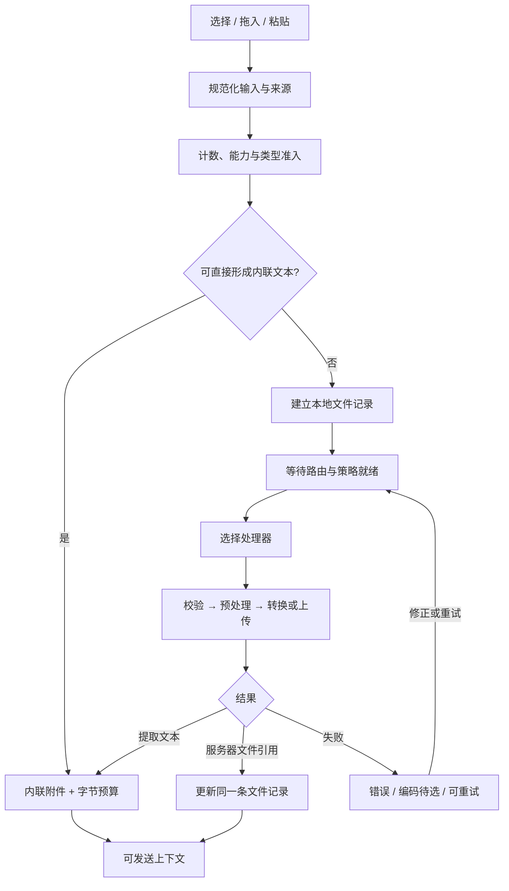
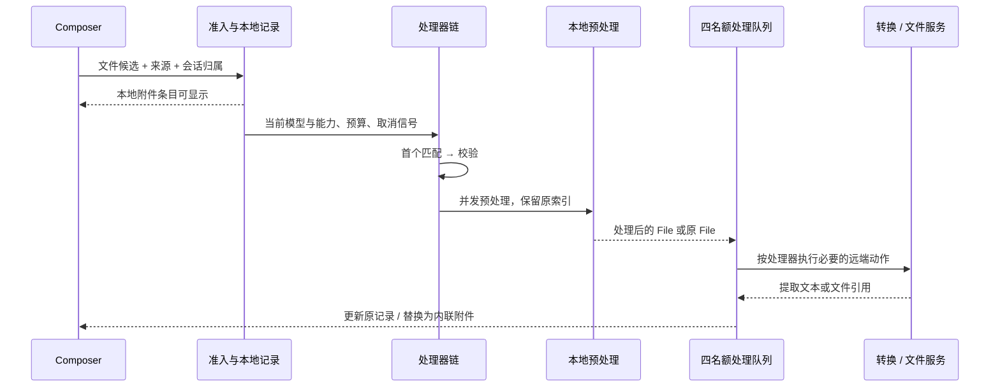
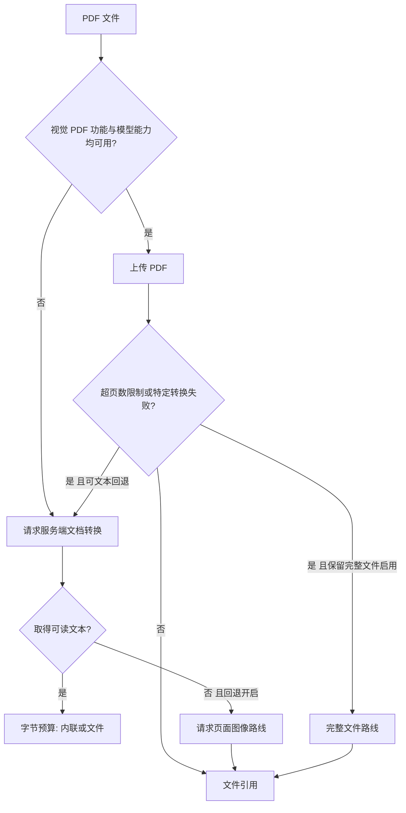
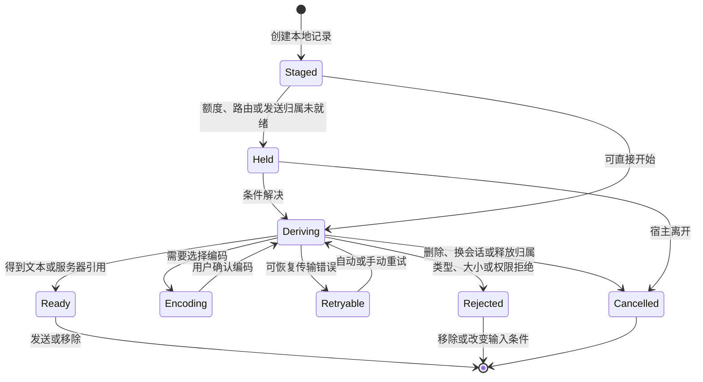
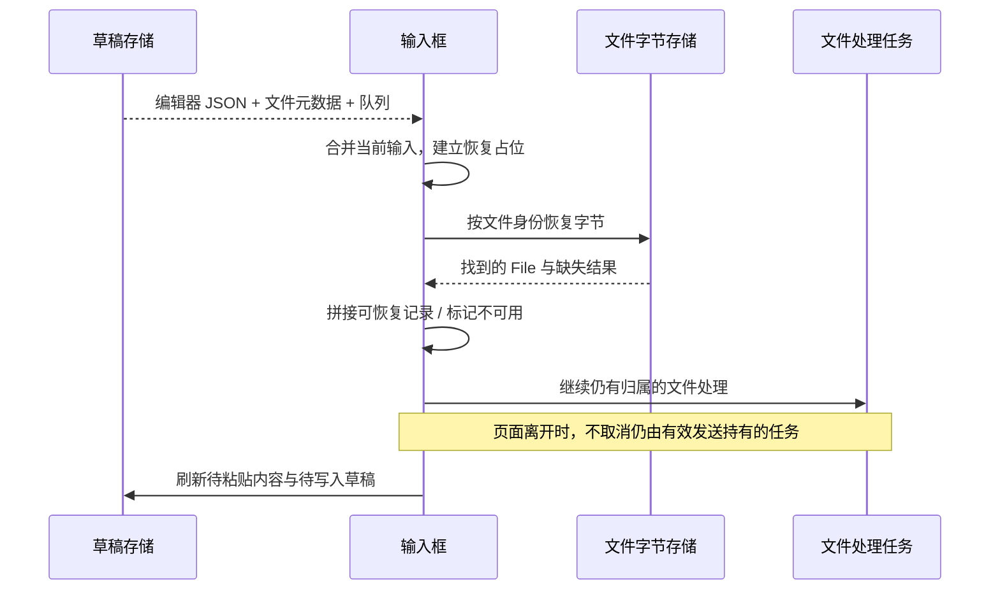

# 卷五 · Context & File Pipeline：从输入动作到可发送上下文

## 5.1 输入框的真实产物是一份待发送记录

一个文件出现在输入框上方，并不意味着模型已经取得它。这个界面同时维护文本草稿、内联附件、待上传文件、同步资料引用、排队消息和录音状态。发送按钮读取的是这些状态共同构成的提交条件，而不是“文本不为空”这一项。

本卷范围是 Claude Desktop 2.37337.1 Linux 包的选定客户端路径；服务器上下文构造与当前托管页面需另行验证。版本与 IP 证据见[附录](#附录)。

最重要的分界是两种附件表示：

| 表示 | 核心内容 | 何时有用 | 尚未解决的问题 |
|---|---|---|---|
| 内联附件 | 文件名、类型、原始大小、提取文本 | 粘贴文本、代码文件、已转换文档 | 编码是否正确；内联字节预算是否足够 |
| 文件记录 | 客户端 UUID、原生 File、可选本地路径、上传状态、服务器引用 | 图像、完整 PDF、表格、较大文件 | 上传是否完成；引用属于哪个会话；失败后能否重试 |
| 同步资料引用 | 来源标识及同步状态 | 连接器或知识来源 | 同步是否结束；来源是否仍可用 |
| 草稿/排队输入 | 编辑器文档、上述引用、发送归属 | 页面切换、排队、恢复编辑 | 谁拥有这次发送；旧异步结果是否仍可写入 |

在客户端内，内联附件与文件记录是两组独立数组。文件记录还可以附带上传 Promise、AbortController、硬错误、软错误和发送阻断原因。服务器返回的新引用会合并到已有客户端记录上；某些处理结果则把一条待上传文件替换为内联附件。稳定的客户端身份使列表不必等服务器返回才建立。〔IP01、IP07〕



图中的“上下文”是客户端准备的输入集合。它并不是已经完成 tokenizer、OCR、检索、系统指令拼接的模型输入。

## 5.2 三种输入动作，共享一条准入路径

### 文件选择器不是唯一的类型裁判

文件选择器的 `accept` 根据模型图像能力、文件能力、允许任意类型的分支和被禁用的扩展名动态生成。存在允许所有类型时返回空 `accept` 的路径。因此，选择器只是第一层交互提示，真正的匹配、大小判断和处理仍在后续处理器中发生。

数量预检查会合并当前内联附件、文件记录、同步来源和新候选数量；另有受功能开关控制的会话文件数、图像数预检查。PDF 在支持视觉 PDF 的路径中也可能占用相应的文件或图像额度。这里不能提炼出一个对所有账户、模型和宿主都成立的固定“最多 N 个附件”。〔IP02〕

### 拖放需要保留目标身份

选择器、粘贴和拖放最终调用共同的上传入口，并携带来源信息。选择器处理后清空 input 的值，使再次选择同一个文件仍能产生变化事件。拖放可以携带路径映射；支持原生文件夹的宿主可保留文件夹引用，否则遍历内容并展平为文件。

文件夹读取是异步的：用户可能在目录展开完之前切换聊天。被检查的新版入口会记录目标快照，对“含文件夹的结果、但目标已变化”的情况丢弃结果并提示重新拖入目标聊天；不能把这一处条件扩写成所有纯文件拖入都经过完全相同的守卫。找不到本地文件夹路径是另一种独立错误，不会被伪装成上传失败。〔IP03、IP04〕

### 长粘贴是表示转换

经典粘贴适配器使用 **4096 个 UTF-8 字节**作为长文本转换门槛。它先取得并清理纯文本，再决定插入编辑器还是形成附件。Shift、禁用该转换的配置、空文本和低于门槛的文本都保留普通编辑路径。这是该适配器的规则，不是上下文窗口大小。

粘贴还处理一种常见混合载荷：Office 类 HTML 同时携带文本和图片。客户端能够识别这种组合并优先使用文本，避免把电子表格复制操作意外理解为一张截图。普通图片粘贴则走文件上传入口。粘贴可能先形成内联文本，也可能经调用方提供的能力提升为 `.txt` 文件。〔IP05〕

```text
原创示意算法：处理一次粘贴

输入 = 读取剪贴板的文本、HTML、文件
清洁文本 = 清理需要处理的隐藏字符(输入.文本)

如果是支持识别的 Office 文本与图片组合：
    在编辑器插入清洁文本
否则如果含文件：
    经过数量检查后，把文件交给共享入口
否则如果按住 Shift，或文本较短，或转换被禁用：
    继续普通编辑器粘贴
否则：
    按当前内联预算与文件能力，建立文本附件或文本文件
```

编辑器另有隐藏字符粘贴扩展，区分外部粘贴和内部拖动，并检查 VS Code 的剪贴板元数据。扩展销毁时撤销监听器。这种清理可以减少不可见字符带来的展示和解析歧义，但不等于理解代码语义或消除内容中的全部风险。〔IP06〕

## 5.3 先决定处理器，再处理文件

文件入口不是一个巨大的“按后缀上传”条件分支，而是有顺序的处理器链。第一个匹配的处理器拥有该文件。顺序本身就是行为的一部分：大文件直传必须排在普通大小拒绝器之前，PDF 必须先于兜底文本处理。

| 次序 | 处理器职责 | 工程含义 |
|---|---|---|
| 1 | 已禁用、未支持、仍下载中的文件 | 及早形成可解释的拒绝 |
| 2 | 有更高额度的会话绑定大文件 | 在普通大小守卫前选择专门上传路径 |
| 3 | 普通文件大小守卫 | 拒绝不满足当前路线限制的文件 |
| 4 | PDF | 决定视觉 PDF、文本提取或完整文件 |
| 5 | 图像 | 格式转换、本地缩放、上传 |
| 6 | 可提取内容的文档 | 服务端转换或保留完整文件 |
| 7 | 上下文外文件 | 保留原文件，供文件/分析能力使用 |
| 8 | 文本 | 本地解码，必要时转交服务端 |
| 9 | 会话文件存储兜底 | 接住该路线允许的剩余文件 |

流水线的阶段是：匹配、校验、预处理、处理。预处理可以并发执行，但其结果写回原输入索引；处理阶段使用 **四个并发名额**，最终的 Promise 集合仍保持输入顺序。实际完成先后不会自动改变返回数组的顺序。外层还有上传节奏和并发协调，这四个名额只是这一处理器内部的限制。〔IP08、IP09〕



队列也有“不要继续制造无意义失败”的保护。如果一个上传收到适用于整批的服务器拒绝，例如项目知识或存储配额问题，尚未开始的必上传项会直接跳过。另一个守卫针对极慢失败：自最近一次成功处理以来，至少耗时 540000 毫秒的失败累计到八次后，后续项可以停止启动。这个数值是慢失败断路条件，不能描述为所有上传的九分钟超时。〔IP10〕

## 5.4 文本、长代码与字节预算

### 本地处理的是字符编码，不是代码语义

对可按文本处理的文件，客户端可以读取 ArrayBuffer，检查编码特征，并使用严格的 TextDecoder 解码。失败并不立即把乱码当作合法内容：它可以保留原缓冲区，形成“编码待选择”的附件。用户确认后，文本重新进入内联预算检查；太大时仍可转成文件上传。

文本分支也有轻量二进制识别。对不属于已知文本类型的文件，它最多采样 8000 字节检查零字节等信号；UTF-16 字节序标记有特别处理。提取结果和文件元数据会去除 NUL 字符；文件名另有 Unicode 规范化。被检查的代码没有显示对 Python、TypeScript 等执行 AST 级理解：长代码在这一层首先是文本。〔IP11、IP12〕

### 字节账本避免并发超额

内联预算的基本单位是 UTF-8 字节。它与 JavaScript 字符串长度、模型 token 数都不同：一个 ASCII 字符通常为一个 UTF-8 字节，一个汉字通常为三个，部分字符需要四个。

客户端为已有附件与尚在处理的附件建立预留账本。若两个异步来源同时产生文本，不能让它们都基于“当前还没加入列表”的旧余额通过检查。预留成功后占住额度，完成、替换或失败后释放；释放函数具有幂等性，重复清理不会把账本减成负数。〔IP13〕

```text
原创示意算法：预留内联字节

能容纳(新增字节) =
    已有附件的 UTF-8 字节总和
    + 已预留但尚未提交的字节
    + 新增字节
    <= 当前消息的内联字节额度

预留(新增字节)：
    若不能容纳，返回失败
    计入预留额度
    返回一个只能生效一次的释放动作

形成附件：
    同时检查单附件额度和总额度
    若都满足，提交内联附件
    否则若该宿主允许文件，形成 text/plain 文件并上传
    否则显示单附件过大或合计过大的具体提示
```

“转成文件”改变的是上下文交付方式：文本不再直接放在内联附件列表里，而是通过文件引用交付。它不是把模型窗口无成本地扩大。是否由服务器读取、何时读取、读取多少，属于后续文件能力和模型执行的契约。某些较旧路径没有上下文外文件能力时仍返回内联结果，因此也不能把预算 helper 的存在等同于所有路线都会硬拒绝。〔IP14〕

## 5.5 PDF 与表格：本地编排，服务端解释

### PDF 的关键问题是“怎样交付”，不是统一提取

PDF 处理器检查两个条件：该功能路线允许视觉 PDF，以及所选模型声明支持 PDF。都满足时，请求上传 PDF 供页面处理；否则使用文档转换路线取得文本。源码中名为 `fallbackToTextExtraction` 的方法调用的仍是服务端转换函数，不能因为方法名含有 extraction 就写成本地 PDF 提取。

长 PDF 的处理存在多条条件路径：

| 条件与结果 | 客户端动作 | 能从客户端确认什么 |
|---|---|---|
| 支持视觉 PDF | 上传 PDF，请求相应处理 | 请求路线和返回文件引用 |
| 未走视觉 PDF | 请求文档转换 | 返回提取文本后，再作内联/文件决策 |
| 超出服务端页面限制 | 视功能配置保留完整文件，或改走文本 | 客户端如何接住特定错误 |
| 文本太大且允许文件 | 上传完整文件或转换后的文本文件 | 表示由内联附件变为文件 |
| 无可读文字且该回退开启 | 请求以页面图像方式处理 | 有针对扫描型/无文本 PDF 的分支 |

结果元数据明确区分“保留过页数上限的原文件”“客户端得到文本后上传为文本文件”“无文本 PDF 作为页面图像上传”等结果。这里的“客户端得到文本”不意味着客户端自己完成了 OCR。页面上限、OCR 引擎、版面分析、公式识别和最终模型页面编码均没有在这些调用点展开。〔IP15、IP16〕



### 表格类型不能只看扩展名

CSV 同时出现在文本扩展名集合和上下文外文件集合中。XLS/XLSX 在文件能力关闭且大小允许时存在转换路径；开启文件/分析能力时可作为完整文件交付。DOC/DOCX、PPTX、RTF、EPUB、ODT 则属于内容提取文档集合，也可能受“文档作为完整文件”策略影响。

所以“CSV 一律转成纯文本”“Excel 一律在浏览器解析”都不成立。处理器优先级、能力配置、项目/普通聊天路线和大小共同决定结果。客户端可验证的是路由和元数据；工作表是否展开、公式如何计算、合并单元格如何保留，需要服务端证据。〔IP17〕

## 5.6 高分辨率图像：多层、有退路的本地预处理

图像路径最容易被一句“上传前压缩”误导。包中至少存在两种不同的缩放策略，以及单独的格式转换路径。

### JPEG 照片路径

符合条件的非项目 JPEG 照片先加载一个专门的本地 worker。该路径的目标长边是 **2576px**，JPEG 质量参数为 **0.85**。它先读 JPEG 头取得尺寸：已经在目标尺寸内就保留原文件，解码像素数超过 **8000 万**也不进入这条重编码路径。输出必须是有效 JPEG，且比原文件更小，才采用新文件。〔IP18〕

worker 会检查浏览器的 bitmap、OffscreenCanvas 和高质量平滑能力，并用一个小型探针确认 EXIF 方向是否被正确应用。方向处理不可靠时，保留原文件更安全，因为“成功缩小但旋转错误”并不是可接受的优化。

```text
原创示意算法：照片缩放

尺寸 = 从 JPEG 头读取宽高
如果尺寸未知，返回原文件
如果长边不超过目标，返回原文件
如果宽 × 高超过解码像素预算，返回原文件
如果 worker 或方向处理能力不足，返回原文件

比例 = min(1, 目标长边 / max(宽, 高))
新尺寸 = 按比例缩放并限制至少为 1 像素
在白色背景上绘制，编码为指定质量的 JPEG

如果输出无效、为空或大小大于等于原文件，返回原文件
否则返回新的 JPEG 文件
```

任务串行进入 worker，以控制峰值解码内存。队列等待上限为 10 秒，单任务为 15 秒；连续 worker 故障可以触发 10 分钟冷却。取消会终止相应工作，bitmap 在清理阶段关闭。超时、能力不足、重编码失败都保留具体结果原因，并可继续使用原文件。〔IP19〕

### 通用 canvas 与格式转换路径

另一条由功能配置控制的 canvas 分支把宽、高分别限制在 **8000px** 范围内。BMP、HEIC、HEIF 还有转 JPEG 的路线：转换 helper 的默认上限为 4096px，符合非项目照片条件的 HEIC 使用前述 2576px 目标。通用 helper 会撤销 object URL，并从 DOM 移除临时 canvas。解码或平滑支持不满足时保留原文件。

这些值是不同分支的预处理参数。2576、4096、8000 不能被合并成一个统一的模型视觉输入尺寸；原文件、项目上传、格式转换、浏览器能力和失败回退都可能走不同路径。〔IP20〕

## 5.7 大文件、取消、重试与清理

### 大文件先取得放置位置，再发送字节

普通路线出现 30 MiB 守卫，但它前面还有专门的大文件处理器。当会话已有标识且当前额度更高时，符合范围的文件进入两阶段上传：先提交文件名、媒体类型和大小提示，取得文件身份及放置路径；再发送实际字节。

完成后，客户端比较选择时大小、当前源文件大小和服务端报告的存储大小。它能区分源文件在处理中发生变化、空文件写入、网络异常与服务器拒绝。失败清理按错误类型分支：已取得上传结果后，空存储或源大小变化错误会进入删除路径；其他失败只有在返回了文件名、且共享路径检查明确允许时才删除。因此，共享检查不是所有失败清理的统一前置条件。〔IP21〕



### 等待策略也是状态

某些文件在真正处理前等待：发送仍被持有、较大文件的额度尚未确定，或者文档究竟应作为文本还是文件尚未得到答案。这些等待与取消信号竞争。会话归属改变会取消旧处理；文档策略改变可以中止当前尝试，重新选择路线。它们不能简单地合并为一个旋转中的 `loading`。〔IP22〕

### 错误不能只有一个红色布尔值

客户端区分：

- 上传仍在进行，有 Promise 和取消控制
- 可继续保留的软错误
- 上传硬错误
- 不可读、被拒绝、不可用等发送阻断原因
- 需要用户决定的编码状态
- 用户主动移除或会话切换引起的取消

被检查的自动重试策略对一类网络错误使用 **1 秒、5 秒**退避，并要求在线、未卸载、尝试持续时间足够且满足特定错误分类。验证拒绝与主动取消不会因为“失败了”就被无限重试。手动重试清理相应错误字段后重新进入处理。〔IP23〕

### 删除附件卡片不等于立即删除远端文件

移除操作先取消该条记录的任务并从草稿列表删除，再判断是否有必要清理远端对象。已有发送、其他持有者、同路径或同名的待处理项可能仍在使用该对象。只有归属检查允许时才继续删除。这个次序既让界面立即响应，也避免破坏另一条正在发送的输入。〔IP25〕

## 5.8 附件卡片是状态投影

图像、Blob、已清理文档、会话文件和内联文本有不同卡片。图像可先使用本地 File 生成预览，随后转为服务器预览资源。错误或阻断状态优先渲染诊断卡片；缺少编码有专门提示，不能假装已经有可用文本。

本地预览还拥有自己的资源生命周期：同一个 File 的 object URL 由订阅者集合共享，最后一个订阅者离开时才撤销 URL 并清除缓存项。上传任务、服务器文件和浏览器预览 URL 因此是三种不同的所有权，不能用同一个删除动作替代。〔IP35〕

因此，卡片应从数据状态投影，而不是自己拥有第二套上传状态。否则很容易出现：卡片显示完成，发送仍被阻断；预览能打开，但上传实际失败；删除了卡片，后台任务又把它加回来。稳定身份、单一归属和取消控制解决的是这些跨组件问题。后一句是从控制流得到的工程解释，并非对运行时测试的声称。〔IP24〕

## 5.9 草稿恢复是一场异步合并

草稿保存的不是整个运行中对象。持久化版本保留编辑器 JSON、过滤后的附件、稳定文件元数据、同步来源和队列输入；原生 File 字节另行保存，Promise、AbortController 和瞬时错误则从序列化结果剥离。

恢复分两层完成：文字/记录已水合，不代表附件字节已恢复。界面为此保留独立标志以及临时文字、附件占位。原生文件重新拼接到记录后才能再次处理；找不到需要的文件字节或有效引用时，会形成 unavailable 状态。临时聊天、特定新聊天、会话不匹配及 URL 预填等场景还有保存或恢复抑制逻辑。〔IP26〕

排队输入的恢复也有次序：标记为“草稿前”的内容、当前草稿、“草稿后”的内容顺序合并。排队文件先过滤掉与当前草稿已有 UUID 重复的项；该 helper 本身未对不同排队条目作全局去重。同步来源则对合并后的标识集合去重。这样排队后的页面重载不会把尚未发送的内容全部抹掉，也不会把它误当成已经发送成功。〔IP27、IP32〕



另有很窄的新输入框交接窗口：内存快照携带账户和草稿键，只接受 5 秒内且归属匹配的快照。这是导航交接机制，不是“草稿只保存五秒”。组件卸载时也不会无条件取消所有附件：仍属于持有、等待创建接受或有效发送的任务需要继续存在。〔IP28〕

## 5.10 语音输入必须拥有当前草稿

短时听写与完整语音会话是两套状态。听写保存最终文本、临时文本、麦克风状态、所有者、开始/连接信息、收尾 drain 和错误原因。它能否出现，取决于平台支持、桌面声明的可用能力或网页功能配置，以及所在界面与布局条件。〔IP29〕

听写适配器为每个输入框建立所有者身份。繁忙状态、功能被关闭、面板隐藏、组件卸载、会话或草稿代际变化，都能结束相应听写。通常 Enter 提交听写文本，Escape 取消；另有允许 Enter 透传的宿主。快捷键按住 500ms 后可切入按住说话模式，释放后停止。这里的“提交”指结束并接纳听写，不应自动解释成向模型发送消息。〔IP30〕

文本合并保留光标前缀和后缀，并有支持录音期间编辑的路径。后到的临时识别结果不能直接覆盖用户刚刚修改的整份草稿。完整语音会话在新聊天导航时还有独立交接：把已经取得的临时转写交给新会话和明确的用户消息身份，清理时撤销订阅并清空已交接的临时文本。〔IP31〕

## 5.11 排序、token 与缓存：三个不同问题

### 客户端集合顺序

处理器批次保留原输入顺序；草稿恢复有前后分组顺序；一个会话消息构造器在普通图像输入时把图像块放在文本前，在录屏帧路径中则把帧相关文本与图像交错。这些都是具体客户端路线的数组顺序。

它们没有揭示最终模型请求中系统指令、工具声明、项目知识、检索结果、历史消息和附件内容的全局排序。没有对应服务器构造器时，不应画出一张貌似确定的“完整 prompt 拼装图”。〔IP32〕

### token 估算

这里能验证三个不同度量：

| 度量 | 实际用途 | 不能解释为 |
|---|---|---|
| UTF-8 字节与预留账本 | 内联附件准入、并发预算 | 模型精确 token 数 |
| 提取文本字节数 ÷ 4 | 一处项目知识额度估算 | 所有语言、文件和模型通用 tokenizer |
| 文本长度 ÷ 4 向上取整；图像/文档块按 1600 | 编码会话的部分归因/用量估算 | 主聊天发送时真实视觉 token 计费 |

后一个 helper 所在路径还汇总工具与子任务用量，因此它不能被挪用为附件上传器的精确成本公式。〔IP33〕

### prompt cache 的可见边界

会话用量代码读取缓存命中输入量、缓存写入输入量和普通输入量；另一个视图据此计算上下文量，并从消息时间推导 cache age。这说明客户端可以观察并展示服务端报告的缓存相关用量。

这些计数没有说明缓存边界放在哪里、缓存键怎样生成、TTL 是多少、哪些附件复用、编辑一段文字会使哪一段失效。也没有证明上传文件自身就是 prompt cache。对独立实现而言，应把“上传对象缓存”“本地预览缓存”“草稿持久化”和“模型 prompt cache”设计成不同层，分别定义身份、有效期与失效条件。〔IP34〕

## 5.12 可迁移的工程结构

这套输入系统最值得借鉴的并不是某个文件上限，而是边界的划分：

1. 入口只负责把选择、拖放、粘贴转换成统一候选，不在每个入口复制上传逻辑。
2. 稳定客户端身份先于服务器身份，附件可以立即显示而不谎称完成。
3. 处理器按明确优先级决定文本、图像、PDF和完整文件路线。
4. 预算在并发工作开始前预留，在成功、失败和取消后对称释放。
5. 每条任务绑定账户、会话和草稿归属；过时的异步结果不能写进新聊天。
6. 卡片、发送按钮和恢复逻辑读取同一份状态，避免各自猜测“上传完成”。
7. 持久化只保存可恢复的数据，运行控制对象重新建立。
8. 本地预处理、远端文档解释和模型上下文策略分层，不用一个“文件已上传”掩盖三种完成条件。

以上可以直接转化为原创实现中的数据模型与测试清单：重复选同一文件、长文本 Shift 粘贴、读取文件夹时换聊天、上传中删除、编码待选、策略中途改变、原文件重编码更大、草稿文字已恢复但字节缺失、听写结束后才到的临时文本，以及保存中的草稿被新输入取代。

## 附录

静态范围为 Claude Desktop Linux amd64 2.37337.1 的选定 `ion-dist` 路径。IP 编号见[结构化证据](../../04-Extracted-Core-Code-And-Scripts/evidence/data/input-pipeline.json)，含文件哈希、字节锚点与适用条件。研究以 REA 和惰性语法分析读取代码，未运行目标应用、上传文件、调用包内 API 或启用麦克风；服务器提示词构造与当前托管页面保持独立边界。

[返回全书目录](../README.md) · [阅读前提与术语](../README.md#一页阅读准备) · [原创代码实验室](../../04-Extracted-Core-Code-And-Scripts/core-code-lab/README.md)

## 动手推演

[完整案例：状态表、可运行代码与预测练习](worked-case.md)把本卷的异步边界放到同一条时间线上。

## 动手检查附件状态

打开[附件实验台](../../01-Frontend-Design-And-HTML-Templates/interactive-lessons/attachment-pipeline/README.md)，先预测两个附件谁先完成，再观察预算、槽位和 Send 快照。实验允许手动投递取消后的迟到结果，检查旧回调为什么不能恢复已经取消的卡片。
