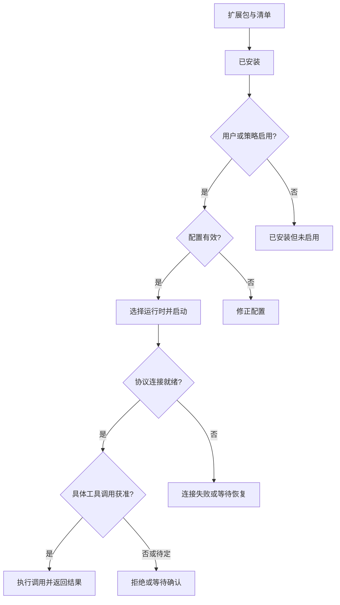

# 第 6 卷 扩展配置与工具权限

从安装包到进程连接 再到一次获准的调用

安装一个扩展，至少会跨过包来源、配置、进程、连接与调用决定五个边界。它们分别失败时，用户看到的可能都是“工具不能用”。把这些状态拆开，才能解释安装完成但尚未启用、连接正常但调用需批准，以及界面中的权限标签为何不等于操作系统隔离。

本章以官方 Claude Desktop Linux x64 2.37337.1 为静态样本，结合截至 2026-10-14 读取的官方文档。重点是扩展宿主如何管理可变状态，以及本地 MCP、账户远程连接器、插件和 Claude Code 为什么不能混用配置与权限结论。

## 一张图：安装到调用的五道门



图中每个判断负责不同的契约；“包存在”“进程已启动”和“动作可执行”不是同一个布尔值。重启工具只能处理运行与连接问题，不能自动修复错误配置或取得用户授权。


## 本章地图

[01 集成的四个坐标](#01-集成的四个坐标) · [02 清单与配置](#02-清单与配置) · [03 本地进程生命周期](#03-本地进程生命周期) · [04 权限与隔离](#04-权限与隔离) · [05 Desktop 与 Code](#05-desktop-与-code) · [06 原创例子与验证](#06-原创例子与验证)

### 证据图例

**S 静态**对应本包的声明与处理分支；**D 官方文档**按文档日期与适用产品解释；**A 原创**表示工程推导与示例。证据范围限于静态分析与文档，账户启用状态及实际执行结果仍待运行验证。

[X01–X16 台账](../../04-Extracted-Core-Code-And-Scripts/evidence/data/extension-boundaries.json)保存文件摘要、短锚点、UTF-8 位置和 D01–D10 官方来源。主进程 IPC 边界见[第 1 卷](../01-System-Architecture/README.md)，通用配置持久化见[恢复专题](../17-State-Recovery-And-Updates/README.md)。

## 01 集成的四个坐标

MCP 是 Model Context Protocol，即模型上下文协议，规定宿主与工具服务如何交换消息。MCPB 是包含清单和本地服务的 ZIP 交付格式，解决怎样打包、描述、配置与安装。后缀从 DXT 改为 MCPB，没有改变两者的分工。[X01](../../04-Extracted-Core-Code-And-Scripts/evidence/data/extension-boundaries.json)，[官方扩展架构说明](https://www.anthropic.com/engineering/desktop-extensions)

| 坐标 | 应问的问题 | 不能据此代答的问题 |
|---|---|---|
| 包装 | 是 MCP 服务、MCPB，还是组合多种能力的插件？ | 服务到底在哪里执行 |
| 执行位置 | 用户机器、其他主机，还是云端？ | 该次调用是否获准 |
| 配置所有者 | Desktop、账户、项目、组织还是某个会话？ | 其他宿主是否实时共享它 |
| 当前阶段 | 已安装、已配置、已连接、已发现工具还是已批准调用？ | 后续各阶段是否自然成功 |

常规账户自定义远程连接器由 Anthropic 云端发起连接；Desktop 本地 MCP 有独立的配置与执行路线。插件可以组合技能、工具等能力，其中的 MCP 也可能是本地或远程。因此，桌面窗口出现在哪台机器上，不足以说明工具请求从哪里发出。[X13](../../04-Extracted-Core-Code-And-Scripts/evidence/data/extension-boundaries.json)，[远程连接器](https://support.claude.com/en/articles/11175166-get-started-with-custom-connectors-using-remote-mcp)、[产品概念区分](https://support.claude.com/en/articles/11725091-when-to-use-desktop-and-web-connectors)

包内还包含组织部署与 direct-MCP 路线。常规账户文档有自己的适用范围，不能包办每一种部署；后文的原生确认窗口也只属于特定路线。

## 02 清单与配置

### 清单成为有效配置之前还有解析阶段

本包解析器包含 0.1、0.2、0.3、0.4 四组 MCPB schema，兼容旧 `dxt_version`，并包含 `uv` 运行类型；运行时探测结果声明最高支持清单版本 0.4。[X02](../../04-Extracted-Core-Code-And-Scripts/evidence/data/extension-boundaries.json) 这是此版本的解析能力，不是任意扩展、平台都能安装成功的保证。

```text
包作者的清单
    │ 服务类型、入口、启动模板
    ├─ 当前平台覆盖项
    ├─ 安装目录与系统目录
    └─ 用户配置
          │
          ▼
    校验必填项并展开变量
          ├─ 缺少必填值 → 暂不生成启动配置
          └─ 条件满足 → 命令、参数、环境变量
```

*图 1　A 配置生成图。安装可以完成而保持未启用，等待必填配置；这两个结果不矛盾。*

上述关系来自 [X03](../../04-Extracted-Core-Code-And-Scripts/evidence/data/extension-boundaries.json)。公开清单的 `user_config` 描述字段类型、必填、默认值、多选与敏感值，使配置表单和校验可以共用输入合同。[MCPB 清单规范](https://github.com/modelcontextprotocol/mcpb/blob/main/MANIFEST.md)

规范页在观察时的页首仍写 0.3，正文已介绍 0.4 的 uv；历史工程文章的字段拼写也与当前规范不同。因此，历史说明、持续更新的文档和固定包的解析行为分别构成版本依据，解析能力以对应二进制为准。

### 包文件 设置和安装记录分别持有

本包分别构造扩展安装目录、扩展设置目录及 `extensions-installations.json`。清单记录包的声明，设置记录用户如何配置它，安装元数据记录宿主认识的安装。[X04](../../04-Extracted-Core-Code-And-Scripts/evidence/data/extension-boundaries.json)

从状态所有权看，这种分离为升级提供了基础：程序文件可被替换，用户输入独立于包，禁用状态也无需改写作者清单。具体升级与恢复分支仍须分别验证。

聊天侧本地 MCP 配置构建器先筛选禁用或组织阻止的扩展，再合并扩展生成项与手工配置。在这个合并点，同名用户条目覆盖扩展条目。[X05](../../04-Extracted-Core-Code-And-Scripts/evidence/data/extension-boundaries.json) 这一优先级不自动适用于 Cowork、Code、远程账户连接器或其他托管配置。

因此，自建诊断界面若只显示服务器名称，会遗漏冲突的原因。更有用的记录是“名称、配置来源、执行位置、有效版本”；它能解释为什么同一个名字最后使用了另一组参数。

### 敏感字段的保护带有条件

本包对标记 sensitive 且非 null/undefined 的值，只有字符串及数组内字符串调用 Electron `safeStorage` 加密，数字、布尔等其他类型保留原形式。加密不可用或异常时存在保留原值的回退，设置 writer 使用转换后的对象写文件，因此这条静态链已经追到持久化调用。解密失败另有配置降级状态。[X07](../../04-Extracted-Core-Code-And-Scripts/evidence/data/extension-boundaries.json)

同一 Linux 包也有启动 keyring 探测和提示。keyring 是系统密钥存储设施：当探测判为不可用、存在已登录账户、不是持续集成 CI 环境、未记录已显示且没有待发提示时，代码约 5 秒后请求主视图显示扩展密钥未加密的说明；只有消息分发器接受后才记为已提示。[X07](../../04-Extracted-Core-Code-And-Scripts/evidence/data/extension-boundaries.json)

提示覆盖范围由上述启动条件决定，单字段加密异常未必触发告知。具体用户是否已明文落盘、各平台密钥库如何工作，均需独立验证。敏感存储的完整契约应说明：加密成功时怎样保护；不可用时是否阻止保存、明确提示或降级。字段标签只声明敏感性，失败路径由这些规则决定。

## 03 本地进程生命周期

### 内置运行时负责适配

宿主按扩展类型、兼容性与配置选择运行方式，包含内置 Node utility process、外部进程和动态 uv 分支。utility process 是 Electron 提供的辅助进程容器；附带运行时可以减少用户安装依赖的步骤，但本身不能证明文件系统被沙箱隔离。[X08](../../04-Extracted-Core-Code-And-Scripts/evidence/data/extension-boundaries.json)

`nodeHost.js` 的静态实现将标准输入、标准输出与错误输出接入 MessagePort，再加载所选服务入口，并向父进程报告致命错误。MessagePort 是进程或线程间传递消息的端口。[X09](../../04-Extracted-Core-Code-And-Scripts/evidence/data/extension-boundaries.json)

MCP 的 stdio 传输把协议消息放在 stdin/stdout，stderr 可用于诊断。服务若把普通调试文字写进协议输出，可能破坏客户端解析。因此，日志写到哪里也是集成合同的一部分。[固定版本传输规范 2025-06-18](https://modelcontextprotocol.io/specification/2025-06-18/basic/transports)

### 启动和停止由同一个管理者协调

聊天侧本地 MCP 管理器对同名服务器的操作串行化，重新启动前关闭旧 transport，并区分初始化、运行与失败。transport 是承载协议消息的连接对象。renderer 释放端口时进入关闭路径，应用退出也注册了 MCP 清理步骤。[X10](../../04-Extracted-Core-Code-And-Scripts/evidence/data/extension-boundaries.json)

```text
同名服务器的操作队列
          │
          ▼
关闭旧 transport → 选择配置与运行方式 → 初始化连接
                                            │
                                      ┌─────┴─────┐
                                      ▼           ▼
                                    运行         失败
                                      │
                  renderer 释放端口或应用退出
                                      ▼
                                  关闭连接
```

*图 2　A 局部生命周期。包内另有共享池与不同会话路线，不表示所有 MCP 都服从同一条独占连接模型。*

最有价值的测试发生在步骤之间：启动未完成时窗口关闭，配置变化时旧进程仍持有参数，撤销之后另一个会话仍持有连接。一个 transport 的退出等待常量不能代表全部 MCP 的停止算法；Code 文档也不能替 Desktop 补齐实际退出时序。

此外，断线只说明连接结束。已经发出的文件写入或远程操作，是否发生、是否取消，需要独立确认；生命周期管理不能自动提供事务回滚。

## 04 权限与隔离

### 安装 启用和调用是不同决定

主进程接口区分扩展可用性、本地安装是否允许、安装状态、配置修改与连接变化。随包携带的 ion 前端也将组织策略加载与扩展列表加载分开。这些结论适用于 bundled UI 的静态实现；标准 hosted 页面的实际显示仍取决于当前账户与部署。[X06](../../04-Extracted-Core-Code-And-Scripts/evidence/data/extension-boundaries.json)

同一类包内前端权限界面按交互、只读、写入/删除及其他类别组织工具，提供始终允许、需要批准和阻止状态，并按组织策略收窄可选项。某些场景即使显示始终允许，也提示写操作可能仍需确认。[X11](../../04-Extracted-Core-Code-And-Scripts/evidence/data/extension-boundaries.json)

可以用下面的 A 状态矩阵设计自己的宿主；各行相互独立，避免一个总“已连接”遮住所有决定。

| 轴 | 原创示例状态 | 它回答什么 |
|---|---|---|
| 安装 | 未安装、已安装、待更新 | 程序文件是否存在 |
| 配置 | 缺必填项、可用、读取失败 | 能否生成有效启动参数 |
| 连接 | 未启动、连接中、已连接、失败 | 当前是否能交换协议消息 |
| 策略 | 允许、受组织限制、尚未加载 | 当前宿主允许提供什么能力 |
| 调用 | 本次允许、需批准、阻止 | 当前目标与参数能否执行 |

包内另有本地原生确认表面，处理组织配置相关的连接、断开、聊天授权与配置应用，并区分允许、取消、超时、错误结果。[X12](../../04-Extracted-Core-Code-And-Scripts/evidence/data/extension-boundaries.json) 它属于特定组织/direct-MCP 路线，不代表每次 MCP 安装或工具调用都弹出同一窗口。

### 安装白名单不代替运行隔离

官方白名单文档说明机器级策略与应用管理的关系，同时明确白名单不能防止用户安装后修改本地文件。官方安全说明提示，本地 MCP 服务拥有普通本地程序的权限；这里的“普通程序”不等于 root 或管理员。[X15](../../04-Extracted-Core-Code-And-Scripts/evidence/data/extension-boundaries.json)，[扩展白名单](https://support.claude.com/en/articles/12592343-enabling-and-using-the-desktop-extension-allowlist)、[本地 MCP 安全说明](https://support.claude.com/en/articles/13364135-use-claude-cowork-safely)

于是，允许目录表单只说明宿主或服务接收了一个范围。要声称操作系统强制限制访问，还需进程权限、沙箱配置与实际执行证据。工具的 `readOnlyHint` 同样只是元数据；MCP 工具规范提醒客户端，不可信服务的注解不能直接视作可信事实。[固定版本工具规范 2025-06-18](https://modelcontextprotocol.io/specification/2025-06-18/server/tools)

这五项控制解决不同问题：安装来源决定信任哪个发布物；配置范围决定期望访问什么；连接与认证确认双方身份；调用批准针对本次动作；资源侧授权决定服务真正能访问什么。[X16](../../04-Extracted-Core-Code-And-Scripts/evidence/data/extension-boundaries.json) 这是一组工程责任划分，证据范围未覆盖 Claude 的完整安全策略。

## 05 Desktop 与 Code

Claude Code 有自己的 local、project、user 配置作用域，也提供显式 Desktop 配置导入。导入是显式配置转移，不是全部本地状态的实时共享；适用平台以 Code 文档的条件为准。公开文档还按终端、云宿主与 Desktop 宿主区分账户连接器交付。[X14](../../04-Extracted-Core-Code-And-Scripts/evidence/data/extension-boundaries.json)，[Claude Code MCP 文档](https://code.claude.com/docs/en/mcp)

尤其当 Claude Code 作为 MCP 服务提供工具时，文档将逐次调用的用户确认责任交给调用它的客户端。工具实现被复用，不会自动带上原产品的每个交互保护。

写下某项集成结论时，给它附上产品、会话类型、配置来源和执行位置，就能避免常见误读。例如“从 Desktop 导入”应继续问导入到哪个 Code 作用域；“已经批准这个工具”应继续问是哪一客户端、哪一动作及哪组参数。上述 Code 行为依据公开文档，固定二进制实现仍在验证范围之外。

## 06 原创例子与验证

### 一个本地资料索引扩展

假设扩展先搜索某个文档目录，再读取文件，最后将摘要发送给云端。最初的目录选择只描述索引范围，不能自然覆盖后续所有操作。可以按以下阶段设计：[X16](../../04-Extracted-Core-Code-And-Scripts/evidence/data/extension-boundaries.json)

1. 安装前展示发布者、版本、执行位置和更新来源。
2. 配置时解释目录用途，校验输入；敏感存储降级应有明确状态。
3. 启动时确认实际配置来源与运行时，日志不记录敏感值。
4. 发现工具时将名称绑定到服务身份，不把返回描述里的额外指令当作授权。
5. 调用时区分搜索、读取、写入和对外发送，呈现重要参数与数据目的地。
6. 服务端再次执行资源访问检查；需要系统级隔离时，另行建立和验证。
7. 断开后清理连接，并对已经提交的外部操作确认结果。

这个原创例子将前述机制组织成一条可实现的责任链。

### 有针对性的合成测试

| 交界条件 | 应观察的结果 |
|---|---|
| 安装完成但必填字段为空 | 配置缺失与启动失败分开呈现 |
| 扩展项与手工项同名 | 有效来源和覆盖关系可查 |
| 策略尚未加载 | 与无扩展、无权限、连接失败区分 |
| 运行时缺失或入口导入失败 | 状态进入失败并给出所属阶段 |
| 启动中关闭窗口或撤销 | 无遗留连接，或明确仍有哪个会话持有 |
| 工具元数据变化 | 重新识别身份与影响，不直接扩大授权 |
| 加密不可用或单字段失败 | 保存结果、降级状态与告知条件可区分 |

以上为 A 测试计划，适用材料是自有无害样例和合成配置。待验证项包括实际扩展库存、功能开关、运行时选择、操作系统权限、加密回退触发情况及竞态时序。

### 静态分析的覆盖范围

本章没有运行目标应用、安装扩展或读取真实配置与凭据。REA 6.5.0 解析的是 Node 适配器与确认界面链路的 4 个文件，另有 433 个清点文件不在选源范围；主 bundle 与部分 ion 前端的结论另据定向字节阅读。这两种方法都不能当作全包运行验证。

[扩展证据台账](../../04-Extracted-Core-Code-And-Scripts/evidence/data/extension-boundaries.json)统一保存选源、解析参数、完整性结果、文件摘要与短锚点，也保留敏感字段落盘链和 Linux keyring 提示的具体条件。完整 REA 图、下载包、提取代码和用户配置不随书分发。

安装决定交付，配置决定如何启动，连接决定能否通信，调用决定当前动作，资源侧控制决定实际权限。每项关系都有独立的验收条件，并须在失败、重连和策略变化后重新检查。

## 动手推演

[完整案例：状态表、可运行代码与预测练习](worked-case.md)把本卷的异步边界放到同一条时间线上。

## 网络配置如何进入工具子进程

[配置转换补篇](../01-System-Architecture/network-ownership/README.md)：Electron 代理答案到环境变量的转换、两个 CA 变量的共存与 caller 优先规则。
