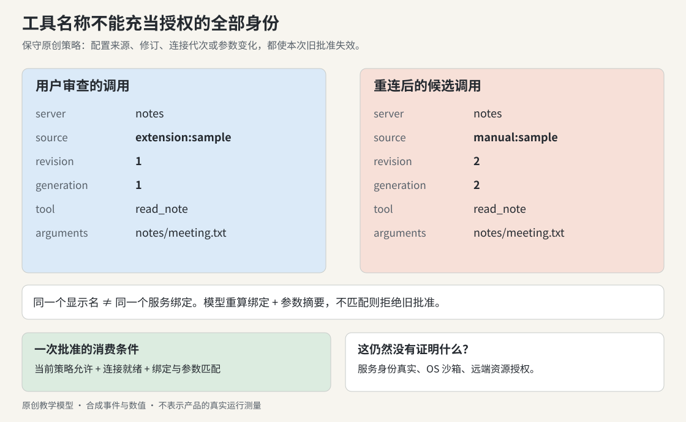

# 实战推演：同名工具重连后，旧审批还有效吗？

设想一个资料索引扩展，服务器显示名为 `notes`，提供 `read_note`。用户正准备允许读取 `notes/meeting.txt`。此时设置中的手工条目覆盖了扩展配置，宿主关闭旧连接、启动新服务。列表里仍写着 `notes`，工具还叫 `read_note`，原审批卡也还在。

如果只按服务器名或工具名取回批准，点击 Allow 就可能把针对旧提供者的决定交给新提供者。这里要问的是：**用户刚才审查的服务身份、配置和参数，与现在即将执行的调用是否仍是同一件事？**

本节用合成配置演示一种保守宿主策略，不声称 Claude 已实现以下完整绑定规则。已观察事实是：所选聊天侧合并点存在同名用户配置覆盖扩展配置（X05）；管理器协调同名服务的连接生命周期（X10）；安装、连接、调用与资源侧权限属于不同判断（X11、X16）。这些事实给出了需要检查的交界，却不足以替代一次完整的安全实现。

## 一、先看一次读取究竟跨过谁

```text
模型提出 read_note({path})
        ↓ 工具名解析
宿主选中一个具体服务连接
        ↓ 调用审批与当前状态检查
客户端在 transport 上发送请求
        ↓ 服务自身的输入、身份和资源检查
服务读取资源并返回结果
        ↓ 宿主验证结果归属并展示
对话收到一份工具结果
```

MCP 是这条链中交换消息的协议；MCPB 描述扩展怎样打包与安装；宿主负责选择服务与提供用户交互。三者没有替彼此完成所有责任。一个合法的协议请求可以被拒绝，一个连接正常的服务也可能没有读取目标文件的权限。

实验不实现 MCP 消息、初始化握手或服务端文件读取。它只把“工具名解析之后、模拟执行之前”这段宿主决策做成可测试代码。

## 二、展示名稳定，绑定对象却可以变化



*图：用户看到的 `notes / read_note` 只是名称。原创模型把配置来源、版本、连接代次与参数一起纳入审批摘要。任何一个改变，都需要重新作出对应决定。*

| 字段 | 旧审批记录 | 重连后的候选调用 | 为什么重要 |
|---|---|---|---|
| server | notes | notes | 单独看不出变化 |
| config source | extension:sample | manual:sample | 提供者或启动来源已不同 |
| config revision | 1 | 2 | 同一来源内也可能改参数 |
| connection generation | 1 | 2 | 新进程不能自动继承旧连接身份 |
| tool | read_note | read_note | 同名接口不保证实现相同 |
| arguments | notes/meeting.txt | notes/meeting.txt | 目标相同也不能抵消提供者变化 |

在这个教学策略里，连接重建一律要求重新批准。实际产品可以选择更精细的长期授权，例如把规则绑定到经验证的发布者、稳定服务身份与明确资源范围。但长期规则与一次卡片结果必须分别建模，不能让旧 Promise 的 allow 充当永久规则。

## 三、用已有 ApprovalDesk，补上“批准的是谁”

本书的 [ApprovalDesk](../../04-Extracted-Core-Code-And-Scripts/core-code-lab/loop-cowork/model.py) 已经解决一次消费与参数摘要匹配。新的 [mcp_binding.py](../../04-Extracted-Core-Code-And-Scripts/worked-cases/mcp_binding.py) 在它外面补一个绑定对象和宿主状态修订号：

```python
from dataclasses import dataclass

@dataclass(frozen=True)
class Binding:
    server: str
    source: str
    revision: int
    generation: int
    tool: str
```

准备审批时，先用 `call_digest(Binding, arguments)` 固定绑定与参数，再将它和当前宿主状态修订号一起计算审批摘要，放进 ApprovalDesk。消费决定时，用当前修订号、绑定和即将使用的参数重新计算。摘要不同，就不能消费为 allow。`call_digest` 的两参数接口与原摘要规则保持不变。

`MockHost` 通过 `__setattr__` 保留直接赋值接口：`policy`、`ready`、`binding` 的值每次真正改变，都会取得一个更大的进程内修订号；赋相等值不算变化。初始化也取得新修订号。因此即使状态经历 A→B→A，当前值恢复相同，修订号仍与旧卡片不同。修订号是运行时内部属性，不加入 dataclass 的字段、构造参数、repr、相等比较或 asdict 输出；新建宿主包括 `dataclasses.replace` 不继承旧审批授权。这个例子只支持可信代码的普通字段赋值，不支持直接改 `__dict__`、私有修订号或跨进程恢复审批。

在 `04-Extracted-Core-Code-And-Scripts/worked-cases/` 目录中独立运行下面的片段：

```python
from mcp_binding import Binding, MockHost

old = Binding("notes", "extension:sample", 1, 1, "read_note")
host = MockHost(old, policy="allow")
args = {"path": "notes/meeting.txt"}
assert host.ask("r1", args) == "pending"

host.binding = Binding("notes", "manual:sample", 2, 2, "read_note")
assert host.decide_and_record("r1", args) == "deny"
assert host.journal == []
```

这个摘要不是身份认证，也不是数字签名。若不可信服务能够自行伪造绑定字段，计算 SHA-256 不会让声明变可信。字段必须由真正拥有配置与连接的宿主持有；真实资源访问仍由服务端和操作系统边界仲裁。示例只处理无秘密的合成路径，也不适合拿摘要日志记录凭据或敏感参数。

## 四、检查两次，是为了应对两次不同的时刻

`ask()` 在画审批卡之前检查策略和连接：策略尚未加载时返回 `policy-loading`，连接断开时返回 `not-connected`。这些状态不应都显示成“无法使用工具，请重试”。

`decide_and_record()` 在消费卡片时再检查一次。如果组织策略变成拒绝，或连接已经断开，它结束这个 pending 请求，返回 `state-changed`。恢复连接或策略之后，旧卡片不会自行复活。如果撤销后还没有点击就已恢复，当前状态检查虽然通过，修订号摘要仍不匹配：首次点击返回 `deny` 并消费旧请求，再点返回 `missing`。

| 时间 | 环境 | 应发生什么 |
|---|---|---|
| t0 | 策略 unknown | 等待策略，不创建可执行的批准 |
| t1 | 策略 allow、连接 ready | 可以展示具体调用审批 |
| t2 | 卡片仍在，管理员撤销能力 | 将该请求视为已经失去当前前提 |
| t3 | 未点击，策略已重新允许 | 修订号继续增加，旧审批仍失效 |
| t4 | 用户首次点击旧 Allow | 返回 deny 并消费旧请求，不记录模拟 dispatch |
| t5 | 用户再次点击旧 Allow | 返回 missing；需使用新请求 ID 重新审批 |

示例的判断与 journal 写入是一个同步内存步骤。真实宿主若在检查后还要 await，需要在真正提交前重新确认相关代次，或把授权凭据交给能原子检查与执行的服务。这个小模型没有证明真实跨进程的“检查到使用”间隙已经消失。

## 五、连接中断后，结果有三种可能

一次读取可能失败得很干净；一次写入或对外发送则可能发生“服务已执行，回应丢失”。把它们全部归为连接失败，会让重试按钮承担未说明的风险。

| 已知信息 | UI 可以说什么 | 重试前还缺什么 |
|---|---|---|
| 请求尚未提交 | 未开始 | 当前配置、连接和权限是否仍有效 |
| 服务明确返回拒绝或未执行 | 未执行或被拒绝 | 修正对应条件 |
| 请求已提交，连接在回应前中断 | 结果待确认 | 服务操作 ID、结果查询或幂等契约 |
| 服务返回成功，随后断开 | 此次调用成功；连接已断开 | 后续调用需要恢复连接 |

停止 transport 管的是通信资源，不会自动回滚外部动作。例子里的 journal 也是如此：模拟成功之后将 `ready` 设为 false，已经存在的记录还在。这里验证的是“断开不等于撤销”的状态语义，没有产生任何外部副作用。

## 六、从工具说明到批准内容，还缺一个语义边界

资料扩展若先搜索目录，再读文件，最后把摘要发送到远端，这三步不应合并成一次“允许访问资料”的模糊表述。

| 动作 | 至少需要用户看懂什么 |
|---|---|
| 搜索 | 搜索哪个范围，返回哪些元数据 |
| 读取 | 读取哪些具体资源，交给当前哪个宿主/模型流程 |
| 对外发送 | 哪份内容，发给谁，用于什么目的 |

`readOnlyHint` 等工具注解可以帮助界面组织信息，不能代替可信的操作分类。一个“搜索”实现可能把输入发送到远端；一个“读取”工具也可能返回带指令的文本。工具返回值是待处理数据，不是新增用户授权。更深入的声明、执行与结果合同见[第 4 卷合同专题](../04-Prompts-And-Protocols/client-tool-contracts.md)；这里不再重复它的 schema 实现。

## 七、运行与练习

在书根目录执行：

```sh
python3 -B 04-Extracted-Core-Code-And-Scripts/worked-cases/mcp_binding.py
python3 -B -m unittest discover -s 04-Extracted-Core-Code-And-Scripts/worked-cases -p 'test_*.py' -v
```

预测下面的结果，再运行对应测试：

1. 服务名和参数不变，仅 source 改变：deny。
2. 所有绑定相同，仅 JSON 对象键顺序改变：摘要相同；这不改变调用语义。
3. 原请求允许后，重复点击 Allow：missing，journal 不增加。
4. 审批期间断开，随后重新连接：原请求不能自动获得新批准。
5. 读取路径从 `notes/meeting.txt` 改成另一个路径：deny，需重新审查目标。

23 个 MCP 绑定与生命周期测试（含撤权恢复、断开恢复、绑定恢复和 API 兼容性）与第 2 卷的 6 个组合场景共用一个 Python 测试入口。它们只验证本模型的宿主策略；既不安装扩展，也不证明操作系统沙箱、真实凭据保护或产品的全部 MCP 行为。

独立 Skill 的 [策略修订号检查](../../03-Ready-To-Use-Agent-Skills/mcp-tool-integration/assets/boundary-model.mjs) 与 [撤销再恢复回归](../../03-Ready-To-Use-Agent-Skills/mcp-tool-integration/assets/boundary-model.test.mjs) 已覆盖等待批准期间的策略历史；本次 Python 修订不改变该实现。它每次 `setToolPolicy` 都推进修订号，而本例普通字段同值赋值保持不变，两者不要混为同一个 API 合同。

可复用流程可继续读[工具集成 Skill](../../03-Ready-To-Use-Agent-Skills/mcp-tool-integration/SKILL.md)。把这个例子迁移到自有宿主时，先接真实的服务身份与配置所有者，再接 transport；不要把模拟 journal 改成文件读写就称作完成了安全边界。
