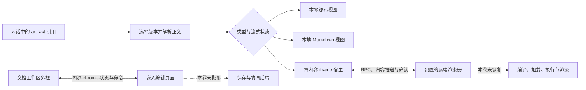
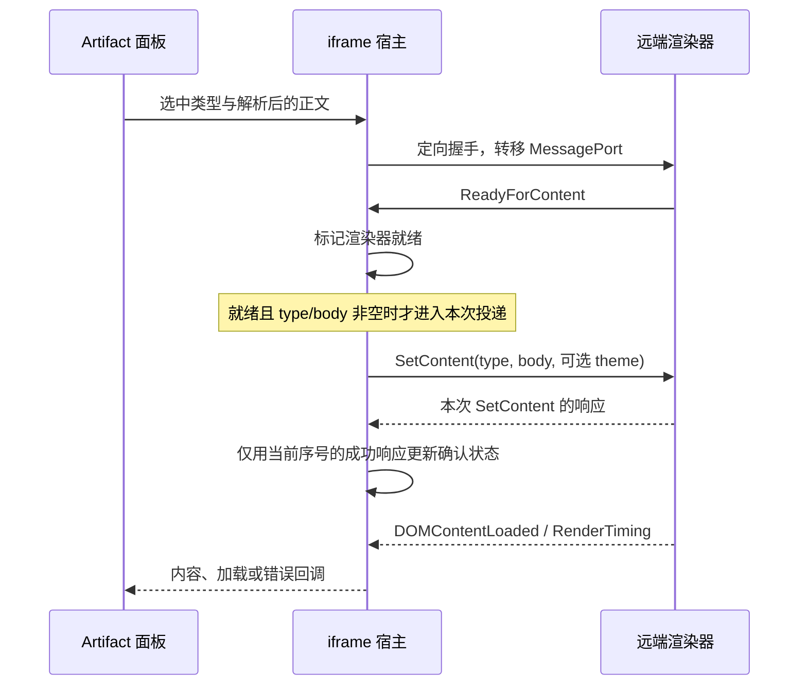
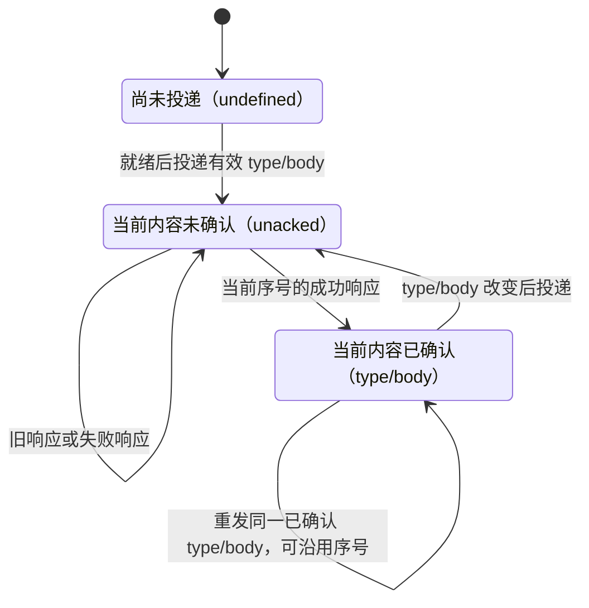
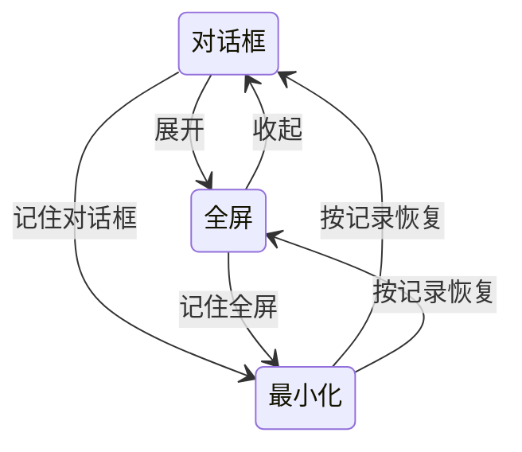

# Vol. 7 · Artifacts 与沙箱：让一份生成结果成为可控工作区

Artifact 同时有三种身份：对话中的一份结果、可以切换的内容版本，以及可能执行代码的页面。工作区的难点，是让这三种身份在流式生成、版本切换、异步回执和错误发生时始终对得上。

想象一个普通操作：用户正在看第一版网页，第二版还在生成；用户切到源码，再回到预览；第一版页面发出的文件读取请求此时才抵达。宿主必须回答的不是“这个消息来自我的 iframe 吗”这一个问题，还要回答“它属于哪一份内容，那份内容是否仍然有效，这次能力调用是否获准”。

本卷沿着客户端可见的控制流，拆开六个相互关联、又不能合并的状态：**版本选择、正文来源、预览资格、内容确认、能力授权、工作区展示**。

本卷范围是 Claude Desktop 2.37337.1 Linux x64 的 `ion-dist` 客户端，远端渲染器另属边界。版本与 W01–W24 证据见[阅读与复核索引](#阅读与复核索引)。

## 1. 先分清两条嵌入路径

界面上都像“右侧打开一份文档”，内部却至少有两条不同的路径。[W03, W05, W19–W22]

| 路径 | 宿主主要拥有的状态 | 嵌入方主要负责什么 | 通信边界 |
|---|---|---|---|
| 对话 artifact 面板 | 选中版本、解析后的正文、Preview/Code、错误与分享入口 | 按宿主投递的类型和正文进行富内容渲染 | 指向配置的渲染器 origin；RPC 与内容确认 |
| 文档 frame 工作区 | 外层标题、artifact 切换器、版本控件、保存指示与页面动作入口 | 编辑页面自身的操作、保存状态和可用功能 | 独立的同源 chrome 状态/命令协议 |

这里的 chrome 指包围文档的标题栏、工具栏与控制区，不是 Google Chrome 浏览器。



图 1：上半部把正文交给渲染器；下半部控制一个会报告自身状态的文档页面。把两者压进同一个 `iframeState`，会同时模糊交互责任与安全边界。

富内容路径覆盖 HTML、React、SVG、Mermaid。Code 与 Markdown 使用本地展示组件；纯文本走源码展示。不能因为它们都叫 artifact，就推定都经过同一个编译器。[W03, W24]

## 2. 选中版本是身份解析，不只是数组下标

### 2.1 三个条件共同定义“当前 artifact 正在生成”

对话仍在输出，不代表当前 artifact 必须一直显示源码。这个路径中的实时状态要求三个条件同时成立：[W01]

1. 对话正在流式输出。
2. 最新 artifact 版本尚未关闭。
3. 解析器的记录映射中，还没有最新版本的服务端记录。

第三个条件尤其重要：最新记录到达后，即使对话还在继续，该 artifact 的实时源码覆盖状态也可能解除。这里的“记录到达”是客户端可见事实，不等于已经证明后端的完整持久化语义。

### 2.2 版本选择有明确的优先级

实时 artifact，或带有新助手消息占位标记的选择，会优先指向最新版本。否则，解析器依次尝试版本 UUID、tool-use ID、消息 UUID，全部没有命中才回退到最新版本。同一条件命中多个版本时，使用第一个匹配下标。[W01]

```js
// 原创重述：展示优先级，不是产品内部 API。
function selectVersion(versions, selection, currentStreaming) {
  if (versions.length === 0) return 0;
  const newest = versions.length - 1;

  if (currentStreaming ||
      selection.messageId?.startsWith('new-assistant-message-uuid')) {
    return newest;
  }

  for (const [field, wanted] of [
    ['uuid', selection.versionId],
    ['toolUseId', selection.toolUseId],
    ['messageId', selection.messageId]
  ]) {
    if (!wanted) continue;
    const found = versions.findIndex(version => version[field] === wanted);
    if (found >= 0) return found;
  }
  return newest;
}
```

用户手动选择版本时，客户端优先写回版本 UUID；没有 UUID 时，可以使用 tool-use ID 与消息身份。数组下标因此只是稳定身份在当前列表中的投影。artifact、版本或选择身份改变时，展示模式会回到 normal。[W01, W03]

### 2.3 “选中了第几版”和“显示什么正文”是两个问题

正文解析器同时面对对话重建内容与服务端版本记录。它收集 UUID 对应的非空服务端结果，把它们与客户端正文做完全一致或去除首尾空白后的比较；遇到重复正文，还可能沿用此前解析出的内容。[W02]

其中两组有条件的文本启发式，会在服务端记录看起来不完整时偏向客户端重建。判断涉及前一版是否已确认或已被归为 partial、是否为 old-string 为空的更新，以及新旧文本的关系。一条路径处理“跟在先前 partial 记录之后”的情况；另一条结合未变的前后缀与之前正文判断。这些条件有具体适用范围，不能扩写成通用文本合并算法。

解析器还保留正文来源标签与被继承正文的来源身份。这种身份会进入内容 key，使“版本下标没变，但实际正文被替换”的情况仍能被区分。

| 应当分开的量 | 回答的问题 | 混在一起会发生什么 |
|---|---|---|
| 版本身份 | 用户选择哪一次修订？ | 列表变化后，旧下标可能指向另一版 |
| 解析后的正文 | 此刻真正展示哪段文本？ | 把选择成功误当成正文已经同步 |
| 正文来源 | 为什么使用这段文本？ | 把重建、继承或临时回退误当成服务端已确认结果 |

这揭示的是客户端的选择与回退策略。服务端如何排序写入、解决冲突、保存历史，仍在证据边界之外。

## 3. Preview 是由状态推导出的资格

Preview/Code 不是对所有类型始终开放的开关。客户端先根据内容类型和当前实时状态决定是否可以预览，再结合用户选择决定展示路径。[W03]

| 类型 | 默认稳定视图 | 当前 artifact 实时生成时 | Preview/Code 开关 | 此标题栏的刷新入口 |
|---|---|---|---|---|
| 纯文本 | 源码 | 源码 | 不显示 | 不显示 |
| Code | 代码视图 | 代码视图 | 不显示 | 不显示 |
| Markdown | Markdown | Markdown | 不显示 | 不显示 |
| HTML | 富内容预览 | 源码 | 实时覆盖解除后可用 | 预览时显示 |
| React | 富内容预览 | 源码 | 实时覆盖解除后可用 | 预览时显示 |
| SVG | 富内容预览 | 源码 | 实时覆盖解除后可用 | 不显示 |
| Mermaid | 富内容预览 | 源码 | 实时覆盖解除后可用 | 不显示 |

把这组逻辑写成 render plan，比到处散落 `if (isStreaming)` 更容易检查：

```js
// 简写类型仅用于讲解；配套可执行模型使用观察到的 MIME 类标签。
function renderPlan(type, requestedMode, currentStreaming) {
  const rich = new Set(['html', 'react', 'svg', 'mermaid']);
  const canPreview = type !== 'text' &&
    !(currentStreaming && rich.has(type));
  const source = !canPreview || requestedMode === 'raw';

  return {
    renderer: source || type === 'code' ? 'source'
      : type === 'markdown' ? 'markdown' : 'sandbox',
    toggleVisible: canPreview &&
      !['text', 'code', 'markdown'].includes(type),
    refreshVisible: !source && ['html', 'react'].includes(type)
  };
}
```

### 隐藏 iframe 不等于销毁执行环境

源码显示时，富内容 iframe 可以继续挂载。它的外层变为零尺寸、透明、裁剪且不可交互，活动内容与类型输入也会被扣住。这保留了实例与展示之间的区别，但不足以证明此前任意页面代码都已经终止。[W03, W05]

因此，讨论“切到 Code 后是否安全”时，不能仅根据用户看不到预览就下结论。可见性、投递输入与执行生命周期需要分别检查。

### Code 是源码阅读视图，不能据此推定为编辑器

这条对话面板路径中的 Code 接收正文并做语法高亮，也可以把选中的文本送回对话请求改进。所追踪组件没有直接提交源码编辑的回调。文档 frame 路径则另有页面自报的保存状态与动作。把 Preview/Code 改称“阅读/编辑”，会引入证据没有支持的功能含义。[W03, W04, W21]

### 500 ms 更新的是比较基线

源码组件确实有一个 500 ms 定时器，但当前正文仍直接作为渲染输入。定时器更新的是判断高亮是否处于流式状态的比较基线，不是把正文投递做成“500 ms 防抖”。[W04]

更新命令还会比较前后正文，定位首个不同字符，把它所在行换算为滚动位置百分比，并在生成过程中移向变更区域。流式过程结束后，滚动重新启用。这里解决的是“如何让用户看懂改动”，不是用一个延迟替代全部实时状态。

## 4. iframe 的生命周期从握手开始

宿主通过 `userContentRendererUrl` 构造渲染地址，附加父页面 origin、内容格式等信息，并可要求向父页面报告错误。iframe 声明的 sandbox 包含 `allow-scripts allow-same-origin`，允许 fullscreen 与 clipboard-write，referrer policy 为 no-referrer；capture-only 分支另请求 credentialless iframe。[W05, W17]

这些是宿主的嵌入声明。实际隔离强度还依赖部署 origin 与响应策略。仅看这一行 sandbox 属性，无法推导远端 CSP、依赖加载策略、服务端响应头或完整执行隔离。

随后，宿主创建通信器，向目标窗口发送握手并转移一个 MessagePort。渲染器就绪、正文投递成功、DOM 内容加载和首次绘制，是几种不同的事件。[W06, W11]



图 2：可以接收正文、正文已确认、页面已绘制，不应共用一个 `loaded` 布尔值。图中没有替远端补画未取得的编译、模块加载与渲染实现。

加载遮罩受就绪状态，以及部分调用者要求的 content-set 状态控制。它是反馈机制，不是特权能力的授权凭据；后者还要检查内容确认状态。

## 5. 真正微妙的边界：这个请求属于哪份内容？

origin 与 iframe 身份只能说明发送者来自哪个窗口。一个窗口可能先后承载 A、B、C 三份正文；来自正确窗口的旧请求，也可能已经不属于用户当前查看的内容。

客户端因此维护内容发布序号与确认状态。需要重新确认的投递会推进序号、使旧确认失效。只有仍属于当前序号的成功响应，才恢复确认。请求进入时还会取得一份回执，记住当时的序号和确认状态。之后即使执行被延后，也不能偷偷继承后来某份内容的授权上下文。[W10]

### 5.1 先理解失效，再理解例外

内容状态有三种：尚未由宿主投递的 `undefined`、待确认的 `unacked` 哨兵、已确认的 type/body 对象。请求回执也可能保留初始 `undefined`；它不等于 `unacked`。不同能力对这三种状态的检查并不相同，见第 7 节。

开始投递后，有两种必须区分的重发：

- 同一 type/body 已经得到确认：再次投递时可以沿用发布序号与已有确认。
- 该内容尚未确认，或 type/body 已变化：投递会进入新的确认周期。

因此，“每个 SetContent 都递增 epoch”并不准确。这里把 epoch 作为教学术语，表达一次内容确认周期；它不是完整版本号，也不与网络消息数一一对应。主题等其他参数触发的重复投递，也不能仅凭发生了 SetContent 就断言正文身份已改变。



图 3：内容投递与确认的局部状态机。初始 `undefined` 与投递后的 `unacked` 分开表示；图中省略刷新、空内容清理及独立的渲染器就绪状态，不替代各能力的检查。

### 5.2 两种常见竞态都要拒绝

第一种是“旧成功覆盖新内容”：A 发出后，B 已替换它，此时 A 的成功回执才到达。第二种是“早到请求借用晚到授权”：A 的请求在确认前已经进入队列，等真正执行时 A 恰好已确认。回执快照让这两种情况都能保持原来的身份。[W10]

```js
// 使用配套原创 ContentEpoch 模型；没有执行网页。
const gate = new ContentEpoch();
const first = gate.replace('text/html', '<h1>A</h1>');
const earlyRequest = gate.receipt();

gate.acknowledge(first, true);
gate.mayUseCapability(earlyRequest); // false：到达时尚未确认

const confirmedRequest = gate.receipt();
const same = gate.replace('text/html', '<h1>A</h1>');
same.epoch === first.epoch;          // true：同一已确认内容可重发

const second = gate.replace('text/html', '<h1>B</h1>');
gate.acknowledge(first, true);       // false：A 的回执已经过期
gate.acknowledge(second, true);      // true：B 的当前回执
gate.mayUseCapability(confirmedRequest); // false：A 的请求仍属于 A
```

真实客户端还管理 consent epoch、用户激活回执、等待中的对话框与 artifact 身份。ContentEpoch 模型从 `replace` 开始，刻意不覆盖初始无投递的 `undefined` 状态；它只验证这一投递模型的确认不变量。`mayUseCapability` 也不是实际各方法的统一权限判定。

### 5.3 五种身份，不要压成一个 ID

下面是为实现者整理的原创区分表。它描述应区分的概念，不声称目标客户端恰好声明了五个同名字段。

| 身份 | 标识什么 | 何时可能变化 | 不能代替什么 |
|---|---|---|---|
| 渲染器文档（renderer document） | iframe 中这一次加载的执行文档 | 刷新、重载或导航；同一 frame window 引用不宜作为内容身份 | 不能证明页面正在显示哪个源码版本 |
| 源码版本（source version） | 用户选择的 artifact 修订 | 选择历史版本、产生新修订 | 不能表示正文已投递或已得到确认 |
| 投递周期（delivery epoch） | 当前等待确认的内容上下文 | 未确认重发、type/body 替换或显式刷新；已确认的相同正文重发可沿用 | 不是每条 RPC 的唯一 ID，也不等于版本下标 |
| 确认周期（ack epoch） | 确认所适用的投递周期，以及请求到达时是否已确认 | 当前投递成功、内容失效；请求自身的到达快照保持不变 | 不能被简单的全局 ready/loaded 替代 |
| 请求 ID（request ID） | 一次协议调用及其响应配对、去重身份 | 每次独立请求 | 不能证明该请求属于当前内容，也不是授权凭证 |

“确认周期”在这里是对已确认投递上下文的解释性称呼，不是宣称存在另一个独立递增计数器。客户端证据展示的是发布序号、三态内容状态，以及请求到达时捕获的回执。初始无投递状态不能并入待确认状态。自行实现时，可以记录这些量的明确对应关系，但不要让旧请求在执行时重新读取一个已被新内容覆盖的全局确认布尔值。

## 6. 通信器是一条验证流水线

### 6.1 Window 消息与 MessagePort 消息不是同一入口

普通 window message 必须同时满足两个条件：origin 等于配置的 origin，source 等于当前 iframe 的 `contentWindow`。只检查其中一个不够。[W06]

转移端口后的 MessagePort 消息没有相同的 origin/source 字段检查。它的边界基础是之前定向握手所转移的端口。两条路径都会解析消息形状，但不能把 window 路径的校验写成对全部消息逐条重复执行的事实。

请求进入后还要依次经过：方法是否识别、完整请求是否符合对应 schema、ID 是否已处理、权限是否允许，以及能力处理器的当前内容/同意状态检查。[W07]

| 检查结果 | 协议层可见处理 |
|---|---|
| 未识别方法或无效请求结构 | 400 错误 |
| 权限拒绝 | 403 错误 |
| 能力处理异常 | 500 错误 |
| 超过计数限制 | 关闭通信通道；请求路径可返回 429 |

这些错误码描述所检查实现的分支，不是对所有外部错误的穷尽分类。

### 6.2 限流、去重与队列，各解决不同问题

通信器在五秒窗口中计数，超过 30 条被计数的消息会关闭端口并移除 window listener。能够识别为当前在途出站请求响应的消息，不增加这个计数。[W07]

已处理请求 ID 集合最多保留 1,000 项；长度超过 256 个字符的 ID 不放入该集合。这是有界去重，不是永久防重放。请求 schema 是否还有其他约束，应单独考察，不能从“没有存入集合”推导所有长 ID 都必然执行。[W08]

队列也不等于整条能力执行串行化：消费队列时会等待权限判断，但被接受的能力 promise 启动后，并不等待它全部完成才处理下一项。若要讨论并发风险，应沿着实际 await 边界检查，而不是看到 `queue` 就假设没有重叠工作。

### 6.3 通用 RPC 有一个未闭合的完成路径

所检查的通用 `sendRequest` 没有内置响应超时。iframe 已断开时，它从 promise executor 提前返回，没有 resolve 或 reject。cleanup 会移除监听器、关闭端口并清空待处理队列，但没有看到逐一结算所有在途请求回调的路径。[W09]

另一个 React 适配层在拿不到 iframe 引用时，最多以 500 ms 间隔重试 20 次，之后记录初始化失败。这个有界初始化等待，不等于通信器建立之后的每个 RPC 都有超时。

结论应止于“这里存在一个局部的未结算边界”。它不证明每项用户操作都会挂起；截图等具体调用者另有期限。若据此设计新系统，值得加入三个机制：逐操作 deadline、关闭时逐项 reject、与底层工作相连的取消信号。配套 `withDeadline` 仅示范第一个，且只限制等待，不会自行取消底层工作。

## 7. 页面能力由宿主提供，并在宿主处仲裁

协议中出现一个方法名，不代表每个调用者都会提供该能力，也不代表渲染器已经获准使用它。这个富内容宿主分支实现了文件读取、向对话发送消息、Claude completion、存储、代理 fetch、外部打开、下载、错误报告及部分渲染工具。共享 schema 中的 `RunCode`，则没有在该处理器找到对应分支。[W12, W24]

| 请求类别 | 主要宿主条件 | 可能结果 |
|---|---|---|
| 读取对话文件 | 调用者提供能力；内容门拒绝 `unacked`，不因 `undefined` 单独拒绝 | 字节内容或 null |
| 回退读取项目文件 | 上述文件内容门、项目文件能力、适用的同意与身份检查 | 提示用户、返回字节或 null |
| 向对话发送消息 | 发送能力；内容门拒绝 `unacked` | 结构化对话请求 |
| Claude completion | 完成能力；拒绝 `unacked`，另有账户/同意检查与请求预算 | 完成结果或拒绝 |
| 存储 get/set/delete/list | 对应存储能力；拒绝 `unacked`，共享操作另有适用的同意检查 | 结果、提示或拒绝 |
| Proxy fetch | 启用代理、已登录组织；拒绝 `unacked`，另有 Claude 访问判断 | 宿主代理响应流或拒绝 |
| 外部打开与下载 | 另做 type/body 匹配；排除 capture-only | 宿主拦截、确认流程或拒绝 |

文件、消息与存储的哨兵检查不能概括为“必须已有确认对象”；外部出口的 type/body 匹配与 completion/fetch 的同意逻辑也不能相互替代。这只是静态分支条件，不证明初始无投递状态可被实际利用。

capture-only 会移除传入的能力 props 并关闭 proxy fetch；其他调用者也可以独立省略某些能力。因此不能把表格当成“所有 artifact 默认拥有的 API”。[W12]

### 7.1 Proxy fetch 不是任意浏览器凭据转发

这一分支识别 Anthropic API 主机名，把请求映射到组织作用域的宿主端点。允许转发的请求头只有 accept、accept-language、content-type、content-length 这一小组；部分响应凭据头被排除，重定向采用 manual，响应流设置 10 MiB 上限。[W14]

对话流式输出期间，fetch 与部分存储工作可能排队。释放时，fetch 比较 `artifactIdentityKey`；存储仅在 `shared=true` 时比较 `consentKey`。非共享存储在这条释放路径中直接调用捕获的操作，没有同样的身份拒绝。另一个入队分支会在新请求的 artifact UUID 不同时拒绝已有队列，但这不等于身份变化时无条件清理，也不能与释放时检查混称。[W14]

这里恢复的是客户端分发边界。后端端点的实现、服务端鉴权与限额没有取得，也没有通过实际请求验证。

### 7.2 外部导航与下载是单独的出口

外部链接会被检查，并可能由宿主拦截或进入显式确认对话框。下载文件名在使用前会移除控制字符、双向格式字符和路径分隔符；下载提示还解释了生成内容的信任边界。[W13]

允许 iframe 内运行 JavaScript，并不等于让它直接决定宿主导航与文件落地。这两个出口有各自的条件和用户反馈，不能从脚本执行能力中顺带推导出来。

## 8. 错误必须绑定到具体版本与正文

错误协议区分不支持的 import、运行时异常、缺失文件、Claude completion 失败与共享存储失败。UI 保存错误时，会连同 artifact ID、版本下标和实际投递的正文一起记录。身份变化或刷新可以清除过期错误。[W15]

这个设计避免了常见的错位反馈：用户已经切到第二版，却仍看到第一版的异常覆盖在预览上。“让 Claude 修复”也有条件：要有合适的发送回调；对话面板为最新版本提供该回调，并在对话流式输出期间禁用动作。

### 8.1 Import 错误分类表不是库加载器

客户端能展示未解析模块列表，以及缺失的 Lucide 图标名。另一个辅助函数把错误文本分成 URL import、样式 import、资源 import、alias、未列入的包、已列包的子路径等类别。[W15, W16]

这个辅助函数出现了熟悉的库名，但它服务于遥测分类，不负责加载这些库。由它无法建立远端精确 allowlist、包版本、模块解析规则或 React 编译流程。对 SVG 和 Mermaid 也一样：宿主可选择类型和接收错误，不意味着已经恢复远端清理策略或图表配置。

### 8.2 对话里的 Mermaid 图还有独立路径

另一个图表组件使用相同的通信器抽象，等待 `ReadyForContent` 后投递 Mermaid 内容；除协议列为始终允许的请求外，它拒绝其他能力请求。如果渲染请求拒绝，组件显示错误与原始源码。该 iframe 声明 600 px 高度。[W18]

这是另一条具体回退路径。不能把它的高度、能力策略或错误展示推广成整个 artifact 面板的统一行为。

## 9. 截图比预览多一道隐私边界

能显示预览，不等于能把当前预览直接作为可分享截图。截图帮助函数拒绝 live frame，只接受 capture-only 实例，并要求 iframe 的实际 `credentialless` 属性为真、此前没有记录到私有数据访问。[W17]

它还设置了几道后置检查：

1. 与 15 秒期限竞速。
2. 响应到达后，再检查一次私有数据接触状态。
3. 截图字符串不能超过 10,485,760 个字符。
4. 数据必须符合预期的图片 data URL 格式。

10,485,760 在这里限制的是字符串长度；不要与 proxy fetch 的 10 MiB 响应体上限混为同一种单位。

前后两次隐私检查抵御的是等待期间状态发生变化的情况。宿主还为发布流程提供隐私判断。这说明“可显示的预览”和“可以取得并分享的截图”是两种独立能力。

不过，该隐私标志来自已观察到的能力活动。它不是对所有可能数据通路的穷尽证明，也不能单独构成完整安全审计。

## 10. 文档 frame：外框消费编辑器报告的状态

现在回到第 1 节的第二条路径。它交换紧凑的 chrome 状态与命令，而不是把 artifact 正文作为 `SetContent` 交给通用渲染器。[W19]

### 10.1 版本预览有角色与来源约束

版本报告包含 artifact UUID、当前查看版本、live version，以及是否提供版本预览控件。外层监听器检查消息标记、state、UUID 形状、可用性字段、同源条件、准确的 iframe window 和预期 artifact 身份。[W19]

在嵌入端，版本预览只在适用嵌入模式、owner/writer 角色，并且页面提供 preview 函数时开放。接收器检查同源 parent 或允许的 opener，验证命令，并设置 250 ms 的接受间隔下限。[W20]

协议能够表达 null 版本，但其具体语义，以及 preview 回调如何恢复或显示某一修订，属于文档页面。不能根据一个 nullable 字段替页面补写历史回滚算法。

### 10.2 保存指示是协议状态，不是独立持久化证明

页面 chrome 对象带版本并经过验证，可以报告：[W21]

| 字段类别 | 表达内容 |
|---|---|
| 保存状态 | `saved`、`saving`、`unsaved`、`reconnecting`、`readonly` |
| 评论 | 评论数量 |
| 动作 | 可用页面动作与导出格式 |
| 手动保存 | 是否提供 save-now |
| 离开风险 | `leaveLosesWork` |
| 展示提示 | 受限的布局与背景选项 |

动作列表最多 18 项，导出列表最多 8 项，数值与计数字段会检查并限制范围。未知动作名不会自动变成宿主可以任意执行的控件。

外层保存指示按页面报告渲染；只有页面声明可立即保存，且状态为 unsaved 或 saving，才提供 save-now。saved 小圆点在焦点仍停留时可以继续显示，离开焦点后再隐去。这是交互连续性，不是宿主对后台持久化另做了一次证明。

这条边界的责任划分很清楚：宿主提供工作区控制，页面提供编辑行为、保存状态与可用动作。协同事务、冲突合并和持久历史都未在本卷恢复。

## 11. 切换、最小化、关闭与恢复，是不同状态轴

artifact 切换器选择的是 artifact key；版本菜单选择同一 artifact 内的修订；全屏与最小化控制改变展示方式。它们挤在同一标题栏里，也不应因此共享同一种“当前页”状态。[W01, W22]

当 viewer-mode 功能被提供时，状态仓库在内存中按 scope 保存 `dialog`、`fullscreen`、`minimized`。独立窗口展示会隐藏相应控制；最小化还排除 `cr`、`pr`、`gdrive`、`browser`、`simulator`、`device_session` 这些目标类型。[W22]



图 4：第一次进入最小化时记住之前的可见模式；重复最小化不覆盖恢复目标。这个状态图只描述显示模式，不声称标签页或版本历史被持久保存。

所检查调用者在 teardown 时会忘记该 scope。因此能确认的是会话内展示状态，而不是跨进程重启恢复能力。

关闭还有键盘与焦点责任：对话 artifact 的 Escape 处理器只在相关分享、发布、存储、连接器对话框与菜单不存在时关闭面板；HTML 评论模式会优先消耗 Escape。关闭后把焦点还给记录的触发元素，必要时回退到输入框。frame viewer 的模式控件也有显式焦点交接。[W23]

关闭标签动作、artifact 切换器和“版本历史”标签，仍不足以证明通用的标签历史持久化或浏览器 Back/Forward 语义。忠实实现应保留这个未知边界，而不是凭 UI 名称补一个恢复仓库。

## 12. 把完整路径变成可验证的设计

重建工作区时，最有用的单位是“触发 → 状态转换 → 可见后果”，而不是截图上的某个按钮。

| 触发 | 状态变化 | 用户或调用者可见的后果 |
|---|---|---|
| 新 artifact 实时生成 | 选择优先最新；富格式预览资格受限 | 可以读源码，尚不进入正常富预览 |
| 最新服务端记录到达 | 三条件实时判断可能转为 false | 富预览重新具备资格 |
| 用户选择修订 | 稳定身份改变，模式回到 normal | 重新解析正文与展示路径 |
| 渲染器就绪 | ready 改变 | 非空类型和正文可被投递 |
| 未确认内容重发或 type/body 改变 | 发布序号推进，旧确认失效 | 旧请求不能借用新内容的确认 |
| 相同已确认 type/body 重发 | 可沿用序号与确认 | 不把重复投递误判成内容替换 |
| 当前投递成功 | 当前内容获确认 | 相关能力可继续检查其他授权条件 |
| 渲染错误到达 | 错误绑定 artifact、版本、正文 | 避免旧错误覆盖新版本 |
| 用户刷新 | ready/确认状态重置，iframe 重载 | 开始新的投递周期 |
| 用户关闭或最小化 | 展示与焦点状态独立变化 | 返回对话或恢复原来的可见模式 |

### 原创模型：只运行能明确解释的部分

配套 [workspace-core 目录](../../04-Extracted-Core-Code-And-Scripts/core-code-lab/workspace-core/README.md)含纯 JavaScript 教学模型、测试和演示，没有第三方依赖。它覆盖版本选择、类型/流式门控、内容 epoch、window 入口校验、最小化恢复，以及明确标为改进建议的 deadline 包装。

从仓库根目录运行：

```sh
cd 04-Extracted-Core-Code-And-Scripts/core-code-lab/workspace-core
node --test workspaces-model.test.mjs
node demo.mjs
```

12 个测试覆盖：版本优先级、服务端记录与关闭条件、各类型渲染路径、旧成功响应、确认前到达的请求、origin/source/payload 校验、恢复模式、deadline，以及相同内容已确认/未确认两类重发和仅类型改变的情况。它们验证的是原创模型，不是目标产品的运行效果或安全性。

模型不执行 HTML、React、SVG 或 Mermaid，不模拟完整 RPC schema、MessagePort、限流、权限、用户同意和数据通道。其 `replace` 表达的是一次已获准进入的正文投递，未把就绪与非空输入前置条件塞进类中；`withDeadline` 也不会取消底层工作。这样可以让每个测试证明一个明确结论，而不是把一个短示例包装成“生产沙箱”。

### 阅读与复核索引

静态范围为 Claude Desktop 2.37337.1 Linux x64 的 `ion-dist`。W01–W24 对应[结构化证据](../../04-Extracted-Core-Code-And-Scripts/evidence/data/workspaces-deep-dive.json)中的文件哈希与 UTF-8 字节锚点。研究未运行目标应用或探测接口，也未验证当前托管网站与此客户端相同；图示和教学代码为原创，远端渲染器未恢复。

| 证据 | 对应主题 |
|---|---|
| W01–W02 | 版本优先级、三条件实时状态与正文来源 |
| W03–W04 | 预览门控、源码组件、500 ms 比较基线 |
| W05–W06 | iframe 声明、握手、window 与 port 两种入口 |
| W07–W09 | schema、限流、去重、队列与 RPC 完成边界 |
| W10–W11 | 内容序号、确认回执、就绪与绘制信号 |
| W12–W14 | 宿主能力、外部出口与代理请求 |
| W15–W18 | 错误归属、import 分类、截图与独立 Mermaid 路径 |
| W19–W21 | 文档 frame 的版本、角色、动作与保存状态 |
| W22–W24 | 展示模式、焦点、类型标签与共享 schema |

两次有界静态分析只覆盖选定 chunk，关系图覆盖不完整，部分语义图受到节点上限截断。精确锚点支持具体控制流结论；它们不把未检查的模块变成“已知不存在”。远端编译与库加载、HTTP CSP、SVG/Mermaid 清理、协同编辑、服务端保存与鉴权、当前生产 flags、跨重启标签恢复，均保持为未知。

本卷最值得带走的不是预览窗的样式，而是六条分开的责任：选哪一版、用哪段正文、何时能预览、哪份内容已确认、谁获准使用能力、界面应如何恢复。把这些边界说清并写成测试，工作区才能在旧回执、快速切换、流式更新和失败交叠时仍然可解释。

[返回全书目录](../README.md) · [阅读前提与术语](../README.md#一页阅读准备) · [原创代码实验室](../../04-Extracted-Core-Code-And-Scripts/core-code-lab/README.md)
