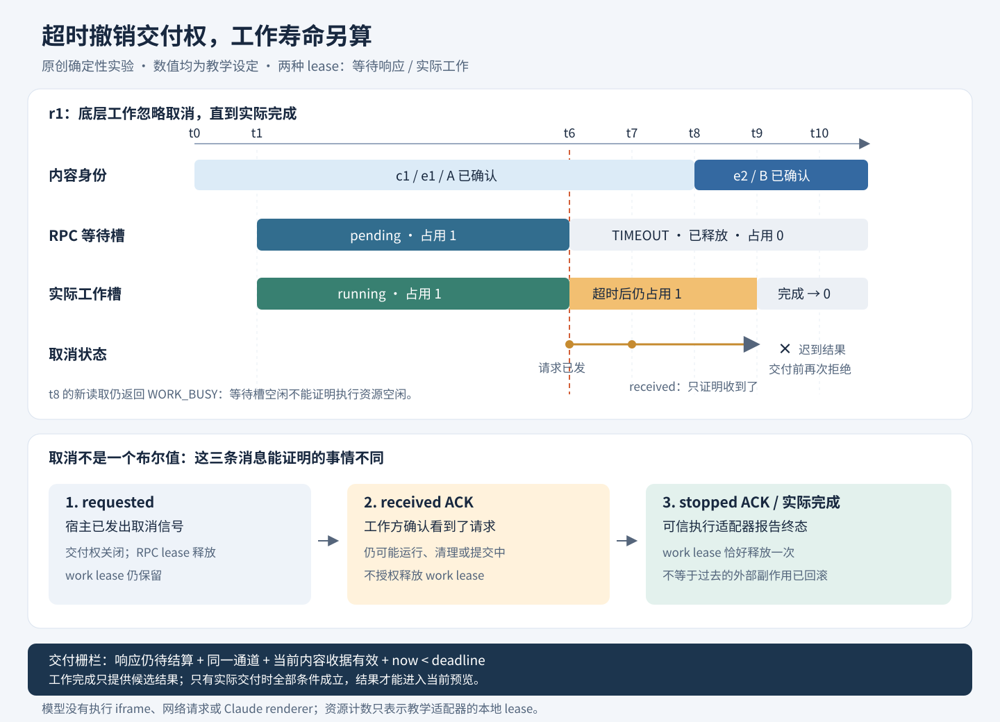
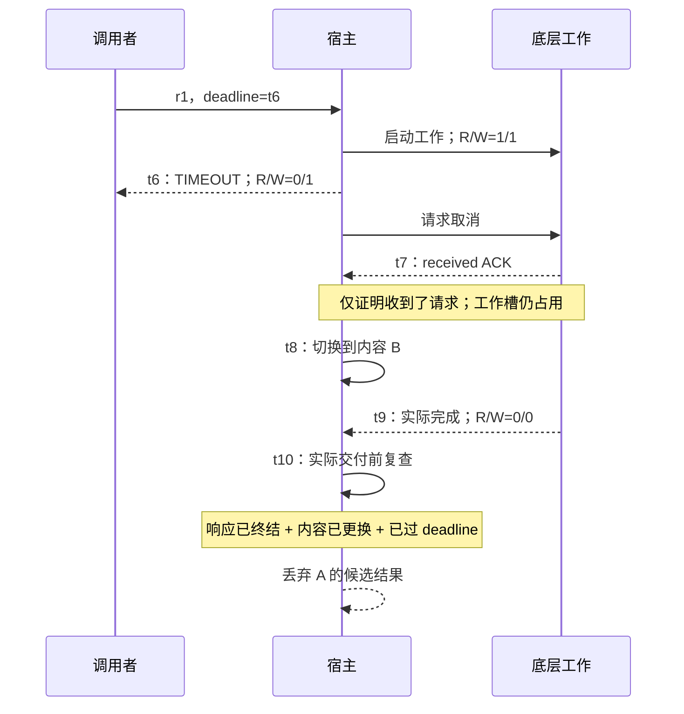

# 实战推演：预览读取超时以后，究竟还有什么在运行？

用户打开网页 A，页面向宿主请求一段资料。宿主显示“读取超时”，用户立即切到网页 B，又点了一次读取。几秒后，A 的旧结果才返回。

这是三个问题，而不是一个错误：调用者是否还在等待？第一次读取是否真的停止？这份结果现在还能不能交给页面？如果把它们都塞进 `loading = false`，界面可能看起来恢复了，旧工作却仍占着执行资源；如果把 Map 里的请求删掉当作取消成功，还可能放进更多工作，让所谓的并发上限失效。

本案例把一次读取拆成四段寿命：**响应交付权、底层工作、内容身份、通信通道**。配额不是第五个装饰字段，而是必须跟随这些寿命记账的资源所有权。读完后，应该能解释为什么“超时后释放等待槽”是对的，“超时后释放所有执行槽”却可能是错的。

这里所有页面、结果与时间都是合成数据。实验不执行 HTML，不读取真实文件，不启动 Claude，不建立真实 RPC 或 MessagePort。代码是用于验证设计选择的原创适配器，不是目标产品的修补版。

## 一、先把已观察事实与新设计分开

[本卷正文](README.md)已经给出这次推演的证据起点。范围仍是 Claude Desktop 2.37337.1 Linux x64 的选定客户端代码，远端 renderer 未恢复。

| 证据边界 | 本卷能支持的结论 | 本案例增加的工程选择 |
|---|---|---|
| W09，通用 `sendRequest` 与 cleanup | 所检查路径没有内置响应超时；未看到 cleanup 逐项结算全部在途回调 | 每次等待有明确 deadline；关闭、替换、取消都结算当前响应 |
| W10，内容发布序号与请求回执 | 旧成功响应不能确认新周期；请求到达时的确认快照不能借用未来状态 | 复用书中 `ContentEpoch`，在实际交付候选结果时再次检查收据 |
| W06，window 与 port 两种入口 | window 入口检查实际 origin/source；转移后的端口依靠已建立的通道归属 | 以宿主持有的通道对象表示当前连接，拒绝旧通道回调 |
| W07–W08，计数、去重与并发边界 | 消息计数、ID 集合和处理队列各有边界；队列不等于全部工作串行 | 单独记录 RPC 等待槽与底层工作槽，不能用 pending 数代替执行数 |
| W17，截图的调用者期限 | 具体调用者可以另有期限，不能从通用路径推论所有操作都无限等待 | 本实验用虚拟时刻 6 作期限，既不是截图的 15 秒，也不是产品常量 |

上述证据的哈希与字节锚点可在[结构化证据][evidence]复核。两类现有原创模块也应分别阅读：

- [workspace-core][workspace-model] 的 `ContentEpoch` 展示内容确认边界；`withDeadline` 只限制等待，不会取消传入的 Promise 所代表的工作。
- [secure-preview-sandbox][sandbox-model] 的 `SandboxHost` 展示本地包装层结算、取消信号与交付前检查；[适配合同][sandbox-contract]明确指出，即使处理器忽略信号而继续运行，包装层也不能交付迟到结果，但这不意味着处理器已停止或外部动作已回滚。

本案例的 `received` / `stopped` 取消回执、双槽账本、虚拟时钟和具体错误名，均为新增教学合同。不能把它们列成已恢复的 Claude 消息类型或资源策略。

## 二、一次调用有两个“结束”，还可能有一个空隙

先从最容易误读的代码开始：

```js
const result = await withDeadline(workPromise, 6);
```

如果 deadline 赢了，调用者收到的是包装 Promise 的拒绝。它不能从这个拒绝推断 `workPromise` 已经停止。JavaScript Promise 的结算也不会自动撤销已经发出的请求、终止线程或回滚写入。

把这件事落实到状态上，需要区分：

1. **响应终态。** 当前调用不再等待成功数据，例如 `TIMEOUT`、`CANCELLED`、`CHANNEL_CLOSED`。终态只写一次，之后的成功结果不能把它改回成功。
2. **工作终态。** 可信执行方报告“正常完成”或“已经停止”。只有这类事实才足以结束本例的工作槽占用。
3. **候选结果。** 工作已完成，但响应回调仍在队列里。此时工作槽可以释放，RPC 等待槽可能还在。内容替换、连接关闭或 deadline 可以在这个空隙发生。

第三种情况尤其容易被漏掉：`readText()` 已返回，不等于数据已经安全交付。把检查只放在读取之前，挡不住“读取结束后、发送之前”发生的内容替换。[现有 sandbox 测试][sandbox-tests]已经包含这一类回归，本例将它变成可手算的事件。



*图：t6 只结束响应等待，底层工作一直占槽到 t9。t8 的新请求因此仍会被拒绝。图下方的三种取消消息是教学合同，不是目标客户端协议摘录。原始可编辑图源见 [Mermaid](figures/sandbox-timeout.mmd)。*

### “响应不能交付”与“工作仍在运行”可以同时为真

以下组合不是状态错误：

```text
reply  = TIMEOUT
worker = running
cancel = received
```

它表示宿主已经对调用者结束等待；执行方看到了取消请求；执行方尚未确认工作终止。界面可以显示“已超时，后台任务尚未确认结束”，但不能显示“已停止且资源已回收”。

反过来，这个组合也合理：

```text
reply  = pending
worker = completed
candidate = queued
```

它表示实际执行结束，响应仍待最终交付。此时再发生关闭，应该结束响应等待；关闭本身并不改变“工作已经完成”的历史事实。

## 三、四个身份判断不能互相顶替

每次成功交付，适配器同时要求：

```text
原调用的响应仍为 pending
并且 原通道对象就是当前通道对象
并且 原内容回执在当前 ContentEpoch 下仍有效
并且 当前时刻早于 deadline
```

这些条件各挡一种不同错误。

### 1. 响应终态挡住“超时后复活”

r1 的 deadline 已经结算为 `TIMEOUT`，即使页面、通道与权限从未改变，r1 的迟到成功也不能再变成这次调用的成功响应。是否保留某个后台产物供用户另行取回，是另一项产品设计，不能偷偷复活原调用。

### 2. 内容收据挡住“正确窗口里的错误正文”

A 和 B 可以先后位于同一个 iframe。来源与窗口正确，只能定位通信对象，不能证明这份数据属于当前正文。适配器在调用进入时冻结 `ContentEpoch.receipt()`，不会在交付时给旧调用重发一份当前收据。

还要保留正文已经确认这一事实发生的时间。确认前进入的请求，不能因为稍后来了确认，就借用新的授权上下文。现有 `ContentEpoch` 已经检查收据的 `accepted` 快照；本例没有复制一份相似但不同的状态机。

### 3. 通道身份挡住“同一个数字在新连接里重现”

一个新通道可能从 epoch 1 开始，旧通道以前也有 epoch 1。即使两份正文都是 A、两个数字都等于 1，也不是同一个确认上下文。因此本例让通道成为宿主创建的对象，收据与内容确认票据都必须绑定到它。

`openChannel()` 创建新的 `ContentEpoch`，要求新通道重新确认正文。模型的通道对象是可信内存身份，不是网页可以在消息里自报的字符串；它没有实现真实握手。浏览器适配仍须执行本卷 W06 描述的窗口/来源校验，以及现有 sandbox 模型的协议合同。

### 4. deadline 检查挡住“定时器尚未处理，所以迟到数据还能通过”

本例选择半开区间：`now < deadlineAt` 才允许成功交付；恰好到点也算超时。这是明确的工程策略。`advanceTo()` 会在跨越期限时结算响应，`deliver()` 还会独立检查实际交付时刻。

这个策略不能推广成所有 `Promise.race` 的固有行为。真实事件循环中同刻定时器、微任务和回调的先后还有运行时规则。要实现严格期限，需要明确使用哪一个单调时钟，在哪里记录开始，在哪个提交点重新读取，而不能仅依靠“我安排了一个 timer”。

## 四、手算一条完整时间线

设 RPC 等待槽上限为 2，实际工作槽上限为 1。槽表示本地实验中的并发占用，不表示产品账户额度、费用额度、浏览器内存或 CPU 配额。

记号：`c1/e1` 表示通道 c1 的内容周期 e1；`R/W` 表示整个适配器当前占用的 RPC 槽 / 工作槽。每一行都是处理完该事件后的快照。表中的数字只使用虚拟时间，不需要等待真实的 19 秒或毫秒。

| 时刻 | 事件 | 当前内容 | 跟踪调用的响应 | 底层工作 | 取消状态 | R/W | 该行最重要的结论 |
|---|---|---|---|---|---|---|---|
| t0 | 打开 c1，投递并确认 A | c1/e1 | — | — | — | 0/0 | 有确认上下文，尚无调用 |
| t1 | 接纳 r1，deadline=t6 | c1/e1 | pending | running | none | 1/1 | 同时取得两个 lease |
| t6 | r1 到期，发送取消请求 | c1/e1 | TIMEOUT | running | requested | 0/1 | 只释放 RPC lease |
| t7 | 工作方确认收到取消 | c1/e1 | TIMEOUT | running | received | 0/1 | received 不证明停止 |
| t8 | B 被确认；尝试启动 r2 | c1/e2 | r1 仍为 TIMEOUT | r1 running | received | 0/1 | r2 返回 WORK_BUSY，未取得任何 lease |
| t9 | r1 实际完成，结果进入候选区 | c1/e2 | TIMEOUT | completed | received | 0/0 | 此时才释放 r1 的工作 lease |
| t10 | 尝试交付 r1 | c1/e2 | TIMEOUT | completed | received | 0/0 | 终态、旧内容、deadline 三项均拒绝 |
| t11 | 再次接纳 r2 | c1/e2 | pending | running | none | 1/1 | 上一次 r2 未接纳，没占用 ID/资源 |
| t12 | 用户取消 r2 | c1/e2 | CANCELLED | running | requested | 0/1 | 用户停止等待不等于工作停止 |
| t13 | r2 确认收到取消 | c1/e2 | CANCELLED | running | received | 0/1 | 工作槽继续保留 |
| t14 | 可信适配器确认 r2 已停止 | c1/e2 | CANCELLED | stopped | stopped | 0/0 | 工作 lease 释放一次 |
| t15 | 重复 stopped 回调，再来一次完成回调 | c1/e2 | CANCELLED | stopped | stopped | 0/0 | 两次回调都无效，不得再次减计数 |
| t16 | 接纳 r3，deadline=t30 | c1/e2 | pending | running | none | 1/1 | 正常开始新工作 |
| t17 | r3 工作完成，尚未发送响应 | c1/e2 | pending | completed | none | 1/0 | 完成与交付之间有空隙 |
| t18 | 关闭 c1，打开 c2，重新确认 B | c2/e1 | r3 为 CHANNEL_CLOSED | completed | none | 0/0 | 旧响应终结，新通道不能继承确认 |
| t19 | c1 的 r3 结果回调尝试交付 | c2/e1 | CHANNEL_CLOSED | completed | none | 0/0 | 即使尚未到 t30，旧通道/旧收据也拒绝 |

注意两个细节。第一，t8 的 r2 只是一项被拒绝的准入尝试，没有被执行；t11 才是它第一次接纳。第二，r1 在完成后仍显示 `cancel=received`，不是程序忘了更新，而是在保留真实历史：它看到了取消请求，却没有通过 `stopped` 路径终止，最终通过正常完成路径释放资源。

最终账本应是：

```json
{
  "rpc":  { "used": 0, "acquired": 3, "released": 3 },
  "work": { "used": 0, "acquired": 3, "released": 3 },
  "delivered": []
}
```

这三个调用故意都没有交付成功数据，分别用来观察超时、主动取消、关闭竞态。成功路径另有测试：期限前、同通道、同内容收据的结果正常交付，并且两个 lease 各释放一次。



完整的三段序列图可查看[独立 Mermaid 文件](figures/sandbox-timeout.mmd)。

## 五、适配器只补缺口，不另造一套预览框架

[实验目录][lab]包含一个 216 行适配器、测试、固定输出及模型定位器。这里的“适配器”指确定性事件驱动器：外部方法代表可信测试夹具注入的事件，响应终态记录在内存中；它没有承诺自己就是可以连到浏览器的 RPC 实现。

### 5.1 直接复用内容状态机

[existing-models.mjs][loader]直接加载本书既有 [workspaces-model.mjs][workspace-model]，导出原来的 `ContentEpoch` 与 `withDeadline`。没有复制正文比较或 epoch 算法。这样相同已确认正文重发时保留 epoch、未确认正文重发时推进 epoch，都会继承原测试的语义。

为什么不同时混入 Skill 的 `ContentGate`？因为它为另一份更保守的教学协议设计：每次 `replace()` 都递增 sequence。本案例要保留本卷强调的“相同已确认 type/body 重发可沿用确认”，因此选择 `ContentEpoch`；不能把两个类的细节拼在一起，然后宣称它们本来就是同一套协议。

### 5.2 只让一个地方结束 RPC

```js
#settle(op, status) {
  if (op.reply !== 'pending') return false;
  op.reply = status;
  op.rpcLease.release();
  this.#note('reply-settled', op.id, {status});
  return true;
}
```

deadline、主动取消、内容替换、通道关闭、成功交付都经过同一个终态入口。它先检查是否仍可结算，再释放等待槽。第二次触发返回 false，不会把 `TIMEOUT` 改成 `SUCCESS`，也不会把账本减成负数。

实际 Promise 适配通常要在同一处 resolve/reject、清掉 deadline timer 并移出 pending map。本例用状态替代 Promise，是为了把事件顺序直接展示出来；真实 Promise 的“超时后工作仍继续”性质，则另外通过导入原 `withDeadline` 的测试证明。

### 5.3 不让 RPC 的 finally 代替工作的 finally

deadline 的处理只做两件事：结算响应、请求工作停止。它没有释放工作 lease。工作 lease 只在以下两条路径释放：

- `finishWork()`：可信测试夹具报告实际工作完成，产生受限类型的候选结果；即使结果格式无效，执行槽也已经不再占用。
- `cancelAcknowledged(id, 'stopped')`：可信执行适配器报告终态；仅 `received` 不够。

两条路径都先检查工作是否仍为 `running`。第一条终态赢了以后，另一条就是迟到或重复通知。工作状态上的一次性门与 lease 自身的一次性释放构成两层保护。

```js
release: () => {
  if (!activeTokens.delete(token)) return false;
  released += 1;
  return true;
}
```

这段简写展示的是单进程内存 token 的幂等释放。它证明不了跨进程 exactly-once，证明不了操作系统一定销毁了资源，也不等于远端账户费用退款。代码中 `acquired - released = used` 是本地账本不变量；真正资源是否已结束，仍依赖适配器提供的可信终态事件。

### 5.4 在最后可控的交付点再问一次

`finishWork()` 只准备候选结果，`deliver()` 才决定是否将它放进当前预览的 `delivered` 列表。后者检查原响应终态、通道、收据与期限。因此 t17 本地完成并不会授权 t19 在新通道交付。

这里的检查与列表追加是一个同步步骤，没有在两者之间插入 await。若真实发送路径在检查之后还会等待、排队或转交另一进程，就必须明确最后的提交边界，携带绑定身份，并让接收方按自身上下文复查。这个内存模型没有消灭真实跨进程的检查到使用间隙。

## 六、取消确认需要一份可解释的合同

不要让一个叫 `cancelled: true` 的布尔值同时表达以下三个声明：

1. 宿主已经发送取消请求。
2. 工作方已经收到取消请求。
3. 工作方已经停止，不会再产生本次工作的执行活动。

本例用 `requested → received → stopped` 把它们拆开，但不要求所有取消都必须经过三个独立消息。例如可信执行器可以直接从请求取消到确认停止；r1 也可以一直没有停止确认，最后正常完成。

更重要的是，“谁说已停止”必须进入合同。不可信预览页面自报 stopped，不能直接作为宿主执行资源已结束的证明。真实集成应由拥有资源生命周期的可信层报告，例如执行器自己的终态/退出观察；如果只能确认取消请求已接收，就应维持未知或停止中状态。

即使停止已经确认，也只能描述此后不再继续执行，并不自动证明此前没有产生外部效果。若任务是写文件、发送消息、创建订单或修改远端对象，需要额外的操作 ID、状态查询、事务或幂等约定。不能由一个 timeout 按钮推导出可以无风险重试。本实验故意只返回合成字符串，不演示真实外部写入。

### 工作永不结束时，怎么办？

把工作槽永远留着，会让系统失去可用性；超时后立即释放，则会把未结束的工作藏到账外。这不是改一个计数器能解决的两难。

生产系统需要更外层的资源监督策略：有界取消宽限期、由可信执行层实施的终止、可观测的退出确认，以及清理失败时的用户反馈。在没有终态证据前，不应把“不知道是否仍在运行”伪装成“资源已释放”。本案例不模拟强制终止，也不承诺替开发者实现隔离执行器。

## 七、三种看似简洁的实现为什么会错

### 反例 A：超时就减 `activeJobs`

假设 `activeJobs` 上限为 1。r1 占 1，超时把计数减到 0，随后接纳 r2。但 r1 实际仍运行，真实工作数已是 2。即使 UI 中只有一个 pending，也没有真正限制执行并发。

本例 t8 保持工作 lease，所以返回 WORK_BUSY。等待槽和执行槽采用两个账本，能够直接看到这个差异。它们不是消息速率限制、账户调用额度或结果缓冲区大小的替代品。

### 反例 B：收到任意 ACK 就释放

received ACK 可能表示“我看到了”，也可能表示“取消动作已经入队”。在这之后，工作仍可能在完成当前步骤、等待中断点、做收尾。若这时放行新工作，同样会突破资源约束。

本例只有 stopped ACK 或实际完成能释放工作 lease。哪一个先到都可以，但第二个到达时不得再释放。

### 反例 C：读取前检查过，回来就直接发

检查时是 A，读取回来时已是 B。或者读取已经回来，发送回调还没执行，通道刚好关闭。只检查入口能证明“当时可以开始”，不能证明“现在可以把这些数据交付给这个上下文”。

本例把候选结果与交付分开，专门给 t17→t19 的间隙写测试。成功产物不是自动继承的通行证。

## 八、离线运行并复核固定输出

要求 Node.js 22+，本次验证使用 Node.js 24.19.0。没有第三方依赖、npm 安装、网络访问或真实时间 sleep。

从出版物根目录执行：

```sh
node 04-Extracted-Core-Code-And-Scripts/worked-cases/sandbox-timeout/demo.mjs
node --test 04-Extracted-Core-Code-And-Scripts/worked-cases/sandbox-timeout/sandbox_timeout.test.mjs
```

也可以进入实验目录，运行 `node demo.mjs` 与 `node --test sandbox_timeout.test.mjs`。定位器向父目录查找书中模型；如需从另一个位置运行，可以把 `BOOK_PUBLICATION` 设为包含 `04-Extracted-Core-Code-And-Scripts` 的出版物根目录。它不会寻找产品安装目录。

`demo.mjs` 输出 rows、journal、delivered 与 final 四部分。rows 与上表逐行对应，journal 便于检查终态顺序；日志不写结果正文。测试把完整输出与[固定 JSON][expected]做深比较，重复运行得到同样的状态与顺序。它不会把真实运行耗时计入输出。

24 项测试覆盖五组边界：

- 原 `withDeadline` 的包装 Promise 已拒绝，底层定时工作仍完成；使用 Node 内置虚拟 timer，没有等真实 6/9 毫秒。
- deadline 与取消分别结算响应；received ACK 不释放执行资源，stopped ACK 与实际完成只消费一次工作 lease。
- 旧内容、旧通道、相同数字 epoch 的新连接，以及完成后尚未发送的候选结果都按身份判断。
- 两种槽的准入原子性、重复回调、恰好到期、无确认内容、错误结果与无效时钟都不会破坏账本；另遍历五种终态事件的全部 120 种顺序。
- 全部 16 个时间点和最终 3/3 释放计数与固定输出一致。

这里的 24 项只验证本案例及其直接导入的两个原创函数，不代表浏览器隔离、目标应用运行、远端安全或全仓测试都已通过。旧 sandbox 模块自己的 MessageChannel 测试是另一组范围，不应混在一起报成产品验收。

## 九、先预测，再看答案

先遮住下一节。每题至少回答三项：响应终态是什么、工作槽是否释放、结果能否交付。

1. r1 到期后立即收到 `received` ACK。当前页面仍是 A，通道也没变化。可以交付稍后返回的结果吗？
2. 工作在 deadline 前完成，结果回调排队；直到恰好 deadline 时才尝试发送。此实验会判成功还是超时？它能否证明所有真实 `Promise.race` 都采用同一规则？
3. r1 的响应已经 TIMEOUT，实际工作仍运行。RPC 容量还有 2 个空槽，工作容量只有 1。能否接纳一个新读取？
4. 用户取消后，先收到实际完成，再收到 stopped ACK，再收到重复完成。工作 lease 共释放几次？原响应终态能否恢复成功？
5. A 已确认，重新投递完全相同的 type/body，主题以外的正文身份没有变化。本例是否一定推进 epoch 并取消旧工作？如果 A 尚未确认呢？
6. 旧通道为 c1/e1，新通道为 c2/e1，两边正文都是 A，且新通道已经确认。只比较 `epoch === 1` 足够吗？
7. t17 工作结束，t18 关闭通道，t19 回调准备发送，而 deadline 是 t30。没有超时是否就应该显示成功？
8. 将合成读取替换成远端写入，宿主超时后一直拿不到停止确认。把 lease 释放并自动重试，是否能保证最多执行一次？还需要什么信息？

## 十、答案与定位

1. **不能。** 响应终态已经是 TIMEOUT；received 只证明执行方收到取消请求，工作槽仍占用。即使内容和通道都不变，响应终态与期限已经足够拒绝迟到成功。对应测试 `a noncooperative worker...` 与 `receipt-only cancellation...`。
2. **本例判 TIMEOUT。** 允许交付的区间不包含 deadline 本身。工作已经完成，所以工作槽可已释放；RPC 终态由期限关闭。这个手动时钟策略不是所有 Promise/race 的实测结论。对应测试 `before deadline succeeds; at exact deadline loses...`。
3. **不能，返回 WORK_BUSY。** 第一个工作仍真实占着唯一工作槽；空闲 RPC 槽仅说明调用者不再等待。新请求的两个 lease 都不会取得。对应 `deadline releases RPC capacity...`。
4. **恰好一次。** 第一个实际完成将 worker 置 completed 并释放 lease；随后 stopped 与重复完成均无效。原响应仍为 CANCELLED。这个顺序与“停止先到、完成后到”的相反顺序都有显式测试；另用 120 种事件排列检查账本。
5. **已确认且 type/body 相同，不推进 epoch，也不撤销现有收据。** 如果相同正文尚未确认，则重发进入新周期，旧 ACK 失效。这来自直接导入的 `ContentEpoch`，不是本例猜测的产品规则。对应 `same acknowledged...` 与 `same unacknowledged...`。
6. **不够。** 数字只在对应通道上下文中有意义；旧通道引用不等于新通道。该测试特意让两个 epoch 数字相同，确保真正起作用的是通道检查，而不是偶然的数字不等。旧内容 ACK 也不能授权新通道。
7. **不应该。** 本地工作成功是历史事实，当前响应却已经 CHANNEL_CLOSED；旧通道回调没有当前交付资格。可以记录工作结束，不能把数据送入新的预览上下文。对应 `successful local completion followed by replacement...` 和通道重建测试。
8. **不能保证。** 超时不证明远端未执行，也不证明底层已停止。至少需要可信操作标识、可查询的最终状态以及与动作匹配的幂等/事务合同；若没有这些，必须如实保留结果不确定性。此实验不实现远端写入，也不把槽位记账当作分布式执行保证。

## 十一、迁移到真实宿主前的最后检查

本实验能给出的是几个清晰、可运行的不变量，不能提供完整沙箱。它还作了一个明确的收窄：只有已确认内容才能启动合成工作，不覆盖本卷 W12 中部分能力对初始 `undefined` 与 `unacked` 的不同检查。不能把本例的默认拒绝规则反写成全部产品能力的实际规则。

迁移时至少还要回答：

- 资源生命周期由谁拥有？哪个可信信号才能证明线程、进程、请求或任务已经结束？
- 如果处理器永不结束，哪一层负责有界终止？清理失败怎样暴露，而不是只吞掉异常？
- 原通道与当前通道如何认证？导航、账户切换、刷新、关闭分别撤销哪些状态？
- 资源授权会不会在工作过程中改变？内容收据不能代替资源 ACL、账户身份与组织策略。
- 候选结果缓存、操作历史与诊断日志是否有自己的容量和生命周期？本例的 Map 为方便教学保留历史，并未给总内存设置上限。
- 当前操作有没有外部副作用？“停止等待”“请求取消”“确认停止”“确认未执行”“已经回滚”分别由什么证据支持？

最后应能说清一句话：**deadline 撤销的是这次响应的交付资格；停止工作需要另一条证据链，资源释放必须跟随真正的所有者，而迟到结果在最后的交付点仍要重新过门。**

[返回本卷](README.md) · [本案例实验目录][lab] · [预览隔离 Skill][sandbox-skill]

[evidence]: ../../04-Extracted-Core-Code-And-Scripts/evidence/data/workspaces-deep-dive.json
[workspace-model]: ../../04-Extracted-Core-Code-And-Scripts/core-code-lab/workspace-core/workspaces-model.mjs
[sandbox-model]: ../../03-Ready-To-Use-Agent-Skills/secure-preview-sandbox/assets/sandbox-model.mjs
[sandbox-contract]: ../../03-Ready-To-Use-Agent-Skills/secure-preview-sandbox/references/boundary-contract.md
[sandbox-tests]: ../../03-Ready-To-Use-Agent-Skills/secure-preview-sandbox/scripts/sandbox-model.test.mjs
[sandbox-skill]: ../../03-Ready-To-Use-Agent-Skills/secure-preview-sandbox/SKILL.md
[lab]: ../../04-Extracted-Core-Code-And-Scripts/worked-cases/sandbox-timeout/README.md
[loader]: ../../04-Extracted-Core-Code-And-Scripts/worked-cases/sandbox-timeout/existing-models.mjs
[expected]: ../../04-Extracted-Core-Code-And-Scripts/worked-cases/sandbox-timeout/expected-output.json
