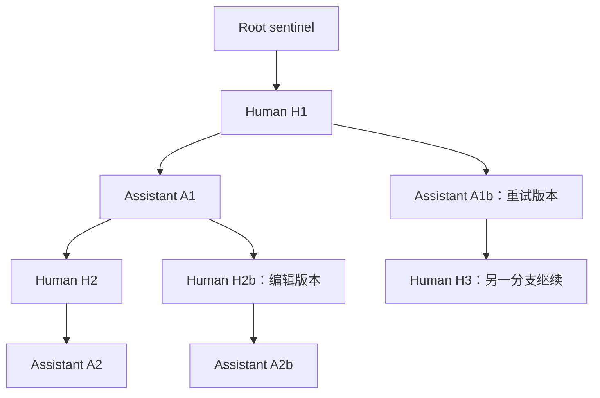
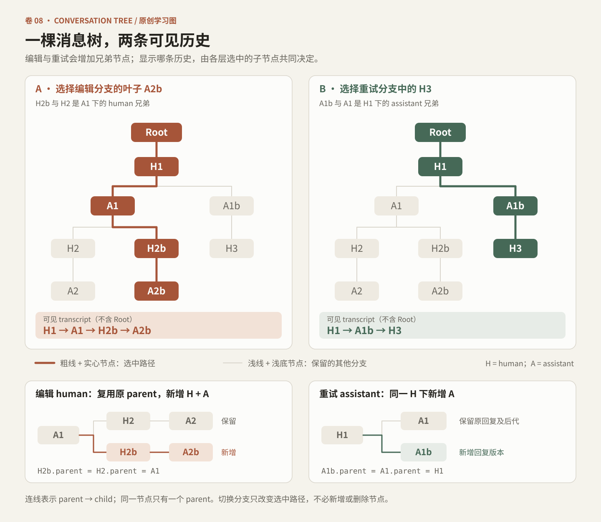
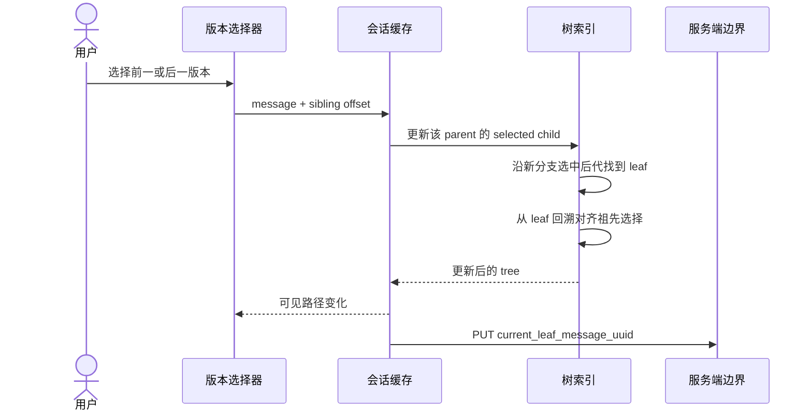
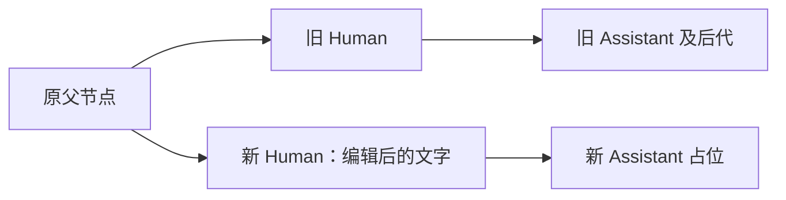
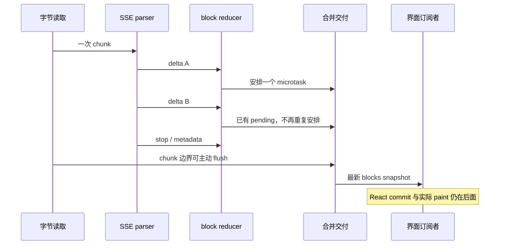

# 卷八：会话不是一条列表，流式也不是一个打字动画

## 1. 两个正交的问题

聊天界面必须同时回答两个问题：**现在显示哪一条历史路径？现在这条回复显示到什么进度？** 前者属于会话树与分支选择；后者属于事件接收、内容块状态和交付节奏。把二者塞进一个 `messages.push(token)`，编辑、重试、断流恢复和多设备刷新很快就会互相干扰。

在本次核实的 classic chat 路径中，服务端会话读结果被建成一组树索引，再从其中导出一条可见路径。流式发送同时创建乐观消息、更新当前内容块，并在条件满足时与服务端 UUID 及最终读结果对账。主聊天路径关闭 generic smoother，选择微任务合并的直接交付。Code 的回复呈现另有提交节奏，语音又有自己的 reducer。[PT-08、PT-34–49、PT-54]

本卷范围是 Desktop 2.37337.1 的选定客户端调用链；数据库结构与其他 surface 的调用条件需独立确认。详见[证据索引](#证据索引)。

## 2. 四个索引描述一棵单父消息树

### 2.1 数据模型

所见构造器建立四个 Map：

| 索引 | 键 → 值 | 作用 |
|---|---|---|
| `messageByUuid` | 消息 UUID → 消息对象 | 按身份读取节点 |
| `parentByChildUuid` | 子 UUID → 一个父 UUID | 沿祖先链回溯 |
| `childrenByParentUuid` | 父 UUID → 有序子 UUID 数组 | 维护同一父节点下的版本/分支 |
| `selectedChildByUuid` | 父 UUID → 被选中的子数组位置 | 决定可见路径走向 |

根采用固定 sentinel UUID。构造器按消息集合的顺序建立 child 数组，并初始化选择位置。存在旧数据兼容：缺失 parent 时，向前寻找较小 index 的最近消息，再找不到才接到 sentinel。它不是简单的“排序后每两项组成一轮”。[PT-34]



这张原创示意图里，H1 的两个 assistant 子节点是同一用户消息的不同回复；A1 的两个 human 子节点是从同一历史位置继续的不同输入。它们都满足“一条消息只有一个 parent”。

### 2.2 为什么这里应称 tree，而不是任意 DAG

有向无环图（DAG）可以允许一个节点拥有多个父节点；所见 `parentByChildUuid` 只存一个 UUID，消息对象也只有单个 `parent_message_uuid`。分支共享祖先，不等于子节点合并多个祖先。

因此，准确表述是：**本路径使用单父消息树及其选中路径。** 不能因为回复有“版本”、存在“分支”，就称它为多父 DAG；也不能从这段客户端表示推断服务端数据库没有其他关联关系。[PT-34–39]

### 2.3 关键不变量

| 不变量 | 对使用者的意义 |
|---|---|
| 每个可用节点有单一父关系 | 回溯不会面临“该采用哪条父边”的歧义 |
| 子节点数组顺序稳定 | 版本计数和前后切换有确定顺序 |
| 每个分叉只选一个子节点 | 可见 transcript 是路径，不是把整棵树平铺 |
| 向上、向下遍历都检查循环 | 坏数据不能让渲染无限循环 |
| 新增节点需要 parent | 追加动作不靠当前 DOM 顺序猜测归属 |

原实现对缺失数据有兼容与恢复分支，不等于在构造时严格验证所有可能错误。配套实验采取更严格的批量插入前验证，属于本书自己的工程加固。

## 3. 选择叶子，是同时选择整条祖先路径



同一单父消息树中的编辑分支、重试分支与两条可见路径。图中数据为教学构造；产品分支条件以本节正文和证据编号为准。

### 3.1 从 leaf 向上对齐选中边

给定一个 leaf UUID，客户端沿 `parentByChildUuid` 向上走，在每一层找到该 child 在 siblings 中的位置，并写入 `selectedChildByUuid`。这样，选择一个深层消息就足以恢复通向它的各层分支选择。[PT-35]

### 3.2 从 root 向下生成可见 transcript

生成可见路径时，代码从 sentinel 或指定节点开始，反复读取该 parent 的子节点数组及 selected index，将选中的消息加入结果，然后继续向下。返回的展示消息还增加：

- `nOptions`：这一层兄弟节点数量
- `selectedOption`：零起点的位置
- `siblingUuids`：该层的兄弟身份列表

界面显示时把位置转成一开始计数，提供 previous/next，并在首尾禁用对应按钮。[PT-36、PT-51]

### 3.3 切换版本并不销毁别的分支

Sibling navigation 将当前位置加上偏移，钳制到有效范围，更新这一层的选择；之后沿新子节点已经选好的后代继续走到叶子，再调用向上对齐函数。这个做法会保留各分支此前选中的后代路径，而不是每次切换都重置到第一条回答。[PT-37]



最后一步不是推测：classic chat host 将新叶子交给 mutation，该 mutation 指向 conversation-scoped 的 `current_leaf_message_uuid` PUT 路径。[PT-40–42]

这仍不能保证写入已经成功，或所有设备同时切换完成。客户端即时路径更新与服务端持久化是不同阶段；本研究未运行失败场景，也不声称这条选择 mutation 有某种未经核实的跨设备事务语义。

## 4. 未回答的 human 消息为什么被单独保存

会话树加载器默认保留 assistant 节点、被 assistant 指向的 human 节点及必要祖先；其余带父关系而尚未形成回复的 human 消息，可放入 `danglingHumanMessages`。在特定读取选项下，也可以把它们保留到主集合。[PT-38]

这不是“丢弃用户刚发的话”。它表达了一种不确定状态：服务端已知有人提交了输入，但当前读取还没有看到对应回答。另有 helper 使用服务端 leaf 或当前路径末端，寻找与这条路径相关的 dangling human。

这个分离能支持两个不同的界面判断：

1. 已完成、可以稳定展示的选中历史路径是什么？
2. 是否还有一个已提交或在其他设备上等待的用户回合？

不能仅凭“主路径最后一条是 assistant”就判断当前完全空闲，也不能把所有悬空 human 平铺成已经完成的对话。相邻的多设备同步路径还会查看 updated time、当前 leaf 是否已知及本地是否正在写入，再决定是否重新读取会话。[PT-53]

## 5. 发送、编辑、重试是三种不同的树操作

### 5.1 普通发送：先创建可识别的乐观节点

发送路径会为本轮 human 与 assistant 生成 UUID，在本地使用带前缀的 optimistic UUID 建立节点。human 指向指定 parent；assistant 指向刚创建的 human。请求中同时可以携带这组本轮 UUID，用于幂等性与后续对账。[PT-27、PT-44]

需要区分四种身份：

| 身份 | 示例性含义 |
|---|---|
| 业务回合 UUID | 请求希望服务器采用的 human/assistant 身份 |
| 乐观显示 UUID | 流尚未完成时本地临时节点的身份 |
| 服务器返回的 UUID | message-start 或会话读取确认的消息身份 |
| 展示 row key | UI 复用一行组件时的身份，未必等同于每条底层消息 |

把这些身份合成一个字符串，并在流结束时随手替换，容易破坏 parent、child 列表、选中路径和 React 行身份。

### 5.2 编辑 human：在原位置分叉

编辑路径将新文字与原消息的 `parent_message_uuid` 传给普通发送层，并设置 `isEdit: true`。普通发送层创建新的 human+assistant 对。因此，编辑一个历史输入的主要结构语义是：**在它原来的父节点下新增一个 human 兄弟，再接上新 assistant。**[PT-43–44]

原消息及其原有后代仍是树中的另一个分支。所见编辑流程会停止相关活动流，处理附件保留/移除选择，并在特定发送拒绝情况下恢复先前显示状态、保留编辑草稿。这里不能描述为“原地覆盖旧文本后让所有后代继续有效”。



### 5.3 重试 assistant：同一 human 下增加回复版本

重试路径使用独立的 retry endpoint 模式，创建新的 assistant 占位；指定 parent 时接在相应 human 下。调用来自 assistant 的重试按钮时，采用原 assistant 的 parent；来自 human 时，采用该 human UUID。[PT-45]

若没有可用的明确 parent，所见代码还会参考当前 leaf：leaf 是 assistant 时取其父节点，否则可取 leaf 本身。该回落是兼容逻辑，不能替代正常调用的明确 parent。

| 操作 | 新增节点 | 接到哪里 | 保留什么 |
|---|---|---|---|
| 普通发送 | human + assistant | 选中历史末端/指定 parent | 其他分支 |
| 编辑 human | 新 human + 新 assistant | 原 human 的 parent | 原 human 与原回答后代 |
| 重试回复 | 新 assistant | 同一 human | 原 assistant 版本 |
| 切换分支 | 不必新增节点 | 只改变 selected edges/leaf | 所有已有分支 |

四个按钮的 UI 外观可能接近，数据操作却不应混写。

## 6. 结束流不等于完成对账

### 6.1 快速结算有明确前提

包中存在将已流出的内容直接写回乐观树、减少立即重读的 fast-settlement 路径；它不是无条件执行。已核实的资格检查包括：classic C1/C2、非后台探测、human UUID 已知、服务端采用客户端 UUID、没有丢弃 parent、已有停止原因、没有错误、干净关闭、恰好一次 message-start、没有 compaction，以及存在应保留的内容。[PT-47]

这解释了为什么某些回合可以马上稳定为最终消息，另一些回合必须重新读取：多次 message-start、模型回合轮转、compaction 或身份不一致时，客户端不应该仅凭自己已经显示的文字决定完整最终状态。

### 6.2 重命名必须同步所有索引

乐观节点 rekey 的函数先检查：

- optimistic assistant 是否存在
- human 是否可定位
- 目标真实 UUID 是否已存在
- assistant 的 parent 去掉临时前缀后是否等于预期 human
- optimistic assistant 是否已经有子节点

通过后才更新消息 Map、parent Map、children Map、selected-child Map、消息数组、dangling 集合和当前 leaf。[PT-46]

这里的一般教训是：**消息身份是结构中的主键，不是仅供标题显示的文本。** 若一个临时节点已经产生后代，简单替换它的 UUID 可能需要更多一致性工作，不能把 fast path 无限制扩展到所有状态。

### 6.3 可见行与底层消息仍然不同

另一个展示层 helper 会把某些连续 assistant 消息合成一条展示 chain，合并 content，保留 constituent message UUIDs、首尾 UUID、row key 和 compaction horizon。于是“一行回答”不保证只有一条服务器消息。[PT-50]

这与树结构不冲突：树描述历史分支；chain 描述怎样把选中路径投影成视觉行。Artifact、工具过程、compaction 和后续模型段都可能使“消息数”和“可见气泡数”不同。

## 7. 流式呈现至少有六个时钟

最容易出现的误解是：模型每产生一个 token，浏览器就绘制一个字符。所见实现并不支持这种一一对应。

| 层次 | 单位 | 为什么不能互相替代 |
|---|---|---|
| 模型生成 | token | 本次未测量服务器 token 产生时刻 |
| 网络读取 | 字节 chunk | 一个 chunk 可含多帧或半帧 |
| SSE 分帧 | event | 一帧 delta 可以含多个字符 |
| reducer | 内容块状态 | 多帧可更新同一块，某些帧无文字 |
| 订阅交付 | snapshot / callback | 可以合并、延后、立即 flush |
| 浏览器绘制 | frame / paint | 状态已交付不等于像素已显示 |

因此，本卷使用“接收”“状态更新”“交付”“绘制”四个不同动词。没有运行时证据时，不把源码中的 timer 数字写成实测帧率或端到端延迟。

## 8. 主聊天：关闭平滑器，使用合并直接交付

### 8.1 最关键的分支条件

generic buffer 确实保留连续平滑器，具有累计长度、到达时间记录、当前位置、速度、结束状态，以及根据可见性调整调度间隔的 task。但所见 classic completion 调用点明确设置：

```js
// 本书对已核实配置的可读表达，不是原模块的完整摘录。
const presentation = {
  smooth: false,
  coalesceDeliveries: true
};
```

因此，不能写成“Claude 主聊天通过平滑器逐 token 打字”。更准确的说法是：**该路径保留完整 block 状态，并在微任务层合并直接交付。** 首次有效内容、chunk 末尾和关闭/错误等边界又可以显式 flush。[PT-08、PT-10、PT-12]

### 8.2 为什么微任务合并有价值

一次网络读取可能同步解析出多帧。每帧都更新内存状态，但只安排一个 pending microtask。多帧连续到达时，订阅者可以一次拿到最新 snapshot，避免为每个小 delta 都执行一次上层状态通知。



### 8.3 平滑器仍值得研究，但要放对位置

generic smoother 的备用 task 有约 60Hz 的前台节奏、不可见面板的 100ms 节奏，以及 document hidden 时的 200ms 等待；隐藏时可直接追上当前完整内容，结束时又有立即补齐逻辑。[PT-13]

这些设计说明作者把“完整接收位置”和“已揭示位置”分开建模。它们可以解释一种平滑器如何工作，却不能推翻本调用点的 `dont_smooth` 配置。研究者应优先报告调用点实际设置，再解释可复用类的能力。

## 9. Code 路径：自己的 commit scheduler

另一条 Code 回复呈现路径同样关闭 generic smoother，但在其上加了一层提交调度。已核实的间隔选择为：

| 条件 | 所见间隔/动作 |
|---|---|
| 页面可见、面板被视为可见 | 33ms |
| 面板不活跃/不可见 | 100ms |
| document hidden | 200ms |
| 首批可显示内容 | 可立即提交 |
| 显式 flush | 可立即提交 |
| block stop / message stop 且有待交付内容 | 将 pending commit 交付 |

可见性检查本身有缓存窗口，并非每个 delta 都执行一次昂贵的可见性判断。该路径还记录 backlog、最大文字跳跃、delivery 数量和首次揭示延迟等指标。[PT-48–49]

33ms 只是这个调度器的源代码常量，不是“所有 Claude 平台都以 30 FPS 流式绘制”的证据。浏览器调度、主线程负载、页面后台限速与 React 都会影响最终显示。

## 10. backpressure：三种机制不能混成一个词

### 10.1 已核实的本地读取节奏控制

底层 reader 调用 chunk handler；如果 handler 返回 thenable，就 await 它，再读取下一个 chunk。主 completion 的 handler 先 flush，再在已收到可显示内容且页面未隐藏时检查 8ms 工作预算。超预算时通过可用的 scheduler yield 或事件循环回调让出主线程。[PT-01、PT-09–10]

这建立了一条真实的反馈链：

```text
本 chunk 解析与状态更新
    → 交付最新内容
    → 检查主线程工作预算
    → 必要时 await 让出事件循环
    → 再读取下一个 chunk
```

它是客户端消费速度控制，能够避免长时间同步处理一串已缓存事件霸占主线程。它不保证服务端模型停止生成，也不保证 TCP、浏览器网络层和所有中间缓冲都停止增长。

### 10.2 呈现合并控制的是通知频率

microtask coalescing 与 Code commit scheduler 减少的是下游通知/呈现次数。它们不直接减少模型生成量，也不自动给字节缓冲设置上限。把“少 render 几次”写成“网络背压已解决”，会掩盖内存问题。

### 10.3 暂存缓冲反而可能继续吸收输入

为了等待某个 paint/teardown 时机，所见 response wrapper 会暂时主动读原始 body，把字节放进数组，再用 `highWaterMark: 0` 的新 stream 暴露给消费者。零高水位约束的是新 stream 自身的拉取策略；临时数组仍是另外一层缓冲。[PT-11]

本研究在这个 helper 内没有看到数组字节上限。因此，不能把它宣传为端到端严格 bounded buffer。另一方面，inline-comparison 的 deferred event queue 确实有 50,000 项上限，并合并兼容的 text/thinking deltas；达到上限会放弃未发布的比较 pair。这个保护只属于该比较功能，不能借给所有流式路径。[PT-52]

| 机制 | 控制的资源 | 已核实边界 |
|---|---|---|
| awaited chunk callback | 连续客户端解析工作 | 8ms cooperative budget，按条件让出 |
| microtask / timer delivery | 订阅通知与呈现频率 | 主聊天和 Code 使用不同节奏 |
| paint-hold 字节数组 | 暂时吸收待消费字节 | helper 内未见字节 cap |
| comparison deferred queue | 未公开的比较事件数量 | 50,000 项 cap，特定 delta 合并 |

真正的流式可靠性要同时考虑吞吐、延迟、内存、可见性和最终一致性，不能由一个 `highWaterMark` 或 `requestAnimationFrame` 一锤定音。

## 11. 本书原创实验：把可解释性变成测试

配套 [protocol-tree](../../04-Extracted-Core-Code-And-Scripts/core-code-lab/protocol-tree/README.md) 代码没有 import、eval 或执行目标 bundle，没有连接真实服务器。它用独立代码实现经过本卷核实的基础机制，并标出更严格或简化的地方。

### 11.1 最小使用示例

```js
const tree = new ConversationBranches([
  { uuid: 'h1', parent_message_uuid: ROOT, sender: 'human', index: 0 },
  { uuid: 'a1', parent_message_uuid: 'h1', sender: 'assistant', index: 1 }
]);

tree.retryAssistant('a1', 'a1b');
// 可见路径：h1 → a1b；a1 仍保存在树中。

tree.switchSibling('a1b', -1);
// 可见路径：h1 → a1。
```

这段代码的重点是分支语义。它不是 Claude 客户端的 drop-in replacement，也没有服务端持久化、权限、完整协作协议或 React UI。

### 11.2 已通过的测试覆盖

原创树模型先验证全部输入节点，再做可见性筛选。没有被选中的分支、悬空 human 与不显示的节点，同样不能携带缺失父节点或环；“用户看不到”不是跳过结构校验的理由。

原创流消费者还在每个帧回调前后检查取消信号：一个 chunk 同时包含帧 A、B，如果 A 的回调触发 abort，B 不再交付。已执行的 A 不会回滚，正在进行的上游 I/O 也不会因此自动被强制取消。这里描述本书实现的合作式检查点，不把它扩写成产品运行时保证。


测试共 41 项，包含原有 24 项与新增 17 项异常输入回归，包括：

| 测试组 | 反例或约束 |
|---|---|
| SSE framing | CR、LF、CRLF；每一个二段切分位置；中文/emoji UTF-8 字节；逐字节输入 |
| SSE 生命周期 | 多行 data、注释、retry；EOF 不制造未闭合事件；资源上限 |
| 消费节奏 | 处理与 yield 完成前不请求下一 chunk；工作预算只在超时时让出 |
| reducer | 微任务合并、snapshot 隔离、允许的较早块更新、错误 index 拒绝 |
| 工具 JSON | tool-use 追加与 tool-result 替换的区别 |
| 回撤与重启 | 删除后缀、重新设置 index 基准、新 message 段、旧 microtask 失效 |
| legacy 标签 | 每个字符串切分点；thinking 不进入可见文字；未闭合 Artifact 保留 open 状态 |
| 消息树 | 深层 leaf 选择、兄弟切换、编辑保留旧分支、重试增加 assistant 兄弟 |
| 异常数据 | dangling human、旧 index 兼容、重复 UUID、循环、缺失 parent、原子插入 |

进入 [protocol-tree 目录](../../04-Extracted-Core-Code-And-Scripts/core-code-lab/protocol-tree/README.md)后，运行 `node --test test/*.test.mjs`，不需要第三方依赖。实验里的 SSE 容量限制、严格 retry 检查、批量原子验证都是本书原创实现的选择，不能反向宣传为目标产品已具备的特性。

## 12. 本卷结论

会话树让“历史版本”成为数据结构，而不是截图里的前后箭头；分层流式管线让“正在回答”成为可管理的状态，而不是每个字一个动画。

这条客户端路径最值得复用的设计是：

1. 分开保存完整树、选中路径和展示行。
2. 通过明确 parent 区分发送、编辑与重试。
3. 将临时身份与最终身份的对账做成受条件约束的操作。
4. 将网络接收、内容状态、通知交付与实际绘制分开观察。
5. 根据调用点配置判断是否平滑，避免从 helper 名称推断运行行为。
6. 明确 local read pacing、呈现合并与内存上限各自解决的问题。
7. 给回撤、重复、缺失 parent、未完成输入和中途重启写测试，不能只测“Hello world 正常流出”。

### 证据索引

静态范围为 Claude Desktop Linux amd64 2.37337.1；研究未运行目标应用或探测端点，客户端树结构不证明数据库设计，通用 helper 的存在不证明所有 surface 使用它。PT 编号对应 [protocol-tree-streaming.json](../../04-Extracted-Core-Code-And-Scripts/evidence/data/protocol-tree-streaming.json)；可读实现与测试位于配套 [protocol-tree](../../04-Extracted-Core-Code-And-Scripts/core-code-lab/protocol-tree/README.md) 目录。哈希、短锚点、偏移和分析范围集中保存在证据文件，正文不再堆叠审计过程。

[返回全书目录](../README.md) · [阅读前提与术语](../README.md#一页阅读准备) · [原创代码实验室](../../04-Extracted-Core-Code-And-Scripts/core-code-lab/README.md)
