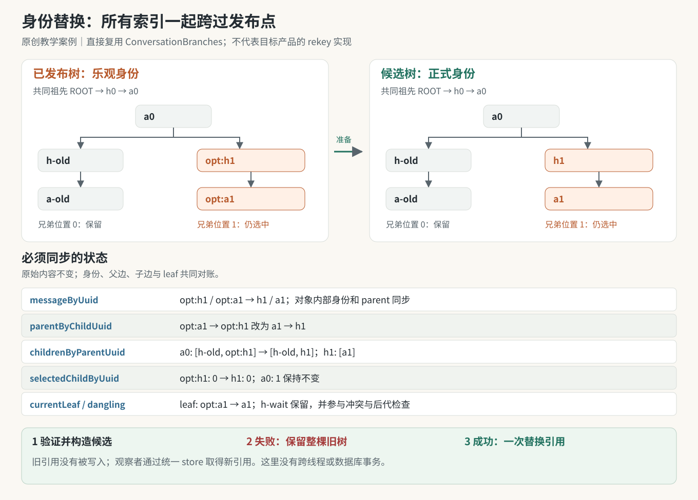

# 实战推演：把乐观身份换成正式身份，究竟要一起改什么？

一段回答已经完整显示，服务端身份也已确认。界面里暂存的两条消息叫 `opt:h1` 和 `opt:a1`，现在要换成 `h1` 和 `a1`。文字完全不变，似乎只要给对象换个 `uuid` 就行。

先预测三个结果：版本按钮还能找到旧回答吗？下一条消息沿父链回溯时，会遇到哪个身份？组件订阅者有没有可能读到“对象已经改名，孩子列表还指向旧名字”的中间状态？

这个案例专门解决**身份对账的一次状态转移**。它直接导入本书已经发布的原创 `ConversationBranches`，并在外面增加一个窄范围的候选树适配器。没有复制树实现，没有加载目标 bundle，没有连接服务器。卷八正文所述产品路径与这里的工程选择必须分开：正文 6.2 的观察包括多种索引和集合；本实验只实现原教学类实际拥有的四张 Map、当前叶子和 dangling 集合。它没有产品消息数组、React row key、流结束资格判定或跨设备事务。



*图：原创模型采用先构造完整候选树、再替换持有者引用的方式。橙色是正在更名的一对节点；绿色发布点之前，读者继续看到整棵旧树。*

## 一、起点不是孤零零的两条消息

我们故意保留一个旧版本和一条尚未回答的输入，让测试不能只验证“新消息显示出来”。

```text
ROOT → h0 → a0
             ├─ h-old → a-old       旧版本，仍可切回
             ├─ opt:h1 → opt:a1     当前选中版本
             └─ h-wait              未回答，保存在 dangling 集合
```

最后一条边是完整输入中的父关系；在本例默认显示分区里，`h-wait` 没有进入四张索引 Map。它仍必须参与目标身份的冲突检查，不能因为暂时不显示就假装身份不存在。

这里的 `ROOT` 是原模型导出的固定 sentinel。`opt:` 是本案例自选的教学前缀，不声明与目标产品的前缀、UUID 格式相同。内容固定如下：

| 身份 | sender | 文本 |
|---|---|---|
| h0 | human | 比较两种方案 |
| a0 | assistant | 先明确约束 |
| h-old | human | 旧版本问题 |
| a-old | assistant | 旧版本回答 |
| opt:h1 → h1 | human | 修订后的问题 |
| opt:a1 → a1 | assistant | 新回答已收齐 |
| h-wait | human | 另一条尚未回答的输入 |

身份替换没有改变这些内容，不会生成新回答，也不表示任何远程写入已经完成。客户端只是在演练如何接纳已知的正式身份。

## 二、逐项对账：六个状态位置，一个也不能遗漏

下表覆盖本模型全部已存状态。表中的 Map 条目按插入顺序书写；`selectedChildByUuid` 的值是零起点数组位置，绝不是 UUID。

### 2.1 messageByUuid：键与对象内部身份必须一致

为避免重复正文，消息值只展示 `uuid / parent_message_uuid`；sender、content 使用上一表的值且保持不变。机器可读完整对象由 `tree-case.mjs --json` 输出。

| Map 键（前 → 后） | 对象 uuid / parent（前） | 对象 uuid / parent（后） |
|---|---|---|
| h0 → h0 | h0 / ROOT | h0 / ROOT |
| a0 → a0 | a0 / h0 | a0 / h0 |
| h-old → h-old | h-old / a0 | h-old / a0 |
| a-old → a-old | a-old / h-old | a-old / h-old |
| opt:h1 → h1 | opt:h1 / a0 | h1 / a0 |
| opt:a1 → a1 | opt:a1 / opt:h1 | a1 / h1 |

只改变最后一行的 Map 键，会留下“键叫 a1，对象却叫 opt:a1”；只改变对象，则按新 UUID 根本查不到它。human 改名还会影响 assistant 对象内部的父身份。

### 2.2 parentByChildUuid：向上的边也要更名

| 前 | 后 |
|---|---|
| h0 → ROOT | h0 → ROOT |
| a0 → h0 | a0 → h0 |
| h-old → a0 | h-old → a0 |
| a-old → h-old | a-old → h-old |
| opt:h1 → a0 | h1 → a0 |
| opt:a1 → opt:h1 | a1 → h1 |

这张索引只更新 key 不够；assistant 的 value 也指向刚刚更名的 human。

### 2.3 childrenByParentUuid：向下的边包含两个更名位置

| 前 | 后 | 是否改变兄弟顺序 |
|---|---|---|
| ROOT → [h0] | ROOT → [h0] | 否 |
| h0 → [a0] | h0 → [a0] | 否 |
| a0 → [h-old, opt:h1] | a0 → [h-old, h1] | 否 |
| h-old → [a-old] | h-old → [a-old] | 否 |
| opt:h1 → [opt:a1] | h1 → [a1] | 否 |

`opt:a1` 没有孩子，因此原来就不存在以它为 key 的条目。不要为了“补齐所有 UUID”凭空添加空数组；本模型依靠是否存在子列表决定继续遍历。

### 2.4 selectedChildByUuid：值不改，部分 key 要改

| 前 | 后 |
|---|---|
| ROOT → 0 | ROOT → 0 |
| h0 → 0 | h0 → 0 |
| a0 → 1 | a0 → 1 |
| h-old → 0 | h-old → 0 |
| opt:h1 → 0 | h1 → 0 |

因为 `a0` 下两个版本仍保持原顺序，所以位置 `1` 继续表示新版本。若把 canonical 节点追加到数组尾部再删除临时节点，就必须另外证明每个索引是否仍指向原来的版本；这里直接保留顺序，避免引入额外的选择语义。

### 2.5 不在四张 Map 里的状态

| 状态 | 前 | 后 |
|---|---|---|
| currentLeaf | opt:a1 | a1 |
| danglingHumanMessages | [{uuid: h-wait, parent: a0, sender: human, content: 另一条尚未回答的输入}] | 同一内容的独立克隆 |
| 可见路径的 UUID | [h0, a0, opt:h1, opt:a1] | [h0, a0, h1, a1] |

dangling 集合的身份和父关系也经过同一个更名函数，只是本次没有命中，因此值保持不变。它不是“不重要所以忽略”。

### 2.6 展示投影也会跟着变

`visiblePath()` 是派生结果，并不是第五张需要独立维护的 Map。重新读取候选树，得到：

| 行 | uuid 前 → 后 | nOptions | selectedOption | siblingUuids 前 → 后 |
|---|---|---:|---:|---|
| 1 | h0 → h0 | 1 | 0 | [h0] → [h0] |
| 2 | a0 → a0 | 1 | 0 | [a0] → [a0] |
| 3 | opt:h1 → h1 | 2 | 1 | [h-old, opt:h1] → [h-old, h1] |
| 4 | opt:a1 → a1 | 1 | 0 | [opt:a1] → [a1] |

旧版本并没有消失。执行 `next.switchSibling('h1', -1)` 后仍可得到 `h0 → a0 → h-old → a-old`，再向后切换也能回到正式身份的新版本。

## 三、为什么采用“准备后发布”，而不是现场改六处？

原模型的 `append()` 已经采用先克隆、验证，再插入的策略，但它没有 rekey 公共方法。这个案例没有绕进私有方法，而是让原构造器承担完整图校验与索引建立：

1. 检查输入树的索引是否与消息对象一致，包括未选分支与 dangling 输入。
2. 检查这次请求是否符合窄 fast path：存在 human+assistant 对，父关系匹配，正式身份空闲，assistant 没有后代。
3. 克隆记录，对所有 `uuid` 与 `parent_message_uuid` 应用同一映射。
4. 调用原 `ConversationBranches` 构造候选树，保留主索引与 dangling 的原分区。
5. 用重命名后的 key 恢复各分支选择位置与 currentLeaf，重新验证候选。
6. 适配器返回；调用方仅在成功后执行一次 `store.current = candidate`。

```js
import { prepareCanonicalPair, makeTreeFixture, canonicalPair }
  from './tree-rekey.mjs';

const store = { current: makeTreeFixture() };
const candidate = prepareCanonicalPair(store.current, canonicalPair);
store.current = candidate;
```

在适配器执行期间，没有 `await`，没有通知外部订阅者，也没有对旧树的写入。它的“原子性”具体指：**准备失败则旧树的值和 Map 引用都保持原样；准备成功后，统一持有者通过一次引用替换发布完整候选。**

这不是多线程事务、数据库事务或 UI 框架的全局原子更新。已经持有旧树引用的组件仍会读到旧快照；真正集成时，订阅者必须通过统一 store 取得新引用。直接缓存某张 Map、允许并发写入旧对象、或者分开发布多个 state 字段，都会超出本例保证。

重建索引还会产生额外对象分配。本例选择容易审计的表达方式，不将它包装成生产环境的性能建议。

## 四、拒绝应该发生在发布之前

| 反例 | 具体输入 | 拒绝理由 | 失败后的承诺 |
|---|---|---|---|
| 已有身份冲突 | canonicalAssistant = a-old | 会覆盖另一分支 | 四 Map、leaf、dangling 均未变 |
| 隐藏身份冲突 | canonicalAssistant = h-wait | dangling 也是已占用身份 | 同上 |
| 两个正式身份相同 | canonicalHuman = canonicalAssistant | 两个节点不能合并成一个 key | 同上 |
| sentinel / 空值 / 临时前缀 | ROOT、空字符串、opt:new | 不满足本例身份协议 | 同上 |
| 乐观对象不存在或角色不符 | assistant 指向 human 或 absent | 不是预期的待结算对 | 同上 |
| assistant 父对象不匹配 | 所指定 human 不是其 parent | 可能结算错回合 | 同上 |
| assistant 已有主树后代 | opt:a1 → child | 超出窄 fast path | 同上 |
| assistant 只有 dangling 后代 | opt:a1 → wait-child | 显示过滤不能隐藏依赖 | 同上 |
| 某个 payload 无法克隆 | content 携带函数 | 无法完成独立候选快照 | 不发布半棵树 |
| 公开 Map 已被直接破坏 | parent Map 与对象不一致 | 拒绝掩盖坏状态 | 不静默修复、不重新解释输入 |
| 重放已完成替换 | 对新树再次替换 opt:h1 / opt:a1 | 乐观对已经不存在 | 明确失败，不暗称幂等 |

拒绝后可以回到更完整的权威状态对账流程；本案例没有网络读取器，因此只把异常交给调用者，绝不会偷偷调用服务端。

## 五、运行一次，然后检查输出

在本书根目录 `books/claude-app/` 运行，使用 Node.js 20+，不需要安装依赖：

```sh
node 04-Extracted-Core-Code-And-Scripts/worked-cases/state-transitions/tree-case.mjs
node 04-Extracted-Core-Code-And-Scripts/worked-cases/state-transitions/tree-case.mjs --json
node --test 04-Extracted-Core-Code-And-Scripts/worked-cases/state-transitions/state-cases.test.mjs
```

第一条的完整预期输出：

```text
before: h0 > a0 > opt:h1 > opt:a1
after:  h0 > a0 > h1 > a1
a0 children: h-old, h1
selected a0: 1
dangling: h-wait
old snapshot unchanged: true
```

测试文件同时覆盖下一例；20 项基础测试全部通过才算本案例集合通过。源码和精确 import 位置见[运行说明](../../04-Extracted-Core-Code-And-Scripts/worked-cases/state-transitions/README.md)。`--json` 输出所有消息字段、四张 Map、leaf、dangling 与展示投影，可以逐格核对本章表格。

## 六、先预测，再运行

1. 如果开始时选中 `a-old`，给隐藏分支改名后，可见路径应改变吗？随后向后切版本，应得到哪些 UUID？
2. 如果只修改 `messageByUuid` 的键，为什么下一次 `visiblePath()` 可能失败？请指出它首先读取哪张索引。
3. 如果 `selectedChildByUuid[a0]` 从 `1` 误改成正式 UUID `h1`，它还是一个合法的选择值吗？
4. `h-wait` 没进四张 Map，为什么不能拿它当 canonicalAssistant？
5. 若 assistant 已有一条不可见的 dangling child，只查看 `childrenByParentUuid.has(opt:a1)` 能否安全放行？
6. 调用方得到候选树后尚未替换 `store.current`，现在观察者会看到什么？如果调用方选择丢弃候选，旧状态需要回滚吗？

### 对照答案

1. 不改变，仍为 `h0 → a0 → h-old → a-old`；随后切换得到 `h0 → a0 → h1 → a1`。A02 专门测试隐藏分支。
2. 它从 ROOT 的 children 数组和 selected 位置往下走，最终仍会拿到旧 key `opt:h1`，在新键集合里查不到对应消息。
3. 不合法。这里存的是数组下标，必须是范围内整数。身份与位置属于不同类型。
4. 它是完整输入中的已占用身份；否则一次读取或后续回复就会暴露冲突。
5. 不能。dangling 集合必须参与后代判断。A07 覆盖这一反例。
6. 仍为整棵旧树。准备阶段没有改写旧树，所以丢弃候选不需要回滚。

最后记住一个检验方法：把“UUID 只是名字”改成“UUID 是被多个方向索引引用的主键”，所有必须一起更新的位置就会逐项浮现。
