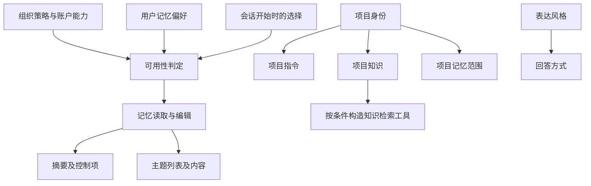
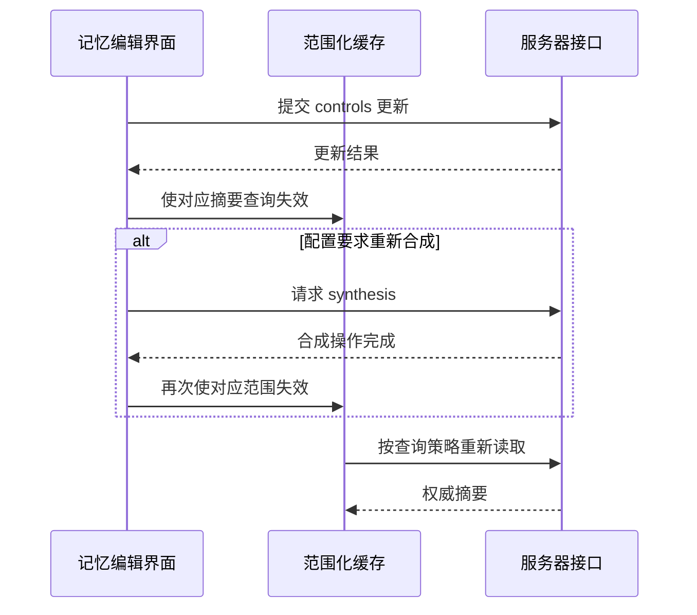
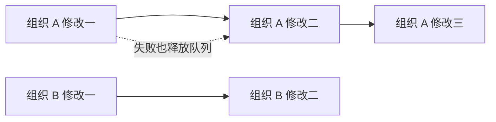
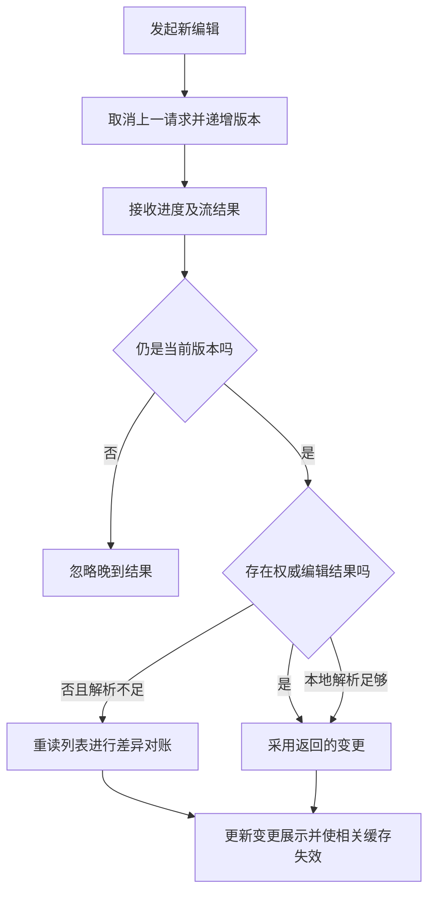

# 第九卷 Memory Projects 与 Styles 的状态边界

让助手记住一个人，远比把一段文字放进提示词复杂。真正难的是划清范围：这条信息属于哪个账户、组织或项目；用户是在暂停使用、修改记忆，还是要求删除；旧请求回来时，能否覆盖刚刚做出的选择。

本卷把这几个问题拆成可理解、可复用的工程结构。最重要的结论是：**Memory、Project instructions、Project knowledge 和 response style 有不同的数据所有者、写入契约与失效条件，不能合并成一个没有边界的“长期上下文”。** Claude Desktop 2.37337.1 的客户端恰好保留了摘要式记忆、主题式记忆与迁移兼容路径，可以看到这些边界如何被维护。

实现范围为 Desktop 2.37337.1 Linux 客户端；产品语义另引官方文档。版本与证据见[附录](#附录-证据与边界)。

## 1 先区分四种长期上下文

| 层次 | 想解决的问题 | 本次能确认的客户端对象 | 不能相互替代的原因 |
|---|---|---|---|
| Memory | 跨次交流保留相关背景 | 摘要与控制项，或主题列表与单项内容 | 暂停、删除、迁移有独立生命周期 |
| Project instructions | 这个项目应怎样工作 | 项目详情中的 prompt_template | 是明确编辑的项目规则，并非自动生成的记忆 |
| Project knowledge | 工作需要哪些参考材料 | 文本文档、上传文件、连接器同步源 | 有数量、体量、同步状态及检索模式 |
| Response style | 怎样组织回答与协作方式 | Code output-style 命令分支 | 改变表达指令，不授予资源访问权限 |

账户级指令又是另一层。当前官方个性化说明把它与项目指令、按任务使用的 Skills 分开；这些概念可以组合，但不能据此推导服务器里的提示词拼接顺序。[官方个性化说明](https://support.claude.com/en/articles/10185728-understanding-claude-s-personalization-features)

以下是原创的状态关系图，连线表示依赖或作用范围，不表示模型实际收到内容的先后顺序。



工程上的第一步不是选择向量数据库，而是先给图中的每个节点指定所有者、缓存键、可写入口和删除语义。

## 2 同时存在的新旧记忆契约

截至研究日，官方帮助页明确区分两种体验：旧版以摘要为中心，存在定期合成；新版按主题保存与管理。它也明确说明，云端 Cowork 可以与 Chat 共享记忆，本地 Cowork 不使用这份记忆；单次聊天或任务的记忆选择在开始时确定。尤其值得注意的是，新版删除来源会话不会自动删除由其生成的记忆条目，而旧版说明把合成与来源会话关联。这些语义必须按版本阅读，不能拼成一份混合规格。[记忆与聊天搜索说明](https://support.claude.com/en/articles/11817273-use-claude-s-chat-search-and-memory-to-build-on-previous-context)

包内恰好可见两组不同契约：

| 观察面 | 摘要式路径 | 主题式路径 |
|---|---|---|
| 展示对象 | memory 字符串、controls 数组、updated_at | 列表及按 path 读取的条目 |
| 范围 | account、org、可选 project | 本次追到的列表与单项查询按 org 分隔 |
| 编辑 | 保存 controls，可按配置继续请求 synthesis | 提交 instruction，消费流式编辑结果 |
| 删除 | 单独的 reset 操作 | 删除单个 path，或 reset 后整体清缓存 |
| 兼容信息 | project_import 状态与项目 memory mode | 导入状态及迁移相关分支 |

解析器先用非 null/undefined 的服务器 mode 计算 `memoryOn` 和候选模式；没有可用服务器 mode 时，才用偏好、功能门和能力状态推导候选值。返回的 UI mode 还会做可用性投影：候选为摘要式、摘要模式不可用而主题模式可用时，会投影为主题式；原始服务器值另存为 `serverMemoryMode`。这里能证明的是多种契约的共存和选择逻辑，不能证明某个具体账户已经迁移，也不能仅凭内部命名重建发布历史。（MEM-01、MEM-10—15）

本地 Cowork 启动参数还保留 memoryEnabled 和可选模板输入。这只说明该客户端保留了相应接线，并不推翻当前官方对本地 Cowork 的产品说明。参数存在、分支可达、实际启用是三个不同层次。（MEM-16）

## 3 摘要记忆的编辑不是直接改写最终摘要

摘要响应解析器要求 memory 为字符串，controls 为可空字符串数组，并规范化带时区的更新时间。项目相关的导入状态、模式字段还有容错解析，以便较旧响应或局部异常不直接击穿整个视图。（MEM-01）

读取缓存键包含账户、组织与可选项目。请求是否启用，还受到活动组织、调用者 enabled、功能状态和策略阻断共同影响。因此，“这个组件已经挂载”不等于“它正在读记忆”。（MEM-02）

更有价值的是写入链：



这是对可见客户端路径的重绘，不是服务端生成算法。保存控制项与重新合成是两件事；后者还受到配置及调用选项影响。不能把“保存按钮成功”统一解释成“所有未来请求已经使用新的最终摘要”。（MEM-03）

reset 同样拥有独立入口。普通禁用、清理浏览器侧缓存、向服务器请求重置各自有不同含义。一个开关变灰，最多是界面状态证据；要声称永久删除，必须看到相应操作契约或官方产品说明。（MEM-04）

可迁移的做法是把操作命名为“修改指导”“重新生成”“暂停使用”“删除数据”，并让反馈对应准确的完成阶段，避免只留下一个模糊的 saveMemory。

## 4 把用户的手势限制为精确写入

记忆设置写入里有一条很细的防线：普通更新与明确的用户手势使用不同入口。

普通入口会移除 user_initiated 和 clear_data。手势入口先验证字段集合与值，再加入 user_initiated。这个检查的重点不是“它是不是 JSON”，而是“这次操作有没有夹带用户没有点过的别的开关”。（MEM-05、MEM-06）

本版本验证器接受的形状如下，字段名保留原样以便核对。

| 字段集合 | 值约束 | 可表达的动作 |
|---|---|---|
| enabled_saffron | 必须为布尔值 | 单独修改摘要式记忆选择 |
| enabled_saffron_search | 必须为布尔值 | 单独修改历史搜索选择 |
| enabled_melange | 只能为 true | 选择主题式记忆 |
| enabled_melange 与 enabled_saffron | 前者必须 false，后者必须布尔值 | 选择摘要式记忆，或总关闭 |
| 上一行加 clear_data | 两个 enabled 都为 false，clear_data 必须 true | 带清除意图的总关闭 |

额外字段、含糊的单字段关闭和不匹配的清除意图会被客户端拒绝。服务端是否执行独立校验不在本次证据范围内；客户端验证不能充当服务端安全保证。

这个设计可用于更广泛的敏感设置：上传、共享、删除、授权范围变更都可以用明确的语义命令构造负载，而不是让设置面板提交整个对象。例如自建产品可以让 reset 命令只从单独的确认流程产生，普通偏好保存永远无权构造它。

## 5 按组织串行写入并处理失败

快速点选两个设置可能产生一个经典问题：第二次写入先完成，第一次失败后的回滚却把第二次结果覆盖了。

本版本记忆设置用组织 UUID 维护 Promise 队列。每次写入接到前一个任务的尾部；失败会向调用者抛出，但内部尾部会吸收拒绝，避免后续任务永久堵住。不同组织使用不同队列，因此不需要一把全局锁。（MEM-07）

写入过程还包含几个彼此配合的步骤：

1. 在本次排队操作开始时，记录需要乐观更新的账户设置字段。
2. 先更新相关 bootstrap 缓存，让 UI 及时响应。
3. 为请求设置 30 秒中止预算，并与调用者的取消信号合并。
4. 成功后使用响应替换本组织设置缓存，并同步已返回的 mode。
5. 失败后回滚乐观字段，同时保留旧查询的新鲜度信息，避免失败被误装成一次新读取。

这里的串行队列是当前客户端实例内的协调机制，并不等于跨设备事务锁。30 秒也只是请求预算，不能解读为记忆处理一定在 30 秒内完成。（MEM-07、MEM-08）



## 6 缓存新鲜度会影响隐私选择

设置值不像头像地址。用户已经在另一台设备关闭记忆时，本机的旧缓存可能仍是 true。启动一个长任务之前，如果只读取本地旧值，就可能把过去的选择当作当前意愿。

包内有一条专门处理这类情况的路径。它区分缓存年龄、进行中的读取、正在进行的设置写入、离线、超时、可重试错误与明确拒绝。在适用分支中，开始工作前可以再读旧设置；默认 unread 策略是关闭，只有明确选择 held 策略才允许保留旧值。（MEM-09）

| 数字或状态 | 在被检查路径中的含义 | 不应误读为 |
|---|---|---|
| 12 小时 | 设置查询默认 staleTime 和 gcTime | 服务器数据保留期 |
| 10 分钟 | 多个重读与年龄判定的基础值 | 所有页面统一轮询频率 |
| 10—60 分钟 | 某个远程年龄配置被限制的区间 | 每台桌面端必然采用的实际值 |
| 3 秒与 30 秒 | 一条启动前等待路径的常规与无人值守默认预算 | 记忆生成 SLA |
| fetched | 已取得新值后再判断是否可用 | 任务已执行 |
| held | 显式允许沿用保留值的策略 | 缺省情况下总能离线使用 |

尤其要看条件：桌面环境迹象会影响某个年龄阈值的最终选择；启动前重读也只对符合条件的已存在、活动查询适用。不能把一个复杂函数概括成“每次启动强制刷新权限”。

对自建产品，更清楚的原则是：为新动作设置独立的授权新鲜度预算。读取失败与允许使用不是同义词；如果业务确实支持沿用旧授权，应将它作为显式策略并记录使用范围。

## 7 主题编辑是带对账的异步过程

主题式记忆有 org 范围的 list、probe 和按 path 划分的 read 查询。列表与单项读取虽然走 POST，但在客户端缓存层承担 query 的角色；HTTP 方法不能独自决定它是不是有副作用。（MEM-11）

这些查询使用很长的新鲜度策略，因此主动失效和对账尤其重要：

- 删除单项成功后，从列表移除该 path，删除对应 read 查询，并修正 probe 的数量。
- reset 后先取消旧列表、probe、read 请求，再把缓存变为空；否则一个晚到的旧响应可能重新填回已经清空的界面。
- 编辑以 instruction 和可选 path、model 发起流式请求，不在本地实现记忆提取器。

编辑器同时使用 AbortController 和请求版本号：发起新编辑时取消旧请求；回调更新还要检查版本。取消信号只能表达“不再需要结果”，版本号才决定“结果是否仍属于当前界面”。（MEM-12—14）



当流无法可靠说明到底改了什么时，客户端可以重读列表，比较 path 和 updated_at，生成写入与删除的展示记录。它优先相信明确的服务器结果，必要时才通过状态差异恢复。这是一种很实用的“结果不完整时读取权威状态”模式，而不是凭自然语言输出猜测保存是否成功。

导入也有独立状态：pending 时以 5 秒间隔检查；切换导入的暂时 404 或瞬时错误使用另一段有界容忍逻辑。尚未准备好、处理失败、暂时读不到不能全部落到一个 error 布尔值里。（MEM-15）

## 8 项目是指令 知识与权限的交点

这里分析的是现有项目的知识库与设置路径。当前官方文档同时介绍了从 Claude Code 开始分阶段开放的新 Projects beta，它用一段持续对话协调并行云端线程。现有项目继续工作，二者不能因为都叫 Projects 就被视为同一个已验证实现。[现有项目与 beta 的官方范围说明](https://support.claude.com/en/articles/9517075-what-are-projects)；[Code Projects 文档](https://code.claude.com/docs/en/claude-projects)

### 8.1 指令编辑有独立权限与保存状态

项目详情按 org、project 区分缓存。项目指令编辑器支持 view-only，保存时检查内容、pending 状态和重复提交保护，再把 prompt_template 交给项目更新操作。（PRJ-01、PRJ-02）

项目设置、知识编辑、成员管理也没有缩成同一个 canEdit。客户端结合创建者、角色、组织可见性与明确权限枚举，分别算出三个结果；详情仍在占位或加载阶段时，还保留权限加载状态。（PRJ-09）

这意味着一个用户“能在项目里聊天”，不能被当作“能改指令、删除知识或邀请成员”。权限设计要按行为拆分，界面也应以相同粒度呈现。

### 8.2 知识来源不止上传文件

| 知识对象 | 可见读写特点 | 客户端需要处理的问题 |
|---|---|---|
| 文本文档 | 列表、单项详情、创建、单项删除与批量删除 | 列表轻量化、详情与总量一致性 |
| 上传文件 | 独立文件列表与类型信息 | 文档页数、图像尺寸、解析状态 |
| 连接器同步源 | 独立 sync 列表与状态 | 持续同步、错误恢复、完成后的刷新 |

文档列表可以只请求 compact 元数据，再按需取详情。因此列表没有全文，不等于内容被删了。文档创建或删除还会维护列表、详情和总量；批量删除按 UUID 集合处理。这些契约未证明编辑既有文档的独立更新操作；一般 mutation 或创建后的缓存更新不能代替该证据。（PRJ-03—05）

同步列表不存在、不是数组或为空时，这个 `refetchInterval` 不安排轮询；非空列表中存在进行中的同步时，间隔为 5 秒，否则为 5 分钟。它还识别“曾经 pending，现在不再 pending”的转变，触发项目知识刷新。重要的是状态转移，不只是定时器数字。（PRJ-06）

### 8.3 检索入口与容量计算是两层

项目知识搜索先经过客户端功能门，在适用模式下检查账户能力，再读取项目自身 KB 统计里的 use_project_knowledge_search。通过后，构造工具时才包含 project_knowledge_search。（PRJ-07）

容量预算使用的是通用的项目检索能力判定 `gh()`，不是上一段按项目读取的 `use_project_knowledge_search`。通用判定通过时采用远程配置预算；不通过时，采用返回模型最大 `hard_limit` 的 90%（四舍五入），没有 `hard_limit` 时使用回退值。文本没有 estimated_token_count 时，用内容长度除以 4 向上取整作为估计。（PRJ-08）

这些都是前端预算与展示计算，不能当作服务端 tokenizer，也不能据此声称每个项目文件都被完整塞进每次请求。官方创建管理说明支持“项目知识与项目指令可供该项目聊天使用”这一用户层含义，却没有为本次分析补出服务器排名、分块或上下文拼接算法。[创建与管理项目](https://support.claude.com/en/articles/9519177-how-can-i-create-and-manage-projects)

## 9 Styles 这个名字覆盖了不同东西

本次最容易产生伪发现的地方，是把所有含 style 的命中归成一个功能。

| 发现 | 实际能说明什么 | 不能说明什么 |
|---|---|---|
| STYLES 菜单枚举 | 包中保留兼容标识 | 当前账户必定能打开样式管理器 |
| customStyles:chatFont | 聊天字体偏好 | 模型回答的语气或结构 |
| has_personalized_style 被设为 false | 某条发送遥测使用固定值 | 全产品已经移除某项功能 |
| /output-style 命令解析 | Code 会话有样式选择与切换分支 | 经典 Chat Custom Styles 的 CRUD |
| 写作风格设置入口 | 存在另一条风格引导消费者 | 它与 Code 或旧 Chat 样式共用数据模型 |

在 3,426 个 assets/v1 JavaScript 文件中，用 custom_style、custom-styles、style_id、style_uuid、selectedStyle、user_styles 等词检索，并结合已追踪消费者，没有恢复出经典 Chat Custom Styles 的完整创建、读取、更新、删除链。这个负面结果只适用于本次语料与方法，不证明功能在所有产品或账户中消失。（STY-01—05）

Code 的命令分支则更具体：它区分没有会话、样式仍在加载、不可用、打开选择器，以及按名称或显示标签选择。当前 Code 文档将 output style 定义为会话指令，并明确它不会改变 permission mode。因此，“更主动的回答风格”不能被解释成“自动获得更多工具权限”。[Code output styles](https://code.claude.com/docs/en/output-styles)

旧 Chat Styles 帮助链接在前一轮检查中返回 404，本轮读取工具也未取得正文。404 与搜索不到实现都不足以证明产品移除；本卷不使用旧搜索摘要来填补这个空白。

## 10 一个可运行的原创学习模型

随卷的 [memory-flags-model.mjs](../../04-Extracted-Core-Code-And-Scripts/core-code-lab/memory-flags/memory-flags-model.mjs) 不复制目标应用实现，也不访问它的 API。它把本卷和下一卷的通用思想缩成几个可独立测试的组件：

- ScopedMutationQueue：同范围串行，失败不堵后续任务。
- applyQueuedOptimistic：在排队操作内部捕获旧值、乐观更新、采用权威响应或回滚。
- LatestRequestGuard：识别晚到的旧结果。
- resolveFreshAccess：新动作需要足够新鲜的允许状态；重读失败时拒绝。
- decideAccess、readBoundedNumber、evaluateCapabilityGraph：分别处理能力状态、数值边界和依赖图。

下面是原创用法，展示“界面马上响应”和“服务端确认”如何分开：

```js
const queue = new ScopedMutationQueue();
const cache = new Map([['workspace-a', { enabled: false }]]);

await applyQueuedOptimistic(
  queue,
  'workspace-a',
  cache,
  { enabled: true },
  async patch => ({ ...patch, confirmed: true })
);
```

教学模型有意简化了客户端缓存订阅、跨标签页协调与真实权限协议，也选择了更保守的权限过期策略。它不是 Claude 的替代实现。测试覆盖同范围顺序、跨范围并行、失败恢复、乐观回滚、旧响应隔离、权限过期和配置边界，共 15 项通过。进入 [memory-flags 目录](../../04-Extracted-Core-Code-And-Scripts/core-code-lab/memory-flags/README.md)后，运行 `node --test memory-flags-model.test.mjs`。

## 11 设计自己的长期上下文系统时应测试什么

| 场景 | 要验证的不变量 |
|---|---|
| 用户连续改变模式，第一次请求失败 | 回滚不覆盖后续已确认选择 |
| 组织切换时旧请求返回 | 结果不进入另一组织的缓存 |
| 用户清空主题，旧列表请求晚到 | 空状态不会被旧数据重新填满 |
| 编辑 A 未结束，编辑 B 已开始 | A 的文本、错误和变更列表都不能接管 B 的界面 |
| 设置过期且设备离线 | 新动作遵守明确的失效策略，不隐式扩权 |
| 列表只加载了 compact 数据 | 按需取详情，不把缺少正文判断为删除 |
| 成员能聊天但不能编辑知识 | 查询权限与写权限分别执行 |
| 样式切换成功 | 仅改变对应表达配置，不顺带变更权限 |

长期上下文系统的可靠性，往往最先在这些交界处显现。真正可迁移的经验，是把意图、范围、权限、异步结果和删除语义做成可以单独验证的契约。

## 附录 证据与边界

- 静态对象：Claude Desktop Linux amd64 2.37337.1；研究日期 2026 年 10 月 14 日。实现分析使用官方包静态资源，产品语义另引公开文档；未登录账户、运行目标应用或调用包内 API。
- 官方包 SHA-256：41745b0914f0ff51631a1ff1bb403b836bf5c995845cca6742dd39bca3a2da14。
- 共用证据文件：[memory-flags.json](../../04-Extracted-Core-Code-And-Scripts/evidence/data/memory-flags.json)。本卷使用 MEM-01—16、PRJ-01—09、STY-01—05；下一卷使用 FLG 系列。
- 关键模块：shared-182-CW7gYT2d.js 负责本次追到的记忆设置、摘要与项目数据路径；shared-156-BeTC6pHT.js 包含主题编辑消费者；shared-4-1vKV8QN9.js 包含项目预算与权限组合；cc43287c9-CNtlFMhj.js 包含 Code output-style 消费分支。
- 本轮独立核对了证据中的 27 个文件哈希与 124 个原有短锚点，均匹配；新增修正锚点也以字节位置保存。
- 当前官方文档与打包客户端不一定同日发布。帮助页内部也可能保留旧计划说明；本卷不据此制作套餐可用性总表。
- 未恢复服务器端记忆提取、主题合并、检索排名、提示词注入顺序或完整存储结构。客户端 path、列表和编辑指令并不足以补出这些算法。
- 正文图、表与学习代码均为原创，未附分发包、原始 bundle 或完整提示词。

[返回全书目录](../README.md) · [阅读前提与术语](../README.md#一页阅读准备) · [原创代码实验室](../../04-Extracted-Core-Code-And-Scripts/core-code-lab/README.md)

## 逐步推演

[实战推演：两次设置更新，一次回滚，一个迟到的允许](worked-case.md)逐步运行同组织队列、失败回滚和切组织后的过期响应处理。
