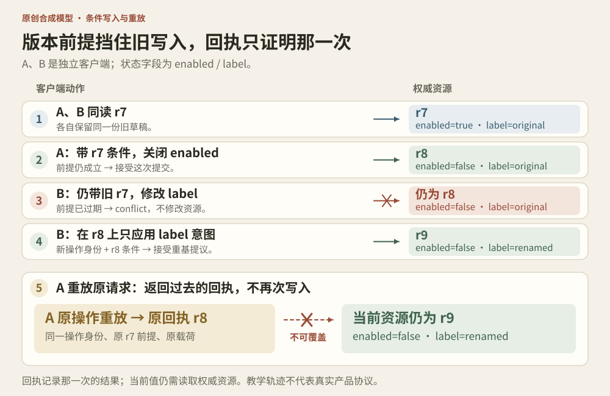

# 实战推演：两边都保存成功，为什么仍会丢失修改？

本节的服务器、设置、版本、操作账本与轨迹均为原创合成模型，用来推演跨客户端写入。静态材料只能确认客户端按组织串行写入，无法据此判断 Claude 服务端是否采用、缺少或需要下述协议。




## 1. 一把客户端锁保护不了两份旧草稿

假设设置只有两个字段：`enabled` 和 `label`。A、B 是两个独立客户端，登录同一个合成资源。两边都正确使用第 9 卷的 `ScopedMutationQueue`。

| 顺序 | A 的状态 | B 的状态 | 权威资源 |
|---|---|---|---|
| t0 | 读取 true / original | 读取 true / original | true / original，r7 |
| t1 | 只想关闭 enabled | 只想把 label 改为 renamed | 仍为 r7 |
| t2 | 提交完整旧对象，加上 enabled=false，成功 | 仍保留自己的旧对象 | false / original |
| t3 | 没有挂起任务 | 提交完整旧对象，加上 label=renamed，成功 | true / renamed |

A 的关闭被 B 顺带改回去了。B 并没有点击开启。两次写入甚至可以按 t2、t3 严格串行执行，问题仍然存在，因为 B 的读发生在 A 的写之前。

这叫丢失更新：另一个人的修改被旧对象覆盖。不是队列写错，也不需要两个 JavaScript 线程同时执行。最小反例已经直接复用书中的原队列，见 [authority-model.test.mjs](../../04-Extracted-Core-Code-And-Scripts/worked-cases/concurrency-and-streaming/authority-model.test.mjs) 第一项。

单字段 patch 可以减少对无关字段的覆盖；同一字段的竞争、跨字段约束，以及“用旧值计算新值”的更新，仍需相应的并发控制。

## 2. 四种身份各自回答一个问题

| 标识 | 谁产生或维护 | 本节中回答的问题 |
|---|---|---|
| queue scope | 客户端队列 | 本实例哪些写入需要排队？ |
| UI generation / ticket | 当前页面 owner | 回来后还能更新这个界面吗？ |
| operationId | 操作发起者与接收端共同约定 | 这是不是同一次提交的重放？ |
| expectedRevision | 权威资源版本，由客户端原样携带 | 本次修改所依据的资源版本仍然有效吗？ |

换一个 operationId 不会让旧 r7 重新有效。提高 UI generation 也不能改变服务端当前已经是 r8。四种值可以一起存在，没有任何一个能替代剩下三个。

这里的 r7、r8 只是可手算的教学编号。生产接口可以提供不透明版本或强 ETag；HTTP 的 `If-Match` 正是用于给状态修改附加版本前提，防止意外覆盖别人的修改。[RFC 9110 §13.1.1](https://www.rfc-editor.org/rfc/rfc9110.html#name-if-match)

## 3. 把前提检查放到真正拥有资源的一侧

本节的接收端只允许这种状态转移：

```text
当前 revision == expectedRevision
    → 替换 value，并产生新 revision
否则
    → 返回 conflict，不修改资源
```

A 带 r7 写入成功，资源变成 r8。B 仍带 r7，收到 conflict；A 的关闭保持不变。

最容易写错的伪实现是：

```js
const current = await readFromDatabase();
if (current.revision === expectedRevision) {
  await writeToDatabase(proposal);
}
```

另一个 writer 可以在两个 await 之间提交。检查与更新需要由资源接收端在同一受保证的提交边界完成，例如数据库条件更新。教学代码的同步函数没有 await，只用来表达这个不可分的逻辑步骤；它没有模拟多实例数据库。

同理，跨标签页广播、WebSocket 通知与失效缓存有助于更快发现变化，却不能代替权威侧的条件提交。即使通知晚到，条件提交也应该拒绝旧前提。

## 4. 冲突不是“再自动点一次保存”

最危险的修补是：收到 conflict 后只把 revision 改成最新值，然后原封不动发送旧完整对象。这样相当于绕过刚刚发现的冲突，仍可能把 `enabled=false` 覆盖成 true。

客户端需要保留三份不同的数据：

- base：用户开始修改时看到的版本
- intent：用户实际想改哪些字段及其目标值
- current：冲突后重新读取的权威状态

在本例中，B 的 intent 是 `{ label: 'renamed' }`。当前 r8 里 A 只修改了 enabled，label 仍等于 base 的 label，因此本节允许把 B 的 label 修改提议应用到 current 上，再用 r8 和一个新的 operationId 提交：

```text
base       = true  / original
intent     = label → renamed
current r8 = false / original
proposal   = false / renamed
```

`rebaseDisjoint` 只实现这种互不重叠的简单标量赋值。若另一个人已经把 label 改为 `other-editor`，它返回冲突字段，不替用户判断该保留谁的名字。

就算生成了新的 proposal，在提交前仍可能出现第三个 writer，所以新提交也必须继续带 r8 条件。读取最新值并不等于从此拥有独占权。

真实的数组、富文本、删除、计数器、跨字段限制或“再增加一点”不属于这个合并算法。尤其不能用通用深层 merge 自动处理授权与删除含义。

## 5. 冲突和丢回包需要不同的下一步

| 结果 | 本模型已知什么 | 应保留的操作身份与动作 |
|---|---|---|
| committed | 这次提交已经采用 | 保存提交回执；当前资源仍可能继续变化 |
| conflict | 这次新提交没有修改资源 | 保留 intent，读 current，决定是否产生新 proposal |
| 请求结果未知 | 无法仅凭没回包判断是否提交 | 重放原请求或查询原操作结果，不擅自换键重发 |

第 16 卷介绍了幂等重试。加上版本条件后，还需处理一种情况：A 成功提交 r8，却丢了回复。随后 B 已经提交 r9。A 使用原 operationId、原 r7 前提和原 payload 重放时，接收端应识别这次操作已经发生，返回 A 原来的回执，而不是再次写入或误报为一次从未成功的普通冲突。

本模型因此先查询已记录的 operationId，再对新操作检查 revision。相同 operationId 搭配不同 payload 或不同 expectedRevision 会明确拒绝。冲突也会留下回执，所以重新计算的提议要使用新身份。

## 6. 成功回执可能比当前数据更旧

```text
A 重放得到：这次操作成功，提交结果是 r8
当前资源为：r9
```

两者都正确。回执证明过去那次操作的结果，`read()` 才读取模型此刻的资源。

若 UI 无条件用重放回执替换整个当前缓存，就可能把 r9 的新设置退回 r8。集成时要区分“结束这次保存中的提示”和“采用一份新的权威快照”。在本节的单资源、递增版本模型中可以拒绝较旧快照；生产系统必须按自己的资源身份及版本比较合同处理，不能靠客户端时钟大小猜新旧。

把第 9 卷原实验中的 `cache.set(scope, confirmed)` 接入跨设备写入时，还需补上上述回执对账。

## 7. 先预测，再运行

在书根目录执行，Node.js 20+，无需安装依赖：

```sh
cd 04-Extracted-Core-Code-And-Scripts/worked-cases/concurrency-and-streaming
node demo.mjs
node --test authority-model.test.mjs
```

逐字输出：

```text
local queues: enabled=true, label=renamed
conditional A: committed, revision=8
conditional B: conflict, enabled=false
rebase B: committed, revision=9, enabled=false
replay A: receiptRevision=8, currentRevision=9, commits=2
```

练习：

1. B 冲突后只换 operationId，不换旧 revision，会成功吗？
2. B 改用 r8，却提交自己的旧完整对象，会发生什么？
3. A 的成功回执被重放时，r8 是否证明当前资源仍是 r8？
4. 两个客户端都修改 label，是否可以用本节算法静默合并？

答案：1 仍冲突；2 可以被条件接受，但会覆盖 A，因为新的前提已被用户代码错误地绑定到旧提议；3 不证明；4 不可以，算法保留冲突。

## 8. 本实验到底保证了什么

14 项测试验证两份本地队列的反例、旧版本拒绝、简单不重叠字段重基、同字段冲突、同操作重放、操作身份绑定、回执与当前状态区分，以及快照隔离和输入边界。

它只保存两个标量字段、一个资源和内存操作账本。它没有账户鉴权、真实网络、数据库并发事务、磁盘持久化、跨资源提交、删除重建、离线同步、日志淘汰或实际设置写入。操作账本在本次进程内不淘汰，也没有存储容量保证。

真实实现还需把条件写入与幂等记录放到适当的原子提交边界，明确身份作用域及保留窗口；不能把这个内存 Map 换成两个互不协调的数据库写入就宣称具备同样保证。
