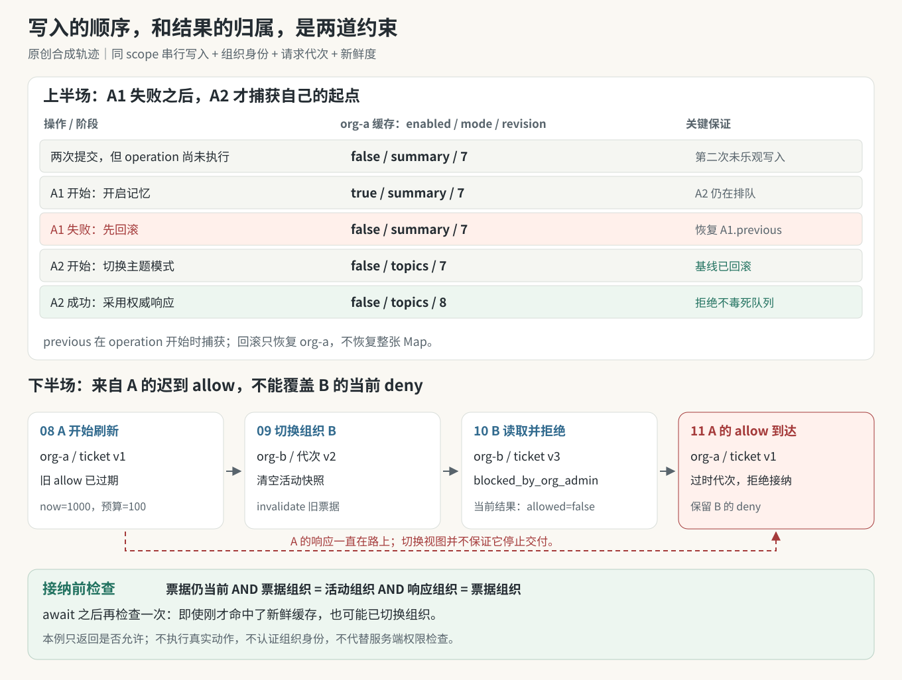

# 实战推演：两次设置更新，一次回滚，一个迟到的允许

用户在组织 A 连续做了两次修改：先开启记忆，再把模式从摘要切到主题。第一个保存还没回来，第二个已经排队。第一个随后失败，第二个成功。接着，用户切到组织 B；一份针对组织 A 的能力读取却在此时返回 `available`。

这里容易发生两类不同错误：失败回滚抹掉较新的设置，或者旧组织的允许结果进入新组织界面。**写入顺序与结果归属是两道不同约束，不能用同一个 pending 布尔值解决。**

本例连接卷九“按组织串行写入、失败回滚”的主题，以及卷十“配置必须携带组织身份与新鲜度”的主题。它直接导入已经发布的原创 `ScopedMutationQueue`、`applyQueuedOptimistic`、`LatestRequestGuard`、`decideAccess`、`resolveFreshAccess`，只补充一层案例专用的 `ScopedAccessView`。组织、缓存、时间和响应都是合成数据，没有读取真实记忆或调用产品 API。这里的字段 `enabled / mode / revision` 是教学字段，不是 Claude 设置负载。



*图：上半段是同一作用域内的保存顺序；下半段是独立的能力读取。队列让回滚先于第二次写入，组织与请求代次让旧允许无法进入当前视图。*

## 一、先写清楚每份状态归谁

| 状态 | 本例持有者 / 键 | 用途 | 不能证明什么 |
|---|---|---|---|
| settings cache | Map 的 org-a 条目 | 显示组织 A 设置及保存结果 | 不自动成为组织 B 的设置 |
| queue tail | ScopedMutationQueue 的 org-a 作用域 | 同组织操作串行，失败后继续 | 不是跨设备锁，也不串行读取 |
| previous | 每个操作开始时捕获 | 本次失败时恢复本次旧值 | 不是“用户点击时的全局快照” |
| active org | ScopedAccessView.org | 确定当前视图归属 | 字符串本身不是身份认证 |
| request ticket | org + version + isCurrent | 排除晚到和失效结果 | 不取消传输、不撤销远端动作 |
| access snapshot | org + checkedAt + state + allowed | 为新动作提供有期限的本地判断 | 不代替服务端鉴权 |

同一份缓存的写入必须走同一个队列实例与一致的作用域键。若一个面板用 `org-a`，另一个用 `account-x:org-a`，两个队列入口不会自动意识到它们在写同一份数据。

这里暂且假定设置对象作为普通不可变数据使用。原模型的乐观合并是浅层展开，调用者不应在提交后继续修改 patch 或旧对象的嵌套内容；本例没有增加深层 merge、版本冲突协商或数据库条件更新。

## 二、两个点击都已提交，不等于两个乐观修改都已执行

初始缓存为：

```json
{"enabled":false,"mode":"summary","revision":7}
```

两次修改分别是：

- A1：patch = `{enabled: true}`，模拟保存等待后失败。
- A2：patch = `{mode: 'topics'}`，模拟保存等待后返回权威对象。

`applyQueuedOptimistic()` 把“记录 previous”和“合并 patch”放在排队 operation 内部。因此第二次的乐观修改也要等第一次结束后才开始。这个选择换来了简单、明确的回滚边界，但它不代表 UI 必然在第二次点击的同一刻就显示新模式。产品若需要点击即展示，应该另外设计 pending intent 层；不能悄悄改写缓存后仍套用这里的证明。

### 完整写入轨迹

| 输出步 | 动作 | org-a 缓存 | A1 / A2 状态 | 为什么是这个值 |
|---:|---|---|---|---|
| 00 | 初始 | false / summary / rev7 | 未开始 / 未开始 | 已确认起点 |
| 01 | 连续提交 A1、A2 | false / summary / rev7 | 已排队 / 已排队 | Promise 回调尚未推进 |
| 02 | A1 开始并乐观更新 | true / summary / rev7 | 等待响应 / 排队 | A1.previous = 初始对象 |
| 03 | A1 失败并回滚 | false / summary / rev7 | 已失败 / 仍未开始 | 恢复 A1.previous |
| 04 | A2 开始并乐观更新 | false / topics / rev7 | 已失败 / 开始 | A2.previous 捕获回滚后的对象 |
| 05 | A2 模拟保存开始 | false / topics / rev7 | 已失败 / 等待响应 | 断言 enabled 必须为 false |
| 06 | A2 成功 | false / topics / rev8，serverNormalized=true | 已失败 / 已完成 | 整份采用权威响应 |
| 07 | 队列清空 | 同上 | 终态 / 终态 | pendingScopes = 0 |

注意步骤 03 和 04 是两次可观测的缓存写入。测试使用一个记录写入的 Map，证明不是只看最终状态猜测发生过回滚。第二次保存看到的 `enabled: false` 是最关键的中间断言：它排除了“把失败的开启操作悄悄带入第二次请求基线”的错误。

`revision` 只是模拟服务器结果里的字段；模型没有使用它做 CAS 或乐观并发控制。`serverNormalized` 则故意只出现在返回对象里，帮助检查成功路径确实用服务器对象替换缓存，没有只保留自己的 patch。

## 三、失败为什么没有把队列永久毒死？

原 `ScopedMutationQueue.run()` 返回真实的操作 Promise，让调用者仍然收到失败；它内部保存的尾 Promise 则把成功和失败都变成可继续的完成状态。

```text
A1 的调用者：收到 offline 错误
                     ↘
组织 A 队列尾：A1 已结算 → 开始 A2 → A2 已结算 → 删除尾记录
```

如果队列只写成 `tail = tail.then(operation)`，而不为内部尾部吸收拒绝，A1 的拒绝可能沿链传播，A2 根本不会开始。反过来，如果对外返回的 Promise 也吞掉异常，界面就会误报保存成功。

“错误对调用者可见”和“队列能继续”必须同时满足。示例在触发模拟错误前就给 A1 安装拒绝处理，避免把测试本身变成未处理 Promise rejection。

另一个组织 B 的操作使用不同 scope，可以在 A1 等待时完成。A1 回滚只写 org-a 的键，不得恢复整张 Map。B03 测试正是把 B 的成功放进这个间隙，再令 A 失败。

## 四、切换组织后，正确的 allow 也可能是错误的数据

设置写入已经结束，我们开始第二段独立流程。

组织 A 留有一个旧访问快照：`org-a / allowed=true / checkedAt=0`。现在注入时钟 `now=1000`，本例预算 `maxAge=100`，所以它已过期。`mayStartAction()` 调用原 `resolveFreshAccess()` 发起重新读取，而不是直接使用旧 allow。

读取期间切换到组织 B，B 的新响应是管理员阻断。最后 A 的旧响应返回 available。

| 输出步 | 事件 | 活动组织 / 代次 | 当前快照 | 能否启动原来的 A 动作 |
|---:|---|---|---|---|
| 08 | A 过期 allow 触发刷新 | A / 1 | A 的过期快照 | 等待，尚未给出 true |
| 09 | 用户切到 B | B / 2 | 清空，尚未取得 B 数据 | A 的票据已失效 |
| 10 | B 开始读取并收到 deny | B / 3 | B / blocked_by_org_admin / false | 不允许 |
| 11 | A 的 available 迟到 | B / 3，A 票据仍为 1 | 保持 B 的 deny | 返回 false |

数字代次来自原 `LatestRequestGuard`：开始请求递增，组织切换显式 invalidate 也递增。`isCurrent()` 检查的是当前代次，而不是响应晚到多久。

为什么要检查两个维度？

- 只有 org 检查：A → B → A 后，旧 A 响应又与当前组织同名，可能被错误接纳。
- 只有 version 检查：如果当前请求收到归属字段错误的响应，版本正确也不能把其他组织数据写进去。
- 只有新鲜度检查：一份刚刚到达、checkedAt 很新的 A 响应仍然不属于 B。
- 只有 AbortController：取消请求不保证网络库、缓存回调或 Promise 永远不再交付结果。

适配器因此在接纳响应时要求：票据仍为当前代次，票据组织等于活动组织，响应组织等于票据组织。接纳后才调用原 `decideAccess()` 生成带原因的结果。

## 五、在 await 后再检查一次，连“没发网络”的路径也要考虑

`resolveFreshAccess()` 是 async 函数。即使缓存还新、没有调用 refresh，等待其结果的 `await` 也形成一个可让其他同步动作发生的边界。

```js
const ticket = view.beginRead();
const allowed = await resolveFreshAccess(snapshot, now, maxAge, refresh);
return ticket.isCurrent() && ticket.org === view.org && allowed;
```

完整代码还会在 refresh 响应写入快照之前执行同一组身份检查；上面只强调最后一道检查。B09 测试使用新鲜 allow，立即切换组织，再等待结果，最终必须为 false。这证明“没有网络所以不存在竞态”并不成立。

本例的 `mayStartAction()` 只返回布尔值，没有真正 dispatch 工具或发送请求。若生产调用者拿到 true 后又 await 其他工作，真正提交动作之前仍应再验证相关代次，或交给能检查权限并执行动作的可信端点。一个前端布尔值不能跨任意长时间继续有效。

此外，本案例选择“同一视图最新请求胜出”。发起新的动作检查会递增同一个 guard，旧检查因此被保守否决。这适合演示单一活动视图，不直接适合并发执行多个互不影响动作；那些动作需要各自明确的归属与生命周期。

## 六、不要把四种成功合成一个词

| 能确认的事情 | 还不能因此确认的事情 |
|---|---|
| UI 已做乐观显示 | 服务器已保存 |
| 模拟 A1 报错并本地回滚 | 真实网络错误下服务器一定没写入 |
| A2 返回权威设置并更新本地缓存 | 所有设备已经同步 |
| B 的能力读取已接纳 | 真实受保护操作一定会执行成功 |
| 旧 A 响应已被忽略 | 底层请求已取消或远端副作用已撤销 |

本例的保存函数完全是受控 Promise，没有服务器副作用，所以回滚含义清楚。真实系统若发生“服务端已写入，但回应丢失”，本地回滚不能撤销远端写入；后续需要幂等请求、结果查询或重新读取权威设置。这里没有假装解决这个问题。

`checkedAt` 同样是注入的教学时间。本例把动作检查的 now 作为接纳记录时间，慢刷新会更早过期，属于保守简化；生产系统应明确时间源、接收时刻与服务端版本，并处理时钟回拨等问题。

## 七、运行与完整预期输出

在本书根目录 `books/claude-app/` 执行，Node.js 20+，没有第三方依赖：

```sh
node 04-Extracted-Core-Code-And-Scripts/worked-cases/state-transitions/settings-case.mjs
node 04-Extracted-Core-Code-And-Scripts/worked-cases/state-transitions/settings-case.mjs --json
node --test 04-Extracted-Core-Code-And-Scripts/worked-cases/state-transitions/state-cases.test.mjs
```

第一条输出没有真实时钟或随机值，因此可以逐行复核：

```text
00 initial {"enabled":false,"mode":"summary","revision":7}
01 both-submitted {"enabled":false,"mode":"summary","revision":7}
02 cache-write {"org":"org-a","enabled":true,"mode":"summary","revision":7}
03 cache-write {"org":"org-a","enabled":false,"mode":"summary","revision":7}
04 cache-write {"org":"org-a","enabled":false,"mode":"topics","revision":7}
05 second-save-starts-after-rollback {"enabled":false,"mode":"topics","revision":7}
06 cache-write {"org":"org-a","enabled":false,"mode":"topics","revision":8,"serverNormalized":true}
07 queue-drained {"pendingScopes":0}
08 refresh-a-start {"org":"org-a","oldAllowExpired":true}
09 switch-to-b {"org":"org-b","snapshot":null}
10 current-b-deny {"org":"org-b","checkedAt":1001,"state":"blocked_by_org_admin","allowed":false}
11 late-a-allow-ignored {"startA":false,"current":{"org":"org-b","checkedAt":1001,"state":"blocked_by_org_admin","allowed":false}}
```

[源码与导入说明](../../04-Extracted-Core-Code-And-Scripts/worked-cases/state-transitions/README.md)同时提供暂存目录运行方式。20 项测试覆盖两个案例；其中 B01—B10 专门覆盖：两次排队更新、两次失败、不同组织互不回滚、旧 allow 晚到、A→B→A、同组织请求乱序、响应归属错配、过期/未来快照刷新失败、新鲜错误组织快照，以及缓存命中后的组织切换。

## 八、先预测结果，再看答案

1. A1 等待时，A2 已经提交但尚未开始。缓存里的 mode 应是 summary 还是 topics？
2. 如果 previous 在“用户点击 A2 时”就捕获，而不是在 A2 operation 开始时捕获，失败恢复会冒什么风险？
3. 如果 A1 和 A2 都失败，最终应恢复哪个对象？下一次操作还能执行吗？
4. A1 等待期间组织 B 保存成功；A1 之后失败，能不能回滚整张缓存 Map？
5. A 的 available 响应非常新鲜，但用户已在 B。只检查 TTL 是否足够？
6. 用户 A→B→A 后，第一份 A 响应到达，org 字符串又匹配了。这时应该接纳吗？
7. refresh 没有发生，因为快照尚新。组织切换为什么仍能让最后结果变 false？
8. B 的 userEnabled 为 true，而 serverStatus 为 blocked_by_org_admin，应该显示 user-paused 还是管理员阻断？

### 对照答案

1. summary。原模型把乐观更新也放在队列 operation 内。
2. 可能捕获前一个尚未确认的乐观状态，后续失败时又把它恢复回来；也可能捕获更早的旧值。开始时捕获才能与串行执行边界对齐。
3. 初始对象 `{enabled:false, mode:'summary'}`，队列仍可继续。内部尾部吸收拒绝，对外 Promise 保留错误。
4. 不能。只能恢复 A 本次作用域，B 的成功不可被 A 的旧快照覆盖。
5. 不足够。身份正确和时间足够新是两项独立前提。
6. 不接纳。原请求代次已失效，组织同名不等于同一次视图生命周期。
7. async/await 仍存在让出执行的边界；返回前检查 ticket 才能覆盖缓存命中路径。
8. 管理员阻断。原 decideAccess 先判服务端状态，用户偏好不能把它覆盖成允许或换成暂停理由。

这个案例最后只留下两条独立的证明：**回滚属于某次排队写入的起点；允许属于某个组织、某个请求代次和一段有限的新鲜度。** 把两者的所有者说清楚，比堆叠更多 loading 状态更有用。
