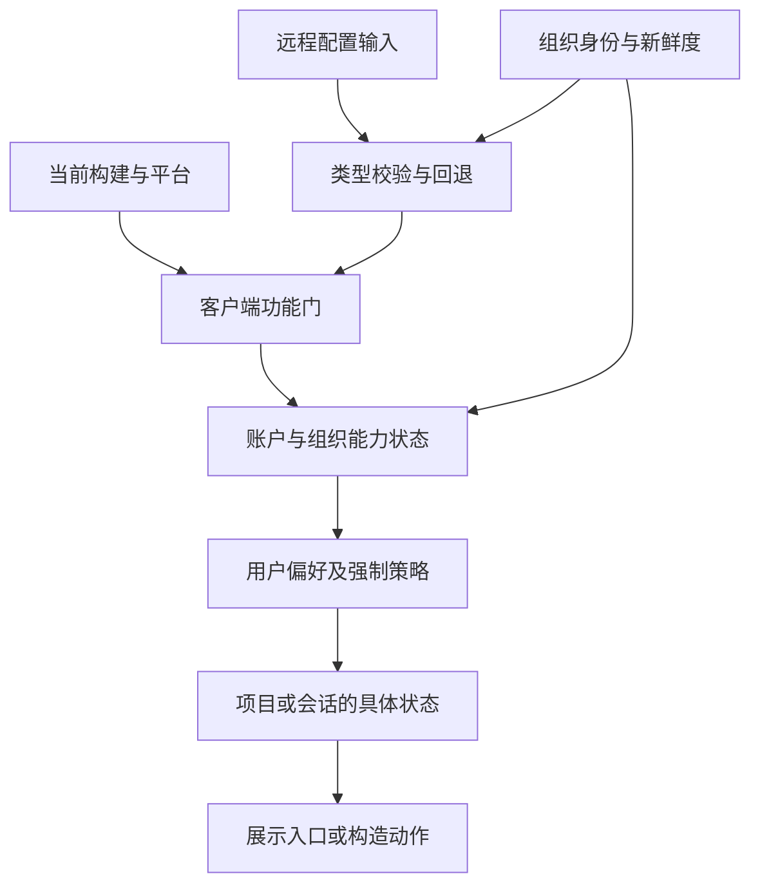
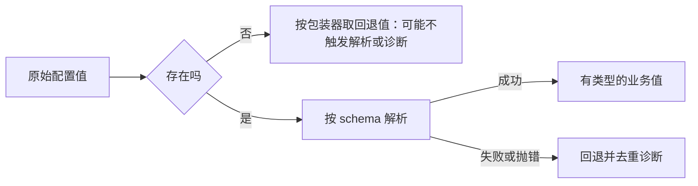
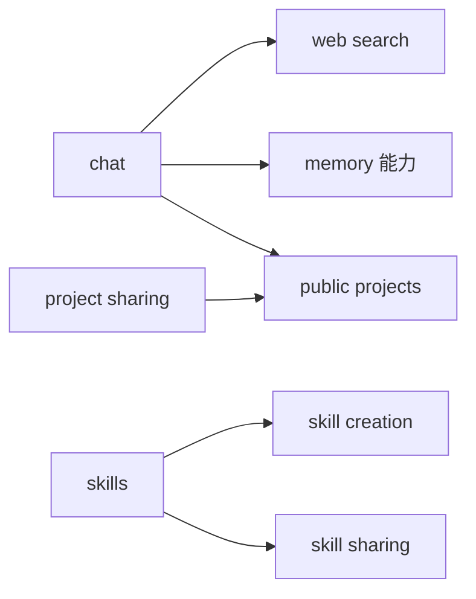

# 第十卷 Feature Flags 配置与兼容演进

一个功能已经写进客户端，为什么用户仍然看不到？因为“代码存在”只回答了最早的一层问题。之后还要经过配置有效性、功能评估、组织能力、账户授权、用户偏好、平台条件与当前资源状态。

Claude Desktop 2.37337.1 的静态客户端展示了一套分层选择机制。本卷最值得借鉴的结论是：**把配置当作有类型、有身份、有新鲜度的输入，把能力当作带原因的状态，把迁移当作需要同时容纳新旧契约的过程。** 这比到处散落 if (flag) 更容易解释、更容易恢复，也更容易测试。

本卷的“演进”指 Desktop 2.37337.1 中可见的兼容结构；统计口径与证据见[附录](#附录-证据口径与复核位置)。

## 1 从一个按钮追到一组决定

下面是根据多处消费者归纳的原创决策模型。不同功能可能省略某层或使用不同默认值，它不是全产品唯一调用栈。



例如项目知识搜索不仅检查功能门，还在适用模式下检查账户能力，再读取项目自身是否应使用检索。记忆开关也组合服务器 mode、客户端兼容开关、组织阻断与用户设置。某个布尔值为 true，并不足以穿过全部层次。（PRJ-07、MEM-10、FLG-05、FLG-06）

在自建产品里，最有用的问题通常是：“这一层拒绝了什么，界面应该怎样解释？”而不是“总共有多少个开关”。

## 2 开关数量必须附带统计口径

本次对 assets/v1 中 3,426 个 JavaScript 文件进行了惰性语法分析，不执行 bundle。基于明确映射的评估包装器及其直接导入绑定，得到以下结果：

| 指标 | 数量 | 含义 |
|---|---:|---|
| 被解析的 JavaScript 文件 | 3,426 | 指定资源目录内的语料 |
| 语法解析失败 | 0 | 不代表语义覆盖完整 |
| 识别的评估调用 | 2,925 | 包含动态参数与不同包装器 |
| 使用非空字符串字面量键的调用 | 1,595 | 可直接提取非空字符串键的调用 |
| 不同非空字符串字面量键 | 979 | 包括布尔门、结构化配置、实验等 |
| 从 HTML 入口导入图可达的模块 | 3,424 | 模块级候选路径，不证明函数实际执行 |

统计排除 1 处空字符串占位调用；若计入全部字符串字面量，则为 1,596 处调用、980 个不同值。

因此正确表述是“在这个分析口径中识别出 979 个不同非空字符串字面量键”，而不是“Claude 有 979 个已上线功能”。同一个键可能被多处读取；一个配置对象可以承载多个字段；另一些动态键或多层包装器不在这份静态统计里。

这些统计只用来衡量系统复杂度和分析覆盖，不提供当前账户的 assignment，不推断发布状态，也不把代号翻译成未宣布功能。

## 3 名称归一化不能承担授权

客户端会把普通功能名转换为十进制的无符号 32 位键；带特定前缀的标识已经携带其键，可以直接取出。这个步骤是配置键归一化，便于不同消费者使用一致索引。（FLG-01）

它不具有加密或权限控制的含义。即使读者知道一个键对应什么名字，也不能推出功能可用，更不能把这个知识视为改变功能状态的授权。

同一模块还维护一份受保护键集合。在设置本地 forced features 时，包装器会先移除集合中的条目，再把其余覆盖交给底层实现。本版本集合有 226 项，本卷只讨论守卫机制，不发布或试验覆盖方法。（FLG-02）

这个边界说明客户端作者没有把“本地覆盖值”与“可信策略”完全等同起来。但它仍不能证明整个产品的安全性；真正的权限必须在有权执行操作的一端落实。一个前端开关守卫也不能替代服务端鉴权。

## 4 unknown 是必须保留的信息

评估包装器有一个值得学习的三态投影：

| 评估情况 | 对外状态 | 适合的理解 |
|---|---|---|
| 评估结果 on | on | 当前评估允许该门 |
| 未知功能或相关前置条件问题 | unknown | 无法按普通关闭解释 |
| 其他关闭结果 | off | 当前评估未打开 |

其中 prerequisite 与 cyclicPrerequisite 会进入 unknown 分支。它们可以对应不同诊断，不能在日志里全被压成 false。（FLG-03）

包装器还缓存共享评估，并在比较结果时考虑来源、规则、实验及结果值，而不只比较 on。由此可以看出，产品需要的往往不只是一个布尔数值，还包括为什么得到它、是不是换了规则、是否需要更新消费者。

对 UI 的原创建议是把三态映射成明确行为：unknown 可以隐藏尚未准备好的交互、显示加载状态或进入保守默认；off 可以给出已确定的不可用原因。不要用一个开关的视觉关闭状态同时表达“用户选择关闭”和“配置还没来”。

## 5 远程配置先经过类型边界

布尔门只占一部分。包内还有读取对象、字段、实验字段、字符串与数字的包装器。结构化路径会把原始值送入 schema safeParse，再返回解析后的数据或回退值。（FLG-04）

解析失败并非单一事件。可见路径区分缺失、类型或结构不匹配、回退仍被拒绝，以及校验器自身抛错。它会对重复诊断做去重，并把上报的问题摘要限制在前五项。这是“让远程错误可见，又避免每次渲染淹没遥测”的平衡。



图中概括的是边界职责。只有进入解析失败处理时，才区分 `absent`、`mismatch`、`fallback_rejected` 或 `threw` 并去重上报；字段缺失但合法回退通过校验，不一定产生错误记录。具体取值、跳过解析与诊断条件仍由包装器决定。

类型正确也不代表操作安全。例如“等待秒数是数字”仍然允许负数、Infinity 或大到阻塞界面的值。因此在记忆设置年龄配置中还能看到有限数检查与上下界限制。**schema 校验、业务边界和合理回退是三项工作。**（MEM-09）

随卷原创的数值读取器把这层思想压缩为可测试例子：

```js
export function readBoundedNumber(raw, fallback, min, max) {
  if (typeof raw !== 'number' || !Number.isFinite(raw)) {
    return {
      value: fallback,
      source: raw === undefined ? 'absent' : 'invalid'
    };
  }
  return {
    value: Math.max(min, Math.min(max, raw)),
    source: 'remote'
  };
}
```

这段代码是教学实现，约定调用者提供合法 fallback、min、max；它不是通用配置 SDK，也不复制目标包装器。

## 6 能力结果比功能门更接近用户问题

账户能力解析器返回的是有理由的状态。几个明确状态如下：

| 状态 | isAvailable | isPolicyBlocked | isUpsellEligible |
|---|---:|---:|---:|
| available | true | false | false |
| blocked_by_platform | false | true | false |
| blocked_by_org_tier | false | true | true |
| blocked_by_org_admin | false | false | false |
| blocked_by_entitlement | false | false | false |

这张表忠实记录本版本投影值。特别是管理员阻断对应的 isPolicyBlocked 为 false，提醒我们不要按变量英文名字自行补出一套业务定义。真正显示原因时应该保留 status，而不是仅依赖某个便利布尔字段。未知 status 会形成不可用结果，而不是自动放行。（FLG-05）

还需要读缺省分支：明确 verdict 缺失时，这个解析器使用按功能制定的回退表。一部分已知能力默认可用，另一些默认不可用；未登记能力采用不可用回退。于是“所有未知一律拒绝”并不是目标应用每条兼容路径的精确描述。

本卷学习模型 decideAccess 故意采用更简单、保守的策略：没有客户端门或服务器结果时返回 loading。它适合说明如何保留状态，不声称复刻目标客户端的历史兼容表。

这个 UI 包装层提供不同消费者：`useEnabledForUser` 将可用性与用户偏好组合；`useAdminToggleState` 则在策略接管时显示强制策略值，否则显示组织设置。用户偏好、组织开关和强制策略不能混称。（FLG-06）

## 7 组织设置是一个声明式依赖图

本版本有一份组织能力表，包含 75 个字面量条目、46 条依赖边。其中 14 项带有 entitlement pending rollout 元数据。每项可以声明更新字段、写入目的端点、依赖、破坏性关闭标记及角色权限信息。（FLG-07）

| 示例能力 | 依赖 | 写入分类 | 重要元数据 |
|---|---|---|---|
| chat | 无 | 常规组织更新 | 关闭被标记为具有破坏性 |
| web_search | chat | 常规组织更新 | 独立 entitlement |
| 摘要式 memory 能力 | chat | 常规组织更新 | 破坏性关闭标记 |
| skills | 无 | skill_settings | 独立设置目的地 |
| skill_creation | skills | skill_settings | 独立 entitlement |
| project_sharing | 无 | privacy_settings | 破坏性关闭标记 |
| public_projects | chat、project_sharing | privacy_settings | 双重前置依赖 |

原始字段有些采用内部名字，这里只对已追到消费者的含义做简化。表中的 destructiveDisable 是客户端元数据，不自动证明服务器删除了哪些对象；具体后果必须由相应产品契约确认。pending rollout 同样不是承诺上线的日期，甚至不能单凭它判断谁目前获得访问。



这类表格适合集中表达“依赖关系”，但还要把执行规则讲清楚：关闭前置能力时，是只隐藏后续控件、禁止新操作，还是同时更新依赖能力？本次表的存在本身不能回答所有问题。自建产品应为关闭顺序、失败回滚和确认文案建立单独的执行计划。

原创模型 evaluateCapabilityGraph 提供最小的拓扑校验：前置项先于消费者；未知依赖与环立即报错。它只检查依赖结构，不自动决定设置应该被怎样改写。

## 8 配置必须带着构建与组织身份

远程配置在不同登录状态、不同组织与不同客户端构建之间流动。如果只看值，不检查是谁的、给哪个版本的，就可能把正确数据用在错误环境里。

### 8.1 gated imports 与文案不是普通全局对象

可见客户端会比较 gated imports 的 build ID 与当前 build ID，也携带 featureFlagsOrgUuid。相关 effect 和状态处理还识别当前组织与数据组织；另一段文案目录选择器则检查组织与 locale，并对构建差异采用相应路径。（FLG-08）

这里有三个独立问题：

1. **身份正确吗？** 来自组织 A 的配置，不能直接视为组织 B 的权限。
2. **结构相容吗？** 新构建发来的 gated 数据，旧客户端未必认识。
3. **语言相容吗？** 文案目录不能只因为存在就覆盖当前语言。

因此，“远程已经下发一个字段”仍不足以说明当前模块立即采用了它。需要继续看接受条件、失配分支和消费者。

### 8.2 bootstrap 能力缓存有新鲜度要求

bootstrap hydration 先从响应取出组织标识与 `current_user_access`，构造目标组织的查询键。写入前检查已有缓存；若缓存有数据、未失效、更新时间不早于模块启动、不在未来且距当前不足一分钟，则保留它，不用这次 bootstrap 覆盖。（FLG-11）

没有可导入的身份或 verdict 时，才使不够新鲜的能力查询失效。这里是一条 hydration/失效规则，不代表每次能力读取前都执行一分钟新鲜度检查。成员关系不匹配的 bootstrap 会被相关调用路径跳过，这是独立条件，不能合写成“所有不匹配都会立刻刷新”。

这也是为什么本卷反复强调“身份”和“年龄”两个维度。一个刚收到的响应也可能来自错误组织；一个身份正确的结果也可能已经陈旧。

## 9 看见一条请求地址并不等于它会请求

本次在一条兼容配置路径中看到完整的请求 URL、缓存参数、initialData、refetch 字段，看上去像是一个普通查询 hook。但逐层检查发现：

- 自动查询 enabled 为 false。
- 数据可以来自 bootstrap 的初始值。
- 暴露给调用者的 refetch 被替换为空操作。
- 其数据来源判定也带着 canFetch 为 false 的条件。

所以仅检索到端点名字就声称“应用每次会请求这份配置”，会得到错误结论。（FLG-09）

这类保留结构可能承担兼容、代码组织或接口稳定性需求，但具体开发动机并没有被证据证明。可确认的只是这个版本中的禁用查询与初始数据回退组合。

路由兼容也类似：包内有把旧桌面 Code 路径转换为规范路径的规则，包含平台条件、例外与最多四轮的转换预算。可以说它保留了有界归一化机制，不能从中倒推出每个旧路由曾经上线的日期。（FLG-10）

## 10 一次产品变化会留下几种痕迹

一个版本常常同时包含新契约、旧契约、兼容默认值、迁移入口、禁用查询、统计标签和菜单枚举。它们共存并不矛盾，也不一定都被某个用户执行。

| 痕迹 | 能支持的结论 | 需要额外证据才能支持的结论 |
|---|---|---|
| 两种模式和响应解析器并存 | 客户端能处理多种契约 | 各账户迁移比例 |
| 导入 pending 与轮询 | 存在异步导入消费者 | 后台如何转换内容 |
| 旧路径归一化规则 | 保留兼容入口 | 某版本首次发布日 |
| pending rollout 元数据 | 配置表识别此类标记 | 未来上线时间与承诺 |
| 禁用查询但保留 URL | 当前代码保留接口形状 | 本次运行真的发出请求 |
| 某模块 import 可达 | 构建图中存在候选路径 | 用户被授权且点击过它 |

公开产品文档提供另一种时间证据。当前官方说明明确描述 Chat 与云端 Cowork 的分阶段统一体验，同套餐账户也可能在不同时间看到变化。这个公开事实足以解释为什么研究时必须注明账户体验与客户端版本，却不授权我们把任何内部 flag 绑定成私有 rollout 规则。[官方统一体验说明](https://support.claude.com/en/articles/16761823-claude-cowork-and-chat-are-one-claude)

因此，一个负责的演进分析应画“契约共存图”，而不是“秘密路线图”。前者帮助开发者设计迁移；后者往往只是给命名过度赋义。

## 11 可迁移的实现检查表

下面的建议由上述机制归纳而来，是原创工程建议，不是对 Claude 全部实现的宣称。

| 设计问题 | 建议的不变量 | 对应测试 |
|---|---|---|
| 远程数字格式错误 | 非有限数不进入业务逻辑 | NaN、Infinity、字符串、null |
| 远程数字过大 | 执行预算有硬上限 | 极大值仍被限制 |
| 缺少能力 verdict | 按明确策略处理，保留原因 | loading 与 off 不混淆 |
| 管理员阻断 | 用户开关不能覆盖拒绝结果 | userEnabled 为 true 仍不可用 |
| 依赖表出现环 | 配置校验阶段失败 | 双向依赖与缺失依赖 |
| 切换组织 | 旧数据不能进入新组织键 | 身份错配与晚到响应 |
| 旧权限过期 | 刷新失败不自动授予新动作 | stale allow 加离线错误 |
| 配置解析持续失败 | 保留诊断但不刷屏 | 相同错误去重与摘要截断 |
| 迁移期间缺字段 | 兼容默认值可解释且可删除 | 老响应、新响应、半迁移响应 |

[原创学习模型](../../04-Extracted-Core-Code-And-Scripts/core-code-lab/memory-flags/memory-flags-model.mjs) 与 [15 项测试](../../04-Extracted-Core-Code-And-Scripts/core-code-lab/memory-flags/memory-flags-model.test.mjs) 实现了其中一部分：范围队列、乐观回滚、版本隔离、权限新鲜度、数值边界与依赖校验。它们不含 SDK 密钥、目标系统调用或开关覆盖器。

如果只保留一个设计原则，应当是：**每次从“配置里有这个值”走向“允许用户做这件事”，都明确记录这一步增加了什么保证，又保留了什么不确定性。**

## 附录 证据口径与复核位置

- 静态版本：Claude Desktop Linux amd64 2.37337.1；包 SHA-256 为 41745b0914f0ff51631a1ff1bb403b836bf5c995845cca6742dd39bca3a2da14。
- [结构化证据](../../04-Extracted-Core-Code-And-Scripts/evidence/data/memory-flags.json) 包含 FLG-01—11、相关消费者、模块 SHA-256、字节偏移、统计范围和限制。
- 关键模块：shared-0-CIydqnOr.js 包含键归一化、覆盖守卫与 bootstrap 缓存接入；shared-25-BQdcIBNa.js 包含评估与类型化包装器、能力投影及路由兼容；ce751cbc9-eTDhHIbX.js 包含本次检查的组织配置表；shared-23-BY6HquaF.js 包含构建、组织及文案接入条件。
- 分析工具只把 JavaScript 作为惰性文本解析。AST 统计采用保守的祖先函数遮蔽排除，只统计明确映射的直接消费者；动态键、额外包装层及条件执行仍可能未被覆盖。
- 导入图的 3,424 个可达模块不是 3,424 个真实执行模块；2 个不可达模块也不能被直接定性为废代码。
- 未修改功能开关，未探测包内隐藏路由，未发出目标应用 API 请求，未读取账户实际配置或权限。
- 本卷没有从内部代号推断未宣布功能、上线时间、服务器分流算法或安全保证。公开文档与包内机制分别引用，不用其中一种证据替另一种补空白。

[返回全书目录](../README.md) · [阅读前提与术语](../README.md#一页阅读准备) · [原创代码实验室](../../04-Extracted-Core-Code-And-Scripts/core-code-lab/README.md)
