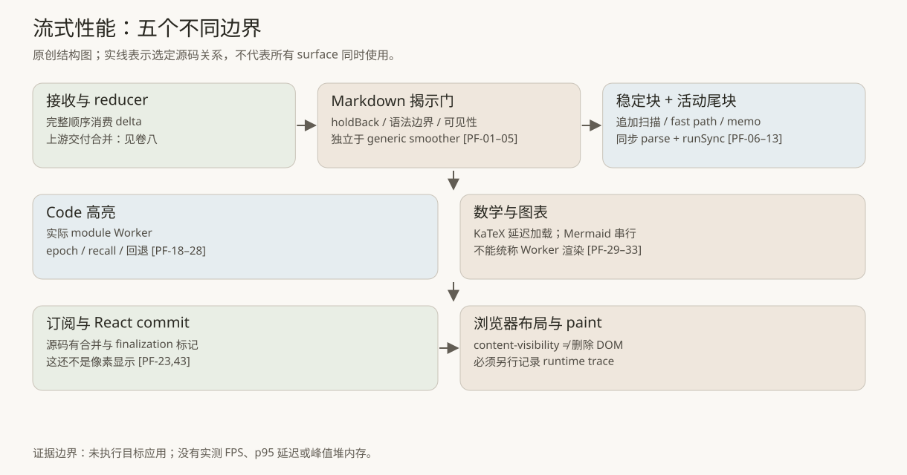
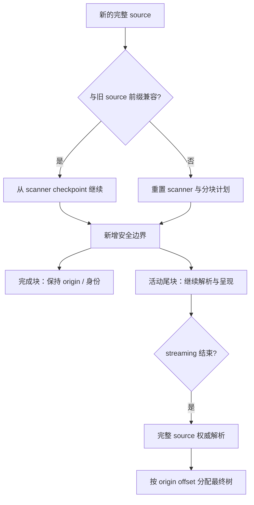
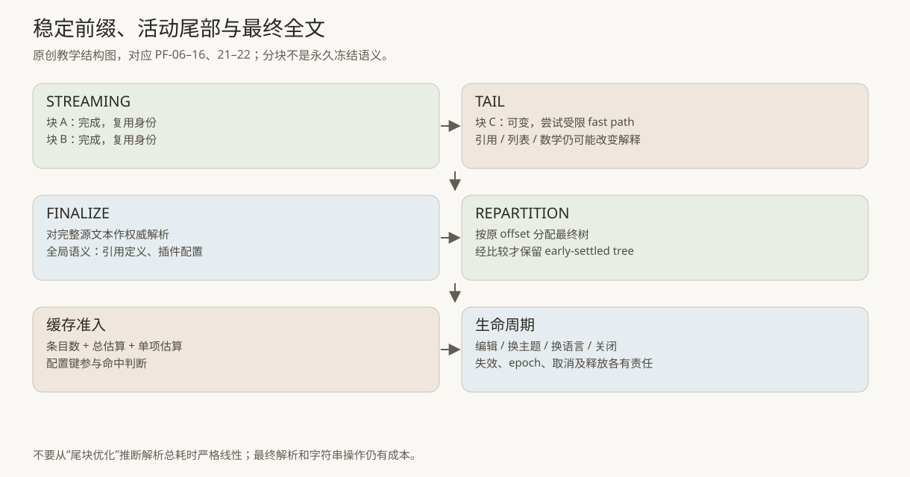
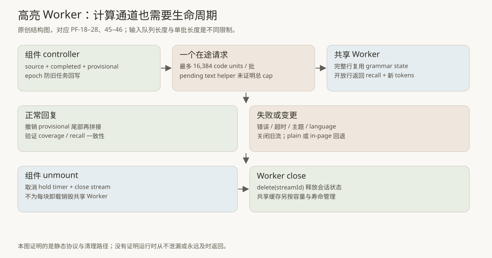

# 第 11 卷：流式性能——从“收到文字”到“完成阅读”的分层调度

本卷沿着文本交付、Markdown 解析、富内容格式化与屏幕更新，解释如何缩小每次变化触发的工作。范围为 Claude Desktop 2.37337.1 的静态调用链；配套原创模型用于验证调度合同。

## 1. 最重要的结论：高性能来自缩小变化范围

一个长回复里，真正持续变化的通常只是末端；已经写完的段落、代码行和图表输入，却可能因为粗糙实现被反复处理。流式性能首先是一个工作范围问题，然后才是定时器问题。

选定调用链包含五类相互独立的控制：

1. 接收层合并交付，减少上层通知。卷八已经说明 classic chat 与 Code 的交付节奏不同。
2. Markdown 层拆出已完成块与活动尾块，尝试受限的语法 fast path，并复用未改变的组件与树。
3. 富内容层分别处理高亮、数学和图表。高亮有真正的 Worker；KaTeX 有延迟加载；Mermaid 有串行队列。三者不能统称“都扔到后台”。
4. 屏幕层根据内容类型采用渐进挂载、content-visibility、代码行虚拟化等不同策略。
5. 生命周期层限制缓存、关闭流、撤销旧任务、清理 timer 和 observer，防止性能优化本身积累成本。[PF-01–47]

**classic 上游设置 dont_smooth=true，并不证明下游 Markdown 没有自己的揭示调度。** chat reply wrapper 明确请求 useStreamingFadeIn，StandardMarkDown 再根据挂载时的加载状态选择对应路径。阅读卷八的上游 buffer 时，应将这两个调度层分开。[PF-01–05；卷八 PT-08]



图中按职责组织选定源码。具体经过哪些模块，取决于 surface、加载状态与功能开关；各分支并非同时生效。

## 2. 先确定“快”究竟在测什么

### 2.1 接收完成、可读、格式化完成，是三个结果

用户可能先看到普通代码，稍后看到着色；先看到公式源文，插件就绪后再变成数学排版；先看到图表占位，最后得到 SVG。对于这些状态，只记录“response end”几乎不能解释体验。

| 边界 | 可记录事件 | 它不能证明什么 |
|---|---|---|
| reducer 接收 | 最后一帧或最终 source revision | 用户已经看见全部文字 |
| UI 快照交付 | subscriber callback / commit request | React 已提交 |
| Markdown finalize | 完整文本已重新解析、相关回调触发 | 所有格式化异步工作完成 |
| React commit | Profiler 回调 / DOM 已更新 | 浏览器完成布局、合成、屏幕扫描 |
| formatter ready | 高亮结果、KaTeX 或 Mermaid 成功 | 当前内容确实位于视口中 |
| 浏览器 rendering | trace 中的 layout / paint / frame | 单靠一次回调得出全部交互的 p95 |

源码有 md:finalize 标记，有格式化等待/失败/完成状态，也有 Worker 启动分段指标。它们证明开发者提供了观察点，不证明这些指标在某设备上具有某个数值。[PF-03、25、43、47]

React Profiler 的 actualDuration 主要描述 React 渲染工作，commitTime 标识提交；它不能替代整个浏览器渲染管线测量。参见 [React Profiler 文档](https://react.dev/reference/react/Profiler)。

### 2.2 为什么 16ms、33ms 或 requestAnimationFrame 都不是“60 FPS 证据”

定时器给出最早请求时间或调度意图。主线程忙碌、页面隐藏、显示器刷新率、浏览器策略和后续布局成本都会影响实际结果。requestAnimationFrame 请求在下一次重绘前执行；通常与显示刷新率相关，隐藏页往往暂停，且是一次性调用。参见 [requestAnimationFrame 文档](https://developer.mozilla.org/en-US/docs/Web/API/Window/requestAnimationFrame)。

因此，“33ms 发布一次快照”“每次 rAF 处理一个批次”“代码有 60Hz 常量”“实测稳定 60 FPS”是四种不同陈述。前三者可以来自源码，最后一种必须来自运行时采样。本文只报告有证据支持的前三类机制。

## 3. 下游 Markdown 的入口：一个挂载时锁定的分支

### 3.1 wrapper 请求，不等于每次都成功走 streaming renderer

chat reply wrapper 传入 useStreamingFadeIn=true，同时传递 isStreaming、holdBack、mountedTextShown、earlySettle、onFirstPaint、onFirstChunk 和 onSettledCommit。StandardMarkDown 内部用 state initializer 读取“请求了 streaming fade-in 且数学插件状态不是 pending”这一条件。[PF-01–02]

这里有三个细节：

- 这是挂载时选择，不能解释为每次 render 都随 loader 状态自由切换。
- pending 与 failed 是不同状态；判断不是“KaTeX 必须成功 ready 才使用 streaming renderer”。
- useStreamingFadeIn 默认值是 false；调用者是否请求仍然重要。

| 挂载条件 | 所见选择 | 应怎样描述 |
|---|---|---|
| 未请求 streaming fade-in | 普通 react-markdown 路径 | 普通 Markdown 呈现 |
| 请求，loader 当时 pending | react-markdown fallback | 有意避免在当前挂载中切换 renderer |
| 请求，loader 当时非 pending | streaming renderer | 可以使用下述分块与揭示机制 |

源码的 telemetry 用 streaming_md、react_md_fallback、react_md 区分这三条路径；分析渲染行为时，也应按实际分支分别观察。[PF-03]

### 3.2 两层“平滑”解决两个不同问题

上游 buffer 可以一次交付全部已接收文本，下游仍然可以选择何时揭示其中的安全前缀。这就形成三种位置：

```text
已收到的完整 source
    ≥ 允许展示的语法安全上界
    ≥ 当前已经揭示的光标
```

上述关系是本书用于理解的示意，不是声明产品内部用这三个同名字段。实际 helper 分别维护完整文本、上界、光标、fence 状态、加入/追赶状态以及可见性监听。它对非前缀变化有回退处理，页面重新可见时可以追上可展示上界。[PF-05]

所见默认参数是 stepChars=22、targetLagMs=550、minStepMs=25、maxStepMs=150。它们属于这个 helper 的算法参数；550ms 不是实测网络延迟，22 也不是 token 数。JavaScript 的字符串位置通常以 UTF-16 code units 表示，不能把它直接翻译成汉字数或 Unicode grapheme 数。[PF-04]

较慢揭示可以压低瞬时更新量、减少半个语法结构闪烁，也可能增加“数据早已到达、用户还没看完”的尾部等待。移植时，应把这部分人为等待纳入测量。

## 4. 解析范围：稳定前缀与活动尾块

### 4.1 scanner 不必每次重扫整份文档

所见 scanner 从保存的 offset 继续扫描，维护 code fence、math block、list、table、blockquote、indented code 等上下文。它专门保留最后一个尚未完整结束的行之前的状态，避免把一个仍可能变成围栏、列表标记或表头的半行过早定型。[PF-06]

输入是旧文本的前缀追加时，completed chunks 可以继续增长；输入出现编辑、重写或回撤时，会重置扫描状态。这个分支非常重要：如果把“字符串变长”错误地当成“尾部追加”，前半段编辑就会复用已经失效的树。[PF-07]



这张原创图对应 PF-06–08、14。scanner 找到的是适合呈现工作的边界；它不是对整个 Markdown 语言的独立完整解释器。

### 4.2 稳定并不意味着语义永远不会改变

Markdown 的引用定义可以出现在后文；插件配置、数学加载状态或源文修正也能改变以前内容的解释。因此，“完成块暂时复用”与“最终语义正确”必须同时成立。

所见 renderer 在 settled 阶段获取全文 HAST，再依据块 origin offset 将最终 children 分配回各块。HAST 指 HTML Abstract Syntax Tree，通常是 Markdown AST 经插件转换后的 HTML 结构树。最终处理仍然涉及整个 source，不能只把光标移动到末尾就宣布完成。[PF-14]

这使分块策略具有一种双层保证：

1. streaming 期间优先复用稳定局部，控制重复工作。
2. settled 时用完整上下文纠正局部近似，恢复全文语义。



### 4.3 复杂度应该怎样诚实描述

如果每次增加一点文字都全文解析，解析器处理的输入总量近似为“第 1 次长度 + 第 2 次长度 + … + 最终长度”。在平均增量固定、每次都解析的理想化条件下，这个累计量呈二次增长。

稳定块复用把许多重复工作缩小到活动尾部；它不能自动把整条实现变成严格线性：

- 活动尾部可能是一段非常长、尚未封口的代码或表格。
- 前缀比较、字符串切片、数据结构复制本身也有成本。
- 插件可能再次遍历树。
- 最终全文解析仍需执行。
- React memo 命中率还依赖 props、组件身份与 Context 更新。

所以可证明的结论是“减少特定重复解析范围”，不是“所有输入 O(n)，永不卡顿”。

## 5. fast path 的价值在于知道何时拒绝

### 5.1 同步解析没有因为函数返回 React 元素而消失

所见处理函数调用 processor.parse，再调用 processor.runSync。异步获取插件、使用 React hooks 或将代码拆成动态 import，并不会自动把这段解析移出主线程。[PF-09]

在活动尾部，它依次尝试针对 open fence、list、table、paragraph 的局部优化。异常路径有专门 fallback 记录，并回到通用处理。[PF-10]

| fast path | 已核实的约束举例 | 不能做的扩大解释 |
|---|---|---|
| open fence | 排除 CR、NUL、frontmatter-like 前缀，检查真正开放的围栏 | 任意包含三个反引号的文本都能直接作为 code |
| list | 检查列表 family、缩进、最后项与嵌套风险 | 只按换行 split 就是正确列表 AST |
| table | 识别表头/分隔行/已有行及可追加尾行 | 任何含竖线的文本都是表格 |
| paragraph | 同一 processor、严格前缀增长、安全字符与行首上下文 | 普通字符追加永远不改变 Markdown 结构 |

例如段落 fast path 还会防范链接样式和括号相关的结构变化。优化路径有意识地“少吃一点语法”，反而更适合维护。[PF-11–12]

### 5.2 “只改活动尾部”的正确迁移方法

可迁移的不是把某个 minified 函数抄进项目，而是以下契约：

```js
// 原创接口示意；不是目标源码。
const candidate = tryAppendOnlyFastPath(previous, nextSource, parserConfig);
const tree = candidate?.provenSafe
  ? candidate.tree
  : fullParser(nextSource, parserConfig);
```

provenSafe 必须对应明确的限制与测试，而不是“看起来是纯文本”。建议把每种 fast path 的拒绝原因分类记录，避免一次异常后静默显示错误树。

### 5.3 early settlement 不是无条件缓存

源码会对已离开活动尾部、且满足条件的块尝试提前 settle；它重新解析并比较树，且有 20,000 code units 的尝试上限。最后全文树到来时，再检查能否保留先前树。[PF-15]

它在省 CPU 之外还有潜在的视觉意义：减少不必要节点替换，有机会保留选择、动画状态与局部组件实例。但这些收益属于机制解释；本文没有测得真实 selection preservation 成功率或 DOM mutation 数量。

## 6. React 边界：通知减少不等于所有组件不 render

分块组件具有专门的 memo 比较逻辑，比较 text、boundaries、settled、HAST、fast-path 开关与 word-fade 参数等；settled 与 streaming 阶段对 processor/options/components 的复用条件不同。[PF-13]

memo 将复用判断细化到块；稳定块是否重渲染，仍取决于 Context、父级身份、组件内部 state 和所在分支。

移植时应把三个问题分开验收：

- reducer 是否按顺序处理所有内容事件？这是正确性。
- snapshot 是否合并到合适频率？这是通知节奏。
- 已完成块是否保持可复用的输入身份？这是渲染范围。

不要为了减少 render 次数直接丢弃内容 delta。可以替换的是“已经包含全部历史更新的最新快照”，而不是未经归并的任意协议事件。

## 7. 代码高亮：真实 Worker，但仍有主线程成本

### 7.1 工厂、调用者、资产三点闭合

高亮 Worker 的静态调用链连接了三个位置：

1. chat 初始化注册 shared highlight host。
2. host factory 构造名为 shiki-highlight 的 module Worker。
3. 安装包中存在对应 highlightWorker 资产，其消息处理器维护每个 stream 的语法状态和开放行。[PF-17–18、45–46]

这足以证明一条静态可达的高亮 Worker 路径。它不证明每个代码块必然使用 Worker，因为 unsupported、boot failure、slow start、grammar failure、语言不支持等分支仍然存在。

### 7.2 高亮的增量单位是“完成行 + 临时行”

Worker 为完成行保留 grammarState。新输入先与开放行拼接，再对完成行推进语法状态，对新的末行生成 provisional tokens。回复携带 recall 数量，告知主线程撤销上一批临时末行 token，再接上新的 tokens。[PF-45–46]

这一点很容易被错误实现：如果把每批 tokens 永远 append 到 DOM，同一开放行会越来越重复。客户端因此检查 recall 是否等于当前 provisional token 数量，并验证内容覆盖没有越过已发送文本；不一致时回退为 protocol_desync。[PF-20]

### 7.3 一次一个请求，不意味着没有积压

客户端在一个请求尚未回答时不再发送下一批。待发送文本留在本地，单次最多发送 16,384 code units，并尽量在换行处拆分。[PF-19]

但单批上限与总队列上限是不同概念。本次在该 helper 中没有核实到 pending text 的总长度 cap，因此不能宣传“高亮队列严格恒定内存”。当 Worker 慢于到达速度时，减少并发可以保护 Worker，却仍可能让 pending text 增长。



### 7.4 新主题、编辑和卸载都属于协议事件

controller 保存 epoch。主题、语言、host 或 registration 改变时可以重新开始；放弃旧流会 close、递增 epoch 并清空局部状态。旧回复回到主线程时，只有匹配当前 epoch 的处理才能生效。[PF-21]

组件卸载执行 dispose，取消 hold timer 并关闭自身 stream；Worker 收到 close 删除 streamId 状态。共享 Worker 不必在每个代码块卸载时 terminate。组件、stream、全局 Worker、全局缓存具有不同所有者，应该分别释放。[PF-22、45]

### 7.5 返回主线程后仍要合并与装配

部分 Worker 回调由 rAF 批次发布，并附带 100ms timeout 作为竞争式后备，identity guard 让赢家只触发一次。流式 controller 另有 200ms 的 hold-for-growth 机制，实际 render 可以取消该 hold。[PF-23–24]

这些数字没有一个等于“高亮每 100ms/200ms 固定刷新”。流式与 settled 分支、是否已有 queued 工作、是否被当前 render 消费，会影响发布路径。Worker 只搬走部分计算，结果消息、React 元素装配、DOM、样式和布局仍发生在主线程相关阶段。

### 7.6 回退策略也必须具备成本控制

in-page highlighter 重用完成行的 grammar state，streaming 尾行可以保持 plain text；语法状态获取失败或时间限制触发时，有进一步降级。[PF-26]

这是可用性保障，同时也是性能风险来源：Worker 失效后 CPU 工作回到主线程。移植时应记录 fallback cause，给超长行/大代码块保留纯文本选择，并防止“失败就无限重试高亮”。

## 8. 数学与 Mermaid：不要把 async 叫作后台线程

### 8.1 KaTeX 的事实边界

所见 hook 订阅共享加载状态，动态导入 KaTeX、remark math、rehype 插件及样式，并有加载失败与恢复处理。Markdown processor 的转换仍可同步调用这些插件。[PF-09、29]

因此准确说法是“延迟获取数学依赖，并在可用时参与格式化”。没有证据支持“所有数学渲染都在 Worker”，更不能由 import() 推断主线程不会被复杂公式占用。

在工具设计上，应分别测量 module acquisition、parse、math transform 和 DOM/layout。把它们合成一个“公式加载慢”，容易优化错地方。

### 8.2 Mermaid 串行队列同时关心性能与安全

所见图表绘制走共享 Promise chain；开始前检查 abort、前一任务是否仍卡住、前序绘制累计成本，并先让出一次调度机会。选定聊天调用配置 maxTextSize=20,000、maxEdges=400，以及请求的 30,000ms limit。[PF-30、33]

这里的等待与绘制失败被区分：排在前面的任务耗尽等待预算，与当前图表自身渲染超时，是不同原因。图表代码仍可能在主线程 DOM 环境中创建临时 host 和 iframe；本文没有建立它使用通用 Worker 的证据。

### 8.3 Promise.race 超时不会杀掉同步算法

Mermaid helper 用超时 Promise 与绘制 Promise 竞争；如果底层绘制还没结束，会把它记为 stuck。后续图表拒绝继续排入绘制，直到旧任务真正 settle。[PF-31]

这体现一个重要区分：

- timeout：调用者不再等待结果。
- cancellation：尽可能阻止尚未开始或后续的工作。
- preemption：强制打断正在执行的计算。

前三者不是同义词。在一个长同步函数占住主线程时，连 timeout callback 本身也可能要等到它返回后才能运行。不能把 timeout 数字当成严格 CPU 执行上限。

移植到 Worker 时，terminate 才可能提供更强的进程内任务中止边界，但代价是丢失 Worker 的共享状态与 warm cache。是否值得，需要根据实际瓶颈决定。

## 9. 三种“看不见就少做点事”

### 9.1 content-visibility：保留结构，减少 rendering work

Markdown deferred mode 给直接子块设置 content-visibility:auto 和按内容类别区分的 intrinsic size。公式或包含公式的部分容器例外保持可见；print 也有强制 visible 规则。[PF-34]

这种方式不等于从 DOM 删除离屏行，也不能假定它减少了此前的 Markdown parse 或 React element 创建。它主要把某些浏览器 rendering work 推迟到需要时。参见 [content-visibility 文档](https://developer.mozilla.org/en-US/docs/Web/CSS/Reference/Properties/content-visibility)。

所见开关还不是对所有动态文字持续启用：它把请求与一份文本绑定；文本改变可以关闭这一 latch，避免流式尺寸变化与离屏估算相互干扰。[PF-35]

### 9.2 idle prelayout：空闲时准备，也要保护正在读的人

可选 idle helper 不只循环调用 getBoundingClientRect。它检查：

- document 是否隐藏，root 是否实际可见；
- pointer 是否按住，最近是否有键盘/指针活动；
- isInputPending 是否报告输入等待；
- idle deadline 剩余预算；
- reader anchor 是否稳定，宽度是否变化；
- 调整后是否需要补偿滚动位置。[PF-36]

随后按工作估算挑选离屏块暂时展开布局。cleanup 移除事件、observer、timer/animation callback 和强制样式。它展示的设计原则是：**后台预热的优先级低于用户输入和阅读位置稳定。**

这条路径也有支持性条件，不能把所有设备都写成使用它。没有 requestIdleCallback 时，此 helper 可以直接不做预布局。

### 9.3 渐进挂载：文件阅读器先给第一块

另一个 file/document renderer 使用独立的 chunk plan。普通 file typography 的阈值为 49,152 code units，document typography 为 8,192；初始只显示一块，后续通过 requestIdleCallback(timeout=100) 或 16ms 后备调度继续揭示。[PF-37–38]

这是渐进挂载：初期没有立刻挂载全部后续块。它和“全部块都在 DOM，只暂缓布局”不同。

导航到较远标题时，revealThrough 源文 offset 可以越过正常 idle 进度；打印/导出准备可以 revealAll，并对图表、图片 pending 状态作有上限的等待。[PF-39]

这类功能是性能方案的必要补丁：如果一个优化让搜索、跳转、复制或导出看不到尚未挂载内容，它就不只是性能问题，而是功能退化。

### 9.4 真正虚拟化：本次证据落在代码/文件 diff

包内 code/file renderer 确实有 before/after spacer、可见行范围计算、虚拟滚动容器、resize observer 和 item metrics。CodeView/diff 模块还维护 first/last item range。[PF-40–41]

这可以称为真正的代码行/文件项虚拟化。它不能被借用来证明整个 chat transcript 都是虚拟列表。

| 策略 | 可能减少的工作 | 不自动减少 | 主要正确性风险 |
|---|---|---|---|
| 内容交付合并 | 订阅/提交频率 | 上游全部 delta 处理 | 丢 final / stop |
| 稳定块复用 | 重复 parse、组件工作 | 巨大活动尾块 | 全局 Markdown 语义 |
| content-visibility | 部分 layout/paint | 已做过的 parse 与 DOM 创建 | 高度估计、打印、读取 |
| 渐进挂载 | 初始组件与 DOM 创建 | 最终全部内容成本 | 跳转、导出、复制 |
| 行/项虚拟化 | 长列表的驻留 DOM | 数据源本身、缓存 | 选择、焦点、滚动定位 |
| Worker | 主线程某类计算 | 消息传输和 DOM/layout | 旧回复、崩溃、队列积压 |

## 10. 表格不是文本：布局也需要增量策略

流式表格不断增加行时，浏览器可能重新分配列宽，引起整张表和后续内容跳动。所见 table hook 记录行数、末行长度、先前宽度、可用空间和列宽；在满足条件时跳过新的完整测量，并按行数增长调整采样间隔。只有宽度差异足够大或溢出条件需要时，才更新 min-width。[PF-42]

列宽抖动需要独立于文本解析的布局策略。上述策略仍会调用 layout reads，其同步布局成本是否降低，应通过实际 layout/recalculate style trace 判断。

建议测试至少包括：窄窗口、超长不可换行内容、中途变更列数、删除行、切换字体、代码单元格和高倍缩放。

## 11. 内存：至少同时画出四张生命周期图

### 11.1 组件状态、全局缓存、Worker 状态、异步队列

“组件卸载了”不等于全部资源已释放。一个代码块可以离开 DOM，但其最终 tokens 仍在共享缓存；一个图表等待超时，但底层 Promise 仍未完成；一个 Worker stream 已关闭，但全局 Worker 的 WASM 和语法库仍然常驻。

| 所见资源 | 所有者与释放机制 | 注意事项 |
|---|---|---|
| Markdown settled tree cache | 模块级 LRU，500 项、约 8MiB 总估算、约 2MiB 单项 | 估算值不是浏览器真实 retained heap |
| highlight prefix cache | 64 项、约 400 万 UTF-16 code units 目标、30 分钟陈旧阈值 | 可保留最后一个超大条目；清理并非精确到期 |
| final-token cache | 2,000 项、100 万字符、寿命清理 | 与组件 dispose 不同 |
| Worker stream | streamId → grammar/open line；close 删除 | 不等于 terminate 全局 Worker |
| Mermaid success cache | 48 项、400 万 SVG 字符、单项 512,000 字符 | width tolerance、scope 替换后重新 sanitize |
| pending render / timer | 组件或 controller | cleanup、epoch、abort 分别负责不同阶段 |

以上容量只描述本次看到的 cache accounting。[PF-16、22、27–28、32、45]

其中 30 分钟是清理判断的年龄阈值。定时清理还加入约一分钟余量，并受实际调度影响；前缀查找也可以先选中候选再清理。因此它不是“到第 30 分钟必定移除或绝不复用”的硬期限。

### 11.2 有容量 cap 仍不等于没有泄漏

一份 cache 有上限，不代表其他 Map、闭包、event listener 或 Worker 引用没有保留旧对象。WeakMap 能避免某些 key 被强引用，也不保证 value 不被其他地方引用。

应在真实应用中重复做“进入长会话 → 生成大量内容 → 切换主题/项目 → 离开页面 → 等待任务结束”，比较 heap snapshot 与已知 cache budget。不要把任意总内存增长都当成泄漏，也不要用“这是缓存”掩盖无限增长。

### 11.3 Warmup 把成本移到哪里

包中存在隐藏的短 Markdown warmup，经历 streaming 与 settled 状态，并有 watchdog。它的目的可以合理解释为提前走过渲染路径；但源码本身没有给出冷启动减少多少毫秒的结果。[PF-44]

Warmup 不是免费优化：它可能提前下载、解析、实例化与占用内存。应比较“用户首次需要时的延迟”与“用户从未使用时的浪费”，并在低优先级、合适可见性和输入空闲条件下执行。

## 12. 原创模型：把策略变成可执行契约

配套 [流式实验室](../../04-Extracted-Core-Code-And-Scripts/streaming-performance/README.md) 包含五个独立组件和 40 项测试，均为本书原创代码。它不导入目标 bundle，不模拟私有 API，不声称等价复现全部产品逻辑。

### 12.1 模型的五个边界

```text
ordered reducer（由调用方保证）
    → SnapshotPresenter：完整快照合并
    → StableBlocks：教学级块扫描 + 最终全文 parser 接口
    → LatestWorkerLane：一个在途完整任务 + 一个最新任务
    → WeightedLRU：明确 accounting 上限
    → runSlices：在可控单元之间检查预算与取消
```

LatestWorkerLane 故意使用“可替换的完整格式化任务”，而不是目标高亮协议的 delta+recall。两者的丢弃规则不同：最新完整任务可以替换旧 pending 任务；未经 reducer 消费的内容 delta 不能随便跳过。

### 12.2 一段最小集成

下面是集成骨架，导入路径相对于 `04-Extracted-Core-Code-And-Scripts/streaming-performance/`；完整可运行演示见该目录的 [simulate.mjs](../../04-Extracted-Core-Code-And-Scripts/streaming-performance/simulate.mjs)。

```js
import { SnapshotPresenter, StableBlocks } from './model.mjs';

const blocks = new StableBlocks({ finalParser: parseMarkdown });
const presenter = new SnapshotPresenter({
  clock: {
    schedule: (fn, ms) => setTimeout(fn, ms),
    cancel: clearTimeout
  },
  commit(snapshot) {
    const plan = blocks.update(snapshot.text, {
      terminal: snapshot.terminal
    });
    render(plan); // 接入业务 renderer
  }
});

presenter.accept(reducer.currentText());
presenter.accept(reducer.finalText(), { terminal: true });
```

示例中的 reducer、parseMarkdown 与 render 是由调用方提供的接入点，不是实验已经实现的服务端或 Markdown UI。模型的 24/160ms 参数是教学选择，与产品源码常量无关。

### 12.3 模拟结果怎样读

固定语料为 4,885 UTF-16 code units，按小批输入形成 543 次更新。模型得到 69 次 commit；“每次全文解析”的逻辑输入累计为 1,329,262 code units，而“稳定块 + 尾部 + 最终全文”的累计为 10,622。[模拟结果](../../04-Extracted-Core-Code-And-Scripts/streaming-performance/simulation-result.json)

这组差异同时包含快照合并与分块复用的贡献。独立复核增加了同样 69 次 commit、但每次仍全文解析的对照，其累计为 169,513 code units；这仍只是逻辑工作量账本。

这个结果证明测试语料上的工作量账本差异，**不证明真实应用快了 99.2%**。模型没有执行完整 Markdown parser，没有计算字符串复制、React、Worker 启动、GC、布局、绘制或真实设备竞争。特别长的单块输入也可能显著削弱分块收益。

### 12.4 测试比顺滑动画更能暴露问题

测试覆盖：首次交付、burst 合并、terminal flush、hidden/visible 切换、dispose、commit 重入、长度限制、非前缀编辑、半个 fence、不同 fence、Unicode 重建、最终全文 parser、LRU 计量、Worker epoch、旧结果拒绝、最新纯文本回退、send failure、协作预算与取消。

其中一个故意构造的测试让单个 work unit 花费 80ms，而 budget 只有 4ms。它仍在 80ms 后才 yield。这不是测试失败，而是对“协作式预算不能抢占单个同步函数”的可执行说明。

## 13. 可迁移 Skill：先做性能合同，再选择技术

配套 [high-performance-streaming-ui-skill](../../03-Ready-To-Use-Agent-Skills/high-performance-streaming-ui-skill/SKILL.md) 可以独立复制到自己的项目中。它要求先完成以下合同，再讨论 Worker 或虚拟化：

1. 哪个层级保存权威内容，哪些快照可以被替换？
2. 哪些块可以证明暂时稳定，何时必须全量重建？
3. final、abort、error、edit、theme change 与 unmount 怎样处理 pending work？
4. 纯文本 fallback 是否始终可读，且不执行不可信标记？
5. 每个队列和缓存以什么单位计量，谁负责释放？
6. 指标到底描述 receive、commit、format 还是 paint？

### Anti-Patterns

| 错误做法 | 为什么危险 | 更稳妥的做法 |
|---|---|---|
| 每个 delta 立即全文 parse | 重复工作随长度放大 | 顺序 reducer + 快照合并 + 稳定局部 |
| 用 debounce 等安静后才显示 | 持续流可能永远不安静 | 有界节奏与明确 terminal flush |
| 为所有富内容立即建 Worker | 启动、消息复制、加载成本可能大于收益 | 先测具体 formatter，保留降级 |
| 只加 requestAnimationFrame | 一个 rAF 内仍可能执行巨大同步任务 | 缩小单元、量化预算、记录超预算 |
| 每次消息来都 parse 全部 code | 开放行反复处理，完成行浪费 | 完成行状态与 provisional tail 分离 |
| 只用 taskId，没有 epoch | 旧主题/旧页面结果覆盖新状态 | epoch + revision/sequence 校验 |
| timeout 后继续无限排任务 | 底层计算未停止，积压扩大 | 标记 stuck、暂停 admission、等待真实结束 |
| “离屏了”就删除所有 DOM | selection、搜索、复制、焦点可能损坏 | 按 surface 选择 containment 或 virtualization |
| 把字符 cap 写成 heap MB | 忽略 AST、对象、字符串和引擎开销 | 分开 reporting unit 与真实 heap measurement |
| 把 firstPaint 回调名当作像素证据 | 可能只是 effect/commit 边界 | 浏览器 trace 与可见性关联验证 |

## 14. 下一轮运行时验证该怎样做

本研究没有执行经过认证的真实客户端性能场景。若未来获得合法、明确授权的运行环境，可以按以下矩阵补齐证据，且只使用合成内容或获准的数据。

| 维度 | 最小测试集 |
|---|---|
| 文本结构 | 短段落、超长单段、未闭合 fence、长列表、大表格、晚到引用定义 |
| 富内容 | 高频代码尾行、超长行、混合 Unicode、数学、多个 Mermaid |
| 到达形态 | 平滑小批、突发大 chunk、停顿后追赶、回撤、终止 |
| 用户活动 | 同时输入、拖动选择、滚动读旧段落、调整窗口、搜索与复制 |
| 生命周期 | 隐藏/恢复、主题切换、导航离开、重复挂载、Worker failure |
| 资源状态 | 冷缓存/热缓存、低端 CPU、不同刷新率、内存压力 |

至少报告：

- first meaningful text：第一次有意义内容的实际可见时间；
- receive-to-commit / receive-to-visible 的分布；
- formatter waiting 与 fallback cause；
- 最大 backlog 与队列计量单位；
- React commit 数、layout/style 工作、长帧分布；
- final 内容与权威 source 的一致性；
- 重复进出后的 retained heap 与资源计数。

Long Animation Frames API 可在支持的浏览器中提供超过阈值的 frame 及 script/rendering 归因，但必须检测支持性。它不是所有短帧的完整记录，也不能单独给出所有用户动作的感知延迟。参见 [PerformanceLongAnimationFrameTiming 文档](https://developer.mozilla.org/en-US/docs/Web/API/PerformanceLongAnimationFrameTiming)。

实验应对比一个改动前后相同语料、设备、构建模式和缓存状态。原始 trace 保留本地，公开报告只发布经审查的统计与合成示例；不要让性能日志顺手上传聊天文本。

## 15. 本卷的最终判断

Claude 客户端值得学习的，不是某个神奇帧率常量，而是持续缩小昂贵工作的范围，并让每类工作拥有自己的完成与失效边界：稳定块、活动尾部、完整文档；完成代码行、临时行；共享 Worker、单个 stream；组件清理、全局缓存；source final、formatter ready、browser paint。

这套设计也留下了清楚的限制：同步 parser 仍然同步，单批 cap 不是总内存 cap，timeout 不是抢占，缓存估算不是 heap 测量，文件 diff 虚拟化不是全 transcript 虚拟化。把这些边界说清楚，才能把机制可靠地迁移到自己的产品，而不是复制一个看似专业的性能故事。

## 证据索引与复核

本卷研究对象为 Claude Desktop 2.37337.1 的 Linux 安装包中可静态核实的客户端。研究日期：2026-10-14 至 2026-10-15。没有登录运行目标应用，没有测得 FPS、输入延迟分布或峰值堆内存。本文的算法实验是原创模型，不是产品 benchmark。

- [本卷证据 ledger](../../04-Extracted-Core-Code-And-Scripts/evidence/data/streaming-performance.json)：47 项短锚点、10 个文件哈希、字节/字符范围、范围限制。
- REA 实际 bounded analysis：4 个选定 JavaScript 文件，556,529 bytes 文本、166,680 AST nodes，parse failures=0；完整资产 inventory 有 3,496 文件，其余 3,492 不在本次 REA source selection 中。额外文件通过惰性文本/AST 人工追踪核实，不能冒称全部经过相同 REA graph 分析。
- REA evidence ID：ev_6c85ae48209047f4d3c3d59198504cbfaab9802c7ea8effbd920d3be88cd4550。
- [证据核验脚本](../../04-Extracted-Core-Code-And-Scripts/streaming-performance/verify_evidence.py) 只读 hash 与短锚点，不执行目标应用。
- [原创实验室](../../04-Extracted-Core-Code-And-Scripts/streaming-performance/README.md)、[可迁移 Skill](../../03-Ready-To-Use-Agent-Skills/high-performance-streaming-ui-skill/SKILL.md)。

本卷不重新展开卷八的 SSE 分帧、会话树、乐观 UUID 对账与上游 buffer；阅读这些部分请回到卷八。这里补的是从文本状态交付之后，真正昂贵的解析、格式化、布局与生命周期。

## 把检查点放进真实工作单元

[实战推演：小事件不等于小工作](chunk-work-quantum.md)从一个包含20,000个合法短事件的输入块出发，比较整块解析与有界分片，并明确字节所有权、取消和失败前缀。
