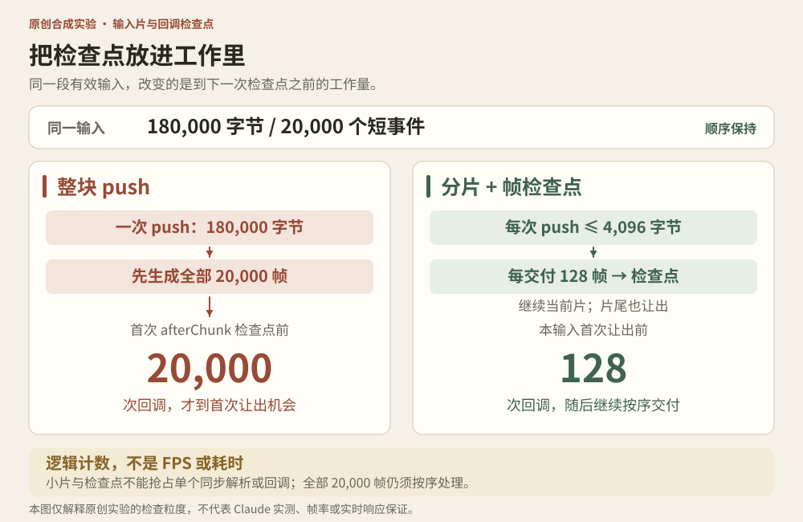

# 实战推演：小事件不等于小工作

协作式预算要约束解析输入和调用事件消费者时的工作量。本节复用书中原创 `IncrementalSSE`，不修改它；所有数字来自合成实验。




## 单事件上限保护不了整块事件突发

`maxLineCharacters` 与 `maxEventCharacters` 限制一行/一件事。现有 `push(chunk)` 却会先扫描整个 chunk，把所有完成帧放进一个数组，然后才交付第一帧。`consumeChunks` 在这些帧全部交付后才调用 `afterChunk`。

把 20,000 个短事件合成一个 180,000 字节的 chunk，每行和每事件 cap 设为 8，运行 `node burst-probe.mjs`：首次回调之前已经产生 20,000 个帧对象，首次 `afterChunk` 在第 20,000 个回调之后。这是逻辑计数，不是卡顿测量。

检查点的位置决定了下一次让出前还要完成多少工作：

```text
整块 push → 创建全部 frames → 全部回调 → 检查是否让出

小字节片 push → 少量回调 → 让出 → 继续当前片的回调
             → 本片结束再让出 → 下一小字节片
```

## 窄适配器，不重写解析器

[sliced-consumer.mjs](../../04-Extracted-Core-Code-And-Scripts/worked-cases/concurrency-and-streaming/sliced-consumer.mjs) 只增加两种教学额度：

- `sliceBytes=4096`：每次交给现有 decoder 的字节视图最多 4096 字节
- `frameQuantum=128`：即使同一解析片里还有帧，交付 128 帧后也先让出

适配器有三条使用前提：

- **借用字节**：当前 chunk 交付后，直到请求下一块或消费结束，来源、回调及所有持有者都不得修改、复用或分离其 backing storage。它不是入站快照，不支持并发修改的 SharedArrayBuffer。
- **合作取消**：等待 next、异步 onFrame 或 scheduler 时，须等对应 Promise 结算才会检查 abort；已执行回调不回滚。
- **有效流等价**：序列不变限定符合 decoder 限制的有效输入。超限时，push 分片可能改变报错前已交付的前缀，不提供整批原子保证。

解析片结束时，即使没有形成完整事件，也要让出。否则一个长未完成字段仍会绕过按事件数设置的检查点。decoder 在各片之间保持同一实例，负责跨片 UTF-8、CRLF 与未闭合事件。

默认让出函数使用定时器把继续工作交还事件循环。测试注入一个立即完成的函数，只验证检查点位置与计数，**不把测试中的微任务当作真实绘制或输入机会**。让出不是硬实时 SLA；实际调度仍由环境决定。

```js
import { consumeInSlices } from './sliced-consumer.mjs';

const stats = await consumeInSlices(byteChunks, frame => {
  reducer(frame); // 必须依序应用；这里不是可丢弃的最新快照。
}, { signal, sliceBytes: 4096, frameQuantum: 128 });
```

上面的 `byteChunks`、`reducer`、`signal` 是集成点；完整可运行例子是 `sliced-demo.mjs`。

## 这两种额度仍不保证什么

1. `subarray` 不复制字节，却保留原 backing buffer；接收端已经持有的 180KB 不会因切片立刻消失。
2. 单次 push 的 frames 数量受本次输入片约束；单个完成事件仍可能含之前积累的内容，行/事件 cap 继续必要。
3. 一个回调本身可能调用巨大的 JSON 解析、reducer 或 renderer。128 个回调以内不等于执行时间以内，重工作仍需自己的边界。
4. 调用者不再要结果时，适配器能停在检查点并丢弃未完成 decoder 状态；它不能抢占正在同步执行的解析或回调，也不能强制取消已发出的上游 I/O。
5. 插入新让出点会改变微任务合并批次与呈现次数。正确性验收首先比较事件顺序与终态，再测实际渲染成本，不能直接称为性能优化成功。

## 最小验证

在书根目录运行：

```sh
cd 04-Extracted-Core-Code-And-Scripts/worked-cases/concurrency-and-streaming
node burst-probe.mjs
node sliced-demo.mjs
node --test burst-probe.test.mjs sliced-consumer.test.mjs
```

同一符合容量限制的 20,000 帧输入，在默认分片示范中，第一次让出前交付 128 帧，最大 push 为 4096 字节；全部 20,000 帧仍按原序交付。

11 项适配器测试覆盖：大批合法短事件；每个二段切分位置再配 1/2/3/7/16 字节分片，保留中文/emoji/CRLF、ID 和 stop；没有完整帧时的检查点；让出期间取消；回调内取消；跨片行限制；非法额度；异步回调顺序；回调和调度器失败；不完整 UTF-8 清理不覆盖原取消原因。另有两项原实现边界 probe 测试。

测试范围不含 FPS、heap、网络背压或 Claude 的运行表现。设置预算时，还应写明**最小不可分工作单元，以及到下一个检查点前最多还会做多少逻辑工作。**

## 三个合同的反例与选型理由

### 字节是借来的，不是被冻结的

适配器接受调用方持有、以普通 ArrayBuffer 为后备存储的 Uint8Array，各片直接读取同一块存储。因此，所有持有者（包括 onFrame 回调）都须遵守前述借用期限，保持字节稳定。

若第一个回调把尚未处理的 `data: two` 改成同长度 `data: six`，下一片就会读到 six。回调改动了仍在借用期内的存储，后续解析读到的便是改动后的字节。

接入方无法满足这个期限时，应另选所有权转移或入站整块快照。整块快照会增加复制和峰值内存，应同时定义 chunk 上限；只在每片处理前复制该片，无法保护早先已经被修改的后续字节。借用方案省下了整块复制的成本，同时把保持字节稳定的责任留给调用方。

### 取消只在重新获得控制后被观察

适配器在可控检查点检查 signal。正在等待上游 `next()`、异步 `onFrame()` 或 `yieldToLoop()` 时，如果那个 Promise 不结算，适配器也不会仅因为 abort 就立即返回。它会在等待结束后检查取消，再拒绝继续交付。

所以调用者必须为这些依赖定义自己的取消或超时合同；不能把这个参数解释成中断任意挂起等待、同步工作或外部副作用的总开关。已经执行的回调不会回滚。

### 只有有效输入的完整帧序列具有分片等价性

前面的切分测试针对符合 decoder 行/事件限制的完整有效输入。错误路径没有“同样长的已交付前缀”保证，也没有事务回滚。

例如 `data: ok\n\ndata: excessive\n\n` 超过 8 code units 的行上限。小片可能先交付 ok，再在后续片抛错；若两件事都在同一次 push 内，原 decoder 可能在返回 frames 数组前就抛错，于是没有任何回调。两种切分都正确地拒绝了超限输入，但已经发生的可见更新或业务动作可能不同。

接入时，应分别验收“有效流不丢帧”“失败后停止继续”“错误前缀不具备原子性”三条合同。对有副作用的业务消费者，不能因为流最终失败就假定早先回调从未发生。
