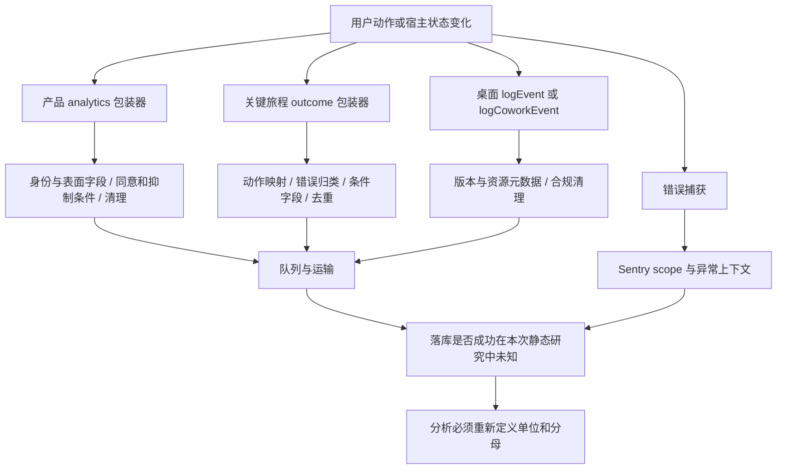
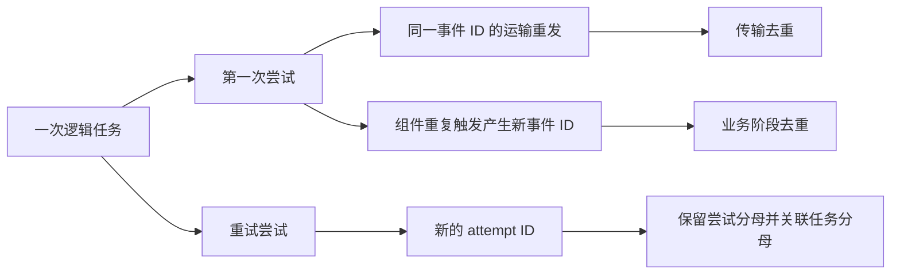
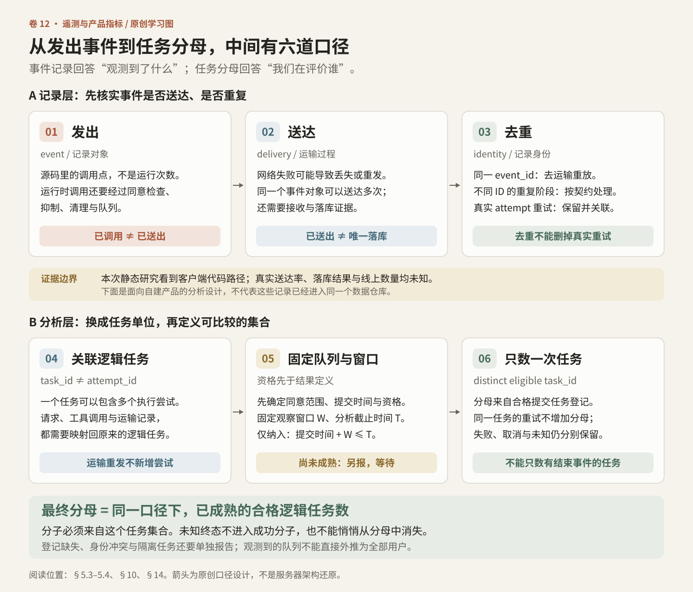
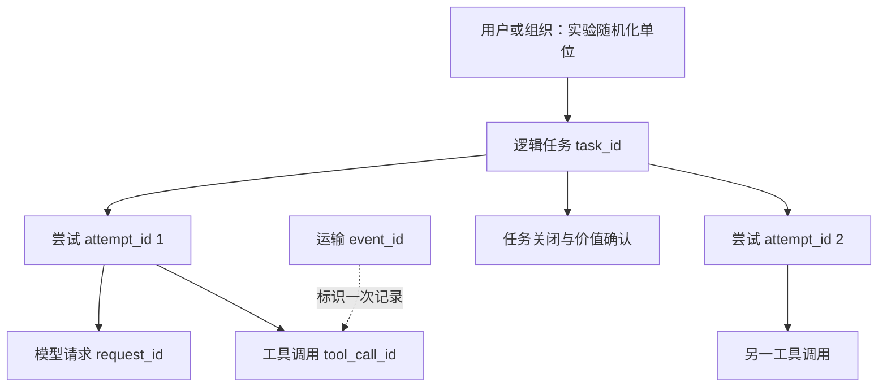
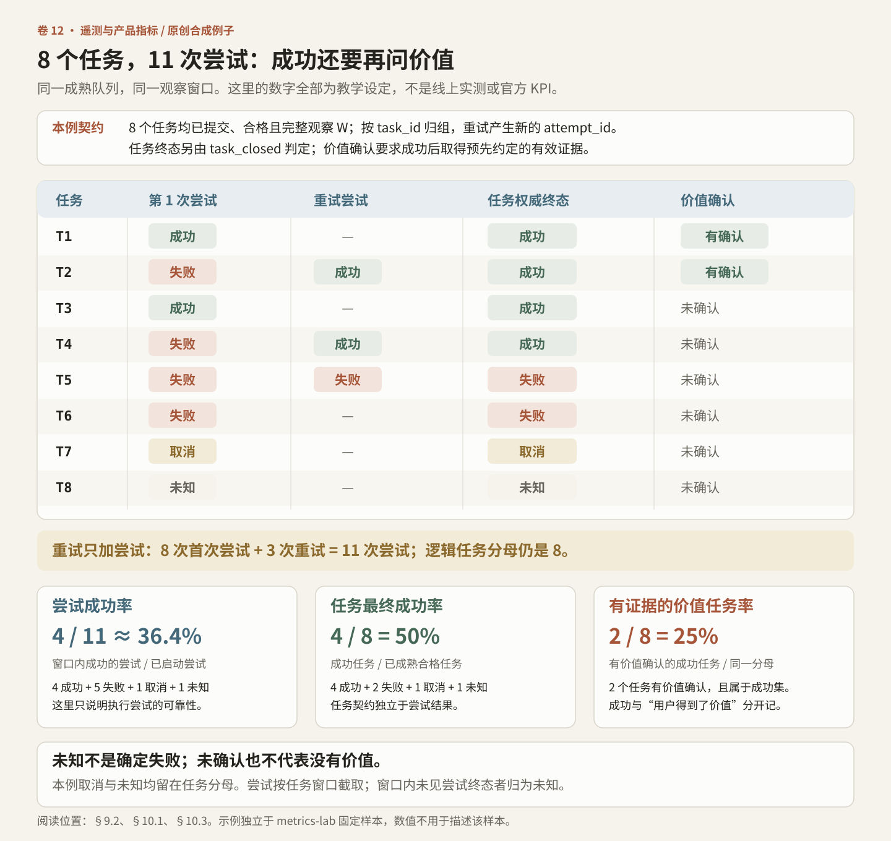
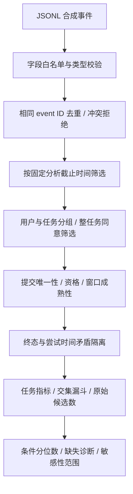

# Vol.12 遥测、事件字典与 AI 产品指标：从“发生了什么”到“用户得到了什么”

本章先追踪客户端怎样记录产品行为、关键旅程和桌面运行状态，再用原创案例说明如何定义任务价值、指标分母与实验判断。事件的触发条件、字段处理、采样与去重规则，共同决定了分析时能使用哪些单位和分母。

静态样本为官方分发的 Claude Desktop Linux amd64 2.37337.1，研究日期为 2026-10-15。客户端实现事实与面向自建 AI 产品的原创指标设计分别展开；后者不代表 Claude 内部的关键绩效指标（KPI）、北极星指标或实验决策。详细范围见第 2 节，证据边界见第 16 节。

## 1. 先给结论：事件目录只是测量工具的目录

一个按钮被点击，不能证明请求成功；请求成功，不能证明模型回答有用；工具调用成功，不能证明任务完成；用户把内容复制出去，也不能证明它在真实工作中产生了价值。

样本中有三条职责不同的测量链：

1. 产品行为链：页面、点击、内容操作、设置变化等 `event_key` 负载。
2. 关键旅程健康链：某项动作的结果、错误分类、耗时和可关联的尝试上下文。
3. 桌面宿主诊断链：进程资源、工具调用、重连、更新、退出和本地环境。

错误报告又是第四种数据。Sentry 的异常调用能帮助定位故障，却不能单独提供“所有任务”的分母。实验分配与曝光是第五种数据，它们回答“谁接受了什么干预”，也不能由普通点击量替代。

这些数据各有观察单位与覆盖缺口；只有单位、范围和触发条件一致，数量之间的比值才有明确含义。

## 2. 范围与完整性声明

配套资料包含：

- [人类可直接阅读的完整事件字典](telemetry-evidence/README.md)：按 analytics、desktop、Health 与动态名称分为五页，包含名称、全部显式字段、条件标记和证据编号。
- [小文件证据索引](telemetry-evidence/index.json)：文件哈希、字节位置、字段类型、未解析项目、包装器锚点与工具覆盖范围；所有分片均小于 145,000 字节。
- [原创离线指标实验](metrics-lab/README.md)：校验、聚合、合成事件与单元测试，不向任何服务发数据。

公开证据使用紧凑的列式表保留完整有界元数据，不发布原始 AST、调用源码或 REA 原始图。

本次抽象语法树（AST）扫描的目录边界是：`ion-dist/assets/v1` 的直接 JavaScript 文件，以及 `app.asar/.vite/build` 的直接 JavaScript 文件。嵌套 worker、单独 renderer 资源、原生模块、服务器、登录后的远程代码和其他版本都不在这个全集里。

“完整”仅指这两个目录内以下定义明确的语法集合：

- 所有 AST 中属性名为 `event_key` 的 ObjectProperty；包括字面量、条件表达式、模板、标识符和对象成员表达式。
- 已核实的 analytics、Health outcome、desktop/Cowork 包装器，以及支持的直接导入和局部绑定路径。
- 主桌面 bundle 中显式的 Sentry 捕获函数绑定与成员调用。

另一条 Datadog RUM 性能观测路径不属于此字典的有界集合，例如 `chat.formatter_wait` 与 `chat.code_stream_render` 的 action/timing 调用。formatter 等待、回退与测量边界见 [Vol.11](../11-Performance-And-Streaming/README.md)。这条明确排除的路径不能被解释为“没有性能埋点”。

该范围不等于“整个产品所有事件”。任意高阶函数、参数转发、动态计算、对象属性重写和运行时下载代码都可能产生额外事件。字典保留这些未知，而不是把搜索不到当作不存在。

### 2.1 计数的单位

| 单位 | 本章如何计数 | 不能等同于 |
|---|---|---|
| 文件 | 完整内容哈希对应的解析输入 | 当前页面加载的文件 |
| 语法位置 | 文件加 UTF-8 起止字节 | 运行一次、发送一次 |
| 字面事件名 | 静态出现的字符串值 | 活跃产品能力、线上事件类型全集 |
| 包装器调用 | 识别到的调用表达式 | 一条成功落库的记录 |
| 字段并集 | 所有已记录位置出现过的键 | 服务器 schema 的必填字段 |
| 动态名称 | 只能看见表达式类别或模板静态片段 | 可以随意补齐的名称 |

统计快照见本章末尾的生成式附录。计数不能跨不同扫描器、不同目录或不同版本直接比较。

### 2.2 工具证据怎么使用

本章另对两个核心共享模块执行了 REA 6.5.0 的有界分析：总语义节点上限 6,000，单文件上限 3,000，单个分析器堆预算 512 MiB。REA 的参数、证据 ID、原始结果哈希与覆盖缺口都保留在 JSON 中。语义图被限制，并不影响另一个 AST 扫描器对所声明语法集合的计数；反过来，AST 无解析错误也不代表控制流和数据流已经完全恢复。原始 REA 图不随本章分发。

## 3. 一张图看懂测量链



图中的箭头表示客户端代码路径，到“落库未知”为止；服务端的存储拓扑与各链路是否汇入同一仓库，仍需另行核实。

## 4. 产品 analytics：调用对象不等于最终负载

### 4.1 找到真正的入口

在 `shared-52-DOMr1cuc.js` 中，`nP` 返回 analytics 门面，导出别名为 `Is`。业务代码既可能写成实例上的 `track`，也可能先解构出 `track` 再调用。门面 `Zv` 经 `Yv` 在实现尚未安装时排队，由 `Xv` 接入实际实现。独立导出的 `Qv` 则对应 `rm`。

因此，仅搜索 `.track(` 会漏掉大量调用。反过来，文本中的 `track` 也可能是焦点、布局或资源跟踪函数。本章在支持的绑定路径上识别 sink；不能关联到 sink 的 `event_key` 对象仍保留为“负载候选”。

证据：`anchors` 中 `nP`、`Zv`、`Yv`、`Xv`、`Qv`；完整别名见 `export_maps`。

### 4.2 包装器补充了什么

实际实现 `tP` 从传入对象拆出 `event_key`，组合账户、组织、计费类型、产品表面以及其他上下文，再调用下游 track。事件发送还受 analytics 偏好与抑制条件影响；合规清理在发送路径中出现。这里能确认“存在条件与处理函数”，不能从静态代码确认某个用户的同意状态，或证明每个字段最终都被删除。

字段合并顺序也重要。前置默认字段可能被后置传入属性覆盖；多个 spread 的键集合未知。本章字典不把前置公共字段复制成每个事件的确定实际值。

在同一个实现里，page 路径还可能组合 URL、路径与 referrer。这提示设计者：即使业务事件从不包含 prompt，也要审计页面地址、异常信息和自定义字段。路径里可能带项目标题或用户内容；“没有 prompt 字段”不是隐私审计结论。

证据：`tP`，UTF-8 字节 `[293437, 296186)`。

### 4.3 两个易漏掉的包装器

| 包装器 | 可见机制 | 字典应该如何记录 |
|---|---|---|
| mutation 包装器 `iP` | 相同输入事件名，成功和失败分支补充 `result`，失败可能补充 `failure_reason` | 将事件名参数与结果维度分开，不能列成两个固定事件名 |
| 可见性包装器 `aP` | 基于交叉可见性状态触发，并有默认阈值及一次性冻结选择 | “viewed” 是实现定义的可见条件，不能直接叫“用户看到了内容” |
| 门面安装前队列 | sink 尚不可用时缓存调用 | 缺失事件可能是初始化、容量、退出或同意变化造成 |

事件字典因此需要同时记录名称、触发条件与结果语义。

## 5. HealthMetric：为什么“失败事件数”通常不是失败率

### 5.1 一层名字会映射成另一层名字

`shared-25-BQdcIBNa.js` 中，`Co` 是关键旅程 outcome 包装器，导出别名 `$h`。它接收动作键、结果、错误详情、上下文、可选耗时和选项，再通过 `mo` 映射表得到 action。例如：

| 输入动作键 | 映射后的 action | 不应误读为 |
|---|---|---|
| `messageSent` | `chat.message_send` | 模型已经完成回答 |
| `messageStreamCompleted` | `chat.message_stream_complete` | 用户确认任务有用 |
| `turnCompleted` | `chat.turn_complete` | 多轮工作已经完成 |
| `fileUpload` | `chat.file_upload` | 附件已被模型正确利用 |
| `conversationCreated` | `chat.conversation_create` | 用户已经获得价值 |
| `coworkMessageSend` | `cowork.message_send` | Cowork 任务最终成功 |

映射表有自身的有限集合；表中有键并不等于本次目录中存在直接调用，更不等于线上发生过这个动作。JSON 分别保存映射定义和已发现调用，避免将二者混成一个数量。

### 5.2 输出不是任意属性袋

最终 HealthMetric 构造器 `$a` 可见的处理包括：

- 为记录生成事件 ID 与时间戳，保留 action、outcome 等字段。
- `product_surface`、`chat_kind` 等字段经过有限值集合检查。
- `attempt_count`、`send_attempt` 必须是有限且不小于 1 的数字，之后取整。
- 一些标识符和文本字段经过专用函数处理。
- `duration_ms` 只在调用方提供时加入并取整；不能把“字段可选”写成“缺失就是零”。
- 还存在与可见性、导航、资源加载和恢复有关的专门字段。

证据：`$a`，字节 `[11764, 14186)`；`Co`，字节 `[24001, 27530)`。

`{duration_ms: undefined}`、`{duration_ms: 0}`、没有这个键、以及经过清理后丢弃该值，是四种不同情况。真正的仓库 schema 应区分 missing、invalid 与 numeric zero；静态字段并集不能替它完成这个判断。

### 5.3 三道选择会改变样本

第一道是 analytics 同意与运行条件。第二道是 action 的 allow/drop/wait 判定。第三道是包装器中的失败去重与抑制。`Co` 可对某些失败按键抑制重复报告；因此这里的失败记录数不是天然的失败尝试次数。

健康队列中可见批量阈值 50、队列容量 100、常规刷新时间 60 秒，以及其他时机的更早刷新。事件可能等待配置判断；页面隐藏、强制刷新或等待达到 30 秒时，代码中存在 `send_unverified` 分支。这是对 action 配置尚未确定的处理，不是绕过前面的 analytics 同意检查。

运输失败时，特定服务器状态与网络异常会进入有限重试。重试保留原来的事件对象，因此同一个 event ID 可以多次送达；相反，组件重新触发构造器会生成新的 ID，单纯按 event ID 去重又不足以识别业务重复。

证据：`Ba`、`Ga`、`Ka`、`qa`、`Ja`、`So` 以及数值常量锚点。

### 5.4 两种去重不是同一件事



正确的处理通常是：运输重发去重；重复阶段按阶段契约处理；真实重试保留。把三者全删掉会隐藏可靠性问题，把三者全计入会夸大使用量。

## 6. 桌面遥测：系统成本与产品价值不是同一个坐标轴

在主桌面 bundle 中，注册表 `Vk` 将 `logEvent` 对应到 `Q`，将 `logCoworkEvent` 对应到 `Jk`。它们通过导出 `xL`、`bL` 被其他 chunk 使用。本章既识别主文件中的直接调用，也识别这两个已验证导出路径。

`RTn` 构造公共元数据，包括应用版本、平台、架构、系统信息、应用会话、运行时间、窗口数及条件性的进程资源采样。`Jk` 还会尝试增加 VM 内存、宿主可用内存、活动进程数等信息。这里“尝试”很重要：采样可能缺失，缓存可能较旧，VM 查询可能超时，字段也可能是 null。

| 字段或事件族 | 适合回答 | 不适合单独回答 |
|---|---|---|
| CPU、常驻内存（RSS）、heap、资源采样年龄 | 哪个版本/表面更重，资源是否异常 | 用户是否因此失败 |
| `lam_mcp_tool_call_completed` | 某类工具返回、耗时、错误与重连状况 | 整个任务是否完成、答案是否正确 |
| update/quit 相关事件 | 安装、重启与退出链路的故障位置 | 产品留存或流失原因 |
| 连接与 transport 事件 | 宿主能力和桥接链路可靠性 | 用户是否需要或喜欢此功能 |
| session 资源清理事件 | 磁盘压力、清理代价、残留风险 | 活跃会话量或商业价值 |

`Gk` 先取出并清空当前批次，再检查非必要遥测开关与持续集成（CI）条件。发送函数会返回失败，但在这条局部路径中没有看到把失败批次放回队列的逻辑。因此，它与 HealthMetric 的重试模型不同。只能下结论“此处不能假设可靠交付”，不能推断所有桌面事件在其他路径上都绝不重试。

证据：`Q` `[2961405,2961757)`，`RTn` `[2962730,2964690)`，`Jk` `[2961028,2961153)`，`Gk` `[2956562,2956775)`，`dTn` `[2957131,2958484)`。

## 7. Statsig、GrowthBook 与 Sentry：先辨认角色，再讨论指标

### 7.1 出现 Statsig 字样，不等于发现 Statsig 埋点

样本中可以看到 `statsig` 相关 bootstrap/config 字段；已有功能开关研究也记录了兼容的数据读取路径。但这不能证明某个 `logEvent` 就是 Statsig 软件开发工具包（SDK）调用，更不能还原 Statsig 后台实验设置。

本次主桌面实验队列明确出现 `GrowthbookExperimentEvent` 分支。ion 资源里有 `logEvent` 的 Firebase messaging 路径，另有 GrowthBook vendor 资源。名字相同而系统不同，是遥测逆向中非常常见的误判。

字典按已核实的包装器和负载分类。Statsig 文档仅用于解释实验分析原则；Claude 的具体实验配置仍需独立证据。

### 7.2 Sentry 是诊断样本，不是完整行为日志

本章有界统计主桌面 bundle 中的 `Ee` 异常捕获绑定、`De` 消息捕获绑定，以及显式 scope 成员捕获调用。异常参数可能是变量，消息可能动态构造，不能把它们强行生成为固定“产品事件名”。具体方法和位置留在 JSON 的 call 记录中。

官方 JavaScript SDK 维护者说明，trace 采样与 error 采样分别控制；调低 trace 采样并不等价于调低 error 采样。本章没有恢复本样本的全部初始化配置，因而不提供它的实际采样率。[Sentry 维护者说明](https://github.com/getsentry/sentry-javascript/discussions/10333)

把“本周有 50 个 Sentry issue”写成“50 次用户失败”也不成立：issue 聚合、重复异常、抑制、采样、未捕获进程退出和一个失败产生多条异常都会改变数量。

### 7.3 五类数据的比较

| 类别 | 典型单位 | 主要价值 | 必须补充的东西 |
|---|---|---|---|
| 产品行为 | 一次交互/阶段 | 入口、路径、功能采用 | 曝光、资格、去重与结果 |
| Health outcome | 某项动作结果 | 关键旅程可靠性 | 完整尝试分母及抑制规则 |
| 宿主诊断 | 资源采样/生命周期 | 成本、稳定性、恢复 | 与任务结果的受控关联 |
| Sentry 捕获 | 被捕获的异常/消息 | 故障定位 | 采样、分组和受影响单位 |
| 实验曝光 | 随机化单位接受干预 | 因果比较 | 分配规则、成熟窗口与指标契约 |

## 8. 怎样读配套事件字典

字典每行是“事件族 + 静态名称”的组，不是一次运行记录。`syntactic_sites` 是语法位置数；同一名称在成功、失败或多个界面中调用，会有多个位置。

字段列表有三层：

1. `field_union`：至少一个位置显式出现的字段。
2. `conditional_fields`：通过条件 spread 等结构加入的字段。
3. `potentially_undefined_fields`：静态值不是已知基本字面量，可能在运行时缺失或被序列化省略。

`fields_at_every_recorded_site` 仍然只是“每个记录的源码对象都写了这个键”，不是线上的 required schema。未知 spread 可能增加或覆盖字段。JSON 为每个位置保留原始字段形状和字节区间，避免并集抹掉这种差异。

`recorded_spreads`（形状表中为 `recorded_spread_count`）是已保留的 spread 注记数，包含字段已提取的条件 spread 与未解析形式；直接字面量对象展开被内联而不计入。例如 `cowork_artifacts_created` 的可选 `creator_session_id` 就贡献一条条件注记。因此它不等于未知字段集合数，也不等于全部 spread 语法节点数。

对于条件事件名，字典会列出能确定的分支值，并保留 `name_form_counts`；对于动态模板，不生成“推测出的完整名称”。成员表达式可能指向常量表，本章没有进行任意跨文件常量求值，故继续标记为未解析。

### 8.1 一个现场读法：MCP 工具完成

`lam_mcp_tool_call_completed` 的不同位置可见 `tool_name`、`server_type`、`is_error`、`duration_ms` 等字段，某些位置还有 `needed_reconnect`、`user_message_uuid`、`output_schema_unchecked`。这说明同一名称跨路径具有不同上下文；不能用某个路径的字段当作全局必填。

建议的分析是：先按路径、版本、表面与字段存在性检查完整度，再分别估计工具尝试成功率和任务成功率。不能拿 `is_error=false` 当作“用户任务成功”。这是本章的分析建议，不是已观察到的内部报表。

### 8.2 名称的过去式不保证操作成功

`claudeai.artifact.copied` 的两个记录点在等待剪贴板操作完成之前发出；`claudeai.artifact.downloaded` 的 PDF 路径也先记录事件，再执行可能失败的导出。它们不能直接作为复制成功率或文件交付成功率的分子。证据：`payload-01800`、`payload-01801`、`payload-01803`。

草稿恢复同样需要明确口径：`text_bytes_bucket` 对序列化编辑器状态的 UTF-8 字节数分桶，不是纯文本字符数；`claudeai.chat.draft.write_failed` 在同一状态实例内按 `error_name` 去重，不能直接作为写入失败次数。这三个草稿负载由回调转发，字典继续保留 `unresolved_payload`，不把它们升级为已验证的直接 analytics sink。证据：`payload-02785` 至 `payload-02787`。

### 8.3 反馈事件也有选择偏差

可以静态发现消息反馈、对话反馈、Artifact 反馈和 Cowork 反馈相关负载。它们只能证明存在提交路径。愿意反馈的人、看到反馈入口的人、成功完成到可反馈阶段的人，可能都不是随机样本。

因此，负反馈率的分母应注明是“所有合格响应”“被展示反馈入口的响应”还是“所有已提交反馈”。三者不互换。第三种指标通常只能表示反馈者内部的构成。

## 9. 原创设计：AI 产品的指标应以任务价值为中心

以下原创方法从用户任务出发，定义可迁移的指标契约。

### 9.1 先写清产品承诺

用户希望完成的工作是什么？它在什么时间内算完成？谁能验证？失败后是否可以恢复？如果这四个问题未确定，就不应该急于给事件命名。

对“生成可交付文档”的产品，一个可测试承诺是：合格任务被接受后，在指定窗口内生成可打开的文件，并由用户明确认可或由预先定义的交付检查确认。这里“文件存在”“文件可打开”“内容符合要求”“用户实际采用”仍是不同层级。

### 9.2 候选主指标与保护指标

| 原创建议指标 | 分子 | 分母/单位 | 主要限制 |
|---|---|---|---|
| 有证据的价值任务率 | 窗口内成功完成且有价值确认的任务 | 已成熟的合格提交任务 | 确认有遗漏；不能代表未同意遥测人群 |
| 任务最终成功率 | 满足任务完成契约的任务 | 已成熟的合格提交任务 | 需独立定义终态，不能用 HTTP 200 替代 |
| 每位合格用户的价值任务数 | 合格窗口内价值任务总数 | 同一成熟队列所有合格用户，包括零次者 | 重度用户分布与身份合并会影响解释 |
| 首次可见输出时延 | 提交到首个可见有效输出的时间 | 实际观察到输出的任务 | 必须同时报告未出结果率与取消率 |
| 工具恢复率 | 故障后恢复并完成的任务 | 发生规定可恢复故障的任务 | 分母是受影响任务，不能用于总体因果推断 |
| 每个价值任务的资源成本 | 同一队列累计的可归属成本 | 该队列的价值任务数 | 缓存、重试、失败任务成本不能漏掉 |
| 授权边界违规率 | 确认越权的任务或动作 | 明确定义的全部受审计任务或动作 | 稀有事件与检测能力不足时零值不证明安全 |
| 重做/纠正负担 | 用户修正轮次、编辑量或重新执行代价 | 成功任务与全部任务分别报告 | 多轮对话也可能是正常探索 |

“有证据的价值任务率”是候选决策指标，不是万用北极星。搜索助手、代码代理、陪伴型产品与实时语音的价值确认机制不同，不能强行共用一个 completion 事件。

### 9.3 防止代理指标诱导错误行为

如果目标只看消息数，产品可能鼓励冗长；只看会话时长，可能奖励拖延；只看工具成功率，可能逃避困难任务；只看首 token，可能迅速展示无用前言；只看分享率，可能把一次外发误读成用户满意。

更稳妥的做法是同时观察结果、效率、安全与可恢复性。每个可优化指标都要写出“怎样会在不增加用户价值的情况下被提高”，再为这个漏洞设置保护指标或人工审计。

## 10. 漏斗的分母：先定义集合，再做除法



图 12-1｜原创指标设计。运输重放、重复阶段与真实执行重试分别处理；固定资格、任务身份与观察窗口，才能得到同一口径的任务分母。

### 10.1 任务、尝试、请求、工具调用必须分别编号



任务重试不会自动产生新的任务分母；运输重试更不应该产生新尝试分母。使用 `conversation_id` 代替 `task_id` 也未必成立：一个会话可以包含多个任务，一个任务又可能跨多个会话或分支。

### 10.2 一个数字例子

假设某成熟队列有 100 个合格任务，其中 80 个观察到首输出，70 个有成功终态，50 个有价值确认。如果成功任务中有 5 个没有前端首输出记录，那么：

- 边际成功率是 70/100。
- “先观察到首输出，再观察到成功”的顺序漏斗至多有 65 个成功任务。
- 不能把 70/80 称为“首输出之后的转化率”，除非证明这 70 个属于同一个首输出集合。

[配套代码](metrics-lab/metrics_lab.py)同时输出边际指标与严格交集漏斗，正是为了不靠直觉把不同分子拼成漏斗。

### 10.3 成熟窗口与未知终态

如果今天的新任务观察时间只有五分钟，就不能与已经观察七天的历史任务直接比较七日价值率。进入分母的资格必须在结果发生之前定义，并等待整个窗口成熟。Statsig 的文档明确讨论了曝光后的指标窗口和排除尚未成熟队列的处理；它支持这个分析原则，不能替本产品选择正确窗口。[曝光与成熟窗口](https://docs.statsig.com/statsig-warehouse-native/features/understanding-experiments)

丢失结束事件不等于确定失败。建议保留 `success`、`failure`、`cancelled`、`unknown`；对于“在时限内有确认的成功”这个指标，unknown 可以不进入成功分子，但仍须单独报告数据缺失规模。



图 12-2｜原创合成例子：8 个成熟合格任务产生 11 次尝试。尝试成功率为 4/11，任务成功率为 4/8，有证据的价值任务率为 2/8。取消与未知继续留在分母；未确认价值不等于没有价值。

## 11. 延迟、成本与质量：不要跨时钟相减

| 名称 | 建议起止点 | 常见误差 |
|---|---|---|
| 点击到请求 | UI 接受提交 → 发起请求 | 输入校验、文件授权、序列化被漏掉 |
| 客户端首可见输出 | UI 接受提交 → 首个有意义内容绘制 | 收到首字节未必已渲染；占位文本不算答案 |
| 模型服务 TTFT（time to first token，首 token 时间） | 服务端接受请求 → 首 token | 不包含客户端和全部网络时间 |
| 完整任务时延 | 逻辑任务接受 → 满足完成契约 | 多轮、工具等待、审批和后台交付 |
| 用户等待时间 | 用户确实在等待的区间之和 | 后台计算、离开页面与并行工作 |

OpenTelemetry v1.37.0 的 GenAI 约定区分 client operation duration、token usage 与 server TTFT，并在当时标记为 Development。这里采用它作为版本固定的术语参照，不能把客户端 duration 直接叫作服务端推理时间；也不能用字符数伪装精确 token 数。[版本固定的 GenAI metrics 约定](https://github.com/open-telemetry/semantic-conventions/blob/v1.37.0/docs/gen-ai/gen-ai-metrics.md)

同一进程的持续时间优先用单调时钟；跨进程/设备需要明确的时钟语义与同步方案。时钟漂移造成负值时，应标记无效并调查，不能统一夹成零后继续画漂亮的第 95 百分位（P95）。每个分位数应附带样本数、样本选择条件和无输出率。

成本也要写清口径：调用方估算、服务端计费 token、缓存命中、重试调用、工具费用及宿主资源并不等价。无法可靠得到 token 或计费数据时，报告未知，比给出看似精确的成本更有用。

## 12. 实验：随机化之前就要决定怎么判断

### 12.1 曝光是“干预开始”，不是“代码访问过 flag”

一个 flag 可能在启动、预加载或后台路径被读取，但用户还没看到变化。应定义实际干预点，并保留分配、资格、曝光、后续结果之间的关系。随机化单位如果是组织，统计时却把消息当独立样本，会严重夸大有效样本量。

Statsig 文档区分随机化 ID、辅助 ID、曝光后的指标时间以及 qualifying-event 过滤，并讨论持续查看与多重比较的处理。这些是可借鉴的设计约束，不是证明某个实验设置已经存在。[实验配置参照](https://docs.statsig.com/statsig-warehouse-native/features/experiment-options)

### 12.2 原创实验计划模板

| 决策项 | 在实验前写下的内容 |
|---|---|
| 假设 | 哪个改动通过什么机制提高哪一种用户价值 |
| 单位 | 用户还是组织；跨设备和成员之间如何污染 |
| 资格 | 干预之前可确定的条件，不能按成功后结果筛人 |
| 曝光 | 用户何时真正开始接受处理，如何避免重放曝光 |
| 主指标 | 分子、分母、窗口、未知终态与去重规则 |
| 保护指标 | 安全、可靠性、延迟、成本与用户纠正负担 |
| 分析 | 聚类单位、置信区间、最小可检测变化、持续查看规则 |
| 数据质量 | 分配比例异常、曝光缺失、身份冲突、埋点版本差异 |
| 停止条件 | 风险阈值、最小窗口、计划结束时间及决策责任人 |

只有留下来的用户才有反馈，只有运行成功的任务才有完整时延；这些都可能是处理之后的变量。按它们筛选再比较实验组会引入选择偏差。相反，若干预本身改变了“是否触发某步骤”，按该步骤出现与否选择分析人群尤其危险。

对首次可见输出作优化时，应先检查失败与无输出的变化，再看条件分位数。P95 变好可能只是最慢的任务不再产生输出，并不代表体验改善。

## 13. 隐私与可维护性：让 schema 限制数据，而不是靠大家自觉

### 13.1 建议的最小数据原则

本章原创实验只允许事件名、有限枚举、时间、任务/尝试标识与确认方式，不接受任意属性。它不会存储 prompt、回答、路径、URL、文件名、异常原文或工具参数。

生产设计还应分别决定：

- 每类数据的用途、保留时间、访问权限、删除传播及合规依据。
- 身份是否需要跨设备关联；任务级诊断与长期用户分析是否真的需要同一个 ID。
- 哪些字段用于低基数指标标签，哪些只能在受控日志中出现。任务 ID、用户 ID 不能不加限制地成为时间序列维度。
- 错误分类应优先使用有限的机器码，原始异常文本走单独的受控流程。
- 上传队列中的数据在同意状态变化、退出账户或切换组织后如何处理。

哈希不是自动匿名化。短空间值、稳定哈希、可关联 ID 和已知词典仍可能重新识别。合规清理函数的存在也不证明完整隐私保护；需要字段级测试、实际负载审计和删除流程验证。

### 13.2 版本迁移不能只比较名字

一次发布可能没有新增事件名，却改变了触发时机、值域、采样、分母资格、公共字段或去重规则。建议在 schema 注册表为这些语义变化单独版本化；新旧口径并行期间做一致性检查，明确报表切换时间。

将“出现新事件”当作“推出新功能”同样不可靠：它可能是实验分支、回滚代码、仅为测试而存在，或者只是重命名。

## 14. 原创离线实验：可执行的数据契约与聚合器

`metrics_lab.py` 只接受六个原创事件：

| 事件 | 语义 | 允许的专属属性 |
|---|---|---|
| `task_submitted` | 逻辑任务被接受，资格已确定 | `eligible`, `surface` |
| `attempt_started` | 一次执行尝试开始 | `attempt_id` |
| `first_output_visible` | 一个尝试有首个可见有效输出 | `attempt_id` |
| `attempt_finished` | 尝试结束，可能还会重试 | `attempt_id`, `outcome` |
| `task_closed` | 逻辑任务达到不可逆的权威终态 | `outcome` |
| `value_confirmed` | 请求归属到成功结果的价值确认信号 | `method` |

每条事件还必须带 schema 版本、event ID、任务/用户标识、时间、同意标记与采样概率。本实验要求采样概率为 1；它拒绝对不完整采样数据进行未经设计的放大估计。时间只接受非负整数毫秒，布尔值、浮点数、NaN 与无穷值均不接受。任务键是 `(user_id, task_id)`，运输去重键是 `(user_id, event_id)`；schema 不提供组织维度，跨组织汇总必须先保证身份命名空间无冲突，不能把组织内局部 ID 直接合并。

算法执行顺序：



乱序到达按业务事件时间处理，不按行顺序或 event ID 猜测先后。同一毫秒允许并列。窗口是从提交时刻开始的闭区间；即使任务提前成功，也必须等完整观察窗口成熟。运输重发保持相同 ID 和内容；内容冲突使整批校验失败。重复提交没有唯一任务锚点，保持隔离。

终态时间现在也是契约的一部分：窗口内所有 `task_closed` 必须具有同一 `(time_ms, outcome)`。同一逻辑终态的相同时间与结果可以去重，但相同结果、不同时间不能默默选择较早的一条。窗口内任何 `attempt_started`、`attempt_finished` 或 `first_output_visible` 晚于关闭时刻，都会隔离整个任务，不再贡献重试数、成功数或延迟。同一尝试改变开始/结束边界、已观察的阶段早于该尝试开始，或任务事件早于提交，也会隔离。执行结束之后才在 UI 展示输出仍可成立，只要不晚于任务关闭；本模型不把执行完成与屏幕可见当成同一时刻。

同意也不能逐条过滤后拼成半条任务：截至分析时点，只要同一任务存在未同意事件，就排除整个任务，并分别报告全未同意与混合同意。这个保守规则适用于截止时点内的全部记录，包括指标窗口之后的记录；未来记录不会提前影响快照。它只是离线教学策略，不能代替生产采集、撤回同意、保留和删除机制。

### 14.1 运行

在本卷的 `metrics-lab/` 目录执行：

```bash
python -m unittest -v test_metrics_lab.py
python metrics_lab.py sample-events.jsonl 2000000
python metrics_lab.py adversarial-events.jsonl 2000 1000
```

第二个参数是固定分析截止时点，第三个可选参数是窗口长度，默认 600,000 毫秒。相同文件、截止时点和窗口共同保证可复现；后来到达的旧事件仍可能改变结果，本程序没有 watermark。脚本不联网、不读取生产账户、不发送埋点。[原始合成样例](metrics-lab/sample-events.jsonl)仍得到 3 个成熟任务、1 个成功、1 个价值确认和 1 个多启动任务，首输出 P95 仍为 400 ms；[更新输出](metrics-lab/sample-result.json)只为这份干净样例增加队列、覆盖和敏感性诊断。

[对抗样例](metrics-lab/adversarial-events.jsonl)及其[固定输出](metrics-lab/adversarial-result.json)另演示：11 个观察到的任务键中，只有 5 个具有唯一、成熟、合格且完全同意的候选锚点；2 个候选因关闭后启动或关闭时间改变而隔离，留下 3 个任务，其中 2 个成功。筛选后的成功率为 2/3，但候选隔离率为 2/5；只展示前者会掩盖分母选择。

### 14.2 缺失、分母与程序边界

缺少尝试起止不是已经观察到的时间矛盾。程序不会补造事件，也不会因缺少 attempt 记录就删除具有可信 task 终态的任务；新增 `attempt_coverage` 显示保留队列的边界缺失。`retry_task_count` 的准确口径仍是“通过质量筛选的成熟任务中，窗口内观察到多个不同 attempt ID 启动的任务数”。它排除了已知的关闭后启动，但不能证明顺序重试，多个并行分支也可能满足此口径。它不是完整执行状态机；关闭后重开需要另一套显式契约。

价值信号只有在成功关闭时刻或之后、且窗口内才记账。缺少成功终态、终态为失败/取消，或信号发生得太早时，保持原来的“不计价值”语义，并计入 `uncredited_value_confirmations`；它不会自动生成成功，也不单独触发隔离。重复可见阶段取最早时间，重复价值信号不重复计任务。

输出新增 `cohort_accounting`，同时保留质量筛选前候选数 C、最终保留数、候选内隔离数 Q，以及同意排除、孤立、提交歧义、不合格和未成熟的互斥计数。若保留队列中确认成功为 S、未知终态为 U，`success_fraction_sensitivity` 报告 `[S/C, (S+U+Q)/C]`；C 为零时不返回伪造的零比率。对抗样例得到 `[2/5, 1]`。这是在保留终态可信假设下，对未知和隔离任务作最坏/最好归属的敏感性范围，不是置信区间或偏差修正，也不覆盖未同意用户、缺少提交、提交歧义和完全丢失的日志。

隔离理由可多选，但任务只隔离一次；理由计数不能简单求和充当任务数。比较实验组时，必须同时调查隔离、同意排除、孤立与缺失是否不平衡，不能把删除异常任务后上升的成功率称为产品改进。首输出和完成分位数仍是条件分布，需同时报告没有输出、未完成、未成熟和被排除的规模。

本实验仍要求数据放入内存，没有持久化 checkpoint、身份映射、到达时间或跨批次状态；它不估算因果 lift，不输出置信区间，不把同意队列外推到全体用户，也不把任务完成自动等同于价值。[实验说明](metrics-lab/README.md)列出完整时间契约、诊断口径与可复核测试。

## 15. 如何把这章落到一个新 AI 产品

从一个明确的用户任务开始，依次完成契约、采集、校验与评估：

1. 写出任务提交、终态与价值确认的契约，区分任务与尝试。
2. 只设计能解释结果差异的有限属性，明确每个字段的用途与保留要求。
3. 做失败、重试、取消、离线、账户切换、重复触发及事件乱序测试。
4. 用原始合成队列手算一遍分子与分母，对照聚合程序。
5. 仪表盘同时展示成功、失败、取消、未知、数据隔离量和样本数。
6. 改进前先写实验假设与停止规则；不要靠事件名称猜产品目标。

最重要的验收题不是“我们埋了多少点”，而是：同事能否在不阅读实现细节的情况下，说清这个指标代表谁、观察多久、漏了什么，以及它变好之后用户究竟得到了什么。

## 16. 证据边界与可推翻条件

研究限于静态阅读，未登录应用、执行目标 JavaScript、发送遥测、探测私有接口或读取用户对话。公开材料保留事件名、字段名及有界证据元数据，不包含原始 bundle、系统提示词、标识符实例或完整源代码。

本章能够支持：样本包包含这些事件负载、包装器、字段处理和队列分支；在声明目录和语法规则内，字典可以复核。

本章不能支持：线上哪些分支已启用；真实事件量、采样率、保留策略与送达率；后台完整 schema；实验组、显著性结果、收入贡献或公司北极星指标；源代码中的清理函数是否消除了所有敏感数据。

新增经过授权的运行时负载、后台 schema 或正式指标文档，会改变对实际发送与分析语义的判断。另一个平台或版本的包，则需要重新生成范围清单和哈希，不能直接继承此处的事实。

公开的列式分片已经做无损回读：完整保留 3,021 个名称组、7,443 条位置记录及 478 个被引用文件的身份。研究总范围仍为 3,782 个文件；未被引用文件的完整清单用清单哈希绑定。

## 附录 A：本次生成式字典的实际规模

以下是同一次扫描的精确语法计数，不是运行量。

| 集合 | 数量 | 边界说明 |
|---|---:|---|
| ion 直接 JavaScript 文件 | 3,426 | assets/v1，不含其他目录 |
| 桌面 build 直接 JavaScript 文件 | 356 | 不递归进入嵌套 worker |
| 解析失败 | 0 | 只说明所选输入可被解析 |
| event_key 属性位置 | 3,281 | 包括未关联到 sink 的对象 |
| 其中直接字面量位置 | 2,986 | 对应 2,224 个不同字面字符串 |
| 结合条件分支与具名包装器调用后的 analytics 名称组 | 2,287 | 字面量、条件候选及 mutation/visibility 包装器，不是所有动态名称 |
| desktop/Cowork 名称组 | 641 | 已识别入口的静态名称 |
| Health action 名称组 | 93 | 输入键映射后的已观察名称；映射表本身有 112 项 |
| 支持规则识别的调用位置 | 4,162 | 含 analytics、Health、desktop、Sentry，不能与 payload 位置相加当事件数 |
| Sentry 捕获位置 | 24 | 14 个异常绑定、7 个消息绑定、3 个显式成员调用 |
| 无静态名称的非 Sentry 记录 | 577 | 含参数转发、成员和模板；完整记录仍保留 |
| 字典分组总数 | 3,021 | 按事件族与名称分组 |

### A.1 可复核的代表记录

下面的字段仅是静态显式字段并集，省略了包装器补充项与未知 spread。完整条目以链接字典与 JSON 分片为准。

| 名称 | 位置数 | 显式字段示例 | 证据位置编号 |
|---|---:|---|---|
| `claudeai.message.feedback_clicked` | 1 | `chat_backend`, `conversation_uuid`, `input_mode`, `message_uuid`, `rating`, `rating_surface` | payload-01934 |
| `claudeai.conversation.feedback.sent` | 1 | `artifacts_enabled`, `chat_backend`, `conversationHasArtifacts`, `conversation_uuid`, `input_mode`, `message_uuid` | payload-02691 |
| `claudeai.memory.import_submitted` | 2 | `backend`, `likely_refusal`, `pasted_char_count` | payload-01012, payload-02781 |
| `voice_session_ended` | 2 | `conversation_uuid` | payload-02090, payload-02709 |
| `artifact.publish.modal.publish_button_clicked` | 1 | `artifact_language`, `artifact_type`, `message_uuid` | payload-00278 |
| `lam_mcp_tool_call_completed` | 23 | `duration_ms`, `error_code`, `error_type`, `http_status`, `internal_server_name`, `is_error` | call-03026, call-03040 |
| `desktop_update_error` | 1 | `current_version`, `duration_ms`, `payload_kind`, `phase`, `target_version`, `update_channel` | call-03848 |
| `desktop_quit_guard_prompt` | 1 | `choice`, `context`, `open_seconds`, `running_sessions`, `still_running_sessions` | call-03634 |

### A.2 三个核心文件的身份

- `ion/shared-25-BQdcIBNa.js`：SHA-256 `797a3809e11f9640317b48a615def40729d5e5e9f591a33588ef1c6e913a1fc1`
- `ion/shared-52-DOMr1cuc.js`：SHA-256 `db63aefe13e740203edee3906f387f2a6546621901b8c68a5ae28848fd7786cc`
- `desktop/index.chunk-ny8j26BQ.js`：SHA-256 `d241a58d6a392b2074afb85713b9a7210cac511d068c30cb182552775e4ee512`

### A.3 验证结果

- 3,782 个文件的大小与哈希复核通过；7,443 条语法位置引用和 34 个核心锚点均在对应文件范围内。7,443 是 payload 与 call 两类元数据记录之和，存在对同一源码位置的不同视图，不能再解释为独立事件数。
- 原创 Python 实验的 74 个测试全部通过：保留原有 26 个测试，新增 48 个测试方法，含 120 种事件排列和 25 次固定种子重排；原始样例与对抗样例的命令行输出均与保存结果逐字节一致。
- 4 个 Mermaid 图通过实际 Mermaid parser 的语法检查；未做浏览器渲染，未声明布局或视觉验收通过。
- REA 分析成功完成，但语义覆盖明确为 partial，并受节点上限约束；结果未被描述为全程序恢复。

读者可以重跑实验而不持有 Claude 包；复核静态字典则需要相同合法样本。两者分别验证“原创算法是否按契约工作”与“本文源代码事实是否可追溯”，不能互相代替。
