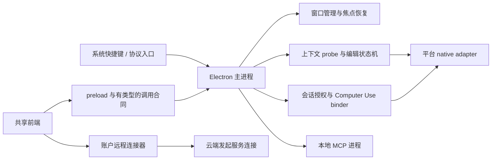
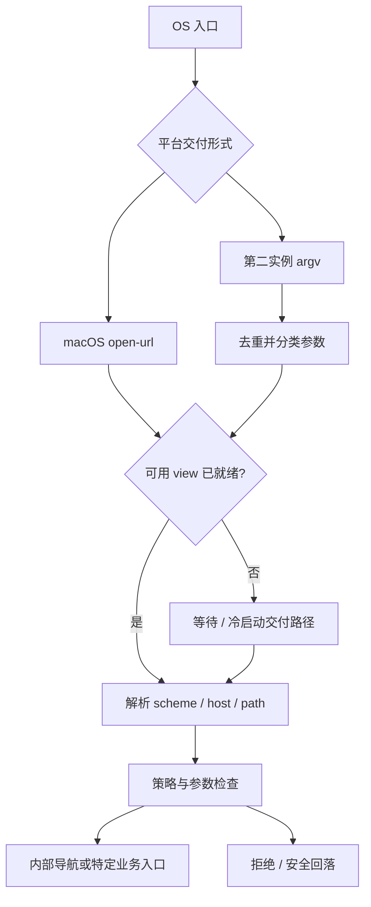
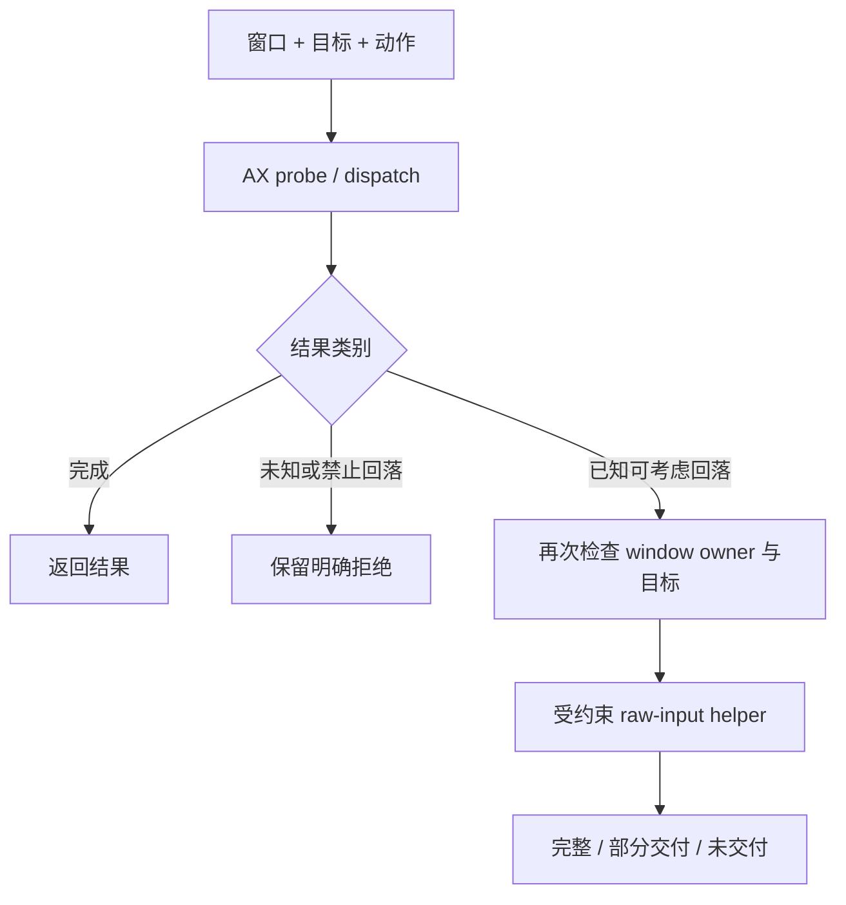

# 第 13 卷： Native OS Bridges：从系统入口到可验证的编辑目标

桌面 AI 的“原生能力”不在一个万能函数里。系统快捷键负责把应用叫出来，窗口句柄帮助它把焦点还回去，辅助功能接口提供局部结构，剪贴板承担某些输入交接，本地服务进程和账户远程连接器又各自拥有执行位置。把这些能力统称为“知道你正在做什么”，会掩盖最重要的产品与工程边界。

本卷追踪 Claude Desktop 2.37337.1 的静态 JavaScript 调用层。重点不是画出一张“Electron 可以调用所有 OS API”的泛化架构图，而是回答：一个入口怎样变成一个有身份、有时效、有权限条件的动作？哪些上下文确实进入了请求，哪些只是为了管理窗口？

观察版本：Desktop 2.37337.1。调用关系来自分发实现，实验代码为原创模型。

## 1. 先给“桥”分工

共享前端与原生宿主之间，至少有四种不同的桥。

| 桥的类别 | 典型输入 | 产生的结果 | 不应由此推断 |
|---|---|---|---|
| 系统入口桥 | 全局快捷键、协议 URL、第二实例参数 | 打开窗口、路由到某个页面或功能 | 已读取前台文档 |
| 窗口管理桥 | 窗口句柄、显示器、工作区位置 | 定位、显示、隐藏、恢复焦点 | 获得该窗口的文本访问授权 |
| 上下文/编辑桥 | 原生 probe、选择文本、额外窗口上下文 | 组织输入、生成预览、定向插入 | 对全部应用具有稳定的 IDE 集成 |
| 工具执行桥 | MCP 配置、会话 grant、工具参数 | 本地进程或远程服务的结果 | 所有连接器都从当前桌面发出请求 |

已有跨平台比较确认，三个安装包的 `ion-dist` 路径与内容相同；这支持共享界面层的研究，不支持原生层等价。三个 ASAR 不同，平台分支、窗口风格与原生适配器仍需单独看。[NB-01]



图里的线表示责任交接，不表示当前账户已经启用每条路线。UI 的存在、接口的存在、平台支持、用户设置和一次动作的授权，是不同事实。

## 2. 全局快捷键是租用系统资源

### 2.1 “设置已保存”和“按键已注册”是两件事

全局快捷键由操作系统仲裁。同一按键可能被其他应用占用，用户的桌面环境也可能不支持当前注册方式。Electron 的 `globalShortcut.register` 返回是否成功；调用它之前要等应用 ready。框架的当前文档还说明平台差异，但不能直接拿最新框架能力替代目标安装包版本的证据。[Electron globalShortcut](https://www.electronjs.org/docs/latest/api/global-shortcut)

所读主进程把 callback 与当前已注册 accelerator 分开保存，更新流程不是简单地改一个设置字符串：[NB-05]

1. 找到该功能原来的注册值。
2. 注销原值，并清空“当前注册”记录。
3. 校验新 accelerator 的键名与修饰键条件。
4. 检查当前环境是否允许走注册路线。
5. 请求 OS 注册。
6. 若特定校验或注册分支失败，尝试重新注册旧值。
7. 对部分设置路径，进一步恢复最后一次工作配置。

这是一种带补偿的更新，而非原子事务。恢复旧按键本身也可能失败；环境能力检查的早退分支没有调用同一恢复函数。因此，界面不能在失败后无条件显示“已恢复原快捷键”。

| 状态 | 设置 UI 应能表达的问题 |
|---|---|
| 配置为空/关闭 | 用户主动停用了入口吗？ |
| 格式无效 | 按键表达式是否可解析？ |
| 注册被拒绝 | 系统是否已经占用了它？ |
| 旧值恢复成功 | 实际正在监听的是哪一组键？ |
| 旧值恢复失败 | 当前是否完全没有该入口？ |

本版本的静态默认值为 Linux、Windows 的 `Ctrl+Alt+Space`，以及 macOS 的 `Alt+Space`。这些只是默认声明。用户配置、legacy quick entry 与 native quick entry 的 capability 分流，会改变实际采用的路线。[NB-06]

### 2.2 一个“按键入口”可以有多个生命周期

quick entry 和 dictation 拥有不同 callback 和配置。native quick entry 支持状态会决定是否使用另一组入口；某些特殊按键设置不会走普通 accelerator 注册。legacy 路线还受启用开关控制，并监听设置变化。

可复用的设计不是背下一组快捷键，而是把“功能入口”作为资源 owner：它拥有当前按键、注册结果、设置订阅和清理责任。快捷键与 UI 按钮可以调用同一个业务入口，却不应各自生成一套互相不知道的 session。

本卷的 `ShortcutLease` 原创模型用可注入 registry 演示注册、失败补偿和只释放自己资源。它不调用 Electron，也不声称复刻目标的所有平台分支。

```js
const result = lease.replace("Ctrl+J");
// { ok: false, active: "Ctrl+K", rollback: "restored" }
// 或 { ok: false, active: null, rollback: "failed" }
```

两个结果都值得测试。只测试“新快捷键成功”会漏掉真实桌面应用最常见的配置失败。

## 3. 焦点恢复提供连续感，但不提供内容

legacy quick-entry 窗口在出现前保存当前活动窗口句柄与时间戳。关闭后，恢复逻辑最多接受 30 秒内的记录；过期记录会丢弃。调用失败也会清理保存的目标。[NB-07]

它解决的是一个细小却重要的交互问题：用户临时呼出助手，取消后仍想回到刚才的工作位置。句柄只是窗口引用。看到 `getActiveWindowHandle`，不能把它翻译成“读取当前编辑器文件”“自动获取选中代码”或“与 Xcode 同步上下文”。

定位也不是固定屏幕坐标。quick entry 保存绝对位置、当时显示器和相对 workArea 的偏移。恢复时尝试识别对应显示器；显示器集合变了，就走回落路线。这里的 workArea 与整个屏幕 bounds 又不同，任务栏、Dock 等系统区域可能占据差额。

这给原创应用带来两个原则：

- 焦点引用应有寿命。一次很久以前的窗口句柄不该决定今天把用户带到哪里。
- 窗口位置应有显示器语境。只保存 `(x, y)`，无法解释拔掉外接显示器后窗口为什么跑到看不见的区域。

把这类状态命名为“窗口恢复信息”，比命名为“用户上下文”准确得多。

## 4. Deep link 是带参数的系统消息

### 4.1 冷启动与已有实例有不同入口

macOS 的 packed 主进程包含 `open-url` 事件处理：已有 view 时交给路由器；view 尚未建立时保存 URL，并阻止系统默认处理。Linux 的入口包含单实例锁、第二实例 argv 分类、去重和 view 就绪等待。[NB-02]

第二实例参数并不全是 URL。分类器还区分目录、skill 包、扩展包和普通文件；部分重复类别只处理第一个。把整个 argv 当成一个字符串直接送给 renderer，会失去原有类型边界。



### 4.2 Scheme 通过不代表路由通过

所读 handler 先检查 URL、可用 view、禁用 deep-link 的组织配置以及协议集合，再按 host/path 分派。Cowork、新聊天、Code session、会话/项目打开、认证回调等分支各有不同参数约束。[NB-03]

例如，Cowork 的 `/new` 与 shared-artifact 是不同分支；会话 ID 与 artifact UUID 有各自校验；部分不认识的路径被拒绝或导向受控页面。协议注册只说明系统知道把消息送给谁，不意味着消息携带的所有参数都可信。

认证回调还有它自己的关联和状态要求。本卷只研究入站路由结构，没有启动认证、读取 code 或探测回调。工程上应该把“导航指令”与“完成认证”视为不同类别，不能用同一个宽松 URL 打开函数代替两者。

### 4.3 长度限制也必须按编码单位定义

Linux build 有一条具体的 argv 保护路线：按 UTF-8 字节累计参数预算，预算为 26624；超长 deep link 会被裁剪，避免切断 UTF-8 多字节字符，并处理末尾不完整的 `%` 转义。重启标记避免同一进程再次进入裁剪循环。[NB-04]

这里有一个比具体数字更重要的设计：截断被当成带语义的状态继续传递。被标记为截断的 Cowork 路线不会沿用 `folder` 与 `file` 参数。不能把截断字符串假装成一条完整、原意未变的指令。

26624 不是通用 URL 长度限制，也不是所有系统的 argv 上限。复用时，应保留“字节预算、完整编码、截断后的参数语义”这三个问题，重新选择适合自己的边界。

## 5. 真正的选择文本桥在另一条 OS composer 路线

若只读 quick-entry 窗口管理，会漏掉另一组上下文能力。Linux 包含一个独立的 OS composer facade，代码标识为 `sableOtter`。它消费原生 probe 的选择文本、caret、window、进程与元素身份，并能组织“改写选中内容”“继续调整上次结果”“在当前位置写内容”等输入。[NB-08..10]

这不应被介绍成所有用户已可用的通用功能。它有至少三类明确条件：

- Linux initializer 在 Wayland 会话直接返回。
- 原生模块必须提供对应 start 与 paste entry points。
- 策略、配置 gate、用户 enabled 设置及请求前的新鲜度检查必须满足。

所读默认配置中的 enabled 是 false。没有读取真实用户设置，不能据此断言当前产品页面必然显示或隐藏这个入口。

### 5.1 三种 source 不是三个不同编辑器插件

| Source | 调用层怎样选它 | 可用信息 |
|---|---|---|
| selection | 选择文本去掉空白与若干零宽字符后仍非空，且不是特殊 siteEditor 路径 | 选中文本 |
| lastResult | 最近结果仍在相同目标的 caret 前，且时效/匹配检查通过 | 上一次生成结果及其编辑语境 |
| none | 没有可用 selection 或 lastResult | 当前写作指令，可能另附窗口上下文 |

这些 source 是原生桥给出的通用输入形态。某个应用名字出现在分类表，或者代码出现 VSCode/Xcode 枚举，都不足以证明它通过该 IDE 的插件 API 读取文件、未保存 buffer 或项目语义。本卷没有建立这样的端到端链。

### 5.2 额外上下文不是自动捆绑

该 facade 把选择文本、窗口内容与剪贴板分别管理。[NB-11]

窗口上下文有自己的 subject 和答复状态。符合条件时显示 once、always、never；某些 subject 只允许 once、never。已存的排除选择还会收窄可用范围。允许之后才进入相应窗口读取路线，返回 title 与 text，作为额外字段加入请求。

剪贴板通过显式 attachment 操作加入 composer，含独立的 pill 与移除路径。其读取函数还检查特定 concealed format，优先取文本，否则可处理 PNG 图片。这里能证明的是调用层有这些分工，不能据此保证每种密码管理器或每个平台的隐私标记都被识别。

一个容易理解的产品模型是：

> 用户选中的内容，是本次编辑对象；整窗内容，是可选背景；剪贴板，是另一份用户主动附加的材料。

三者都有用，但不能把前者自动扩张成后两者。

## 6. 生成完成后，必须重新确认编辑对象

一次请求可能需要几秒钟。期间用户可以切换窗口、移动 caret、改变选择、关闭文档，甚至让旧窗口 ID 被不同对象复用。只在请求开始时记录坐标不够。

所读 apply 路线在插入前再次调用 probe，并核对：[NB-12]

- verdict 仍是 ready。
- 窗口句柄相同。
- 进程 ID 相同。
- 先前 elementId 非空，而且当前 elementId 相同。
- 当前仍符合可写条件。
- selection 文本与原先一致。

它还对 lastResult 路线检查上次文本是否仍处在预期位置。检查失败时保留生成结果、提示目标改变，不继续当作可插入。

这是一种乐观并发控制：开始时保存版本线索，提交时验证前提。与数据库不同，GUI 的验证和输入通常不可能在同一原子事务中完成。验证之后到 paste 之前，用户仍可能改变焦点。正确的表述是“缩小过期目标的风险”，而非“彻底消除误输入”。

原创模型把这一原则浓缩成一个纯函数，不连接任何应用：

```js
sameEditTarget(before, after)
// 比较 windowId、processId、非空 elementId、editable 和 selection。
// false 表示保留草稿，要求重新观察目标。
```

测试故意一次只改变一个字段。这样才能知道判断依赖的是哪个身份，不会被一个“看起来仍在同一 app”的宽松条件掩盖。

### 拒绝理由也属于交互设计

facade 区分无窗口、读不到、secure field、自家进程、terminal/被排除 app、只读目标、选择太长等情况。部分 dictation 场景可退为复制结果，而不是直接打字。[NB-13]

这些类别对应不同的下一步：目标不存在时应重新选择；secure field 不应持续尝试；只读文档可以保留结果供用户复制；目标变了则重新观察。一个笼统的“出了点问题”无法支持安全恢复。

## 7. 剪贴板是共享资源，恢复也有竞态

该插入路线使用临时剪贴板内容和 paste。调用层先保存既有格式，写入待插入文字并检查回读，然后重新验证目标，再请求 paste。finally 中安排延时恢复原剪贴板。[NB-14]

这种实现能解释为什么“复制附件”和“借剪贴板输入”必须分开：前者把用户剪贴板当输入材料，后者把它当短暂的数据传输介质，目的不同。

也要准确描述可见保证。保存并恢复不等于无条件不影响用户。所读恢复位置是延时执行，没有在那个位置再次比较剪贴板是否已被用户更新。若用户在这段时间自己复制了新内容，是否被覆盖取决于实际时序。本次没有运行验证，因此这是一条需要测试的竞态路径，而不是对真实机器已发生故障的断言。

对原创应用，建议：

1. 记录自己的写入 generation 或可识别 payload。
2. 恢复前检查当前内容仍是自己写入的那一代。
3. 用户已复制新内容时，不覆盖它。
4. 文本写入成功、paste 发出、目标实际插入成功，分别记录结果。
5. 失败后优先保留草稿，避免重复粘贴。

“恢复以前的状态”也会产生副作用。清理代码值得与主要动作同等认真地测试。

## 8. Accessibility 不是一棵永远正确的树

Computer Use 的 app-scoped 路线与上述 OS composer 是不同 owner。前者通过会话 grant、窗口锁与 snapshot 管理工具动作；不要把 composer 的选择文本能力当成任意 agent tool 的隐式授权。

### 8.1 三种权限/可用性

macOS 调用层分别检查 accessibility 与 screen recording。某些 app 还需要启用手动 accessibility，再等待网页树可用。这三层解决的问题不同：[NB-15]

| 层 | 问题 |
|---|---|
| 会话权限 | 当前任务是否被允许访问这个 app/能力？ |
| OS 权限 | 当前宿主是否有系统授予的辅助功能或截屏能力？ |
| 目标结构就绪 | 这个 app 此刻是否暴露可用的 AX 元素？ |

在 Linux/Windows 的某一统一 permission helper 中返回 granted，只能说明它不在这里做 macOS TCC 式检查；不能由此断言系统上不存在其他同意、portal 或输入限制。

### 8.2 element_index 属于一次观察

`app_screenshot` 保存窗口图像与 AX summary。`app_ax_find` 随后搜索这一份 summary，按 role 和 title 过滤，返回前 50 个匹配及它们原来的 index。它不是每次都重新遍历实时树。[NB-16]

因此，index 更像“这次观测里的行号”，不是应用全局永久 ID。需要同时携带 session、app、window、capture identity，才能知道第 7 项究竟指什么。摘要还可能截断；有些元素可见却不在 AX 列表里，有些无障碍标签与视觉内容不完全一致。

元素标题属于来自目标应用的数据。分发文案也明确要求把标题当数据。按钮名里的一段命令式文字，不会因为出现在结构树中就变成宿主的操作指令。

本卷的 `SnapshotAuthority` 模型额外加入显式 grant version 和有效期。这是原创强化设计，不是声称目标代码采用同样的数据结构。它测试 A 会话不能消费 B 的 index、旧 capture 不能继续使用、新授权版本会让旧 snapshot 失效。

## 9. AX 失败之后，不能一律降级成原始输入

app-scoped adapter 先做 AX probe，得到 outcome、reasonCode、角色、错误、原内容等信息。随后才决定是否可以采用 raw-input fallback。[NB-17]

可见实现对未知 reasonCode 阻断；某些已分类理由也禁止回落。针对已列出元素的动作，如果当前位置已经对应其他元素，不能简单改成盲点坐标。真正进入 fallback 前，还要核对窗口 owner 与获准 app 一致，并考虑用户正在输入、secure input 与取消条件。



原生 helper 内部没有被恢复。以上说明调用层怎样限制和解释它，不是宣称已经证明其全部系统权限行为。

### 部分交付是必须保留的一等结果

typing 路线会报告 `partialDelivery` 与 `deliveredPrefixChars`；分块还避免把 UTF-16 surrogate pair 从中间切开。[NB-18]

例如，前 300 个字符已输入，第 301 个之前用户开始自己打字。若客户端把整个调用当作“失败，重试即可”，就可能重复前缀。正确处理是保存已交付边界，重新观察目标，再决定继续、让用户接管或放弃。`isError` 和“没有副作用”不是同义词。

这也是为什么批处理不等于事务。多个 GUI 动作已经发生之后，最后一项失败通常无法自动回滚整段操作。

## 10. 本地与远程由执行 owner 定义

桌面 UI 能展示远程连接器，本地插件也能向网络发请求。判断“数据从哪里出去”，要看具体连接 owner，不能看应用窗口的位置。[NB-19]

| 路线 | 配置归属 | 可建立的结论 | 不能自动继承的性质 |
|---|---|---|---|
| Desktop-local MCP | 本地安装/设置 | 宿主启动或连接本地进程，使用该主机网络语境 | 操作系统沙箱、最小文件权限 |
| 普通账户 remote MCP | Claude 账户 | 官方文档说明连接从 Anthropic 云端发起 | 当前电脑的 VPN、localhost 可达性 |
| 特定 session/部署路线 | 会话或组织部署配置 | 必须继续查该路线的 transport 与 owner | 普通账户连接器的全部行为 |
| 手机上的连接器入口 | 移动客户端与账户 | 可展示账户可用工具 | 启动用户桌面的任意本地进程 |

[官方 remote MCP 网络说明](https://support.claude.com/en/articles/11175166-get-started-with-custom-connectors-using-remote-mcp)明确区分账户远程连接器与 Desktop 本地配置。[连接器类别说明](https://support.claude.com/en/articles/11725091-when-to-use-desktop-and-web-connectors)也应按其具体产品范围阅读。包内另有组织/direct-MCP 路线，不应把某一帮助页的概括变成所有内部路径的总规则。

“同名”“都叫插件”“在同一账户登录”均不是本地设置同步的证据。本卷没有发现并验证足以宣称所有本地配置、授权和进程状态跨设备实时共享的链路。

一个实际可用的诊断面板应显示：名称、配置来源、连接发起位置、进程/服务身份、当前连接状态，以及本次工具调用的决定。只显示绿色“Connected”，不足以回答权限与网络问题。

## 11. 原创实验：让边界可测试

配套目录 [原生、语音与坐标实验](../../04-Extracted-Core-Code-And-Scripts/native-voice-geometry/README.md) 中的 `native-state.mjs` 没有原生依赖，不读取剪贴板、不注册系统快捷键、不接触用户数据。运行：

```sh
node --test models.test.mjs
```

本卷相关测试覆盖：

- window/process/element/selection 中任一身份改变，编辑目标判定失败。
- 空 element ID 不能充当稳定身份。
- snapshot 在错误 session、window、capture、grant version 或过期时间下拒绝解析。
- 新快捷键冲突后的旧值恢复成功，以及恢复本身失败。
- 关闭一个快捷键 owner 不注销别人的资源。
- 连接器 owner 由显式 route 得出，缺少 route 时不猜。

整个 native/voice/geometry 实验套件有 34 个通过的测试。它们验证原创模型，不验证目标应用已经在真实 OS 上实现了相同保证。要向真实运行推进，下一阶段必须使用获准的测试账户和无害目标窗口，逐平台验证系统能力、用户同时输入、目标关闭、权限撤回与异步回包。

## 小结

原生桥最值得复用的不是某个 API 名字，而是它携带的边界：入口有路由类型，窗口引用有时效，上下文有来源，目标有身份，权限有作用域，失败有交付程度。

从“助手可以打字”走到“助手知道这次字应该写到哪里”，中间需要的正是这些边界。它们既决定系统是否可靠，也决定用户能否理解和信任每一次交接。

## 附录：证据与可复核范围

- 事实索引：[native-bridges-expansion.json](../../04-Extracted-Core-Code-And-Scripts/evidence/data/native-bridges-expansion.json)，19 条结论、47 个已重新定位的短字节锚点；文件 SHA-256 与 byte offset 均在索引中。
- 相关基础研究：`platform-comparison.json`、`shell-architecture.json`、`agent-loop-cowork.json`、`extension-boundaries.json`。
- 本卷新增 REA 6.5.0 选择性分析：quick-window preload、Computer Use control chunk、Linux OS composer facade、OS composer initializer。使用默认 fail 完整性策略、512 MiB worker heap、每文件 30 秒限制；4 个所选文件解析成功。主 bundle 的其它结论来自独立静态字节/AST 阅读，不冒充完整 REA 语义恢复。
- macOS/Windows 的 JS 来源是已逐文件、逐块验证的 packed ASAR entries。此前发现的 native companion hash mismatch 没有被忽略；其内部实现不在本卷结论内。官方包获取和 JS 完整性核验不等于 Apple/Windows 签名链验证。
- 未验证：实际 rollout、用户设置、OS 权限、native 检测精度、原生输入时序、IDE 专用集成、真实网络连接及连接器配置同步。
- 配套算法、测试和图均为原创；下载包、提取源码、原生二进制和完整 REA 图不随出版物分发。

### 观察方法

观察日跨 2026-10-14 至 2026-10-15 UTC。没有启动目标应用、发送 deep link、读取真实剪贴板或用户窗口，也没有执行原生模块。文中“包含”“调用”“检查”均指所读分发实现；“建议”与实验代码是原创设计。
