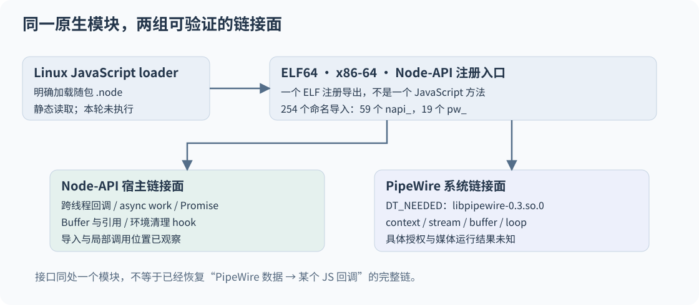
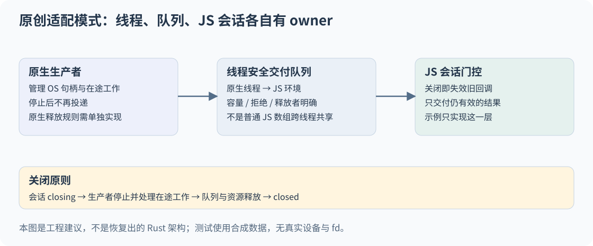
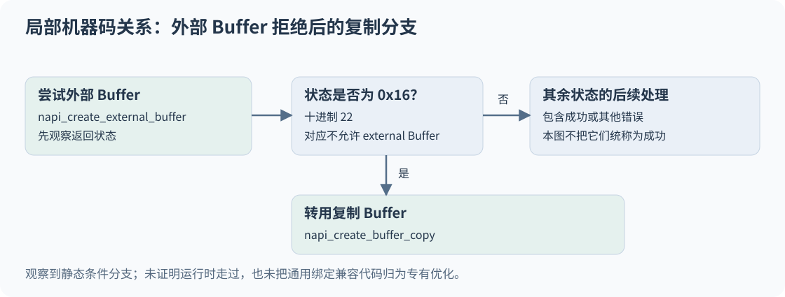
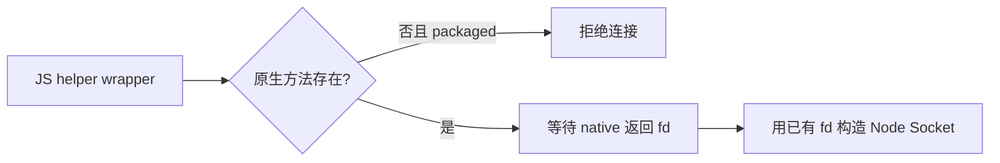

# 原生层增补：把“调用了 native”拆成可以验证的几件事

前文从 JavaScript 追踪了系统入口、窗口管理与编辑目标。本节向下走一层：只读检查 Claude Desktop 2.37337.1 Linux amd64 随包的原生模块，看看它实际向宿主与操作系统连接了什么。

最重要的结果不是又找到几个功能名称，而是建立了三种不同的证据：**装载合同、原生链接面，以及一条局部兼容分支**。本节没有加载 `.node`，没有启动产品，没有验证任何用户设备上的录音、截屏、输入或权限状态。原始二进制、源码片段与反汇编均不随正文发布；精确定位集中在[证据附录](EVIDENCE-APPENDIX.md)。

## 1. 一个入口，很多职责

先把 JavaScript 接口与二进制接口分开。`.node` 是供 Node/Electron 装载的原生扩展；ELF 是本样本使用的二进制文件格式；Node-API 是宿主与原生扩展交互的一组接口。后文的 ABI 指二进制层面的接口约定，兼容与否需要同时考察宿主接口和系统依赖。

模块是 64 位、小端、x86-64 的 ELF 共享对象。动态符号表有 256 项：1 项保留的空符号、254 个未定义命名符号，以及唯一已定义的公开函数 `napi_register_module_v1`。其中未定义项包括 59 个 Node-API 名称与 19 个 PipeWire 名称。[LNB-01..03]

这里的“未定义”不是分析失败。共享对象会把部分符号交给宿主或动态链接器解析；`napi_` 接口由兼容的 Node/Electron 宿主提供，PipeWire 则出现在动态依赖列表里。普通符号表已经剥离，动态符号表仍然承担链接工作。

**只有一个 ELF 导出，不代表只向 JavaScript 提供一个方法。** 注册入口可以构造 JavaScript 对象及其方法；ELF 导出清单与 JavaScript API 清单是两层不同的合同。本次没有把注册结构完整还原成所有 JS 方法，也没有把 `v1` 当成目标采用的完整 Node-API 版本号。



图中连线表示已观察到的装载或链接关系。两组接口同处一个模块，不等于已经证明 PipeWire 数据进入哪一个 JS 回调。

### ABI 兼容要分层回答

| 层次 | 本样本直接支持的结论 | 仍需另行证明 |
|---|---|---|
| 文件格式 | ELF64、x86-64、小端、共享对象 | 另一架构的产物是否相同 |
| JS 宿主接口 | Node-API 注册入口与导入 | 全部方法可用、最低 Electron/Node 版本 |
| 动态系统依赖 | PipeWire、libc、libm、libgcc 与 loader 的命名依赖 | 用户机器实际解析到的路径、安装状态 |
| 符号版本 | 存在强引用的 `GLIBC_2.34` 需求 | 全部发行版或 OS 的统一最低版本 |

动态依赖还包括 `libpipewire-0.3.so.0`。这个名字是 SONAME 接口标识，不能据此宣布安装版本恰好是 0.3。`GLIBC_2.34` 描述这份模块的符号版本约束，也不能单独变成“产品最低支持某个 Ubuntu 版本”的结论。[LNB-02]

Node-API 的 ABI 稳定范围和第三方库依赖是不同问题；公开文档也明确区分了它们。[Node-API ABI 说明](https://nodejs.org/download/release/v24.11.0/docs/api/n-api.html#implications-of-abi-stability)

## 2. 跨线程、异步工作、Buffer 是三份不同的合同

这份模块导入了三组很有解释力的 Node-API 接口：[LNB-03]

- 跨线程回调：创建、调用、释放以及 unref thread-safe function
- 异步工作：创建、排队、删除 async work，并创建和完成 Promise
- 对象及内存：引用、wrap/unwrap、Buffer 创建、external Buffer、复制 Buffer 与环境清理 hook

它们支持“模块包含与 JS 异步交付和内存生命周期相关的原生链接面”。不能从名称直接读出线程数、队列上限、调度时延，或者判断每次调用都正确清理了资源。Node-API 对 thread-safe function 的规定，是把工作线程产生的交付送回 JS 环境；`unref` 与释放所有权也不是同一动作。[Node-API 线程安全回调](https://nodejs.org/download/release/v24.11.0/docs/api/n-api.html#asynchronous-thread-safe-function-calls)

有一个更强的局部观察：在公开注册函数的符号范围内，能定位到 thread-safe function 创建与环境清理 hook 的调用指令。它把“导入存在”推进到“注册代码中存在相应调用位置”，仍未证明所有执行路径都会经过它们。[LNB-04]

### 停止不是只改一个布尔值

如果自己做这样的桥，建议明确三个 owner：生产者管理 OS 资源，队列管理待交付数据，JS 会话管理用户仍然感兴趣的结果。



这是设计建议，不是恢复出的 Rust 实现。一个可审查的关闭顺序是：

1. 让 JS 会话进入 closing，并失效旧一代回调。
2. 请求生产者停止，不再接受新任务；处理在途工作与取消竞态。
3. 按约定丢弃或排空待交付数据；被拒绝的数据仍有明确释放者。
4. 等生产者确实停止，再完成原生句柄与 thread-safe function 的释放。
5. 到 closed 后不再向业务层交付。已进入的同步回调只能自然结束。

[原创小模型](examples/callback-gate.mjs)只演示第 1、3、5 点的 JS 会话门控：有界等待队列、迟到回调失效、重复关闭与交付异常后的继续处理。调度器失败会关闭并失效已排队票据，返回明确失败或记录丢弃数量；错误报告器自身抛错会被隔离并计数。它不创建线程、不调用 Node-API、不使用真实 fd，也不承担原生内存释放。注入的调度器须异步排队，业务交付与错误报告回调须同步返回；模型不接管 Promise 或异步回调内部工作。真实实现仍需对生产者停止和资源释放单独测试。

## 3. 一个可以落到指令上的兼容分支

仅看到 external Buffer 与 copy Buffer 两个导入，无法知道二者之间有什么关系。GOT（全局偏移表）为这类间接调用保存目标地址，重定位记录把相关表项关联到符号。本次将这些记录与局部指令对齐，找到了同一段代码里的条件分支：[LNB-05]



具体观察是：

1. 调用 `napi_create_external_buffer`。
2. 比较其返回值与 `0x16`，即十进制 22。
3. 相等时进入调用 `napi_create_buffer_copy` 的分支。
4. 其余返回值进入后续状态处理；不能把它们统称为成功。

Node.js v24.11.0 的官方 `napi_status` 枚举中，22 对应 `napi_no_external_buffers_allowed`；相关 API 文档说明部分运行时不支持 external Buffer。这里使用公开 ABI 枚举解释数值，并未认定目标内嵌的 Node 版本就是 v24.11.0。[官方状态枚举](https://nodejs.org/download/release/v24.11.0/docs/api/n-api.html#napi_status)、[external Buffer 约束](https://nodejs.org/download/release/v24.11.0/docs/api/n-api.html#napi_create_external_buffer)

这说明随包原生代码里存在一个“外部缓冲区不被允许时，改用复制缓冲区”的局部兼容路径。它可能来自通用绑定或 Rust 依赖，不能据此归功为 Claude 专有的手工优化；也不能宣布当前运行时一定走过这条路径，或者“整条媒体链已经零拷贝”。

对原创实现，值得借鉴的是**区分不支持与其他错误**：明确的不支持可以改走已知安全的替代策略，分配失败、参数错误和关闭中的环境不能不加区分地重试。外部内存的最终释放与复制完成后的源内存释放，还必须分别制定合同。本节只证明分支关系，没有验证整个内存所有权实现。

## 4. PipeWire：有原生流接口，不等于一次采集已经发生

动态表明列 PipeWire 依赖；动态符号包含 stream 创建、listener、连接、buffer 出队/归队、main loop 与 context 生命周期接口。进一步通过重定位定位到 `pw_context_connect_fd`、`pw_stream_connect`、buffer 出队/归队的局部调用位置。[LNB-06]

这比只找到一个 “PipeWire” 字符串更强，但仍然只是静态链接与调用位置证据。官方定义中，同一组 buffer 接口可服务于播放或采集，`pw_context_connect_fd` 接受已连接的 socket。接口名称不能替代调用参数、媒体格式、授权来源和真实执行记录。[PipeWire Stream](https://docs.pipewire.org/group__pw__stream.html)、[PipeWire Core](https://docs.pipewire.org/group__pw__core.html)

有界只读数据扫描也发现了 ScreenCast 与 RemoteDesktop portal 的接口名称。它们只留下一个合理的后续研究问题：这些名称由谁引用，哪个 JS 方法触发会话，成功得到的句柄怎样进入媒体层？本轮没有建立这条完整链，也不把门户字符串与 PipeWire 导入拼接为“已经实现屏幕控制”。[LNB-07]

公开 portal 协议本身还把创建会话、选择来源、启动和取得 PipeWire remote 分成不同步骤。协议存在与本样本成功完成协议，是不同的证据。[ScreenCast 会话生命周期](https://flatpak.github.io/xdg-desktop-portal/docs/doc-org.freedesktop.portal.ScreenCast.html#session-lifecycle)

## 5. 为什么 JS 要把某些动作交给 native

同一份已验证 Linux 输出提供了两个小而完整的调用层例子。[LNB-08..09]

### 5.1 从受约束的连接返回 fd，而不是再按路径连接

helper 连接 wrapper 先取原生方法 `connectUnixSocketSameUid`。若方法不存在，packaged 分支拒绝继续；开发分支另外保留普通连接的回落。若方法存在，wrapper 等待其返回 fd，再用该 fd 构造 Node Socket。



有价值的设计是“把检查过的资源交给上层”，避免另开一次连接而失去原先的身份语境。[继续追到原生 peer 检查](socket-peer-credentials/README.md)：注册回调与任务表关联到 SO_PEERCRED 查询、有效 UID 比较和两条拒绝时的 close 分支。恶意 peer、竞态与交付失败的完整生命周期仍需分别验证。

### 5.2 安全路径失败时，不悄悄降低保障

safe-fs wrapper 经必需的 native loader 调用 `openRootDir`、`openBeneath` 等方法。模块加载失败时，调用层抛错而不回退为普通按路径打开；打开后的部分失败路线还会关闭已取得的句柄。[LNB-09]

这是明确的调用层 fail-closed 策略。与之相符的原生导入包括 openat、readlinkat、renameat、unlinkat 等，但这些原语本身不构成“路径包含性已经正确实现”的证明；导入还可能来自通用依赖。原生函数内部如何防符号链接、处理目录替换及平台差异，本轮没有恢复或运行验证。

## 6. 可复用的结论

| 问题 | 本次证据推动到哪里 | 必须保留的未知 |
|---|---|---|
| 原生模块怎样接入 JS？ | loader、注册入口、Node-API 链接面 | 完整 JS 导出清单与全部版本兼容 |
| 为什么要管理回调寿命？ | 跨线程/异步接口与注册范围内的清理调用点 | 队列策略、关闭竞态与实际清理正确性 |
| Buffer 是否有兼容回落？ | 识别到 external 被拒绝后复制的局部分支 | 哪个业务触发、运行频率、完整所有权 |
| 有没有 PipeWire 桥接？ | 依赖、19 个符号与若干真实调用位置 | 具体媒体功能、授权及运行结果 |
| 为什么 helper 与 safe-fs 需要 native？ | JS 返回资源合同，以及 Linux 选定 peer-UID 检查/拒绝分支 | 恶意 peer、取消与交付失败、路径隔离的完整保证 |

原生分析最有用的地方，是把“有某项功能”的大句子拆成可审核的小结论。依赖、接口、调用位置、局部分支、完整可达路径、真实运行结果，各自回答不同的问题。下一步若要继续深入，应选择其中一个未闭合的问题继续追踪，而不是扩大字符串清单。

## 7. 运行原创模型与独立反例

[返回第 13 卷](../README.md)。此目录可单独阅读；正文的图与附录均使用相对链接。

进入本目录，使用已安装、支持内置 test runner 的 Node.js 执行：

```sh
node --test examples/callback-gate.test.mjs examples/callback-gate.audit.test.mjs
```

随包包含 12 项模型测试，以及独立编写的 22 项反例测试，共 34 项。已在 Node.js v24.19.0 复跑通过，不需安装依赖。

除排队、关闭、重入与异常路径外，独立测试还明确验证模型的限制：它不会自动复制可变 Buffer，不会替调用方释放被拒绝或关闭时丢弃的合成资源。测试中的资源只是普通 JS 对象，不是真实 fd、原生内存或设备。34 项通过只验证这个原创模型，不验证目标应用的真实线程、PipeWire、权限或 native 行为。

## 文件解析：内核约束与兼容路径

[openRootDir / openBeneath 补篇](file-containment/README.md)连接方法注册、异步工作、根目录 fd、openat2 的解析约束和逐分量 openat 回退。重点区分目录身份与目录树位置、链接解析与跨挂载限制，并提供样本绑定的只读复核器及无需样本的输入安全测试。
