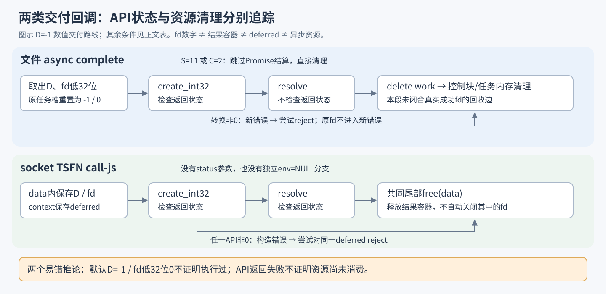

# fd 交付失败：先分资源，再分回调

三份 Linux 原生回调有不同的失败合同：socket 检查 resolve 的返回状态并尝试 reject；两个文件回调直接进入清理。三者可定位到的尾部释放主要处理内存与异步资源，仍未闭合交付失败时 fd 的完整所有权链。

对象限于 Claude Desktop 2.37337.1、Linux amd64 的已校验样本。本文是静态研究，没有执行目标或故障注入。[样本、定位与未闭合链](EVIDENCE-APPENDIX.md)

## 1. 同样叫“完成”，其实是两类回调

TSFN 是 Node-API 的线程安全函数。socket 的交付回调使用 `call_js_cb(env, js_callback, context, data)`；两个文件方法使用 `complete(env, status, data)`。原章节自然语言中的“完成回调”不能据此理解成相同的 API 签名。

| 资源 / 参数 | socket：TSFN call-js | openRootDir / openBeneath：async complete |
|---|---|---|
| 第二参数 | JS callback，不能解释成取消status | status；固定参考ABI中11为napi_cancelled |
| 描述符数字 | 堆结果+8的低32位，转换成JS整数 | 先搬到寄存器，任务原槽低32位清零，再转换成JS整数 |
| 结果/任务容器 | 尾部free(data)；异常helper也直接free | 路径/分量、错误文字、控制块与任务分别清理 |
| Promise deferred | context保存；resolve非0后尝试对同一个deferred reject | 从任务取出；resolve返回值不检查 |
| 异步资源 | 生产端call_threadsafe_function后release；入队返回值未检查 | 完成/抑制结算路线调用delete_async_work；其返回值未检查 |

这里的 `free` 是 libc 的内存释放调用。**free结果容器不等于close容器中保存的fd；JS整数也没有在此自动获得描述符析构器。** 四个相关cleanup helper已展开到选定末端，没有恢复出从真实成功fd到局部描述符回收操作的边。[NDH-01、06](EVIDENCE-APPENDIX.md#ndh-01签名关联)

## 2. 失败条件要带着结果判别器一起看

记 `D` 为结果首字段，`F` 为已经由execute写入的真实成功fd；`S`仅指文件回调status，`C`是文件共享控制块+0x10的字节。

**文件任务在execute前就初始化为 `D=-1，fd低32位=0`。** 因而仅看到成功判别值-1，不证明打开过fd。下表“若存在F”是条件推演，不能省略这个前提。[NDH-02、03](EVIDENCE-APPENDIX.md#ndh-02初始值与真正执行结果)

| 条件 | 局部动作 | 描述符追踪的边界 |
|---|---|---|
| 文件：`S=11` 或 `C=2` | 跳过数值转换与Promise结算；delete work，写C=1并清理任务 | 若已有F，本段未接到fd回收；取消时序、C=2写入链及此组合可达性未闭合 |
| 文件：其他非0 S，原D=-1 | 用status构造错误，尝试reject | 新错误不携带原fd |
| 文件：S=0、C!=2、D=-1，create_int32非0 | 原fd寄存器被status覆盖；构造错误并尝试reject | 原任务槽已清零；选定清理不回收该fd |
| 文件：create_int32为0，resolve为0或非0 | 调用resolve后无条件进入共同清理 | 不检查交付结果，没有resolve失败专用分支 |
| socket：D=-1，create_int32非0 | 构造转换错误，尝试reject，再free原结果 | fd数字仍留在被释放的容器内；没有局部fd回收边 |
| socket：D=-1，create_int32为0、resolve非0 | 构造另一错误，尝试用同一deferred reject，再free结果 | 不能只凭非0状态认定deferred仍可用 |
| socket：env=NULL | 没有独立NULL-env清理分支，仍按D调用相关API | 属于TSFN拆除条件，不能解释为status11 |
| 两类：D!=-1，且未被status/共享状态截走 | 原错误转JS错误并尝试reject | 载荷按错误对象解释，不能当作成功fd |

所有“尝试reject”均不代表Promise已经拒绝：这三份回调都没有检查reject的返回状态。[逐条地址与完整条件表](EVIDENCE-APPENDIX.md#ndh-04文件api失败的分歧)



[对应Mermaid资源交接图源](figures/descriptor-handoff.mmd)

## 3. 失败返回不一定意味着资源尚未消费

固定 [Node v24.0.0的公开合同](https://github.com/nodejs/node/blob/v24.0.0/doc/api/n-api.md#L935-L953) 允许TSFN在JS不可调用时以env=NULL通知原生侧清理剩余data。参考版本的 [ConcludeDeferred](https://github.com/nodejs/node/blob/v24.0.0/src/js_native_api_v8.cc#L307-L333) 也说明，resolve/reject的非成功返回可能位于消费deferred之前，也可能位于删除deferred之后。

这两点是API设计提醒：调用失败后，应分别确认输入资源、结果容器和交付凭据的归属。**不能把“resolve失败就再reject”当作普遍安全的恢复模板。** Node24只是固定参考，不能代替Claude实际宿主的实现与可达性证据。

完整所有权分析还需要连接失败可达性、TSFN入队接管与拆除、取消时序以及宿主交付合同。这里分清了内存、异步资源与fd的局部去向；这些证据不足以判断运行时泄漏或漏洞。更完整的API阶段对照见 [Node-API参考合同](node-api-contracts.md)。

## 复核与复用

无产品样本也可运行输入安全测试：

```sh
python3 -B test-verifier.py
```

已有摘要一致的 Linux 模块时，运行样本绑定的静态检查：

```sh
python3 -B verify-static.py /absolute/path/to/verified-linux.node
```

10项fixture检查输入拒绝和临时快照清理；174项静态检查对应15个FDE，不能替代手工控制流分析。JSON只输出stdout；样本摘要和精确定位见[附录](EVIDENCE-APPENDIX.md)。图可从[Mermaid图源](figures/descriptor-handoff.mmd)继续改写。

[返回 Linux 原生层](../README.md)
