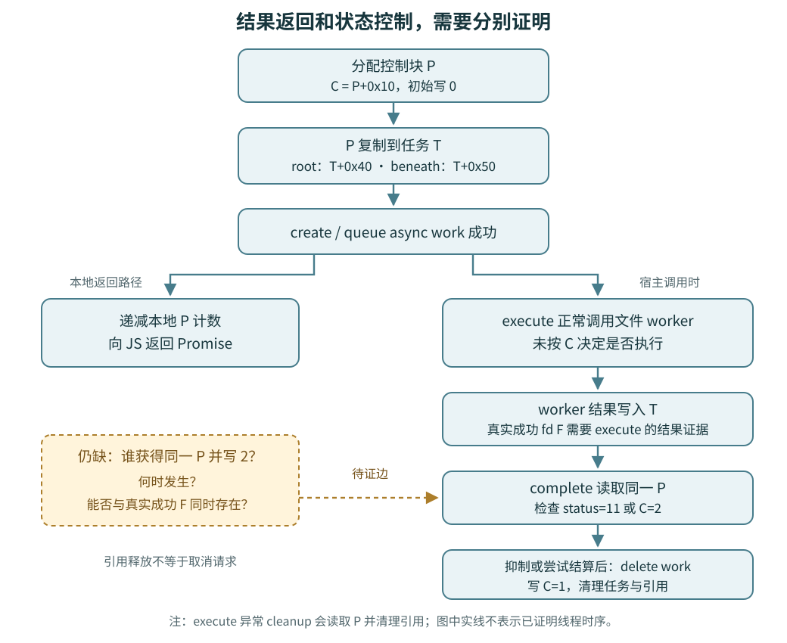

# 拿到 Promise，不等于拿到取消能力

Promise说明调用方能接收结果；取消还需要另一条能力链：有人持有同一任务的控制对象，能够改变它，并且与worker的执行时序衔接。`openRootDir`和`openBeneath`的Linux实现，已证明了前一条链，尚未闭合后一条。

这里把任务称为T，共享控制块称为P，`P+0x10`的字节称为C。这些只是分析记号，不是已恢复的源码类型名。

| 已观察到的动作 | 能说明什么 |
|---|---|
| 分配P，令C=0，再把P放入T | 找到了同一个控制块的起点和传递位置 |
| queue成功后递减本地P计数，向JS返回Promise | 本地引用释放与结果交付可以独立发生；这段返回路径没有发出写C=2的请求 |
| execute正常工作路径调用文件worker，不按C分支 | complete的状态检查不能反过来当作worker已支持取消的证据 |
| complete检查status=11或C=2，并在清理时写C=1 | 证明了收到这些条件时的处理方式，尚未证明谁能产生这些条件 |

[Mermaid图源](figures/control-byte-flow.mmd)

两个execute的异常cleanup会读取P并清理引用。因此，准确的说法是“正常工作路径未按C决定是否调用文件worker”，不能扩大成“execute的所有后续效果都与P无关”。

模块里另有一个通过间接表引用、能够写入同偏移字节2的小函数，但尚未把它的对象参数连接到文件任务的P。**同偏移、同数值，不足以证明同一对象。** [精确流向与候选边界](EVIDENCE.md)

前篇的条件推演仍然有效：若execute确已写入真实成功fd F，而complete入口又满足C=2，就会抑制交付并进入清理。这里仍未证明F与C=2能够在实际宿主中同时成立；初始化的fd=0也不能当作已经打开过文件。因此不能据此判断泄漏、漏洞，或反向断言取消永远不可达。

这条设计经验可以直接复用：审查异步取消时，应分别追踪“结果从哪里返回”和“谁有权改变任务状态”，再核对取消请求与执行完成的先后关系。结果接口的形状不能替代控制能力的证据。

[样本身份、静态检查与复核方法](METHOD.md)

[固定 napi 2.16.17 对照](UPSTREAM-COMPARISON.md)说明同样返回Promise的库入口如何保留不同的取消能力；公开源码对照不代替样本中的对象关联证据。
