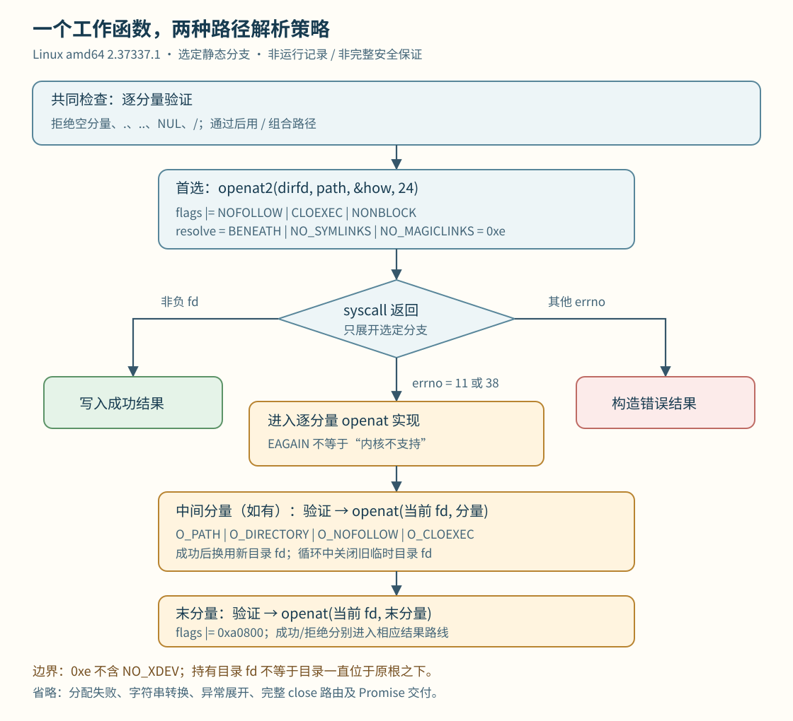

# 原生文件边界：同一个“在根目录下打开”，其实有两条路径

safe-fs 的调用层最终进入 Linux 原生模块。**`openBeneath` 的异步工作函数先尝试带有明确解析约束的 `openat2`；遇到两个指定错误码时，转入按路径分量逐段 `openat` 的实现。** 两条路线的参数和部分拒绝分支已经定位，但它们不能直接合并成一份完整、相同的安全保证。

版本范围：Claude Desktop **2.37337.1、Linux amd64**。本文从已校验 ELF 的静态指令与调用参数还原选定控制流；函数角色是分析标签。[证据与复核方法](EVIDENCE-APPENDIX.md)保留定位及验证器用法。

## 1. 先把方法名字接到真正的工作函数

单独找到一个方法名或系统调用，不能证明两者有关。本轮建立了两条可审查的静态关联：

- `openRootDir`：方法构造器把名字和 Node-API callback 绑定；callback 创建异步工作并指定 execute；execute 调用根目录打开函数。
- `openBeneath`：另一个方法构造器绑定 callback；callback 进入异步工厂，指定不同的 execute；execute 从任务对象读取 dirfd、分量集合与 flags/mode，再调用包含性处理函数。

这些是明确的函数地址、直接调用和 `napi_create_async_work` 实参，不是把同一二进制里的相近名字拼在一起。任务创建之后还能定位到 queue 调用；完整调度器、取消与异常路径不在本轮证明范围内。[NFC-01]

两个完成 callback 都包含把整数转为 JS 数值以及 resolve/reject Promise 的调用点。这里可支持“原生返回一个 fd 数值”的交付形态，不能据此宣称交付失败或取消时一定释放了 fd。[NFC-06]

## 2. 建立根：打开的是目录对象，不是保存一串路径

根目录工作函数调用的是 `open(path, 0x2b0000)`。按 Linux x86-64 ABI，这个常量由四个标志组成：[NFC-02]

| 标志 | 在这里的作用 |
|---|---|
| `O_PATH` | 取得用于路径操作的引用；不是普通内容读写句柄 |
| `O_DIRECTORY` | 要求目标为目录 |
| `O_NOFOLLOW` | 不跟随路径末端的符号链接 |
| `O_CLOEXEC` | 执行新程序时关闭该描述符 |

这四项共同出现，与仅保存根路径字符串有实质差别：后续可以把已经打开的目录当作 `dirfd`，减少重新从全局路径解释根的机会。原生成功分支把返回整数写入结果；负返回值进入错误处理。

但这里必须保留一个很具体的边界：**根本身是用完整路径调用 `open` 建立的。`O_NOFOLLOW` 针对末端，不代表根路径之前的每一级都禁止符号链接。** 本轮没有发现并证明一条“根路径所有祖先都逐级禁止跟随”的链。根的选择、输入来源及上层授权仍是另外的问题。[Linux open 手册](https://man7.org/linux/man-pages/man2/open.2.html)

## 3. 共同入口：先检查分量，再交给内核

`openBeneath` 工作函数循环调用同一个分量验证器。该验证器可以直接定位到以下拒绝条件：[NFC-03]

- 空分量
- 恰好为 `.` 或 `..`
- 分量内出现 NUL
- 分量内出现 `/`

通过这一步后，函数使用 `/` 分隔符组合路径，再准备系统调用。这里的“分量”不是未经区分的一整条绝对路径。验证器还有长度相关分支，但本节不把它简写成“最多 255 字节”：那段代码涉及字符计数，完整字符串合同没有恢复。

这些字面检查也不能替代文件系统约束。一个没有点号或斜杠的名字，仍可能指向符号链接、挂载点，或在另一个线程改动目录时得到不同结果。下一层 flags 才回答如何解析它。

## 4. 首选路线：一次受约束的 openat2

在工作函数里，能恢复一个 24 字节的 `open_how`：flags、mode、resolve 各占 8 字节。随后通过 libc 的 `syscall` 导入调用 x86-64 编号 **437**，传入原 dirfd、组合后的路径、结构体地址以及大小 24。[NFC-04]

关键参数是：

- flags：调用方 flags 再 OR `0xa0800`，即 `O_NOFOLLOW | O_CLOEXEC | O_NONBLOCK`
- mode：这段代码按输入 flags 的 `O_CREAT` 位选择传入 mode 或零
- resolve：固定为 **`0xe`**

根据固定版本的 [Linux v6.12 openat2 ABI 头](https://github.com/torvalds/linux/blob/v6.12/include/uapi/linux/openat2.h)，`0xe` 是 `RESOLVE_NO_MAGICLINKS | RESOLVE_NO_SYMLINKS | RESOLVE_BENEATH`。它要求此调用禁止相应链接解析，并把解析限制在 dirfd 之下。**它不包含 `RESOLVE_NO_XDEV`，不能由这个常量推出禁止跨挂载点。** syscall 编号另由 [x86-64 syscall 表](https://github.com/torvalds/linux/blob/v6.12/arch/x86/entry/syscalls/syscall_64.tbl)核对。

这里恢复的是“程序向内核提出了什么解析要求”，没有证明某次真实运行调用成功，也没有把公开内核合同变成整个产品所有文件访问的合同。

## 5. 兼容分支：不是任意错误都重试

图中只画已定位的主分支；内存转换、分配失败、异常展开和 Promise 交付省略。各箭头表示代码分支或调用关联，不表示一次运行记录。

`openat2` 的非负结果走 fd 返回路线。负结果读取 errno，然后分别比较 **11（EAGAIN）和 38（ENOSYS）**。这两种情况汇入逐分量实现；其他 errno 进入错误构造路线。[NFC-04]

因此不能把图讲成“旧内核不支持才回退”。`EAGAIN` 还可能来自内核在 `RESOLVE_BENEATH` 等约束下无法排除竞争导致的逃逸；它不是 `ENOSYS` 的同义词。这里观察到的策略是在这些返回值下尝试另一条实现，不是无条件再次调用同一个 syscall。[Linux openat2 手册](https://man7.org/linux/man-pages/man2/openat2.2.html)

## 6. 逐段路线：每一步使用新的目录 fd

fallback 不是简单调用 `open(拼接后的绝对路径)`。[NFC-05]

1. 空分量集合在此函数里有单独拒绝分支。
2. 首个及后续中间分量都调用共同验证器。
3. 中间目录按 `openat(当前 dirfd, 单个分量, 0x2b0000)` 打开。
4. 下一步采用刚返回的目录 fd；循环里能定位到取得新 fd 后关闭前一个临时目录 fd 的调用。
5. 末分量同样验证，以 `openat(当前 dirfd, 末分量, 输入 flags | 0xa0800, mode)` 打开。
6. 返回成功 fd；若拥有中间目录 fd，所选成功/拒绝路线中存在关闭它的调用。

“对末端不跟随”的标志之所以在逐段实现中有用，是因为**每次传给 openat 的都是一个经过检查的分量**。每次中间目录打开都带 `O_DIRECTORY` 与 `O_NOFOLLOW`，而不是仅在最终长路径尾部加一个标志。本轮证据支持这个局部机制，不支持自动推导所有 flags 组合、所有内核与文件系统都具有相同终态。

尤其要把下面两件事分开：

- **目录身份**：已经打开的 fd 可以继续引用同一个目录对象。
- **目录树位置**：那个目录对象在后续时刻是否仍位于原来的根下面。

例如，完成一个中间目录打开后，另一个参与者可能重命名或移动这个目录。已持有的 fd 并不会因此自动改成重新解释最初的根路径；接下来的相对打开仍从该目录对象出发。仅证明“每一步都使用 fd、拒绝符号链接”不足以证明“最终对象在返回时仍是原 root 的后代”。这是一项需要明确时间语义的保证，不是本轮已证实的产品缺陷。

相比之下，首选路线把整个解析请求交给内核的 `RESOLVE_BENEATH` 合同；逐段路线由若干次独立 `openat` 组成。**本轮没有闭合两条路线在并发目录移动下的语义等价性**，也没有运行竞态或攻击测试。

## 7. 实现合同对照

| 已经定位的事实 | 还不能写成事实的保证 |
|---|---|
| 两个方法名绑定到各自 callback，再关联到 async execute | 每次创建、排队、执行、取消都成功且正确 |
| 根打开使用固定目录 flags | 根路径的所有祖先都不含链接，根来源永远可信 |
| 首选调用使用 openat2、指定 dirfd、24 字节 how、resolve=0xe | 跨挂载受阻、所有操作都由这条路线执行 |
| errno 11/38 进入逐段实现，其他 syscall 错误进入错误路线 | EAGAIN 只意味着旧内核；两条路线保证完全相同 |
| 分量检查、逐段目录 flags、末段 flags 和选定 close 调用 | 任意 fd 来源、复用、rename 竞态与全生命周期均安全 |

对原创设计，最值得借鉴的不是照抄数字，而是把合同拆开：根如何建立、分量允许什么、内核负责什么、何时使用另一实现，以及另一实现究竟承诺哪一种时间点上的边界。兼容路径也应拥有自己的验证计划。

[返回 Linux 原生层](../README.md) · [运行样本复核器与10项输入安全测试](EVIDENCE-APPENDIX.md#如何复核)

文件打开后的async-complete、取消状态和失败交付，见[描述符交付补篇](../descriptor-handoff/README.md)。
