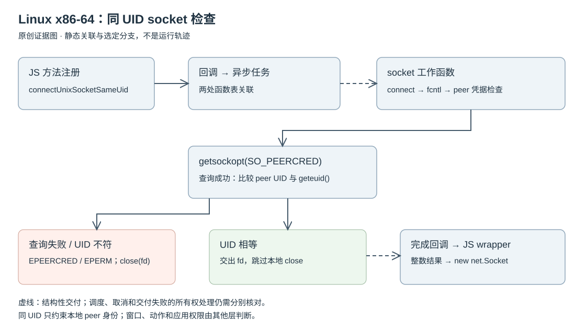

# 同 UID socket 连接：一条可定位的 Linux 原生边界

Linux amd64 模块中的 `connectUnixSocketSameUid` 将函数注册、异步任务、peer 凭据检查与文件描述符交付连接起来。选定控制流会比较有效 UID，在拒绝时调用 close，成功时返回 fd。窗口、动作和业务请求的授权仍由上层分别判断。

研究对象为 Claude Desktop Linux amd64 2.37337.1 的已校验原生模块，采用静态分析。[定位附录](EVIDENCE-APPENDIX.md)保留样本身份、函数边界与调用点。

## 1. 从 JS 方法名到原生工作函数

注册构造函数调用 `napi_create_function`，同时传入方法名字串和 callback。callback 在参数提取成功路径进入异步工厂。

后续不是一条普通同步 call 链：任务构造代码安装了两个可由 ELF relocation 解析的函数表。第一张表指向一个跳板，沿静态调用链到达第二个任务构造器；第二张表的首项经跳板与包装函数到达 socket 工作函数。附录给出每个位置，而不是用函数邻近关系猜测关联。

这闭合了“命名 callback—任务构造—函数表—socket 工作函数”的静态结构关联。它不等于验证调度器必定运行、成功唤醒或在某个线程执行；异步调度时序与所有取消路径未穷尽恢复。

## 2. 连接后检查了什么

工作函数有完整的 FDE 边界。观察到的普通成功路径是：

1. 创建 AF_UNIX stream socket，创建参数包含 CLOEXEC 和 NONBLOCK 位；fd 保存在局部槽中。
2. 构造 Unix socket 地址并调用 connect。直接成功路径汇入 flags 处理段；另有重试/等待分支，本节不把其时间边界或全部错误处理宣布为已证明。
3. 调用 fcntl 获取 flags，再写回清除了 NONBLOCK 位的 flags。两次调用均有错误分支；成功才进入 peer 检查。
4. 调用 getsockopt：level=1，optname=17，输出缓冲区12字节。返回0才调用 geteuid；将返回缓冲区 +4 位置的32位值与其比较。
5. 相等时将 fd 写入结果 +8，并写成功判别值 -1，然后跳过关闭块。不同则构造带 EPERM 前缀的错误，再关闭该 fd。

这些常数和布局不是凭函数名猜出来的。Linux 内核头定义 `SOL_SOCKET=1`、`SO_PEERCRED=17`，内核 `ucred` 由三个32位字段组成，UID 位于第二字段。本地 x86-64 glibc 头的只编译、不运行断言也核对了 size=12、UID offset=4。[Linux socket 选项](https://raw.githubusercontent.com/torvalds/linux/v6.12/include/uapi/asm-generic/socket.h)、[Linux ucred 定义](https://raw.githubusercontent.com/torvalds/linux/v6.12/include/linux/socket.h)、[glibc socket 定义](https://raw.githubusercontent.com/bminor/glibc/glibc-2.40/sysdeps/unix/sysv/linux/bits/socket.h)。参考头版本用于解释 ABI，不声称它就是产品构建时的头版本。

SO_PEERCRED 返回连接建立相关时刻的 peer 凭据，不是每次业务动作都重新认证；这里比较的是本进程的有效 UID，不是 getuid 的真实 UID，也没有在这段比较中核对 PID 或 GID。[Linux unix(7)](https://man7.org/linux/man-pages/man7/unix.7.html)

## 3. 两种拒绝，和一个交付边界

- getsockopt 失败：构造带 `EPEERCRED` 前缀的错误，进入公共关闭块。
- UID 不相等：构造带 `EPERM` 前缀的错误，也进入同一关闭块。
- 正常成功：工作函数不关闭 fd；结果结构携带该 fd。异步工厂还指定了完成回调，其中成功结果被转为 int32 后交给 `napi_resolve_deferred`；错误结果交给 `napi_reject_deferred`。

上层 JS 等待 native 结果，成功后将 fd 包装为可读写的 `net.Socket`。失败时，wrapper 用消息开头的错误前缀恢复 `.code`，并附上 native-connect 标记。这解释了为什么原生层的两种拒绝能在 JS 层保留不同分类，而不必假设它们直接来自 Node 的 errno 映射。

准确的生命周期结论是：上述两条普通拒绝路径调用 close；上述成功路径绕过 close 并交出数字 fd。不能进一步说“全生命周期绝无泄漏”：本节没有证明 Promise 交付失败、取消、环境销毁或 JS Socket 构造抛错时 fd 的每条处置路径。局部 close 调用也未检查返回值，不能把“发起关闭”写成运行时关闭已成功。

## 4. 接入时保留哪些边界

- 只适用于这份 Linux x86-64 样本，不泛化为所有 Unix 平台。
- 同 UID 不是可执行文件来源证明，也不是 helper 协议或业务权限的完整认证。
- 取得凭据成功后，局部路径直接比较 UID；没有看到对 getsockopt 返回长度再次比较。这里记录观察，不据此提出绕过或漏洞结论。
- openRootDir/openBeneath 没有在本次继续下钻；JS wrapper 的 fail-closed 文本不是本节证明了内核路径包含约束的理由。
- 不把静态路径存在写成用户机器已经执行或验证成功。

[返回 Linux 原生层](../README.md)
