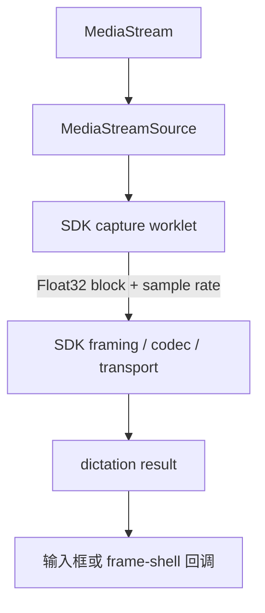
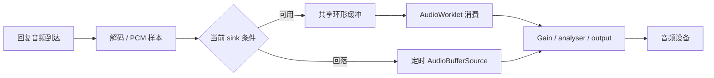
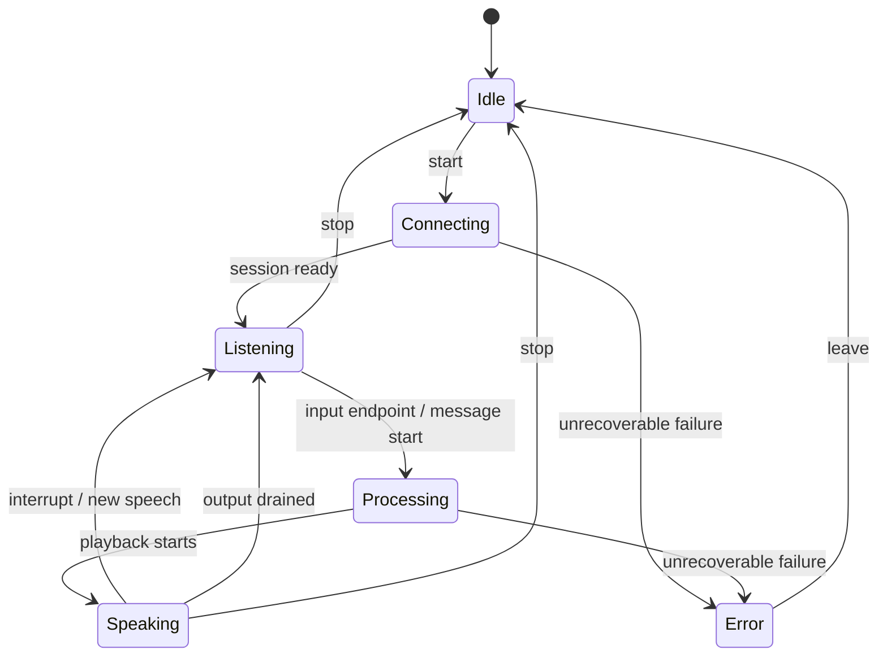

# 第 15 卷： Voice / Vision Math：让声音、时间与坐标各有参照系

语音与视觉系统需要同时管理多种参照系。声音有采样时钟、播放时钟和界面时钟，图像有像素帧、窗口局部坐标、显示器空间与文档坐标。一次播放何时结束、一个点击落在哪里，都取决于数据使用了哪种参照系。

本卷以 Claude Desktop 2.37337.1 的分发代码为静态样本，追踪语音输入与播放、打断与会话状态，以及截图坐标。PDF 部分区分已见的文本提取入口与独立的通用几何实验。配套数学实验和状态模型均为使用合成数据的原创教学实现。

观察日为 2026-10-14 至 2026-10-15 UTC。事实编号对应本卷证据索引，分析与实验范围见附录。

## 1. 先拆开三个看起来相似的语音入口

官方产品说明把 dictation 定义为语音转文字，把 voice mode 定义为双向语音对话。这个区分也出现在客户端架构里，但实际比两个按钮更细。[官方 voice mode 说明](https://support.claude.com/en/articles/11101966-use-voice-mode)

| 入口 | 本次找到的实现边界 | 输出的主要 owner |
|---|---|---|
| Composer dictation | dictation session 与输入框生命周期、草稿及 transcript reconciliation | 输入框文字 |
| frame-shell dictation / speak | 独立 facade，使用 bundled voice SDK；dictation 显式注入 capture worklet | 文字回调或朗读播放 |
| 完整 voice session | `voiceSessionManager`，独立 recorder、transport、turn、message 与播放状态 | 双向会话与对话记录 |

这三条路线可以共享概念甚至底层工具，但不能因为包中有一个 AudioWorklet，就宣布“整个 Claude 语音采集都由该 worklet 完成”。本次追踪显示，SDK worklet 被 frame-shell facade 引用；完整 voice manager 的 recorder 另有 WebCodecs、MediaRecorder 与 PCM 路线。[VV-01..04]

同样，朗读是输出音频，dictation 是输入文字，双向 voice 才同时管理麦克风、回复、会话 turn 与用户插话。若把它们合并成一个 `isRecording` 布尔值，错误恢复、麦克风占用和停止行为都会变得模糊。

## 2. 三个时钟，三种“已经完成”

理解语音流水线，先区分三个时间来源。

| 时钟 | 可描述的事实 | 不能单独描述的事实 |
|---|---|---|
| 采样时钟 | 收到多少音频样本，代表多长输入 | 服务器何时完成识别 |
| 播放时钟 | 已消费多少回复样本，播放队列还有多少 | 用户在扬声器前实际听到了多少声学信号 |
| UI/事件时钟 | 事件到达、状态变化、动画刷新时间 | 原始语音真正结束的时刻 |

例如服务器说“回复音频发送完了”，客户端队列可能还剩 700 ms。若立即把 UI 改为完全空闲，用户会看到“已结束”却继续听到声音。反过来，麦克风权限已授予，也不意味着 AudioContext 已 running，更不意味着服务器收到了非静音帧。

完整 voice 的 `playback_end` 分支会检查尚未播放的回复时长，并在需要时等待 drain。所读输出播放器也分别记录 pushed sample 数和 played duration。[VV-07、VV-13]

可以把一次语音回复拆成四个里程碑：

1. 首个回复数据到达。
2. 首个音频真正进入播放。
3. 服务端完成发送。
4. 客户端播放队列排空。

这四个时间差，不应都叫“模型延迟”。

## 3. 音频采集：权限之后还有资源所有权

### 3.1 SDK capture worklet 的职责很窄

frame-shell dictation 指定一个 packaged capture worklet。该 worklet读取第一个输入的第一个声道，把当前 Float32 样本块复制出来，再以可转移 buffer 发给主线程。另有消息回传用于宿主的 fence 协调。[VV-02]

这段职责很清楚：搬运音频块。没有在这一个 worklet 中发现语音识别、语义理解或神经网络 VAD。把它画成“麦克风 → AudioWorklet → 识别文本”的黑箱，会跳过编码、帧组装、连接和服务端处理。

Web Audio 的工作线程与主线程分工，是浏览器提供的机制；具体 product facade 怎样使用它，需要调用链证据。[W3C Web Audio API](https://www.w3.org/TR/webaudio-1.1/)



图只描述被识别的 SDK dictation 路线，不代表完整 voice 的所有后端。

### 3.2 Stop 与 switch 必须知道谁拥有 stream

SDK capture 区分 caller-owned stream 与自行拥有的 stream。停止时，只有在相应所有权条件下才停止 tracks；随后断开节点、移除 port callback、关闭 AudioContext，并保存关闭 promise。设备切换使用 generation，避免旧的异步 setup 完成后覆盖新资源。[VV-03]

这是一个通用异步资源问题：

- A 次启动已经申请麦克风，但 setup 尚未完成。
- 用户停止，再开始 B 次启动。
- A 的异步结果最后返回。

如果只检查 `isRecording`，此时它可能因为 B 已启动而再次为 true，A 就会错误地接管 B。epoch/generation 要回答的是“这次结果属于哪一次启动”，而不是“现在是不是有人在录音”。

原创 `VoiceEpoch` 模型验证旧 epoch 的音频不能复活已停止的会话，也不能在 interrupt 后继续加入旧回复。它是纯状态模拟，不含音频设备和网络。

### 3.3 完整 voice recorder 有另一组后端

完整 voice recorder 的配置包含优先 WebCodecs、MediaRecorder 备选与显式 PCM 选择。非 PCM 路线检查 Opus 能力；若两种 Opus backend 都不可用，则报错。其 PCM 分支在所读代码中使用 ScriptProcessor，而非上述 SDK capture worklet。[VV-04]

| 后端 | 调用层可见的数据处理 | 应保留的限制 |
|---|---|---|
| WebCodecs | AudioEncoder、track 读取与编码 | 浏览器与 codec 支持是条件 |
| MediaRecorder | WebM/Opus 与分片数据处理 | timeslice 不能当成所有帧严格等长的保证 |
| PCM | Float32 转换、重采样支路、Int16 字节 | 这是特定后端，不是所有连接都传 PCM |

所读 analyser 请求 48 kHz AudioContext，并检查上下文状态。请求 48 kHz、实际设备采样率、编码器采用的采样率，是三个需要单独记录的字段。只在配置中看到一个数字，不足以建立整条链的实际采样率。

## 4. 采样率数学：单位明确，缓冲才不会漂

### 4.1 样本数不是字节数

对单声道、每帧时长为 `T_ms` 的流：

`N = sampleRate × T_ms / 1000`

假设采样率是 16000 samples/s，一帧是 20 ms，则 `N = 320`。同样 320 个样本，用 Float32 存储需要 1280 bytes，用 PCM16 需要 640 bytes。编码成 Opus 后，字节数又不由这个公式直接决定。

| 量 | 单位 | 示例 |
|---|---|---|
| sampleRate | samples / second / channel | 16000 |
| samplesPerFrame | samples / channel | 320 |
| duration | ms | 20 |
| channels | 声道数 | 1 |
| PCM16 byte length | bytes | 320 × 1 × 2 = 640 |

本卷 `PcmFrameAssembler` 只做固定采样率下的分帧，不承担重采样。输入块可以是 137、256 或其他长度；累计够 320 个样本就产生一帧，余数留给下一次。最后的尾部必须显式处理，不能静默填充后假装它本来存在。

测试把同一段 1007 个合成样本，一次全部输入和每次 137 个分块输入，要求生成的帧与尾部完全相同。这比只检查“平均每秒约 50 帧”更强，因为它同时覆盖块边界。

### 尾段交付之后，这条流就结束了

`push()` 接收任意大小的输入块，`finish()` 交付不足一帧的余数并关闭分帧器。二者不是可以任意交替使用的“写入/清空”操作。

假设每帧三个样本：输入 `[a,b,c,d]` 后，完整帧占据样本位置 0–2，尾段 `d` 占据位置 3。如果把尾段取走后又在同一个分帧器上输入 `[e,f,g]`，只按完整帧序号计算时间的位置仍从 3 开始，便会与已经交付的 `d` 重叠。修复这类问题要先确定 API 合同：本模型选择 `finish()` 为终态，新流新建实例；需要持续排空尾段的系统则应另设 flush 合同，并按实际已消费样本数推进时间轴。

| 调用 | 结果 |
|---|---|
| 开放流 `push(samples)` | 输出零个或多个完整帧，保留余数 |
| 第一次 `finish()` | 返回余数；没有余数时返回空数组；进入终态 |
| 再次 `finish()` | 返回新的空数组，不重复交付 |
| 终态 `push()`，包括空输入 | 在读取输入迭代器前抛错 |
| 输入迭代器在展开时调用 `finish()` | 当前批次被拒绝，不能让已结束的流重新开放 |

这是本书原创分帧器的生命周期合同。固定采样率、分块不变性和 Float32 数值校验仍各自保留；它不承担重采样、编码或真实录音设备管理。

### 4.2 重采样与分帧不同

完整 voice 的 PCM 支路包含线性插值降采样与 float-to-Int16 转换。线性插值的数学直觉是，在相邻源样本之间按距离求加权值。但降采样还涉及混叠与滤波，不能因为看到了插值，就推断整条产品链具有特定音质保证。[VV-04]

对于原创系统，建议让格式合同明确写出：输入 rate、输出 rate、声道布局、样本格式、字节序、帧持续时间，以及跨块余数怎样保留。分帧器不应偷偷改变采样率，播放器也不应凭字节长度猜 codec。

本实验的 `pcm16le` 明确选择 little-endian，并裁剪到 `[-1,1]`。例如输入 -2 先裁剪为 -1，再编码为 -32768，对应字节 `[0,128]`；+1 编码为 32767，对应 `[255,127]`；0 对应 `[0,0]`。测试验证零值、正负满幅与越界样本。这个函数的存在不表示目标所有平台传输采用相同字节序；它只是一个定义完整的原创合同。

## 5. “有声音”“像语音”“该结束一轮”是不同判断

### 5.1 两种 level，不要叫成同一个 RMS

完整 voice recorder 的 analyser 用 2048 FFT size、0.3 smoothing，并每 100 ms 更新分析结果。代码同时具有两类统计：[VV-05..06]

1. 对时域 Float32 样本计算真正的均方根振幅，用于 peak-input 等指标。
2. 对频域 byte-bin 数据计算 level 或某个频段的平均值。

时域 RMS 的公式是：

`RMS = sqrt((x₁² + x₂² + … + xₙ²) / n)`

而 `getByteFrequencyData` 返回的是频域映射后的 byte 值。对这些值再做均方根或平均，得到的是该可视化表示上的统计量，不能直接当成未经转换的声压或原始时域振幅。

### 5.2 本地 detectSpeech 的证据边界

所读 `detectSpeech` 选择约 85–3500 Hz 的频域 bins，求平均后除以 255，再与 0.075 比较。结果随 level 与 frequencyData 一起回调；完整 voice manager 的该 callback 更新 audio-level store。[VV-06]

它可以被准确地描述为“本地频段能量阈值标记”。本次没有从这条调用链恢复出神经 VAD，也没有证明这个标记决定服务端什么时候结束一句话。

完整 voice 的 turn 状态另由服务器事件推进，包括 `transcription_start` 与 `user_input_end`。`playback_start` 的指标字段还提到 server VAD 到 TTS 的时间，但字段名称不是 VAD 算法的实现证据。[VV-07]

| 可见信号 | 适合的用途 | 不应直接推出 |
|---|---|---|
| 时域 RMS 很低 | 诊断静音、设备故障、显示能量 | 用户一定没在说话 |
| 频段阈值标记 | 本地 level/状态展示的线索 | 对所有语言和噪声都可靠的 VAD |
| transcript interim | 已收到部分识别文字 | 用户这一轮已经结束 |
| user_input_end | 服务端报告输入端点 | 端点检测内部阈值或模型结构 |
| processing 状态 debounce | 稳定 UI 状态转换 | 麦克风或服务器统一的静音时长 |

尤其不要把 `user_input_end` 后出现的 1000 ms processing debounce，写成“VAD 等待一秒静音”。它的位置在端点事件之后，承担的是客户端状态处理；两者因果顺序不同。

## 6. 波形更像仪表，不是声音的完整画像

本次找到的 `DictationWaveform` 有自己的 analyser 与 SVG 历史柱条。它不是完整 voice manager 的端点检测器，也不应被宣传为真实语音识别进度。[VV-14..15]

### 6.1 从 byte 波形到可读的幅度

它读取 byte time-domain 数据，先把每个值转换到近似 `[-1,1]`：

`x = (byteValue − 128) / 128`

然后计算 RMS，去掉 0.015 的噪声底，做平方根增益并限制最大值。这个非线性步骤有明确视觉意义：让较小声音也能产生可见变化，同时避免大声时柱条超出范围。

公式中的常数来自这一 packaged component 的声明，并不是通用语音判定阈值。波形动起来，只能说明它所用的 analyser 收到了可测变化；不能单独证明网络正在传输、ASR 正常或对方正在听。

### 6.2 采样节奏与动画节奏分开

该组件默认约 80 ms 往历史中加入一个能量值，但用 `requestAnimationFrame` 连续移动条形。这样，测量更新不必跟着每个显示帧进行，而横向移动仍能顺滑。

柱数随容器宽度变化，历史长度受限；2 px 宽的柱与间隔形成 7 px 节距。边缘还做高度衰减。卸载时断开 source、关闭 AudioContext、清空历史并取消 animation frame。

这些细节提供一个复用思路：把视觉对象分成采样、包络、有限历史和绘制四层。不要把 canvas/SVG 的每次重画都变成一次音频资源重建。

本卷的 `EnvelopeHistory` 采用另一套原创参数和按 elapsed time 的指数平滑：

`α = 1 − exp(−Δt / τ)`

`level_new = level_old + α × (target − level_old)`

它的一个测试比较“一次 100 ms”和“两次 50 ms”对相同目标的平滑结果，验证刷新率变化不会改变同一时间跨度的基本响应。此模型不是照抄目标的视觉波形算法。

## 7. 输出音频：网络队列与扬声器之间还有一个消费者

### 7.1 Worklet 不是无条件可用

完整 voice 使用的输出播放器会检查 SharedArrayBuffer、cross-origin isolation 和 AudioWorklet 能力。满足条件可选择 worklet sink；否则使用 buffer-source 路线。worklet 初始化失败也有回落分支。[VV-11]

因此，分发目录里存在 `audioSinkWorklet.js`，只能证明某条可选路线的实现存在，不能证明用户当前正在走它。



ring buffer 的 producer 是写入方，consumer 是音频渲染方。两者的速度不会完全相同，缓冲的意义正是吸收这种差异。

### 7.2 一个槽为什么不能用

所读 ring buffer 用 read/write 索引，保留一个槽来区分空和满。可读样本数按环形差值计算，可写样本数是 capacity 减一再减可读量。[VV-12]

若不保留空槽，就必须增加其他状态来区分 `read == write` 的两种含义。选择哪种设计不是重点，重点是空/满合同不能含糊，否则 producer 会覆盖尚未播放的数据，或 consumer 会读到没有写完的区域。

写入数量不等于播放数量。只有 consumer 真正取出并提交样本后，played counter 才增长。相应播放时间为：

`played_ms = played_samples / sampleRate × 1000`

静音补齐的空白不会自动成为“听过了的回复内容”。这对于字幕位置和打断后的文本截断尤其重要。[VV-13]

一个合成例子：16 kHz 队列收到 400 个样本，只消费了 160 个，播放账本是 10 ms；随后用户打断，未消费的 240 个样本被清空。不能因为曾经收到 400 个，就把已播放时间记成 25 ms。实验的数值输出保留了这组结果。

深入读[音频队列的发布边界](audio-ring-publication/README.md)：样本复制后才发布索引，满队列尾部在所读路径中会被丢弃；flush与residual分别管理丢弃和数量边界，不能合称代次隔离。

### 7.3 Underrun 计数也有定义

音频节点可能在首个 TTS 数据到达之前就开始运行。若每个空 quantum 都计为 underrun，等待首包的正常时间会被误报为大量播放故障。

所读 worklet 只有实际开始播放后才进入相应缺口判断；短暂干涸在随后又有音频时才被确认成一次 mid-utterance stall。自然 turn end、flush、残留样本与下一轮样本交错，又有独立状态。[VV-12]

这个事实有两个启发：

- 指标应先定义事件语义，再计数。空队列可能是等待、暂停、自然结束或故障。
- 播放完成通知要避免每个 quantum 重复发送；一次完成应有 latch，下一轮音频再重新打开。

原创 `PlaybackLedger` 只模拟“初始静音不计故障、真正中途干涸在恢复时计数、played 不包含 zero-fill”。它没有实现目标 worklet 的所有 residual-sample 竞态分支，更不承担实时音频线程的性能保证。

## 8. 打断不是一个 stop 按钮的别名

### 8.1 本地停播、服务端中断和工具撤销不同

完整 voice 的按钮 interrupt 路线包含多项操作：停本地播放器、清理 cut audio、取消待发 playback acknowledgement、发送 interrupt 控制消息、通知宿主、冻结字幕/截断未说出的文字，并转回合适的 listening 状态。[VV-08]

本地停止能快速改变用户听见的声音，但不等于服务端已经停止生成；更不等于之前发出的工具操作自动撤销。网络消息可能正在路上，远程动作可能已经完成。UI 应表达“停止说话”“中断当前回复”“取消某项工作”的各自范围。

### 8.2 插话需要处理迟到音频

如果用户开始说话，旧回复音频仍可能继续到达。所读实现包含 queue、hold、drop 等 cut-audio gate，并有条件性 verdict 等待；服务器 cut 与用户按钮也不是完全相同路径。[VV-09]

此外，导航到新会话时也会暂存 events 和 audio。导航 hold 是为了把状态接到正确会话，cut hold 是为了处理插话后的音频归属。两个缓冲都叫“等待”，却等待不同的决定，不能混成一个队列。



这是教学简图。真实实现还包含 reconnect hold、临时错误、mute、tool approval、字幕和媒体腿状态；图中的每条箭头不应被误读为真实产品的完整 transition table。

### 8.3 Socket 与 WebRTC 也不能混读

完整 voice manager 包含 `socket_audio` 与 `webrtc_media` 分支，存在媒体 offer/answer、连接失败标记、mic 交接和条件性回落逻辑。[VV-10]

这能支持“该 build 分发了两类媒体路线”，不能支持“当前所有账户都在使用 WebRTC”或“WebRTC 一定比 socket 更低延迟”。实际 transport、网络路径、服务器策略和 rollout 没有经过运行验证。

一条稳健的事件规则是：旧连接的回包不能改变新连接的状态。原创 `VoiceEpoch` 用 epoch 展示这一规则；目标中还可见以当前连接实例、session state 和各类 held state 限定回调的机制，但本卷不把两者逐字段等同。

## 9. 截图坐标：先把单位写在纸上

声音的问题是多个时钟，截图的问题是多个坐标系。

| 坐标系 | 原点与单位 | 常见错误 |
|---|---|---|
| 返回 image 像素 | 当前图片左上角，实际图片像素 | 误以为等于动作完整 frame |
| 完整 coordinate frame | 本次协议约定的完整截图参照 | 缩小图片后把它一起改小 |
| display-space | executor 使用的显示器空间，加桌面 origin | 忽略负原点或混用物理像素 |
| window-local | 目标窗口左上角，窗口几何单位 | 再加一次桌面原点 |
| CSS viewport | 页面内容/元素显示坐标 | 直接乘 OS scaleFactor |
| canvas backing store | 实际绘图 bitmap 像素 | 把 DPR 缩放用于鼠标事件两次 |
| PDF user space | 文档自身 viewBox 与旋转 | 假定永远等于页面 CSS 像素 |

Electron 文档明确区分 DIP 与 physical screen points，Display 的 bounds/workArea 属于 DIP 语境。目标 native executor 又有自己的返回合同，因此本卷用“display-space”描述分发代码的动作目标，不无条件称它为物理屏幕像素。[Electron screen](https://www.electronjs.org/docs/latest/api/screen)、[Display structure](https://www.electronjs.org/docs/latest/api/structures/display)

`devicePixelRatio`、Electron `scaleFactor`、截图缩小倍率和浏览器 zoom 即使数值碰巧相等，也不应共享一个模糊的 `scale` 变量。

## 10. Display screenshot 的变换

### 10.1 先选择正确 frame，再缩放

所读 display 坐标转换优先使用 `frameWidth/frameHeight`，没有时才使用返回截图的 width/height。把动作点 `(x_f, y_f)` 映射到 executor display-space：[VV-16]

`x_d = originX + round(x_f × displayWidth / frameWidth)`

`y_d = originY + round(y_f × displayHeight / frameHeight)`

结果再夹到该显示器最后一个坐标位置。输入恰好等于 frame 边界可以进入转换，但最终不会落到显示器之外；负值与超出 frame 的点有拒绝路径，非有限结果也会报错。

这里的 full-resolution frame 是协议选择的完整参照，不必等于原始硬件最高分辨率。截图还可能经过预算限制和缩放，图像大小与动作参照必须由元数据说明。

### 10.2 一个左侧显示器的例子

设：

- 完整 frame：1000 × 600。
- 返回给 UI 的缩小图片：500 × 300。
- display-space 大小：2000 × 1200。
- 桌面原点：(-2000, -100)。

frame 中点 `(500, 300)` 映射为 `(-1000, 500)`。如果把缩小图片的 `(250, 150)` 直接当成完整 frame 点，它会落到错误的四分之一位置；如果忘记原点，又会落到另一块显示器的空间。

配套实验使用完全相同的合成 fixture，并测试右下边界、负原点、横纵比例和 stale capture identity。

### 10.3 归一化必须由协议明确指定

该实现确实包含 `normalized_0_100` 可选模式，数值范围是 0 到 100，而不是 0 到 1。在这个模式下：

`x_d = originX + round(x_percent / 100 × displayWidth)`

不能因为归一化对模型方便，就把任何工具的坐标都当成百分比。模式未知时应拒绝或重新取得合同；“看起来像 0.5”不是足够证据。[VV-17]

没有上一张截图时，目标实现还有按 scaleFactor 回落并记录警告的路径。本卷的原创模型刻意要求匹配的 capture identity，不实现这一回落。它是更严格的教学选择，不能被描述为目标软件的实际行为。

## 11. 窗口、AX 元素与局部放大

### 11.1 Window-local 不加桌面原点

app-scoped 路线把完整 frame 点转换为窗口局部位置：[VV-18]

`x_window = x_frame × windowWidth / frameWidth`

`y_window = y_frame × windowHeight / frameHeight`

实际 helper 会对点做边界夹取。原创实验选择拒绝越界输入，防止错误坐标被无声修正；这个差异在代码注释中明确标出。

AX summary 的元素几何沿相反方向缩放，显示为同一完整 frame 的坐标。这样，图像里看到的位置与元素列表的位置才可以比较。element_index 仍属于那次 snapshot，不能因为坐标换算正确就忽略其身份和时效。

### 11.2 缩小截图不是切换动作参照

缩小的 app screenshot 保存 full frame 尺寸；后续动作继续使用 full frame。`app_zoom` 是局部阅读辅助，不替换完整 screenshot，也不携带新的元素列表。[VV-19]

同样，display zoom 后的 click 不改用放大图坐标。batch 还明确以批开始前的 full screenshot 为参照。若一批中途获得新图像，不能让前半批按旧 frame、后半批按新 frame，而不在协议层声明变化。

可以给每张图片加一张简短的“坐标标签”：

```text
captureId: synthetic-42
image: 500 × 300
coordinateFrame: 1000 × 600
space: window-local frame pixels
windowId: synthetic-window-A
```

它的价值不在字多，而在让缩小、裁剪和窗口移动不会悄悄改变数值含义。

## 12. PDF 矩形：先说明哪里没有证据

本次在 Office MCP 的 PDF extractor 依赖中找到了 viewport 矩阵、旋转和 `convertToViewportRectangle`。但实际 extractor 入口调用 `getTextContent` 后，将 `items[].str` 用空格拼接，返回文本；没有在这条入口中调用矩形映射。[VV-20]

因此，本卷没有把这份依赖包装成“Claude 聊天 PDF 高亮/引用坐标实现”。输入处理卷中观察到的 PDF 服务器转换与 fallback，同样不能补出一个未被看到的客户端矩形协议。

下面是独立的通用 PDF geometry lab。它解释如何正确处理这种问题，而不是声称目标产品正按相同代码绘制引用。

### 12.1 用一个仿射矩阵表达坐标变换

二维仿射矩阵可写成六个参数 `[a,b,c,d,e,f]`：

`x' = a×x + c×y + e`

`y' = b×x + d×y + f`

对本实验的 PDF viewport，先把 PDF 的向上 y 轴映射为 CSS 的向下 y 轴，再处理 0、90、180、270 度旋转与缩放，最后平移，使 viewBox 的变换后左上边界对齐 viewport offset。

采用列向量约定，实验的线性部分为：

`[ s×cosθ, s×sinθ, s×sinθ, −s×cosθ, 0, 0 ]`

其中 `s = zoom × userUnit`。实现只接受 90 度的整数倍，并使用精确的 0、1、-1，避免这些正交角度产生无意义的浮点三角误差。

视图框不必从 `(0,0)` 开始。先变换 viewBox 的四个角，求最小 x/y，再减去这个最小值并加 offset，就能自然处理非零、负数 crop origin 与旋转后的宽高交换。

PDF.js 的官方示例也区分 viewport 变换和 HiDPI canvas backing store；本实验从基本仿射几何独立编写，没有调用目标库。[PDF.js rendering example](https://github.com/mozilla/pdf.js/blob/master/docs/contents/examples/index.md)

### 12.2 为什么矩形要考虑四个角

在只有正交旋转、翻转和缩放的特定合同里，两个对角点可能足以恢复矩形。但一个可复用的 affine utility 还可能接收 shear 或其他变换，因此本实验对四个角逐个变换，再计算 axis-aligned bounds。

设 PDF 页为 `[0,0,600,800]`，zoom 为 1.5，文档矩形为 `[100,600,200,700]`。映射到 CSS 后的 bounding box 是 `[150,150,300,300]`。这里 y 方向翻转了：靠近 PDF 顶部的矩形，在 CSS 中也应靠近顶部。

另一个测试使用非零 viewBox `[10,20,210,120]`、90 度旋转、zoom 2、userUnit 1.5，以及 offset `(7,11)`。预期 viewport 是 300 × 600，完整页 bounds 是 `[7,11,307,611]`。

这比只测一张未旋转、原点为零的 A4 页面，更接近真实文档需要面对的几何复杂度。

### 12.3 CSS 坐标与 canvas backing store 分开

若一个 PDF 点映射到 CSS `(100,100)`，DPR 为 2 时，canvas backing store 的对应像素可以是 `(200,200)`。但浏览器 mouse/pointer event 的 CSS 坐标仍是 `(100,100)`；反向查询 PDF 位置时，应先使用 CSS viewport 的逆矩阵，不能再乘一次 DPR。

实验中：

```js
const cssPoint = apply(viewport.matrix, pdfPoint);
const bitmapPoint = apply(canvasTransform(viewport.matrix, 2), pdfPoint);
const recoveredPdfPoint = apply(invert(viewport.matrix), cssPoint);
```

若再叠加滚动或容器平移，矩阵顺序也重要。`compose(outer, inner)` 定义为先应用 inner，再应用 outer。缩放后平移，与平移后缩放，结果通常不同。变量名和函数约定必须把顺序写清楚。

## 13. 原创实验的组织方式

配套 [原生、语音与坐标实验](../../04-Extracted-Core-Code-And-Scripts/native-voice-geometry/README.md) 中：

| 文件 | 验证对象 |
|---|---|
| `geometry.mjs` | 完整 frame、display origin、window-local、PDF affine、逆变换与 DPR |
| `audio-state.mjs` | RMS、PCM16、跨块分帧、包络历史、播放计数与 stale epoch |
| `native-state.mjs` | 编辑目标身份、snapshot 作用域、快捷键补偿与连接 owner |
| `models.test.mjs` | 合成输入下的正常、边界、过期、失败与恢复测试 |

先进入上述 `04-Extracted-Core-Code-And-Scripts/native-voice-geometry/` 实验目录，再运行：

```sh
node --test *.test.mjs
```

本次结果为 81 个测试通过。其中 PDF round-trip 测试在六种等价/正交角度和多种缩放下生成 360 组点，要求正向再逆向回到原点；还单独测试矩形 shear、非零 crop、DPR、右下边界、NaN、退化矩阵和 stale capture。

音频测试则验证：

- 固定 rate 下，分帧结果与上游 chunk 切分无关。
- 未开始播放前的空输出不算 underrun。
- 中途缺口只在音频恢复时计数一次。
- 播放时长不包含 zero-fill 或尚未消费的队列。
- stop/interrupt 后，旧 epoch 的回包被忽略。

另有 10 个数值域回归覆盖极小/极大尺度逆变换、各向异性、Float32 边界及整批溢出拒绝。这些测试扩展原创模型的数值可靠性，不表示极值输入常见于真实设备。

这些是原创逻辑模型的测试结果，不是 Claude 在真实浏览器、麦克风、声卡或多显示器桌面上的运行结果。实时线程性能、codec 音质、硬件时延、OS 权限与网络拥塞都需要另一种获准实验。

## 14. 面向真实产品的故障清单

| 用户看到的现象 | 应优先区分的边界 | 避免的错误修复 |
|---|---|---|
| 波形在动，却没有文字 | analyser 收到声音、编码是否产出、连接是否发送、识别是否回包 | 仅把波形增益调大 |
| 停止后又突然开始说话 | 旧 epoch、旧 socket 回包、held audio 和播放队列 | 只把 UI 的 speaking 改成 false |
| 最后几个字被截掉 | 服务端完成与客户端 drain 不同 | 收到 playback_end 立即清空所有音频 |
| 指标有很多 underrun | 初始等待、正常结束与中途缺口是否混计 | 把所有空 quantum 都当故障 |
| 点击落到另一块屏幕 | display origin、display identity、完整 frame | 全局乘一个 DPR |
| 缩小截图后点击偏移 | image size 与 coordinate frame 是否混用 | 按肉眼显示尺寸直接重算所有参数 |
| PDF 高亮上下颠倒 | y 轴方向、rotation、viewBox、矩阵顺序 | 为某张样例 PDF 写固定偏移 |
| 高 DPI 下标注偏一倍 | CSS viewport 与 canvas backing store | 在输入和输出两边都乘 DPR |

好的诊断不是一次显示更多日志，而是让每个数值带上单位、owner 和 generation。这样才能解释“发生了什么”，也才能知道重试是否会重复副作用。

## 小结

语音和视觉看似是两类功能，核心工程问题却相似：一份数据只在某个时钟、某个坐标系、某个会话代次里有意义。

波形不能替代识别确认，服务端结束不能替代播放排空，像素不能替代坐标合同，库函数存在不能替代产品调用链。把这些关系说明白，才有可能做出既顺滑又可靠的多模态助手。

## 附录：证据与可复核范围

研究未打开麦克风、录音、登录、调用私有接口或执行原生模块。实验使用合成数据和原创模型，验证教学算法的契约；不移植目标软件，也不提供真实设备上的运行测量。

- 事实索引：[voice-vision-expansion.json](../../04-Extracted-Core-Code-And-Scripts/evidence/data/voice-vision-expansion.json)，20 条结论、56 个已重新定位的短字节锚点，包含文件 SHA-256、offset 与限定条件。
- 复用基础事实：`input-pipeline.json` 的 dictation 生命周期，`agent-loop-cowork.json` 的 screenshot sidecar、batch 与 zoom，`mobile-surfaces.json` 的移动端证据边界。
- 本卷两个 REA 6.5.0 bounded run 分别分析 SDK/capture/output worklet 四文件，以及完整 voice core、waveform、两个 frame-shell facade、完整 voice player 五文件。九个所选文件均解析成功，完整性矛盾为空；未选文件的关系覆盖仍不完整。
- 没有恢复服务端 ASR/TTS/VAD、active transport、真实设备路由、端到端 latency、当前 feature gates 或实际声学输出。提到 WebRTC 是分发分支证据，不是 rollout 证明。
- PDF 只证实 Office MCP extractor 的静态入口和依赖内的 viewport 数学；未证实聊天 PDF 引用矩形、OCR 坐标或可交互 PDF viewer 的完整实现。
- 原创算法、图和测试可以分发；目标 bundle、native modules、完整 REA 输出与任何真实音频不包含在交付中。
