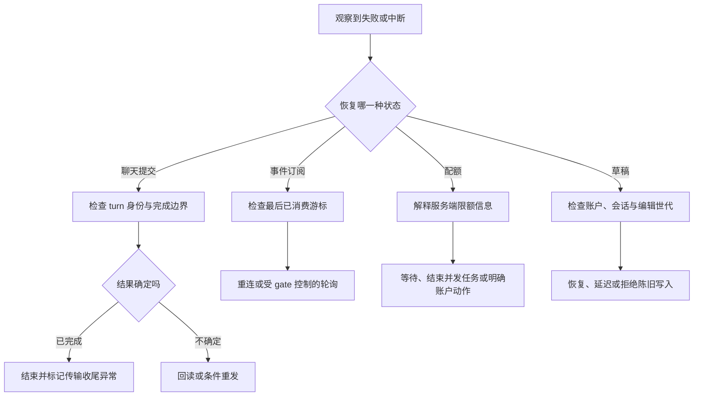
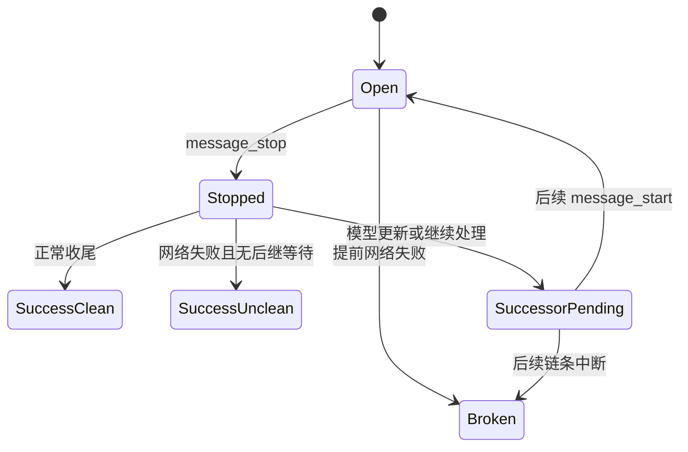
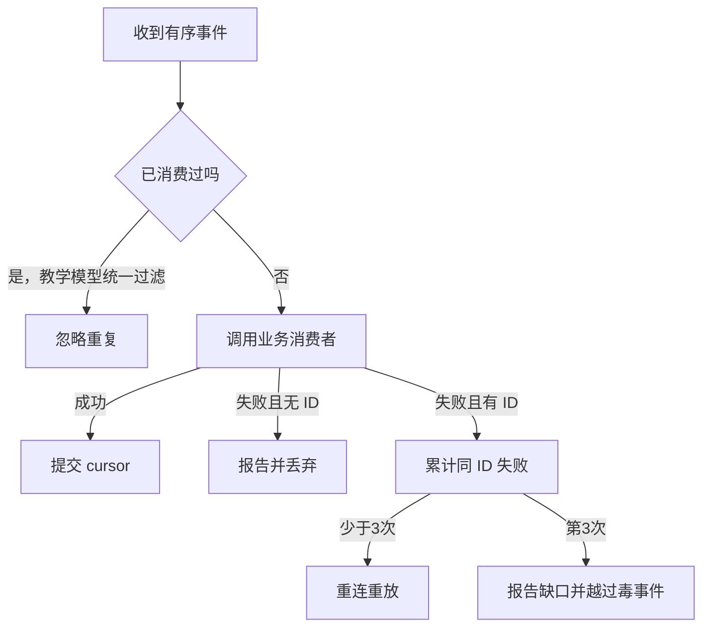
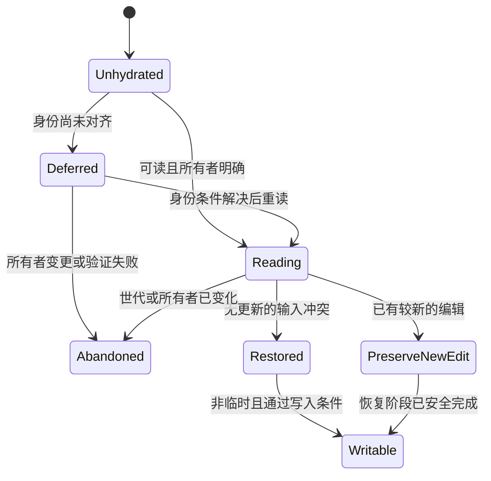

# 第 16 卷：Resilience & Quota——失败之后，先弄清哪些事情已经发生

版本范围：Desktop Linux amd64 2.37337.1 的选定聊天、Code/CCR 事件订阅与草稿恢复路径。

网络断了，用户最关心的通常不是错误码，而是三件事：我的话有没有送出去？回答还会不会回来？我刚才写的内容还在不在？

这三件事分别属于提交、交付与本地编辑状态。把它们压成一个 `error: true`，很容易制造两种相反的事故：明明已经完成，却自动再做一次；明明没有完成，却把输入清空并显示成功。

本卷的主线是：**恢复首先是一种事实判断，其次才是一种重试算法。** 指数退避只是工具之一。消息身份、完成边界、游标、持久化回读、配额解释和草稿所有权，决定了这个工具何时可以使用。

## 1. 一次故障，至少有五种不同的恢复对象

| 恢复对象 | 要回答的问题 | 常见动作 | 不应混为一谈的动作 |
|---|---|---|---|
| 尚未建立的传输 | 请求能否连接到服务？ | 重开连接、退避 | 假定服务端没有执行 |
| 已提交的一轮聊天 | 同一轮是否已经被接收？ | 复用身份、回读对账、有限重发 | 新建另一轮来掩盖失败 |
| 持续事件订阅 | 从哪一条事件继续？ | 游标重连、重放、轮询 | 再提交原任务 |
| 账户/模型配额 | 哪个资源窗口阻止继续？ | 显示重置时间、并发说明、账户动作 | 把所有 429 当作短暂断网 |
| 本地未发送草稿 | 这份内容属于哪个账户、哪个编辑器世代？ | 条件恢复、延迟 hydration、保留新编辑 | 把旧磁盘值无条件覆盖到新输入 |

桌面壳层的页面 reload、renderer/GPU 恢复、配置文件修复与更新，由卷十七讨论。本卷不把那些恢复预算叠进聊天请求的预算；否则会产生“重试了三次”究竟指网络、页面还是进程的歧义。



classic completion 的重试执行器、CCR 订阅循环、配额展示处理器与草稿 store 各自拥有状态；恢复动作必须在对应层内判断和推进。[RQ-01–04、28–34、36、48]

## 2. 失败分类先于重试次数

### 2.1 expanded 的分类器有明确排除项

用于 expanded 及部分传输判断的所选分类器识别网络错误、服务端通用错误与过载错误。但它没有采用“所有异常都重试”的规则。

| 输入情况 | 所选分类结果 | 解释边界 |
|---|---|---|
| 特定断流哨兵、已识别的网络 TypeError | network | 不是所有 JavaScript TypeError 都代表网络 |
| API 错误的 overload 类型 | server.overloaded | 与普通 5xx 分开计数与等待 |
| 其他符合条件的 5xx | server.generic | 不把客户端请求修正问题算进来 |
| HTTP 429 | 不进入该自动重试分类 | 后续可进入配额展示；不等于完全没人处理 |
| HTTP 409 或容器占用错误 | 不进入该自动重试分类 | 另有冲突、对账与界面处理 |
| 其他 4xx | 不进入该自动重试分类 | 重新发相同错误请求通常不能改变条件 |
| AbortError | 退出 | 用户取消不能被后台重试复活 |

这里的“API 错误”指分发包自己的错误类型，不是只读取一个随意对象的 `status` 字段。分类器还按先后顺序排除了部分冲突，不能只搜索 `>=500` 就总结全部条件。[RQ-03]

### 2.2 同样是 429，不同产品路径可以有不同策略

公开 Claude API 文档将 429 与限流/用量限制联系起来，并描述官方 SDK 对部分暂时性错误的重试。那是公开 API 与 SDK 的契约，不能直接覆盖应用内 classic completion 的实现。此次静态证据恰好显示：classic 的 expanded 分类器排除 429，而另一条 CCR 事件订阅路径会处理 429 的 `Retry-After`。[官方 API 错误文档](https://platform.claude.com/docs/en/api/errors)、[RQ-03、31]

还要保留模式差异：legacy/emergency 的分类器只检查 API 错误是否为 overload 类型，并没有复制 expanded 的状态码排除表。因此不能把“任何模式都绝不重试 429”当作已证实保证。实验用人为组合的 overload 类型与 429 状态验证这一优先级，不声称服务端真实产生过这种组合。[RQ-03–04]

**错误分类取决于操作语义、恢复责任与 HTTP 状态码。** 持续读取事件的 GET 订阅，与可能创建一轮回复的 POST，拥有不同的恢复风险。

## 3. 四种重试模式，必须继续追到调用者

### 3.1 模式选择有优先级

已核实的 classic 聊天 hook 读取配置后选择模式，优先级如下：

1. 禁用重试的条件成立：`off`
2. 否则，紧急模式条件成立：`emergency`
3. 否则，消息幂等相关 gate 成立：`expanded`
4. 否则：`legacy`

如果禁用和紧急两个条件同时成立，禁用优先。如果紧急和 expanded 条件同时成立，紧急优先。这比“有一个 expanded 开关”更准确，因为可用性事件期间的总开关可以覆盖常规策略。[RQ-01]

hook 将模式、每轮预算与遵守声明等待的选项传入流处理器。还有一层独立的 `networkRetryOnOpen`，在这个调用者中只对 legacy 开启。它包装打开连接时的 fetch；不能把其尝试次数悄悄当成外层 completion 执行器的同一计数。[RQ-02]

**范围限制：** 这些分支证明可达的条件逻辑，不证明本次研究账户、全部用户或所有平台实际启用了哪个 gate。

### 3.2 策略表中的次数是失败上限，包含第一次调用

以下是所选工厂的配置，延迟单位为毫秒。基准等待指没有继承失败、没有服务端额外等待时，第一次失败后准备再试的名义值。[RQ-04–06]

| 模式 | 错误类别 | 配置失败上限 | 初始等待 | 乘数 | 对称抖动 | 指数封顶 |
|---|---|---:|---:|---:|---:|---:|
| off | 无 | 无自动重试 | — | — | — | — |
| legacy | overload | 10 | 5,000 | 1.5 | ±10% | helper 默认 10 |
| expanded | network | 声明为 30，另受升级逻辑约束 | 500 | 2 | ±10% | 4 |
| expanded | generic server | 2 | 8,000 | 1.5 | ±15% | helper 默认 10 |
| expanded | overload | 5 | 8,000 | 1.5 | ±15% | helper 默认 10 |
| emergency | overload | 3 | 45,000 | 2 | ±20% | 2 |

“失败上限 10”在持续失败的单类别情形中，意味着总共最多 10 次外层调用，最多 9 次重新调用。写成“重试 10 次”会多算一次。

模式名称也不应被解释成产品承诺。例如 emergency 并非“更积极地救回来”：它只覆盖过载，等待更长、失败预算更小，体现的是减少持续压力的方向。

### 3.3 为什么 `maxAttempts: 30` 并不等于连续重试三十次

expanded 的循环不是直接执行配置表。它先记录分类次数；当网络类别已经累计三次失败，下一次网络错误会转入 generic server 类别，而这个类别的失败上限是 2。[RQ-07]

在继承失败数为零、没有其他错误类别、每次调用都遭遇网络错误的前提下，推导轨迹如下：

| 外层调用 | 原始错误 | 实际预算类别 | 类别失败数 | 后续动作 | 名义等待 |
|---:|---|---|---:|---|---:|
| 1 | network | network | 1 | 再试 | 500 ms |
| 2 | network | network | 2 | 再试 | 1,000 ms |
| 3 | network | network | 3 | 再试 | 2,000 ms |
| 4 | network | generic server | 1 | 再试 | 8,000 ms |
| 5 | network | generic server | 2 | 终止 | 无 |

所以是 **5 次失败调用、4 段等待**。零抖动时总等待为 11.5 秒，另加每次请求本身的耗时。它不是“11.5 秒内必定完成”，也不是所有 expanded 错误混合序列的统一上限。

这个推导已由原创模型的确定性测试覆盖。它解释控制流如何改变常量的含义，并未实际对 Claude 连续制造五次断网。


混合错误还需要分别维护各类别计数。执行器另有 50 次外层调用的防失控保护，它是防御性保险，不应拿来介绍为正常重试预算。[RQ-09]

## 4. 退避数学：次数、指数与墙钟时间是三个量

### 4.1 延迟封顶实际上封的是指数

所选 helper 计算：

```text
nominal = initialDelay × factor ^ min(exponentCap, previousAttempts)
delay   = floor(max(0, nominal × (1 + jitter × (2u − 1))))
```

其中 `u` 来自均匀随机数。这个 helper 的参数名也叫 `maxAttempts`，但在这里它限制指数，不限制调用次数。外层循环才决定是否继续。[RQ-05–06]

以 network 的 500ms、乘数 2、指数 cap 4 为例，基准序列到 8,000ms 后不再继续指数增长。可是上一节已经看到，纯网络失败会先转入另一类预算。因此“network 等待最终到 8 秒”只是该 helper 的局部性质，不等于纯网络序列一定在原类别中走到那个档位。

### 4.2 抖动解决同时醒来，不解决业务幂等

如果一万台客户端同时遇到过载，并且都固定等待 8 秒，它们可能在第 8 秒再次同时到达。随机等待把下一波请求分散在区间中。expanded generic 的初始等待区间约为 6.8–9.2 秒。

但抖动只改变时机，不改变“这次请求会不会重复执行”。同一个副作用做两次，即使间隔被随机化，仍然是重复。预算、抖动、幂等与对账分别回答不同的问题。

### 4.3 服务器声明等待与本地退避不相加

classic 的所选 helper 读取两类信息：

- 错误详情中有限数值的 `retry_after`，解释为秒
- HTTP 529 时，从一个 Headers 对象读取正的有限数值 `retry-after`

二者取较大正值，再把输入的声明等待限制为 120 秒。这里的 header helper **没有**实现 HTTP-date 形式；后面 CCR 的 parser 则有。[RQ-10–11]

本地指数等待与声明等待通过并行等待组合，所以整体等待由较长者控制，而不是两者相加。继续等待时，声明值还可叠加最多约 10% 的正向抖动。因而“输入先 cap 120 秒”不等于“本次最终等待绝不会超过 120 秒”。[RQ-12–13]

例如，本地等待为 8 秒、服务器声明 20 秒，结果应由约 20 秒及其正向抖动控制，而不是约 28 秒。

### 4.4 长等待可以交还控制权

当每轮预算选项开启，且被采用的过载声明等待超过 60 秒，所选循环可以立即停止内部重试，并记录相应等待状态。等于 60 秒不触发这个严格大于判断。[RQ-13]

另一个容易漏掉的条件是：流处理器只在 retry-completion endpoint 模式下，把“遵守声明等待”的开关传为真；另行传递的“保留声明等待”不是同一个条件。[RQ-14]

因此不能把本节概括成“所有 Claude 发送都遵守 Retry-After”。正确结论必须带上类别、模式、endpoint 和 gate。

对自建系统，建议把服务器要求的最早重试时间作为独立 deadline；如果前台不愿等待这么久，就进入可解释的等待状态。不要为了保持按钮活跃，擅自把对端要求的一小时压成一分钟。这是设计建议，不是对目标实现全部路径的描述。

HTTP 标准允许 Retry-After 使用延迟秒数或 HTTP 日期，也强调非幂等请求的自动重试需要额外语义依据。对接口实现而言，应明确支持的形式和重放契约。[RFC 9110 §9.2.2、§10.2.3](https://www.rfc-editor.org/rfc/rfc9110.html)

## 5. 跨发送的失败历史：避免“点一次按钮就恢复全部预算”

### 5.1 失败历史是一份短期记录

所选 backoff 记录包含版本、连续失败数和最近失败时间；按条件携带错误类别、会话 UUID、建议等待、声明等待截止时间与模型。常量包括五分钟有效期、最多保留 15 次失败以及两分钟的声明等待范围。[RQ-15–18]

这些字段不是聊天正文，也不是一份 durable job queue。它们的用途是让新的尝试知道刚刚发生过的失败，避免刷新状态或重新按发送时总从最轻的等待开始。

记录也有条件：执行器只在相应可重试失败路径记账；用于条件 resend 的内部断流哨兵不会再次写入这份失败历史。不能把它描述成全局收集所有异常的计数器。[RQ-18]

| 状态 | 局部规则 | 工程意义 |
|---|---|---|
| 连续失败计数 | 符合记账条件的新失败递增并封顶 15 | 不让计数无限增长 |
| 新鲜度 | 最近失败距现在小于五分钟 | 很久以前的故障不永久惩罚现在 |
| 时间戳 | 有限非负并限制异常未来时间 | 损坏数据不能制造任意遥远等待 |
| 写入位置 | 优先 localStorage，失败后 sessionStorage | 浏览器存储失败不应令错误处理本身崩溃 |
| 双份记录 | 比较最近失败时间，尝试把新 session 记录提升至 local | 恢复能力时收敛到共同位置 |
| 成功 | 启用重试的执行成功后清两处记录 | 真正恢复应解除历史负担 |

parser 也会忽略无效可选字段；“整个 JSON 能 parse”不等于“其中所有元数据都可信”。[RQ-16–19]

### 5.2 继承有两种效应，不能混写

第一种是**抬高等待档位**：本次执行捕获历史失败数，并把最多四次历史失败加入等待指数的偏移。

第二种是**减少剩余失败预算**：需要同时满足外层每轮预算选项、schedule 显式支持，以及历史错误类别匹配。在所选配置中，是 legacy overload schedule 显式设置这一项；不能因为参数名叫 per-turn，就认为 expanded 的三个类别都统一扣减历史计数。[RQ-08]

例如，legacy overload 原上限为 10，继承同类别 8 次失败且启用扣减后，本次最多容纳 2 次失败。若继承的是不同类别，仍会影响等待偏移，但不触发相同的类别预算减法。

### 5.3 会话字段不代表存储按会话隔离

该历史使用一个 versioned key，而不是每个 conversation 一个 key。记录内有 conversation UUID，并不能据此宣称读取失败历史时按会话分别计算。本次读到的继承 helper 直接取得该共享记录的失败数与类别。[RQ-15、18]

同样，storage 事件和本页订阅者广播提供的是通知机制。localStorage 的“读旧值、加一、再写回”并非跨标签页事务；这份静态代码不能证明多个 tab 的失败计数不会竞争，也不能证明它是一个跨进程的严格全局限流器。[RQ-20]

**协作状态与互斥状态需要分别设计。** 通知让其他 tab 得知变化；要避免预算被重复消费，还需要原子的预算更新。对于高成本请求，还需要服务端身份与配额控制。

## 6. 最容易多做一次的地方：已经完成，网络才报错

### 6.1 内容完成与传输干净关闭是两个布尔量

所选流处理器收到 `message_stop` 后记录停止状态。若随后发生已识别的网络错误，而且没有等待中的后续消息/切换，它会把这类错误转成专门的“完成但收尾不干净”结果。[RQ-23]

执行器返回的关键差异是：

```text
正常结束：       completion succeeded, closedCleanly = true
终止帧之后断网： completion succeeded, closedCleanly = false
```

第二种情况不能直接当作普通失败去重发。否则用户可能先看见完整回答，随后又收到一个重复回答，或者引发本不需要的重新生成。

但这个抑制条件也不是“曾经收到任意 message_stop 就永远成功”。流中可能在停止后收到模型更新或继续处理信号，形成等待中的后继状态；这种情况下不能用前一个 stop 掩盖后续链条的中断。[RQ-23–24]



把 `closedCleanly` 与业务完成分开，也让后续缓存对账能更保守。成功并不自动证明所有关联元数据都已完整交付；传输异常也不自动推翻已收到的完成边界。

### 6.2 “没收到 stop”何时允许条件重发

所选 reconnect-resend 至少需要：

1. expanded 模式
2. 不是 detached 调用
3. 请求已有 human 或 assistant turn-message UUID
4. 单独的 reconnect-resend gate 开启
5. 当前未取消
6. 曾观察到 message_start
7. 流返回后仍有后继等待，或既未停止、也没有 stop reason

满足条件时，代码制造一个可分类为网络的断流信号，交还外层重试执行器；下一次尝试重新整理本地内容缓冲。[RQ-21–22]

这些条件将“第一次提交任务”与“以稳定消息身份接回这一轮”分开。服务端幂等键的持久化方式、保留期限及工具副作用的事务范围，仍需独立核实。

**本研究不做以下推断：** 有 `turn_message_uuids` ⇒ 全链路 exactly-once；重发同一 body ⇒ 工具只执行一次；聊天消息去重 ⇒ 文件修改、支付或外部消息也在同一事务中。

### 6.3 用一个原创反例理解身份的重要性

实验中的模拟服务端保存 `turnId → payload + result`。以下片段以 `04-Extracted-Core-Code-And-Scripts/resilience-quota/` 为工作目录，保存为 `.mjs` 后运行，或使用 `node --input-type=module`：

```js
import { IdempotentServer } from './recovery-state.mjs';

const server = new IdempotentServer();
server.submit('turn-1', '整理会议记录'); // 服务端已提交，假设回包丢失
server.submit('turn-1', '整理会议记录'); // 返回既有结果
console.assert(server.executions === 1);
```

若第二次生成新的 turn ID，模拟服务端会执行两次。若同一个 ID 携带不同 payload，则抛冲突。这个小模型演示的是一种可以被验证的契约，**不是对 Claude 服务端的复刻或逆向证明**。

真正设计接口时，还需回答：身份作用域是什么？过期窗口多长？第一次请求仍在运行怎么办？返回缓存结果还是让客户端订阅？附件发生变化是否仍算同一请求？哪些外部副作用不在 dedup 事务里？

## 7. 不确定是否提交成功时，先回读事实

### 7.1 所选代码存在有界的持久化探测

classic hook 还有一个读取会话树、寻找 client message UUID 的 helper。它使用相对起点的绝对偏移：1.5、3、5、8、12、16、20 秒。[RQ-25]

这是“在第几个时间点读”，不是依次睡 1.5+3+5+8+12+16+20 秒。如果前一次读取已经花了很久，过期的中间读点可能被跳过；最后读点保留检查机会。因此，也不能描述成“必定读取七次”。

helper 返回 `persisted`、实际读取次数，以及 aborted、absent 或 read_failed 等状态。遇到某些不可继续的读取错误也会提前退出。

### 7.2 探测的调用条件同样重要

已打开 stream，但还没有拿到 assistant 身份、没有最终停止原因，遭遇指定传输错误且不是已知离线，并且有人类消息 UUID 时，一条 gated 路径可以先做回读。它排除编辑与后台探测，inline conversation create 还需要额外条件。[RQ-26]

另一条 gated 路径用于自动 open retry 之后的容器占用错误，也要求还没有 assistant UUID、有人类 UUID，并排除 create、edit 与后台场景。[RQ-27]

若发现该人类消息已经持久化，UI 可以转为等待既有工作恢复的状态，而不是立即把输入重新解释为一个从未发送过的新任务。

这里读到人类消息只证明“提交的这份记录可见”，不证明回答已经生成完毕。**回读事实的强度必须与恢复动作的强度匹配。** 发现输入存在，可以支持继续等候；不能据此显示答案已成功完成。

对自建产品，一个很有用的错误状态是“已发送，仍在确认结果”。它比一律报“发送失败，请重试”更接近真实系统状态，也更不容易诱导用户重复提交。

## 8. Code/CCR 事件订阅是另一套恢复协议

### 8.1 游标续订，不是 classic 聊天任务重发

选定 CCR 订阅函数的工作对象是事件流。调用者传入初始 sequence number，订阅层把游标写进请求参数及 `last-event-id`，并在重连前重建 header，避免残留的旧 header 覆盖当前进度。[RQ-28–29、34]

这与 classic completion 的 turn-message UUID 不同：

| 身份 | 表示什么 | 恢复用途 |
|---|---|---|
| turn message UUID | 一轮交互中的消息身份 | 提交去重、持久化回读、消息对账 |
| event sequence / cursor | 事件日志中的交付位置 | 从已消费位置继续订阅 |
| completion request ID | 一次请求/关联追踪身份 | 诊断关联；不能独自证明业务幂等 |

“带上 last-event-id”不等于“再次提交用户任务”。同样，网络库通用地支持 last-event-id，也不能证明 classic completion 在所有中断条件下都具备服务端事件重放。

### 8.2 空连接、长时间无交付与轮询退路

CCR 的局部常量包含 35 秒 idle restart、最高约 30 秒的随机指数重连等待。两次被 idle 机制中止且没有交付任何 frame 的尝试，可以触发受配置控制的 poll fallback。[RQ-28、33]

这里的“空”是 frame 计数层面的空，不宜泛化为“没有业务文字”。一个只返回心跳/控制帧的连接，与完全没有 frame 的连接，不一定触发相同条件。

调用者实际提供了 `pollFallback.isEnabled()` 和可配置间隔。所见调用者的默认间隔是 10 秒；底层没有拿到有效间隔时另有自己的默认与上下界。因此只读底层常量，可能把实际默认误写成五分钟。[RQ-34]

轮询读取事件页，维护 resume cursor，并可以在有下一页时立即继续。遇到部分超时情形会缩小页大小，正常路径再向上恢复。轮询段在约三分钟后重新给 SSE 一次探测机会；它不是“进入 poll 后永远不再尝试 stream”。[RQ-33]

三分钟是循环检查预算，也不是严格的墙钟上限：已经开始的请求及等待可能跨过该检查点。

### 8.3 410 的恢复语义受路径约束

在 SSE 打开失败的处理分支中，HTTP 410 会清除游标并重新连接。它可以表示旧续订位置不再适用，而不是需要无限使用同一个 cursor 重试。[RQ-30]

但不能说“CCR 所有 410 都自动 reset”：poll 错误分支按自己的 4xx 规则分类，本次没有同样的专门 reset 分支。限定在哪一个 transport 的哪一个回调中，才是可复核的事实。

### 8.4 Retry-After 支持更广，但也有实现 cap

CCR parser 同时接受数值秒数与 HTTP 日期，日期过去时得到零等待。其 SSE 重新等待会受 30 秒 cap 约束；poll 等待有五分钟 cap。[RQ-31]

因此，若服务端给出比 cap 更长的值，不能把这里概述成“完整保留服务端最早重试时间”。这是一项静态实现边界，需要在接口测试中覆盖，不能用“支持 Retry-After”四个字代替。也不要把本实现的 cap 当作通用 HTTP 最佳实践。

## 9. 毒事件：一直重放同一条，系统就永远走不出去

### 9.1 接收成功不等于消费成功

假设事件 107 已经从网络拿到，但交给业务 reducer 时抛错。如果在调用 reducer 前就把 cursor 改为 107，重连时可能跳过尚未成功应用的事件；如果永远不推进 cursor，又可能陷入 107 的无限重放。

所选 CCR 消费逻辑把这种情况显式化：[RQ-32]

| 情况 | 行为 |
|---|---|
| 无 sequence ID 的坏事件 | 丢弃并报告无法定位 |
| 有 ID，第一次消费失败 | 重新连接/重放，不先承认成功 |
| 同一 ID 第二次失败 | 再给一次重放机会 |
| 同一 ID 第三次失败 | 标为 skipped poison，推进游标 |
| 后续带已识别序号的事件成功消费 | 清除相应失败追踪并继续；无 ID 成功事件不据此清零 |

这是一种可用性与完整性的权衡：第三次之后继续前进，意味着有一条事件没有被应用。错误信号中保留 disposition、strikes 与 sequence，才能让上层知道发生了跳过，而不是悄悄假装整条日志完整。

### 9.2 重放协议必须定义缺口修复

本书的原创 cursor 模型覆盖三次失败后跳过、无 ID 丢弃、成功后 ack、重复事件过滤和 410 风格 reset。为了方便教学，它对所有输入都统一做 sequence 去重；目标源码中明确核实到的 `<= cursor` 过滤位于 poll 路径，不能把实验的统一过滤反过来宣称为目标 SSE 的全部行为。

一个生产级系统在跳过毒事件后，可以选择拉取快照、标记当前视图不完整或提示刷新。究竟选哪种取决于事件是否可再生、是否有完整快照，以及跳过会不会丢失用户不可重建的数据。本次静态研究不证明服务端或所有消费者一定执行了这些修复。



## 10. 配额是多维的，不能只画一个“剩余消息数”

### 10.1 公共产品语义与客户端字段互相补充

公开帮助文档区分用量限制与单次对话长度限制，并说明付费计划具有五小时与每周用量窗口。模型、对话复杂度与功能等会影响用量，不能从前端几条文案推导出一个永久固定的“每五小时 N 条消息”。[用量与长度限制说明](https://support.claude.com/en/articles/11647753-how-do-usage-and-length-limits-work)

本包中实际出现的配额展示维度包括：

- `five_hour` 与 `seven_day` 代表窗口
- `concurrents` 代表同时运行数量
- 模型专属限额
- overage 是否可用、为什么被禁用
- 是否需要 credits、是否允许购买、是否存在可收费的保存支付方式
- approaching 与 exceeded 状态
- reset 时间、首次触达说明及其他有条件元数据

这些数据由服务端错误或 `message_limit` 事件携带，客户端负责归一化和选择展示路径。不能由它们推导完整计费公式或服务端额度算法。[RQ-35–40]

### 10.2 并发用尽和时间窗口用尽需要不同建议

`concurrents` 分支对应的意思是：当前同时运行的回复过多，可等待已有工作完成或停止其中一项再尝试。这里需要释放并发槽位，而不是盲目显示“五小时后再来”。[RQ-38]

对 `five_hour` 或 `seven_day`，可用 reset 时间指导等待；对模型专属或 overage/credits，可能需要进入更具体的账户展示路径。处理器还区分 thinking-specific 错误与 Opus-specific 错误，后者在此处会重新抛给外层，不能认为所有限额都被同一个 toast 吃掉。[RQ-36–39]

| 限制问题 | 用户真正需要知道什么 | 错误的统一做法 |
|---|---|---|
| 同时任务过多 | 哪个已有工作占用并发、何时可再试 | 自动换模型或长时间倒计时 |
| 时间窗口耗尽 | 服务器给出的重置时间 | 每秒无限重发 |
| 模型单独受限 | 哪个模型受影响、是否有明确可选项 | 悄悄降低模型并假装无变化 |
| overage/credits | 是否允许、为何不可用、具体账户动作 | 仅凭“有付款方式”自动付费 |
| 上下文长度超限 | 当前输入/会话需要缩减或另开 | 等配额窗口刷新 |

这张表后两列是设计分析，不是全部目标 UI 的逐像素复刻。

### 10.3 限额展示还有“控制面尚未更新”的解释

所选处理器保存组织级的最近计划成功标记，期限为五分钟。在五小时/七天 exceeded 情形中，若没有首次触达、tier override、特定模型/overage/credits 等排除条件，并且标记吻合，它可以采用“新计划用量限制仍在更新”的说明。[RQ-37、40]

这个细节揭示配额错误有时来自两个状态传播速度不同：账户动作已经成功，但后续请求看到的限额状态还没一致。正确 UI 可以解释传播延迟，但不能仅凭这份本地标记就允许越过服务端配额。

### 10.4 公开 API 的 RPM/TPM 不等于订阅应用的五小时窗口

公开 API 限流文档描述请求与 token 维度、特定限制和等待信息。把这些规则直接当作 Claude App 的订阅用量算法，会混淆产品边界。本卷只用公开文档解释区别，不利用文档补造客户端中不可见的 quota 数学。[公开 API 限流文档](https://platform.claude.com/docs/en/api/rate-limits)

## 11. 模型 fallback 必须拆成三种事情

### 11.1 流里收到模型变化事件

`model_fallback` 与 `model_update` 在所选流消费者中进入同一个处理分支，附带“本次尝试的第一跳”“是否在主要内容之前”等元数据交给 callback。它可能影响当前消息链条的完成判断。[RQ-24]

这证明客户端认识服务端发来的模型状态变化，不证明客户端在配额耗尽时自行挑选便宜模型。

### 11.2 模型不可用后，重新读取账户推荐

另一条独立流程专门识别 model unavailable / blocklisted 类错误。它受 gate 控制，刷新账户数据，使用约三秒的 Promise race，并从账户 chat model-selector 状态里读取一个与原模型不同、存在、未禁用且不属于 legacy/deprecated 的候选。[RQ-41]

这不是“把模型 ID 按大小排序，自动向下找一个”。候选来自账户状态与配置，而且超时处理后仍可能读取已有缓存；本地看到候选不意味着这次刷新一定取得了最新服务端事实。

### 11.3 展示切换入口，不等于授权所有自动降级

现有会话中的所选路径恢复失败输入相关数据，并显示一个用户触发的切换动作；首次创建还有另外的恢复与记录流程。[RQ-42]

这条恢复流程针对模型不可用错误，受 gate 与状态条件约束，并提供用户触发的切换入口；其他 rate-limit 情形是否切换模型，需要分别核实。

对自建助手，模型变化涉及用户预期、能力、成本与已选参数。恢复目标不只是“让任何回答出现”，还要让用户知道他们得到的是否仍是原先选择的执行条件。

## 12. 草稿镜像：快速恢复需要更小的数据投影

### 12.1 一个轻量 mirror 与完整编辑器 store 并存

包内的 static composer draft mirror 是一份小型本地投影。它包含账户、会话标记、更新时间和附件/文件计数，并尝试保存可简化的纯文本。[RQ-43–46]

纯文本条件比“拿 rich text 的 textContent”严格：

- 文档必须是 doc
- 内容块必须是 paragraph
- 段落内部必须是 text 节点
- 不接受有 marks 的文本节点
- 节点内部不带换行；段落之间由 mirror 统一插入换行

若不满足条件，保存 `not-plain-text` 的省略原因，而不是把富文本偷偷展平。若文本过大，则记录 `exceeds-capacity`。

**省略 mirror 的 text 不等于删除完整草稿。** 完整编辑器持久化有自己的 store、migration、附件引用与队列状态。mirror 可服务于快速起始展示，但不是完整编辑器文档的唯一真相。[RQ-48]

### 12.2 4,096 的单位是写入时的 UTF-8 字节

write path 用 TextEncoder 检查 4,096 字节。这个数字不能写成“4,096 个汉字”或“4,096 个字符”。[RQ-44]

| 测试文本 | JavaScript string.length | UTF-8 字节 | 能否进入 mirror text |
|---|---:|---:|---|
| 4,096 个 ASCII 字符 | 4,096 | 4,096 | 可以 |
| 1,365 个“中” | 1,365 | 4,095 | 可以 |
| 1,366 个“中” | 1,366 | 4,098 | 省略 |
| 1,024 个 😀 | 2,048 | 4,096 | 可以 |
| 1,025 个 😀 | 2,050 | 4,100 | 省略 |

低层 read parser 则检查 `text.length <= 4096`，这是代码单元长度，并不与写入 byte cap 完全相同。[RQ-46]

本书实验刻意在读写两侧都用 UTF-8 字节检查，属于更严格的教学选择。不能因为实验这么实现，就把目标 read parser 描述成相同的字节校验。

### 12.3 owner 与 session 是恢复前提

写 mirror 时，需要记录过账户所有者、有会话标记，并确认当前标记与记录标记吻合。若写入是排队后发生，还检查入队时的 owner 是否已经变化。读 mirror 时也要求账户与 session 同时相等。[RQ-45–46]

这解决了一个很真实的竞态：A 账户输入了一段文字，异步写入排队；用户切换至 B 账户，旧回调才执行。如果只看“现在 localStorage 可写”，A 的文字可能进入 B 正在使用的初始界面。

但这些检查属于逻辑所有权，不是加密。静态代码不能据此证明 localStorage 内容被端到端加密、能抵抗同源脚本，或允许任意脚本安全读取。

## 13. hydration 的危险时刻：空内存覆盖有价值的磁盘内容

### 13.1 初始化、恢复完成与允许写入应分别表示

完整编辑器 store 有 `_hasHydrated`、恢复是否待决、附件 blob 是否完成拼接等多个状态；创建时还可接受推迟 hydration、禁止恢复、URL/种子文档等条件。[RQ-47–49]

为什么不直接“建立 store，然后马上开始持久化”？

```text
t0  内存 store 初始化为空
 t1  异步磁盘读取尚未返回
 t2  store 订阅认为状态改变，把空值写入磁盘
 t3  读取拿到被覆盖后的空值
```

这是一个恢复代码自己制造的数据丢失窗口。所选代码在恢复被抑制、hydration 未解决、seed/卸载等状态下控制 setItem；部分排队内容还会主动触发延迟的 hydration。[RQ-49]

### 13.2 旧读取也不能覆盖用户刚输入的新内容

另一种竞态与上面相反：

```text
t0  开始读取旧草稿 A
 t1  用户已经输入新草稿 B
 t2  A 返回
 t3  直接 assign(A)，B 消失
```

目标实现包含 seed 优先级、merge、暂存输入与重新读取等较复杂处理。本书不把它简化为一句“最后写入者赢”。原创实验采用更容易验证的编辑 revision：开始读取时记录 revision，返回时如果已经有新编辑就保留新输入。

此片段同样在 `resilience-quota/` 目录中按 ESM 运行：

```js
import { DraftHydration } from './recovery-state.mjs';

const draft = new DraftHydration({ account: 'a', session: 's' });
const ticket = draft.begin();
draft.edit('读取期间新写的内容');
const outcome = draft.restore(ticket, '磁盘上的旧内容');
console.assert(outcome === 'kept-new-edit');
```

这是设计重构示例，不是从包中逐行复制的算法。

### 13.3 帐户变更、临时会话与旧清理回调

restore guard 可以因为缺失 session marker、session 不符、确认后的账户不符或 marker 有歧义而延迟恢复。后续继续检查时还可能放弃，避免从未确认身份的旧空间里读出文本。[RQ-47]

完整 store 对 temporary conversation 另有写入抑制/释放处理。附件引用的延迟清理还会查看实例世代，避免旧编辑器的延迟回调清理新实例仍在使用的数据。[RQ-48、50]



本图是按风险整理的教学状态机，不是目标组件所有布尔变量的一对一图解。其价值是把“什么时候不能覆盖”变成可审查的条件。

## 14. 原创实验：把恢复设计写成可失败的测试

实验目录是 [resilience-quota](../../04-Extracted-Core-Code-And-Scripts/resilience-quota/README.md)。全部代码原创，无第三方运行依赖，不导入目标 bundle，不访问网络，不创建真实聊天或账户数据。

从本书根目录 `books/claude-app/` 执行：

```bash
cd 04-Extracted-Core-Code-And-Scripts/resilience-quota
node --test --test-reporter=tap test/*.test.mjs
node demo.mjs
```

### 14.1 模块与职责

| 文件 | 教学对象 | 刻意未声称覆盖的内容 |
|---|---|---|
| resilience-core.mjs | 模式选择、类别预算、退避、声明等待、终态判定、可取消等待 | 真实 fetch、目标错误类、所有嵌套网络重试 |
| recovery-state.mjs | 短期失败记录、cursor、mirror、hydration、quota 分派 | 完整 rich-editor merge、IndexedDB、跨设备同步 |
| IdempotentServer | 提交后丢回包的去重契约示例 | Claude 服务端实际幂等事务 |
| demo.mjs | 五次网络失败轨迹、毒事件、超大 mirror | 真实用户流量、服务端故障时序 |
| test/resilience.test.mjs | 原有52项可复现断言 | 目标应用端到端运行正确性 |
| test/boundaries.test.mjs | 新增12项：三时区HTTP日期、同毫秒存储降级/恢复/clear，共64项通过 | 任意存储故障下的持久事务或跨tab一致性 |

### 14.2 关键测试矩阵

| 失败场景 | 测试确认的结果 |
|---|---|
| disabled、emergency、idempotency 同时存在 | 模式优先级明确 |
| 400/401/403/404/409/429 | 不误入 generic 自动重试 |
| expanded 持续网络错误 | 第四次改计 generic，第五次停止 |
| legacy 继承 8 次相同错误 | 本次只剩 2 次失败预算 |
| 不同类别的继承 | 影响等待，不误扣类别预算 |
| 服务器声明 20 秒、本地退避较短 | 采用较长等待，不相加 |
| 声明等待 60,000 与 60,001 ms | 严格边界被覆盖 |
| 等待期间取消、等待前已取消 | 不留下活跃长定时器 |
| message_stop 后断网 | 完成但 unclean；后继待决时不误抑制 |
| 任一 resend gate 缺失 | 不进入条件重发 |
| localStorage 写失败 | 可退至 session；恢复后可提升 |
| 两种 storage 都不可用 | 返回无法保存而不崩溃 |
| 五分钟、15 次失败边界 | TTL 与 cap 被覆盖 |
| 同一毒事件三次失败 | 有界重放后继续前进 |
| 中文/emoji 接近 4,096 byte 边界 | 单位不会误用为字符数 |
| 恢复期间输入新文字 | 保留新编辑 |
| 恢复期间切换账户 | 拒绝旧恢复票据 |
| 同一 ID 复发、不同 ID 复发 | 模拟服务端分别执行一次、两次 |

还以 1,001 个确定性随机输入验证 jitter 区间。这类属性式断言比只检查一次随机结果更可靠，但不构成统计意义上的分布检验。

### 14.3 测试与源码之间保留差异表

实验使用可读名称与显式类，避免照搬 minified 闭包。其 Retry-After parser 更严格；cursor 统一去重；mirror reader 也实施 byte cap；hydration 使用简化的编辑 revision；失败 ledger 保留版本、时间、计数及持久顺序字段，用零计数墓碑表达逻辑clear。HTTP日期支持三种规范形式并按UTC解释，RFC850使用50年规则。ledger限定单逻辑写者、非倒退时钟且能读取最新记录；stored:true只表示至少一次存储写入成功，不保证读故障下的计数与clear排序。所有这些差异都在 README 与证据清单中列出。

源码观察与教学实验分别回答两个问题：目标版本实现了什么，以及某项设计性质能否独立验证。

### 14.4 两个时间边界的完整反例

[两个看似相同的时间，为何改变恢复结果](clock-and-storage-boundaries.md)：从纽约时区下20秒变为5小时20秒的日期解释，到同毫秒旧记录遮住新记录，沿着输入、决策与修补逐步解释。包含前后对照、clear墓碑图与可运行测试。

## 15. 评审恢复系统时，优先追问这十二件事

1. 这是连接失败、提交失败、交付失败，还是确认失败？
2. 已经观察到什么完成证据？还能否出现后继消息？
3. 重试的是同一个业务操作，还是新操作？身份在哪一层固定？
4. request ID、message UUID 与 cursor 有没有被混用？
5. 哪些错误必须修正输入、权限或账户状态，继续重试没有意义？
6. 次数是总调用数、额外重试数、分类失败数，还是指数上限？
7. 嵌套重试会不会放大实际网络请求数？
8. 服务端最早允许重试的时间，与本地最长愿意等待的时间如何分别表达？
9. 页面重载、换 tab 或重新点击会不会重置所有预算？
10. 事件消费失败时，何时提交 cursor？跳过后如何告诉上层有缺口？
11. 配额提示是否指向实际受限资源，还是一律写“稍后再试”？
12. 每一个延迟写入、恢复结果和清理回调，是否仍拥有当前账户与编辑器世代？

最好的恢复体验并非所有失败都悄悄自动处理，而是：**能安全继续时继续；结果不确定时核对；需要用户改变条件时说明原因；不该丢掉的输入始终有明确的所有者。**

## 附录 A：证据范围与复核入口

可缩放教学图：[恢复边界](../../assets/figures/resilience-recovery-boundaries.svg)、[expanded 网络失败轨迹](../../assets/figures/resilience-expanded-network-budget.svg)。Mermaid 源另存于实验目录。

结构化文件：[resilience-quota-expansion.json](../../04-Extracted-Core-Code-And-Scripts/evidence/data/resilience-quota-expansion.json)。共 50 条短锚点事实，覆盖 7 个文件；每条带版本范围、文件 SHA-256、零基且末端不包含的字符/UTF-8 字节偏移。长目标源码、原始 bundle 和大体积 REA 输出不随本卷发布。

| 证据编号 | 追踪内容 |
|---|---|
| RQ-01–04 | 调用者模式决策、参数传递、错误分类与策略工厂 |
| RQ-05–14 | 指数/抖动、分类升级、继承预算、声明等待与 endpoint 条件 |
| RQ-15–20 | 短期历史、存储降级、过期、成功清理与跨 tab 通知 |
| RQ-21–27 | 条件 resend、完成后断网、模型事件、回读 helper 及其调用者 |
| RQ-28–34 | CCR cursor、idle、410、Retry-After、poll fallback 与订阅适配器 |
| RQ-35–42 | 限额事件/错误展示、窗口/并发、计划传播与模型不可用恢复 |
| RQ-43–50 | 纯文本 mirror、UTF-8 上限、账户/session、hydration 与世代清理 |

实际调用已安装的 REA 6.5.0，对四个选定模块进行静态分析：解析 4 个 JavaScript 文件、访问 472,122 个 AST 节点、解析失败 0。源选择之外仍有 3,492 个被编目但未在这次 REA 调用中解析的文件。其余 helper 与调用者由惰性文本检查闭合。成功解析不意味着所有控制流已被工具自动证明，更不意味着功能当前上线。

证据 ID：`ev_8ed6418a14d521ec9c0398ae5199219f6c4b34f9b57416c964ea9f6a9bc99905`。

### 明确未得到的证据

- 真实账户的 feature-gate 值与上线比例
- 服务端去重存储、保留窗口、工具副作用原子性
- 真实断网/过载/限额情况下的端到端时序与成功率
- 完整离线编辑、跨设备草稿同步或本地草稿加密保证
- 全产品所有 surface 共同遵守的一份重试/配额 schema

## 附录 B：公开来源

公开资料核对日期为 2026-10-15；版本包事实固定在 2.37337.1，两者不合并成一个无时间边界的结论。

- [RFC 9110](https://www.rfc-editor.org/rfc/rfc9110.html)：§9.2.2 幂等请求与自动重试；§10.2.3 Retry-After。用于协议语义比较。
- [Claude：用量与长度限制](https://support.claude.com/en/articles/11647753-how-do-usage-and-length-limits-work)：用于公共产品概念，未据此编造固定消息额度。
- [Claude API errors](https://platform.claude.com/docs/en/api/errors)：用于公开 API 错误与流中错误比较，不替代应用私有协议证据。
- [Claude API rate limits](https://platform.claude.com/docs/en/api/rate-limits)：用于区分 API 的速率维度与订阅应用的用量窗口。

### 验证对象

本卷研究 Claude Desktop Linux amd64 2.37337.1 分发包中的选定聊天、Code/CCR 事件订阅与草稿恢复路径。证据来自惰性静态分析与调用关系核对，没有启动目标应用、登录账户或请求私有接口。64 项通过的测试（原52项及新增12项边界回归）运行在本书原创教学模型上。它们验证可复用设计与推导，不是对 Claude 生产系统的故障注入报告。

[延伸到卷九：重放成功回执为何可能比当前数据更旧](../09-Memory-Projects-And-Styles/authoritative-writes.md)。幂等身份与权威版本前提解决不同问题。
