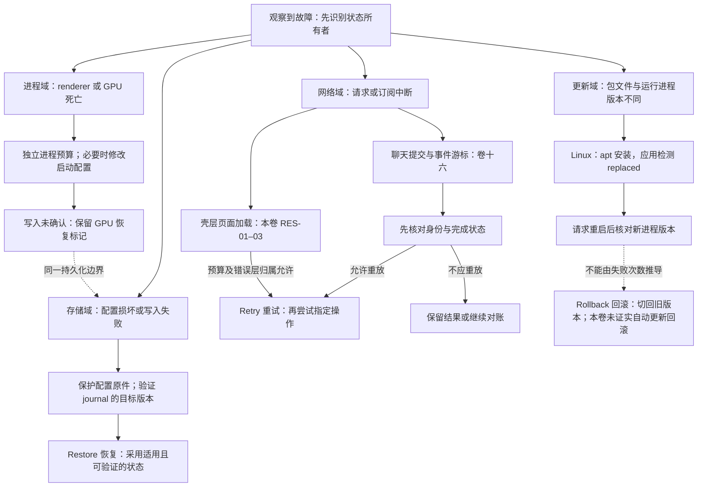
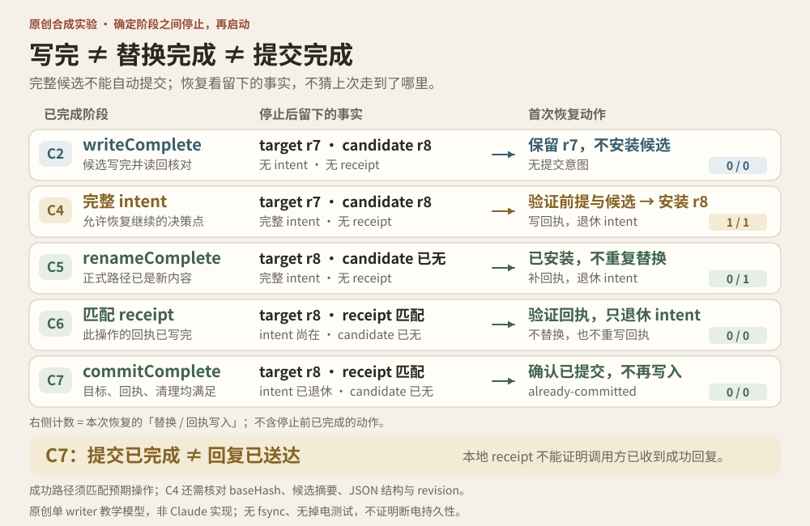

# 第 17 卷：状态、恢复与更新

让配置保住原件，让故障跨启动留下证据，让更新在新进程中得到确认

版本范围：Claude Desktop Linux amd64 2.37337.1 的选定桌面壳层、设置、进程恢复与更新路径。

用户关闭应用后，内存中的新设置可能消失；窗口重新打开后，损坏配置仍然需要处理；新安装包已经替换文件，旧进程却可能还在运行。这些问题都跨过了“当前页面”的生命周期，需要由文件、恢复标记和版本记账接住。

**本卷的主线是恢复动作如何改变本地状态，以及用什么证据确认改变已经生效。** 用户配置与可重建的壳层 store 采用不同损坏策略；内存生效、广播完成和磁盘确认是不同结果；GPU 修复要保存跨启动标记；Linux 默认更新由 apt 安装，应用负责检测变化与重启接管。把这些动作统称为“重试”，会丢掉最重要的完成条件。

## 先画清故障域

第 16 卷讨论聊天提交、事件交付、配额与草稿。本卷接手桌面壳层和下一次启动。两卷都会出现“网络失败”“恢复”“持久化”等词，但状态所有者和恢复对象并不相同。

| 读者的问题 | 去哪里追踪 | 本卷保留的边界 |
|---|---|---|
| 回答完成后断网，能否重发？ | [卷十六 §6 完成边界](../16-Resilience-And-Quota/README.md#6-最容易多做一次的地方已经完成网络才报错)、[§7 回读对账](../16-Resilience-And-Quota/README.md#7-不确定是否提交成功时先回读事实) | 页面 reload 不提供聊天是否提交成功的证明 |
| 事件流断开，应从哪里继续？ | [卷十六 §8 CCR 订阅](../16-Resilience-And-Quota/README.md#8-codeccr-事件订阅是另一套恢复协议) | 重连订阅、重建 renderer 和再次提交任务分别计量 |
| 限额阻止继续，应等多久？ | [卷十六 §10 配额](../16-Resilience-And-Quota/README.md#10-配额是多维的不能只画一个剩余消息数) | 壳层的加载预算不能解释账户配额 |
| 未发送文字如何恢复？ | [卷十六 §12 草稿镜像](../16-Resilience-And-Quota/README.md#12-草稿镜像快速恢复需要更小的数据投影)、[§13 hydration](../16-Resilience-And-Quota/README.md#13-hydration-的危险时刻空内存覆盖有价值的磁盘内容) | 本卷追踪配置文件和窗口状态，不再展开编辑器恢复算法 |
| 配置损坏、进程连续死亡、更新未生效怎么办？ | 本卷 §1–5 | 追踪原件、写入结果、恢复标记、运行版本和诊断材料 |



*图 1　A 原创故障域图。实线整理本包所见责任，虚线标明跨域依赖或证据不能支持的跳跃。它是教学模型，不是运行轨迹或完整调用图。网络域也可能影响更新检查，但不能因此共用一份恢复预算。*

三个恢复动词需要不同的完成证据。**Retry** 是重新尝试一个操作，动作身份与重放条件由该操作定义；**Restore** 是从保存状态重建可用状态，需要确认来源适用；**Rollback** 是切回先前版本或状态，需要一条真正实施反向切换的路径。库里有迁移失败回滚能力、配置能恢复、更新有失败计数，三者都不能独自证明应用具备自动版本回滚。[SET-08、SET-10、UPD-03](../../04-Extracted-Core-Code-And-Scripts/evidence/data/settings-resilience.json)

## 本章地图

[01 状态所有权](#01-状态所有权) · [02 设置的写入边界](#02-设置的写入边界) · [03 进程恢复与壳层加载](#03-进程恢复与壳层加载) · [04 Linux 更新](#04-linux-更新) · [05 日志与诊断](#05-日志与诊断) · [06 验证入口](#06-验证入口)

### 证据图例与范围

**S 静态**表示官方 Linux amd64 2.37337.1 包中的声明与控制流；**A 原创**表示本书的图解、合成场景与测试建议。设置与恢复证据的研究截点为 2026-10-14；卷十六选定网络、配额与草稿路径的整理日期为 2026-10-15。两卷都没有目标运行观察，不能把参数写成实测时限，也不能从静态 gate 推出当前账户或组织启用情况。

[设置与恢复台账](../../04-Extracted-Core-Code-And-Scripts/evidence/data/settings-resilience.json)保存 SET、RES、UPD、LOG 共 24 条证据；[卷十六台账](../../04-Extracted-Core-Code-And-Scripts/evidence/data/resilience-quota-expansion.json)另有 RQ-01–50，覆盖聊天、CCR 与草稿。窗口与 IPC 归属见[第 1 卷](../01-System-Architecture/README.md)，扩展配置安全边界见[第 6 卷](../06-MCP-Host-Internals/README.md)。编号所属的证据范围不能互相替代。

## 01 状态所有权

### 先找保存者，再选择恢复策略

store 是主进程持有的持久化键值存储；schema 是约束字段与类型的结构规则。一个设置界面可以同时操作多个 store 和加载器，所以“恢复设置”首先要回答恢复的是哪份数据。

| 状态 | 本包所见所有者与载体 | 典型内容 | 恢复需要保住的东西 |
|---|---|---|---|
| 通用壳层 store | 主进程 electron-store 派生实例，默认 `config.json` | 主题、语言、更新记账 | 可继续运行的壳层状态 |
| 用户可编辑应用配置 | schema 加载器，`claude_desktop_config.json` | preferences、MCP、图形加速开关 | 原件与手工编辑内容 |
| 窗口几何 | 独立服务，`window-state.json` | 尺寸、位置、显示器边界 | 在当前显示器布局中可见的位置 |
| 恢复标记 | 专用文件或 store 项 | GPU 故障、更新尝试及失败次数 | 尚未解决的跨启动证据 |
| renderer 临时状态 | 本地页面内存 | 错误层、可选小游戏状态 | 当前页面生命周期内的状态 |

此表基于 [SET-01、SET-11、RES-05、RES-06、UPD-03](../../04-Extracted-Core-Code-And-Scripts/evidence/data/settings-resilience.json)所列契约，不是全产品存储清单。尤其不能把壳层配置文件当成卷十六编辑器 store 或服务端会话的持久化位置。

分开所有权后，策略差异便有了理由：窗口拖动适合合并写入；用户手工配置损坏需要保护原件；恢复标记需要等修复确认后才清除。统一采用“解析失败就清空”，会把可重建的显示状态与不可轻易重建的用户输入混在一起。

### 普通偏好入口只接收被允许的投影

AppPreferences 写入先验证 key 属于 schema，再拒绝主进程专用字段，随后校验 value。快捷键另有合法性检查；部分授权相关结构只允许普通偏好入口删除条目，不允许从这里增加授权。读取与广播也经过投影，将部分授权、目录访问集合替换为空值。[SET-04](../../04-Extracted-Core-Code-And-Scripts/evidence/data/settings-resilience.json)

因此，磁盘对象、主进程对象和页面可见对象具有不同形状。若调试时只比较页面对象与配置文件，看到字段“消失”并不能立即断言保存失败；需要先检查投影规则。普通偏好校验也不能替代专门授权入口与 IPC 调用者检查，后者由第 1、6 卷继续追踪。

### 主题与语言说明了生效范围

主题方法同时修改 Electron `nativeTheme.themeSource` 与 store 中的 `userThemeMode`。启动接受 `system`、`light`、`dark`；原生主题更新事件再驱动窗口背景、标题栏与菜单处理。[SET-02](../../04-Extracted-Core-Code-And-Scripts/evidence/data/settings-resilience.json)

`system` 保存的是跟随系统的偏好，最终明暗仍会变化。自建产品应让原生窗口订阅解析后的结果，而不只在启动时读取一次选项。这里的证据覆盖壳层通路，不包含远程聊天页面全部主题 token 或跨设备同步。

语言初始化先建立 `en-US` 回退，再尝试保存的 locale，或匹配系统偏好语言。locale 是语言与地区标识。显式切换检查文件名形状及目录存在性；成功后更新主进程语言实例和持久化值，向存活 renderer 广播，窗口销毁时取消订阅。[SET-03](../../04-Extracted-Core-Code-And-Scripts/evidence/data/settings-resilience.json)

资源目录有 43 个语言 JSON，含 `zh-Hans`、`zh-Hant`、`es-419`；系统自动选择经过较窄白名单与地区式正则，本包得到 10 个候选，显式切换的文件名规则则更宽。资源存在、自动探测可选、菜单实际展示是三个范围。目录数量不能证明译文完整，也不能证明菜单可用语言数量。

实现者可以让自动匹配、手动选择与资源清单共同引用一个权威定义，并单独标记实验目录。只测试 JSON 能解析，仍可能漏掉初始化和用户切换采用不同候选范围的问题。

## 02 设置的写入边界

### 用户配置损坏时，回退值不等于替代原件

用户可编辑配置加载器区分缺失、读取错误、JSON 错误和 schema 错误。它可过滤无效 MCP 条目再校验；整体不合法时仅保留少数启动恢复字段。只有加载结果被标记为需要保护原件的降级状态，writer 才返回 `parked`，即暂停落盘，避免把内存回退值覆盖到原文件。[SET-05](../../04-Extracted-Core-Code-And-Scripts/evidence/data/settings-resilience.json)

这不是“一有异常就停写”。下列情况不会因此设置降级标记：

- 文件缺失
- 仅由空白、控制字符或替代字符组成的空内容
- 被实现视为空值的 JSON：null、布尔、数字、空字符串、空数组、空对象
- 剔除无效 MCP 条目后，整体配置通过校验

判断依据是加载结果标记，而不只是是否遇到错误或是否过滤过条目。因此，也不能承诺被剔除的无效 MCP 条目永久保留在原文件中。

卷十六的 [hydration 写入门控](../16-Resilience-And-Quota/README.md#13-hydration-的危险时刻空内存覆盖有价值的磁盘内容)解决“旧草稿还没恢复，空内存先覆盖磁盘”的问题。本节保留另一条机制：配置读取已经完成，但结果不适合替换原件，于是暂停写入。两者都保护已有数据，阻止写入的具体条件却不同。

### 可重建的壳层 store 有另一套损坏处理

通用壳层 `config.json` 的错误分支如下。[SET-09](../../04-Extracted-Core-Code-And-Scripts/evidence/data/settings-resilience.json)

| 情况 | 所见处理 | 不能据此扩大成什么保证 |
|---|---|---|
| JSON SyntaxError | 回退空对象并标记损坏，后续显示 Settings Reset 提示 | 不能说语法错误必先备份原件 |
| `UNKNOWN`、`EBUSY`、`EIO` 开文件错误 | 以 250 ms、500 ms 两次延迟重试 | 不能作为全部磁盘错误的统一重试策略 |
| `EISDIR`、`ELOOP`、`ENOTDIR` 路径结构错误 | 尝试改名为带时间戳的 corrupt 文件，再重建 | 改名是尝试，也只属于特定分支 |

这里的两次文件打开重试既不是卷十六的聊天重试，也不是后文壳层页面重载。计数应跟着操作所有者走。更重要的是，通用 store 重置与用户配置 `parked` 各有成本判断，不应被压缩为一个全局“设置自愈”功能。

### 保存有三个可分别观察的结果

所核对的普通偏好链条是：**内存采用新值 → 尝试持久化 → 通知订阅者**。writer 返回以下三种结果。[SET-06](../../04-Extracted-Core-Code-And-Scripts/evidence/data/settings-resilience.json)

| writer 结果 | 本地含义 | 调用者应如何解释 |
|---|---|---|
| `written` | 此次写入路径报告成功 | 可作为该路径的落盘确认，仍不等于掉电安全保证 |
| `parked` | 降级读取保护生效，暂停持久化 | 内存可以继续工作，不能显示为已保存到原文件 |
| `write-failed` | 写入尝试失败 | 需保留未完成的恢复义务，不能用通知成功替代写入成功 |

普通偏好 IPC 包装器未继续向调用者传递落盘结果，所以接口完成与磁盘确认必须区分。这里没有 UI 运行观察，不能据此断言界面已经误报“保存成功”。GPU 恢复等重要路径会检查 `written`，再决定是否清理跨启动标记。[RES-05](../../04-Extracted-Core-Code-And-Scripts/evidence/data/settings-resilience.json)

用户配置写入优先采用按路径互斥、临时文件与 rename；默认文件权限参数为十进制 384，即 POSIX 0600。某些 rename 失败会回退直接写入。因此可以确认原子替换优先路径，不能保证所有错误分支原子化，也不能从一次成功返回推导掉电后必定完整。[SET-07](../../04-Extracted-Core-Code-And-Scripts/evidence/data/settings-resilience.json)

### journal 必须属于当前目标版本

journal 是写入过程留下的恢复记录。本包 store 的 `.journal` 携带内容 SHA-256、目标文件摘要与提交中摘要。启动恢复需要检查记录完整性及它与目标版本的适配关系，避免残留记录覆盖后来已变化的文件；退出调用 `quiesce` 等待正在提交的写入。[SET-08](../../04-Extracted-Core-Code-And-Scripts/evidence/data/settings-resilience.json)

可以把它想成两道不同的问题：这份记录有没有损坏？它是否仍有资格应用到这个目标？只有内容完整而缺少版本匹配，仍可能恢复出错误的旧状态。这个解释是 A 教学模型；摘要校验本身也不是有密钥的恶意篡改认证。

包内 store 库有版本迁移与迁移失败回滚能力，但本次追踪的主 config store 构造没有注册 migrations 表。应用配置校验前清理旧 sidebar 值和不合法枚举，仅支持“兼容性归一化”的结论。不能把依赖能力写成主设置已采用完整版本迁移体系，更不能把这条数据迁移回滚写成安装包版本回滚。[SET-10](../../04-Extracted-Core-Code-And-Scripts/evidence/data/settings-resilience.json)

### 小实验：write、rename、commit 之间停下，重启后该读到什么？

本节新增的是**原创教学模型**。SET-07 的 private-file writer 与 SET-08 的 store/journal 是两条产品路线，不能把它们拼成一条“已经还原的 Claude 写入算法”。下面不使用产品格式、运行时、账户或真实配置。

让一个独立 Python 子进程把合成配置从 r7 改成 r8。我们不按时间猜测它走到哪里：子进程在指定阶段完成后发出握手并暂停，父进程收到握手，才通过自己创建的 Popen handle 终止它；恢复由一个新子进程执行。全部数据只存在于父进程自己的 TemporaryDirectory。



#### 三个完成点，三个不同承诺

```text
r7 target
  → 写完 candidate，并读回核对摘要           [C2: writeComplete]
  → 写完 intent，固定 baseHash / nextHash   [C4: 可恢复的意图]
  → 同目录 replace candidate → target      [C5: renameComplete]
  → 核对 r8，写匹配的 receipt               [C6]
  → 退休 intent                             [C7: commitComplete]
```

writeComplete 只表示候选写入与读回校验完成；renameComplete 表示正式路径已能读到新内容；commitComplete 才表示本模型的目标、回执、清理合同全部满足。这里的 commit 是应用自定语义，不是操作系统额外提供的耐久性原语。receipt 是本地合成记账，不表示调用方已收到成功响应，也不涵盖外部副作用“恰好一次”。

先比较最容易混淆的三个切点：

| 停在何处 | 停止后留下什么 | 新进程如何恢复 |
|---|---|---|
| C2：写完候选 | target=r7，candidate=r8，没有 intent | 保留 r7；只有准备材料，不能自动创造提交意图 |
| C4：写完 intent | target=r7，candidate=r8，完整 intent | baseHash 与候选 nextHash 都匹配才替换，再写回执 |
| C5：完成替换 | target=r8，完整 intent，没有 candidate/receipt | 识别已安装，只补回执与清理，不再替换 target |

**完整 intent 是允许恢复继续提交的决策点，仍不等于提交已经完成。** 这是本实验选择的合同，不是所有产品必须遵守的规则。

#### 恢复器判断的是事实，不是“文件在不在”

完整且合法的 intent 只允许两条成功路径：

1. targetHash 已等于 nextHash：优先判为已安装，验证或补齐匹配的 receipt，再退休 intent。
2. targetHash 等于 baseHash，且 candidate 的摘要、JSON 结构和 revision 都符合意图：安装候选，再完成记账。

其他组合拒绝提交。恢复入口知道本实验要确认的完整操作：operationId 及 r7→r8 对应的摘要、版本等字段；journal 必须与它一致，receipt 必须匹配其完整回执。即使 intent 已退休，也不能拿另一次操作，或同 ID、不同内容的回执确认这次请求。哈希检查区分“字节是否一致”和“这份意图是否仍适用于当前目标”，但它不是来源认证，也没有替代并发仲裁。

本次运行还验证了三种反例：旧 r7→r8 意图不能覆盖已变成 r9 的目标；完整意图不能授权安装损坏候选；恢复先停在 rename 后，再停在 receipt 后，第三次仍能完成，第四次不再替换目标或重写回执。损坏 journal、错误回执均保留现场并拒绝，不靠猜测修复。

#### 读结果时不要跨过证据边界

C1/C3 的半文件是程序主动写入固定前缀的**合成 torn file**。进程停止时操作系统还在运行，页缓存也可能存在；本实验没有调用 fsync，没有模拟断电，没有观察任意 I/O 指令内部的崩溃，也没有证明 Claude 的实际恢复行为。Linux 文档分别讨论 [rename 的替换可见性](https://man7.org/linux/man-pages/man2/rename.2.html) 与 [fsync 及目录项同步](https://man7.org/linux/man-pages/man2/fsync.2.html)；“正式名字已切换”不能替代一份持久顺序证明。

本模型假设单 writer。读取摘要再 replace 之间没有并发修改；若允许另一个 writer 插入修改，就必须另行设计锁、仲裁或条件提交。故意制造 r9 的案例检验的是**恢复开始前已有的新状态**，不是并发写入的完整解决方案。

完整代码、八切点矩阵、运行命令和机器记录见 [实验说明](../../04-Extracted-Core-Code-And-Scripts/crash-cut-recovery/README.md)。复习时只问一句：如果一个 API 在 C2、C5、C7 分别返回成功，它承诺给调用方的究竟是哪件事？

### 窗口恢复重新解释旧坐标

所追踪的窗口几何服务采用约 1 秒防抖、串行写入链与关闭时 flush；跳过最小化状态，校验尺寸，并按当前显示器工作区重新安置失效位置。[SET-11](../../04-Extracted-Core-Code-And-Scripts/evidence/data/settings-resilience.json)

这里保存的是正常窗口的位置意图，不是每次临时外观。昨天的坐标在今天拔掉外接显示器后可能落到屏幕外，所以恢复需要结合当前设备布局。结论仅覆盖已追踪的服务及主窗口调用路径；包里存在其他旧窗口状态依赖，不证明所有窗口共用这一实现。

<a id="03-网络与进程恢复"></a>

## 03 进程恢复与壳层加载

### 恢复入口需要活在故障页面之外

主内容失败后，主进程将错误交给本地外壳；外壳表达标题、说明、Reload、可选 Restart 与重试状态，并通过 preload 桥接请求相关动作。恢复 UI 因而不必依靠失败的远程文档重新加载。容器关系见第 1 卷。[RES-01](../../04-Extracted-Core-Code-And-Scripts/evidence/data/settings-resilience.json)

错误页存在 `role=status`、隐藏装饰图标与减少动态效果查询。可选离线小游戏由主进程功能开关提供后懒加载，资源失败可以不渲染，Map 只保存在该 renderer 内存。它既不证明离线聊天持久化，也不证明默认开启；屏幕阅读器与键盘体验尚未实测。[RES-06](../../04-Extracted-Core-Code-And-Scripts/evidence/data/settings-resilience.json)

### renderer 重建只负责进程恢复

`render-process-gone` 路径在约 5 分钟安静期后重置尝试计数；普通计数分支上限为三次，`launch-failed` 延迟为 1、5、20 秒。达到上限后转为本地重启、帮助或图形加速说明。主动结束、待执行 reload 与打印保护另有分支，因此不能概括为每次 renderer 死亡都恰好重试三次。[RES-04](../../04-Extracted-Core-Code-And-Scripts/evidence/data/settings-resilience.json)

这些计数衡量重新建立可用页面进程的尝试。它们不能证明聊天操作没有执行，也不能为重新提交同一任务提供授权条件。若故障发生在聊天完成附近，应回到卷十六的完成边界与回读机制；恢复了页面进程，只说明又有了检查状态的载体。

### GPU 恢复把未完成义务带到下次启动

GPU 是图形处理器。对应进程的持续故障可能需要改变下次启动配置，因此仅在进程内数次数不够。代码保存 `gpu-crash-streak`：相邻死亡超过 5 分钟可重置普通计数，三次进入关闭硬件加速与提示重启路线；另有一分钟内二十次死亡的终止循环保护。自动关闭与极端终止分别受动态功能开关约束。[RES-05](../../04-Extracted-Core-Code-And-Scripts/evidence/data/settings-resilience.json)

这个恢复链的关键顺序是：

1. 记录故障，使后续启动能识别尚未解决的问题。
2. 按条件尝试修改图形加速配置。
3. 检查写入结果；不是 `written` 时保留标记，让后续启动继续恢复。
4. 只有写入确认且相应恢复条件满足，才清理标记；提示重启或按门控进入终止循环保护。

如果在“已经尝试修改”时就清除标记，而 writer 实际返回 `parked` 或 `write-failed`，下一次启动可能失去继续修复的依据。本包把清理与写入确认联系起来，正好说明为什么保存结果必须越过普通通知层传给恢复调用者。以上是静态路径，不是已触发过 GPU 故障的报告。

### 壳层页面加载保留自己的预算

卷十六已经解释退避、完成判断与重放身份。本节只保留 `load_failed` / `http_error` 的壳层特有规则，避免读者把它套到 classic completion 或 CCR 订阅上。[RES-02、RES-03](../../04-Extracted-Core-Code-And-Scripts/evidence/data/settings-resilience.json)

| 条件 | 本包壳层加载的静态规则 |
|---|---|
| 普通 `load_failed` | 基准延迟 0、15、30 秒，后续沿用末档；约 ±20% 抖动 |
| `http_error` | 从较晚档起步；连续超过 3 次后停止自动重试 |
| 初始自动重试预算 | 约 180 秒；等待离线恢复会延长原预算 |
| 已有 load 或网络 reset 活动 | 避免叠加新的请求 |
| 首次成功页面加载之前 | 重试可关闭连接、清 DNS 缓存、重新加载代理配置 |
| focus / show / resume / unlock | 可提前触发，约 10 秒节流 |
| 自动重试耗尽后的唤醒 | 另有约 60 秒离线等待边界 |
| 回调即将执行 | 当前错误 overlay 必须仍是原来的对象 |

初始 timer 在离线等待时没有统一墙钟截止；离线暂停会延长原预算。因此“三分钟”只能描述这条壳层路径的预算量级，不能作为统一完成时限。自动重试耗尽后的 60 秒离线等待也不能倒推覆盖初始 timer。

overlay 身份检查的对象是错误层：用户已经导航到新页面，旧错误回调就不能再刷新它。它与卷十六草稿的 owner/session/编辑世代检查具有相似的异步风险，但保护的是不同对象。本卷保留这一条件，不重复展开草稿竞态和恢复算法。

## 04 Linux 更新

### 包管理器安装，应用识别外部替换

本版本 Linux 的 `enableUpdates` 路径关闭应用内 updater，安装责任交给 apt。相关检查未被策略禁用时，应用读取 apt Packages 比较版本，并检查 `/proc/self/exe` 的 deleted 标识及当前 exe 是否存在，识别运行中的可执行文件已被外部替换。[UPD-01](../../04-Extracted-Core-Code-And-Scripts/evidence/data/settings-resilience.json)

这套机制把“可用版本”“磁盘上的文件”和“当前运行版本”分开。代码中的 Linux `available` 与 `replaced` 也因此不能与公共 updater 的 downloading 简单画成同一条默认路径。

| 阶段 | 本包可见的状态或动作 | 尚需区分的事实 |
|---|---|---|
| 发现版本差异 | 读取 apt Packages，比较版本 | 发现新版本不等于新包已安装 |
| 发现外部替换 | 检查运行中 exe 的替换线索，形成 `replaced` | 新文件在磁盘不等于旧进程已退出 |
| 向页面投影 | 内部 `replaced` 映射为 `Ready` | 页面 Ready 不等于已运行新版本 |
| 请求更新重启 | `restartToUpdate` 对 `replaced` 调用保留导航的 relaunch | 发出重启请求仍需后续版本核对 |
| 跨启动确认 | 更新记账保存 from/to version、尝试与实际版本比较 | 失败计数不等于自动回滚路径 |

前四行的机制来自 [UPD-01、UPD-02](../../04-Extracted-Core-Code-And-Scripts/evidence/data/settings-resilience.json)；最后一行属于包内跨启动记账机制 [UPD-03](../../04-Extracted-Core-Code-And-Scripts/evidence/data/settings-resilience.json)。它们共同给出检查视角，不构成一次已观测的 Linux 安装端到端轨迹。显式“检查更新”入口也可打开官方下载页，不能把每个入口都理解为应用内下载。

### 策略条件会改变检测是否进行

`autoUpdate.disabled` 为真时，周期分支可退回 idle，并跳过版本与替换检查；focus、unlock、resume 触发的替换检查同样受这个条件限制。[UPD-01](../../04-Extracted-Core-Code-And-Scripts/evidence/data/settings-resilience.json)

所以不能只看到系统事件监听就承诺“恢复焦点必能发现更新”。正确解释需要同时带上平台和策略条件。组织更新要求另有独立路径：优先选择可见且未最小化的合适窗口，没有时等待焦点变化，并提供 dismiss 或 update；组织禁用自动更新时，提示转向管理员处理。模块可以被调用，不证明当前组织正在强制更新。[UPD-04](../../04-Extracted-Core-Code-And-Scripts/evidence/data/settings-resilience.json)

### 公共 updater 状态不是跨平台执行证明

包内包含 Electron autoUpdater 的 checking、downloading、ready、error 等公共状态及其他平台路径。但 Linux 当前所追踪的默认入口明确把安装交给 apt，公共协议的存在不能证明 Linux 通过应用内 updater 下载和安装。[UPD-01、UPD-02](../../04-Extracted-Core-Code-And-Scripts/evidence/data/settings-resilience.json)

另一组更新记账保存 `update-attempt`、from/to version、上次尝试、失败次数与实际版本，退出流程可等待 store `quiesce`。这些是跨启动确认安装是否生效的源代码机制；未验证安装、原子切换或自动回滚。[UPD-03](../../04-Extracted-Core-Code-And-Scripts/evidence/data/settings-resilience.json)

平台约束还出现在 POSIX 0600、`/proc/self/exe` 与 apt Packages 上。可复用的是“文件替换与运行版本分别确认”的设计问题，具体路径和权限语义不能直接搬到 Windows 或 macOS。更广的样本比较见[第 18 卷](../18-Versions-And-Cross-Platform/README.md)。

### 一个合成场景检验四种恢复是否被混写

**A 合成示例，未执行故障注入。** 假设某桌面产品先后发生以下事件；版本 N / N+1 只是教学符号。

| 时刻 | 已知事实 | 应追踪的恢复对象 | 此时不能下的结论 |
|---|---|---|---|
| t0 | 聊天网络流中断 | 卷十六的提交身份、完成边界与回读 | 不能仅凭断网再发一轮任务 |
| t1 | renderer 退出，壳层请求恢复页面 | 本卷独立进程预算 | 页面恢复不证明 t0 的任务从未执行 |
| t2 | GPU 恢复尝试改配置，writer 返回 `parked` | 原配置与跨启动标记 | 通知已发出不等于配置已持久化 |
| t3 | apt 将磁盘文件替换为 N+1，旧进程仍为 N | 外部替换检测和重启接管 | `Ready` 不等于运行版本已变 |
| t4 | 后续启动读取实际版本并核对尝试记录 | 版本确认及仍未完成的恢复义务 | 发现更新失败不证明已经切回旧版本 |

这张表没有要求故障按此顺序出现。它测试的是记录结构：若只留下一个“重试成功”字段，就无法知道恢复的是连接、页面、配置还是版本。至少要让结果能够指回具体对象及确认依据。

## 05 日志与诊断

### 日志也有失败模式和容量范围

主日志格式含时间、级别、消息和元数据；打包默认 info，开发默认 debug。默认 file transport 为每文件 10 MiB、最多 5 个文件；renderer 类别只收相关主 frame 的 warning/error，单文件上限 5 MiB，继续继承默认数量上限。[LOG-01](../../04-Extracted-Core-Code-And-Scripts/evidence/data/settings-resilience.json)

这些是构造默认值，不是全系统日志总量或实际磁盘占用承诺。renderer 日志的类别与级别筛选也意味着，没有相应日志不等于没有发生故障。

日志初始化前先缓冲；路径异常时尝试搬移重建，再失败可禁用文件日志。这样，记录故障的设施可以降级，而不是递归制造新的致命故障。[LOG-02](../../04-Extracted-Core-Code-And-Scripts/evidence/data/settings-resilience.json)

### 局部脱敏不构成全部诊断材料的隐私保证

`spawnargs` 等特定参数元数据会被替换；完整行 scrub 只在受限合规模式启用，scrubber 失败时使用固定 redacted 占位。浏览器类别另限制为 4,096 字符，并裁去查询参数与片段。[LOG-02](../../04-Extracted-Core-Code-And-Scripts/evidence/data/settings-resilience.json)

脱敏覆盖率需要逐条日志路径核对。轮转大小回答保存多少，scrub 回答某些内容如何改写，二者都不能证明所有日志已经去标识化。这里没有读取真实用户日志，也未测量任何实际故障记录。

### 显示日志入口可能先创建一个支持包

`showLogsInFileManager` 并非仅打开现有日志目录。实现可准备调试信息、会话诊断、堆/VM 等材料，经过筛选与 transform，生成下载目录中的 ZIP，再在文件管理器显示。[LOG-03](../../04-Extracted-Core-Code-And-Scripts/evidence/data/settings-resilience.json)

因此，支持包需要被视为新的诊断对象。自建支持流程应把生成、检查内容和发送给接收者分成独立步骤；不能用日志轮转限制、局部 scrub 或友好的入口名称代替最终 ZIP 的内容审阅。生成成功也不等于分享已获许可。本章没有点击该操作、生成用户支持包或验证其完整脱敏效果。

## 06 验证入口

### 从独有机制导出最小故障矩阵

| 测试对象 | 合成故障或边界 | 需要分别确认的结果 |
|---|---|---|
| 用户配置 | JSON 损坏、缺失、空内容、局部 MCP 条目不合法 | 加载结果标记、是否 `parked`、原件是否保留，不能只看有无异常 |
| 壳层 store | SyntaxError、可重试开文件错误、路径结构错误 | 重置、延迟重试、改名重建是否进入正确分支 |
| 用户配置 writer | rename 失败、磁盘不可写 | 内存值、通知值、返回结果与实际文件分开确认 |
| store journal | 完整记录配上已变化的目标文件 | 内容完整性与前序版本匹配分别检查，避免恢复旧状态 |
| 窗口几何 | 最小化、关闭前待写、外接显示器移除 | 正常几何、flush、当前工作区重新安置 |
| renderer / GPU | 特殊退出、连续死亡、修复配置写入失败 | 独立预算及门控、未完成修复的跨启动标记 |
| 壳层加载 | 离线、频繁 focus、新导航覆盖旧错误层 | 预算延长、节流、当前 overlay 归属；不测聊天重放 |
| Linux 更新 | 外部替换而旧进程仍在、策略禁用、重启后版本未变 | 检测资格、页面投影、重启请求和实际版本分开 |
| 日志与支持包 | 日志目录不可写、scrubber 失败、ZIP 生成 | 降级运行、占位行为、实际内容与分享边界 |

以上为 A 测试建议。聊天重复提交、CCR 游标、配额分类和草稿世代测试直接使用[卷十六原创实验](../16-Resilience-And-Quota/README.md#14-原创实验把恢复设计写成可失败的测试)的范围与差异说明，不在本卷重复建立一套模型。断电、磁盘满、代理异常、GPU 故障、多显示器恢复和辅助技术仍需受控环境实验，内存中的教学模型不能代替。

### 两份台账的证据不能合并计功

本章未启动 Claude 或登录账户，未读取真实配置、日志或用户支持包，也未进行故障注入。所有故障矩阵和合成时间线都属于设计推导。

设置与恢复台账的 REA 6.5.0 精确选源分析完成了更新要求模块和本地错误页两个 JavaScript 文件，解析失败为 0；对应 Evidence ID 为 `ev_3c6038a524519772bfabe0689aa6dbcbbd19aa3dd88e22cc5bab5e79f178f340`。主 chunk 加错误页的另一次运行采用 1,024 MiB heap、3,000 semantic-node 上限和单文件 60 秒限额；主 chunk 超时，结果为 partial observation，Evidence ID 为 `ev_4431a6fc73309aecf05ca18d601744911ceb15909e87293363ec60cbf27bfe84`。本章大部分机制来自原文件惰性读取和控制流人工核对，不是完整全程序调用图。

[设置与恢复台账](../../04-Extracted-Core-Code-And-Scripts/evidence/data/settings-resilience.json)修订后的记录是 **24 条主张、149 个已核验短锚点**，以及文件 SHA-256、字符和 UTF-8 字节区间。143 是追加 SET-05 非停放例外与 UPD-01 策略条件前的旧计数。锚点匹配确认源码位置，仍不证明功能在任何账户实际运行。

[卷十六台账](../../04-Extracted-Core-Code-And-Scripts/evidence/data/resilience-quota-expansion.json)另有 50 条主张、7 个源文件，REA 精确分析其中四个模块，Evidence ID 为 `ev_8ed6418a14d521ec9c0398ae5199219f6c4b34f9b57416c964ea9f6a9bc99905`。其 52 项通过测试属于原创教学模型，不能作为本卷文件损坏、GPU 故障或更新安装已通过运行验证的证据。

### 读完本卷应能提出的验收问题

- 恢复的是哪份状态，谁有权写入它，谁能确认完成？
- 配置回退是否允许继续运行，又是否需要暂停覆盖原件？
- UI 通知、writer 结果与磁盘内容是否被分开检查？
- 恢复标记是否只在相应修复确认后清除？
- 更新检测是否被平台或策略限制，新进程实际运行了哪个版本？
- 诊断入口生成了什么材料，检查和发送是否仍是独立步骤？

这些问题把恢复从“再试一下”变成可追踪的责任链：错误发生过，哪些状态改变过，哪些义务还没有完成。公开内容只包含原创分析、短锚点及定位，不包含完整 bundle、原始 REA 输出或用户状态。

[返回本书导航](../README.md) · [前一卷：恢复、限流与配额](../16-Resilience-And-Quota/README.md) · [后一卷：版本与跨平台](../18-Versions-And-Cross-Platform/README.md)
