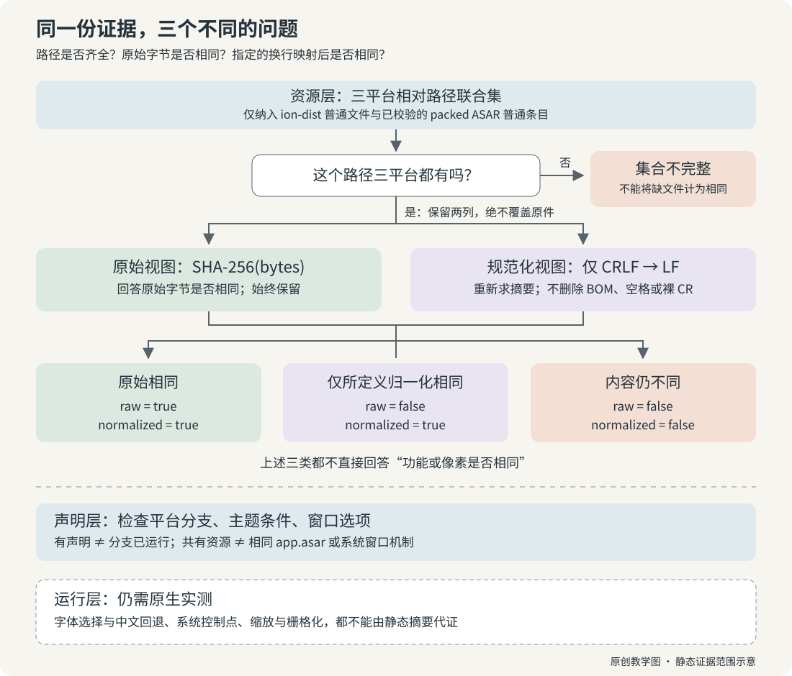

# 跨平台：共享前端不等于相同的桌面程序

本章比较 Windows、macOS、Linux 的官方 **2.37337.1** 安装包。Windows 的 MSIX Identity 以第四段 `.0` 表示该版本。结论范围是静态资源与声明；三套操作系统中的实际运行行为仍待验证。

证据索引：CP-01 主 UI，CP-02 CSS，CP-03 字体，CP-04 窗口构造，CP-05 完整性边界。

## 最重要的结论

三个包的 `ion-dist` 文件集合一致，**3,847 个文件逐字节相同**。这包括 25 个 CSS、90 个字体实例和 3,465 个 JavaScript 文件，以及图标、媒体等资源。这里的 JS 数量统计整个目录，不要与只统计 `assets/v1` 的数字混用。

再加上 ASAR 内的桌面窗口资源：

| 比较对象 | 结果 | 能说明什么 |
|---|---|---|
| 主 UI 资源 ion-dist | 3,847 个路径与 SHA-256 全相同 | 此版本三个发行包携带同一套主 UI 资源 |
| 主 UI 与窗口壳的 CSS 合计 | 每平台 41 个；33 个逐字节相同 | 多数 CSS 字节相同 |
| 其余 8 个 Windows CSS | 仅 CRLF/LF 换行差异 | 换行归一化后 41 个均相同，但原始哈希必须保留 |
| 字体实例 | 每平台 111 个，路径与哈希均相同 | 字体文件相同，不证明实际使用字体或字符回退相同 |
| 去重字体内容 | 每平台 88 种哈希 | 同一字体可以随不同窗口重复打包 |

[完整摘要与 CSS / 字体哈希](../../04-Extracted-Core-Code-And-Scripts/evidence/data/platform-comparison.json)

这套共享资源为前端审美章提供了跨平台依据。标准部署中的核心页面还可能由托管服务加载，因此实际页面版本、功能开关和可见内容仍须按账户与部署分别核对。

## 跟着一条 CSS 记录走完证据链

### 起点：Windows 哈希不同，究竟不同在哪里？

假设你接手三个平台的设计一致性检查，第一张表里就有一条 Windows 哈希不一样。现在直接写“Windows 的样式实现不同”太早；先把文件转换成 LF，再写“三个平台完全一致”也不对。我们要留下原始证据，再提出一个更窄、可验证的问题：这些字节经过**仅 CRLF → LF** 的映射后，是否相同？

本节只使用上文已公开的 **2.37337.1** 静态比较记录，记录时间为 **2026-10-14**。Linux 样本是 amd64 DEB，Windows 是 x64 MSIX，macOS 是 universal PKG；Windows Identity 的四段版本为 **2.37337.1.0**。这不是对所有版本、所有架构、托管页面或当前在线服务的保证。新增实验只生成原创小样本，不重新下载、解包或运行产品。



图 18-1：原始哈希与 CRLF 规范化哈希是并列保留的证据。路径缺失先退出一致性判断；静态资源结果不能越级成为运行结果。图中步骤是本书原创示意，不是产品架构截图。

### 第一步：先问“在比较哪些路径”，再问“内容相同吗”

脚本的输入是三个已解包的 resources 根目录。`read_platform()` 分别读取 `ion-dist` 下的普通文件，以及 `app.asar` 内通过尺寸、文件 SHA-256 与分块 SHA-256 校验的 packed 普通条目。unpacked 伴随文件和 ASAR 链接不会跟随读取。这些限定决定了结论覆盖哪些东西；“目录里一共有多少”必须带上这个范围。

比较不是把每个平台所有哈希扔进一个集合。设 Linux 有 `ion-dist/a.css`，Windows 有 `ion-dist/b.css`，两份文件内容完全相同。哈希集合相等，但引用 `a.css` 的页面在 Windows 树中找不到对应路径。现有脚本将相对路径作为键，`ion-dist` 的值同时包含大小和原始 SHA-256，逐项比较整个字典。因此改名也会使 `all_paths_sizes_and_hashes_equal` 为 false。

对于 CSS，`compare()` 使用三平台路径的**联合集**：只要任一平台有这条路径，它就进入报告。然后检查该路径是否三方齐全。假如只保留交集，Windows 缺少的文件会直接消失；假如只检查现存哈希有几种，Linux/macOS 恰好相同还会被误报成“三平台相同”。脚本先计算 `all_present`，再计算相等标志，正是为了挡住这两种误判。

这里还需要区分“相等为 false”和“比较执行失败”。缺文件是成功报告中的集合不完整；packed 条目的声明摘要不匹配则抛出错误，中止这次比较，不能把一个未完成的报告当作否定结论或全绿结论。实验后面的破坏摘要测试覆盖这条边界。

### 第二步：把真实记录摊开，不覆盖原始列

打开[现有证据 JSON](../../04-Extracted-Core-Code-And-Scripts/evidence/data/platform-comparison.json)，在 `css.inventory` 找到：

`.vite/renderer/about_window/window-legacy-pins.css`

以下只是已公开的摘要，不包含该产品 CSS 内容：

| 视图 | Linux | Windows | macOS |
|---|---|---|---|
| 原始 SHA-256 | A | B | A |
| CRLF → LF 后 SHA-256 | A | A | A |

- A = `00b91f194bf981bf4d5f6c6b2ff976e623f6c50cee69265a0213314b49e5eeec`
- B = `7948836002a0067fce40cea23edfd508dce54d54375f3b976dbfc7fe771e2a03`

第一行回答“原始字节是否一致”：否。第二行回答“消除 CRLF/LF 差异后是否一致”：是。在本比较使用 SHA-256 作为内容标识的前提下，这支持该路径的差异被所定义的换行映射消除。不能把 B 改写成 A 后删掉第一行，也不能从 B ≠ A 推出 CSS 属性、选择器或功能必然改变。

脚本实际做的映射很小：对字节串执行 `data.replace(b'\r\n', b'\n')`，然后再计算 SHA-256。它不是 CSS 解析器，不删空格、注释或 UTF-8 BOM，不改编码，不整理属性顺序，不把孤立的 CR 变成 LF，也不做 Unicode 规范化。因此本章说“规范化文本相同”时，精确定义是**经过该字节替换后相同**，不是通用的“语义相同”。原始 SHA、规范化 SHA、CRLF 数与裸 CR 数分别保留，源文件也不被改写。

这是一个有损视图：LF 与 CRLF 两种原始输入都可能映射为 LF。原始相同必然导出规范化相同，反方向不成立。这种不对称性正是保留两列的理由。相反，规范化后不同也只说明此映射没有消除全部差异；它仍不自动意味着浏览器呈现不同，例如只改注释也会改变摘要。

### 第三步：用四个原创反例亲手预测输出

现在暂时放下产品记录。我们只写一行原创 CSS：`.demo { color: teal; }`，以及颜色改成 `plum` 的版本。表中的 `\n`、`\r\n` 是字节表示，实验脚本会写入实际换行字节，不是两个可见字符。

| 合成路径 | Linux / macOS | Windows | 原始相等 | CRLF → LF 相等 | 应读作 |
|---|---|---|---|---|---|
| `ion-dist/same.css` | 原创 CSS + `\n` | 同左 | true | true | 同字节 |
| `shell/newlines.css` | 原创 CSS + `\n` | 原创 CSS + `\r\n` | false | true | 仅所定义归一化相同 |
| `shell/changed.css` | `teal` + `\n` | `plum` + `\n` | false | false | 内容不同 |
| `shell/missing.css` | 原创 CSS + `\n` | 无此路径 | false | false | 集合不完整 |

第三、四行的两个布尔值相同，但解释不同。你必须先看 `platforms` 中是否包含全部三方，再解释摘要。集合不完整不是“缺少的那个文件内容不同”，因为那里没有文件可供比较。

从 publication 根目录运行（Python 3.10+，仅标准库）：

```sh
python3 -B 02-Illustrated-Deep-Dive-Book/18-Versions-And-Cross-Platform/lab/lesson.py
python3 -B -m unittest discover -s 02-Illustrated-Deep-Dive-Book/18-Versions-And-Cross-Platform/lab -p 'test_*.py' -v
```

[lesson.py](lab/lesson.py) 在临时目录构造三个极小资源树和带自洽摘要的原创 ASAR；退出时清理样本。它直接导入现有[比较脚本](../../04-Extracted-Core-Code-And-Scripts/scripts/compare_ui_trees.py)的 `read_platform()` / `compare()` 逻辑，不复制一个简化比较器来“证明自己”。程序只输出路径、摘要结论与数量，未读真实产品样本、未执行任何产品代码。

你会得到四种分类，CSS 每平台数量为 Linux 4、Windows 3、macOS 4，逐路径原始相同数为 1，规范化相同数为 2。只有 `same.css` 和 `newlines.css` 三方齐全且规范化一致。产品的 41/33/8 与实验的 4/3/4 是两份不同输入的计数，不能相互替代。

[测试](lab/test_lesson.py)另外做三个有意的扰动：将 Windows 的 `same.css` 改名，验证哈希多重集相同却资源树不同；只将 Windows 的换行改成裸 CR 或添加 BOM，验证这两种差异不会被 CRLF 替换吞掉；破坏一字节 packed 内容，验证完整性检查中止。测试中的 `.woff2` 文件也只是带该后缀的原创占位字节，**不是有效字体**，不会分发或加载产品字体。

### 第四步：回到 41、33、8，先对齐统计单位

产品样本的 41 是每平台 CSS **路径实例**数：`ion-dist` 的 25 个，加上 packed ASAR 的 16 个。逐路径对齐后，33 条的三方原始摘要相同；剩余 8 条在 Windows 存在 CRLF/LF 差异。规范化后 41 条都相同。因此 `33 + 8 = 41` 是对同一批路径按比较结果划分，不是说“另外发现 8 种新的 CSS 内容”。

现有 JSON 的 `css.unique_content_hashes_each` 也恰好是 33。这是每个平台内部去重后的原始内容摘要数，回答“本平台有几种不同字节内容”，并不是三平台逐路径一致数。两个 33 的数值重合不构成定义上的等价；实验中的相同 CSS 字节可以在多个路径出现，修改其中一个路径是否存在也会独立改变跨平台相同数。

主 UI 的 3,847 则是另一个范围：`ion-dist` 的全部普通文件，不仅 CSS。CSS 中那 8 条换行差异来自扩大的窗口资源范围，并不与“3,847 个主 UI 文件相同”矛盾。共享主 UI 也不表示三个 `app.asar` 相同；证据中的三个 ASAR 摘要不同，已校验 packed 条目数也分别是 486、490、493。

树摘要是清单的紧凑标识：按路径排序，将 `路径 + TAB + 原始文件 SHA-256` 的记录以 LF 连接，末尾不加 LF，再对 UTF-8 字节求 SHA-256。路径也参与摘要，所以文件改名会改变树摘要。**这个摘要串本身没有编码大小**；脚本的 `all_paths_sizes_and_hashes_equal` 则比较包含大小的完整清单。阅读时不能把二者的字段定义混在一起。

### 第五步：为什么 111 个字体实例只得到 88 个内容摘要？

把“字体”换成三张标签更容易理解。实验在三个路径分别写入占位内容 A、A、B。路径清单长度是 3，内容摘要集合长度是 2。第二份 A 仍占一个路径，在那个位置被引用时仍有意义；内容去重只是在另一个问题上将它折叠。

现有产品记录同理：每平台 90 个 `ion-dist` 字体实例加 21 个 packed ASAR 实例，共 111 个路径；按原始内容摘要去重后为 88。`111 - 88 = 23` 是超过“每种摘要保留一份”后的重复实例数量，不意味着有 23 组重复，也不意味着删去任意 23 个文件都安全。多个窗口可能各带一份内容相同的资源，引用路径仍需保留。

更重要的是，这个脚本按 `.woff`、`.woff2`、`.ttf`、`.otf` 后缀清点并按字节去重，**不解析 font face、不测量已激活字体、不查询字符覆盖范围**。88 不是已知的 font face 数，也不是屏幕上用了 88 种字体。不同容器或编码的文件也可能承载相关字体内容，字节去重不会替你作字体语义合并。相同字体文件不能证明中文回退、图标字体启用、可变字体轴或文本栅格化跨平台一致；那需要运行时的字体选择与渲染证据。

### 最后一步：把“已证明”停在正确的一层

完成这一链路后，合格的结论应包含对象、版本、范围与判据。例如：“在本次 2.37337.1 三平台安装包的已读取 CSS 路径中，41 条经过仅 CRLF → LF 映射后摘要相同，其中 33 条原始摘要相同。”这比“CSS 一样”更长，却允许别人复算，也不会把换行视图误当整包认证。

接下来可以阅读窗口构造声明，查平台条件如何选择标题栏和控制点；但静态分支尚未被运行。如果问题变成“在同样文本、缩放、主题和账户条件下是否画出相同像素”，就必须进入原生实测。本节实验不能替代那一步，已有 ASAR 内部摘要检查也不能代替 Windows/Apple 系统签名信任链验证。

**停下来预测：**三平台文件内容摘要集合相同，路径不同，是否足以说“同一资源树”？一个文件只在 Linux/macOS 存在且字节相同，能不能记为“三平台原始相同”？111 个实例与 88 个摘要能不能推出当前画面用了 88 个 font face？

**核对答案：**都不能。第一个缺少路径对应关系；第二个不满足三方齐全；第三个把文件计数越级成了运行时字体选择。可以重新运行实验中的改名、缺文件与占位字体测试，让每个否定都有可观察的原因。

## 真正的平台差异在什么地方

主窗口构造声明的最小尺寸均为 600×400，标题栏风格均为 hidden，但这不是三平台实测屏幕尺寸。

- Linux、Windows 的 `titleBarOverlay` 为 true；macOS 为 false。
- Windows 普通标题栏覆盖背景为透明；Linux 使用主题派生颜色。二者都还有条件分支，不能把这个普通值写成每个窗口的最终颜色。
- macOS 的系统窗口控制点位置随缩放重新计算；另外两平台的对应初始化使用 zoom 1。
- 共享 CDS 的 desktop 条件选择箭头光标；旧壳层的按钮 CSS 仍可使用 pointer。不能概括成“Claude 的按钮都用一种光标”。

这些差异说明：共同的设计语言可以落在不同系统窗口机制上。自己实现桌面产品时，应把颜色和组件共享层与系统窗口适配层分开，而不是为每个平台复制整套 UI，也不是假设共享 CSS 就消除了系统差异。

## 三个不能跳过的验证层

**资源层**：核对路径、大小与哈希。本章已完成这一层的比较。

**声明层**：核对包内的平台分支、主题条件和窗口选项。本章覆盖主窗口的代表性声明。

**运行层**：验证实际字体 face、系统控件占位，以及缩放和输入方式对布局的影响。这一层仍待实测。

例如三个包拥有同一拉丁字体，不意味着中文都使用同一回退字体；相同的逻辑尺寸，也不意味着不同设备像素比上的细线栅格化完全一致。后两项属于待测试的差异来源，尚无实际故障观察。

## 如何得到这些结果

Windows 从[官方部署说明](https://support.claude.com/en/articles/12622703-deploy-claude-desktop-for-windows)的 MSIX 链接取得；macOS 从[官方部署说明](https://support.claude.com/en/articles/12611117-deploy-claude-desktop-for-macos)的通用 PKG 链接取得。记录实际 GET 重定向与最终包，不采用搜索缓存中的旧地址。

MSIX 清点由 REA 完成；PKG 子项清点需要原生 macOS 适配，其外层格式由只读 XAR/CPIO 解析补足。两种工具的提取范围分别记录。

完整 ASAR 提取在两个平台的 unpacked 原生伴随文件上遇到声明哈希不匹配。默认完整性策略保持不变。随后仅对 packed UI 条目做独立尺寸、SHA-256 与分块摘要核对，所有读取条目通过。

核验范围仅覆盖读取的 packed UI 条目，被排除的原生二进制仍未认证。哈希不匹配的原因未定，现有证据不足以判断整包存在恶意内容，或归因于签名、发布过程。Windows/Apple 的系统签名信任链仍待独立验证；官方 HTTPS 来源与本地摘要仅覆盖来源与字节核对，不能替代操作系统签名验证。

## 可复用的工程经验

1. 比较清单时保留原始哈希，再增加归一化视图。否则会把换行差异当成逻辑差异，或反过来抹掉原始证据。
2. 版本号、文件相同、功能启用、实际渲染是四种不同结论。
3. 共享前端研究可以复用；原生集成仍按平台验收。
4. 部分条目失败时划清可信边界，而不是把一次失败写成全包无效，或把其余成功写成整包认证通过。

### 独立复算

使用 [compare_ui_trees.py](../../04-Extracted-Core-Code-And-Scripts/scripts/compare_ui_trees.py)，为三个已解包的 `resources` 目录分别传入 `--linux-resources`、`--windows-resources`、`--macos-resources`，并以 `--output` 指定自己的结果文件。脚本从实际文件重新计算完整路径 / 哈希清单、归一化差异和数量，同时核验 packed ASAR 条目；不执行目标代码，也不提取或认证 unpacked 原生伴随文件。
