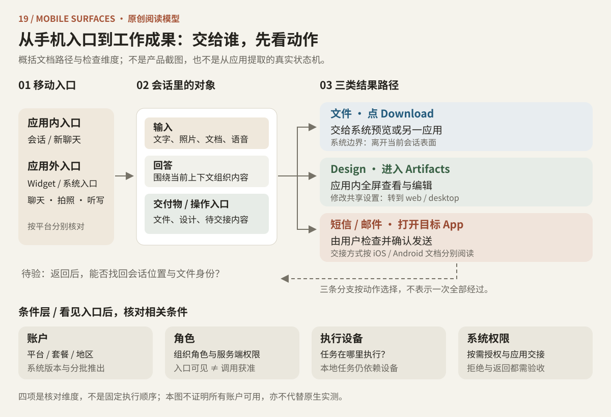
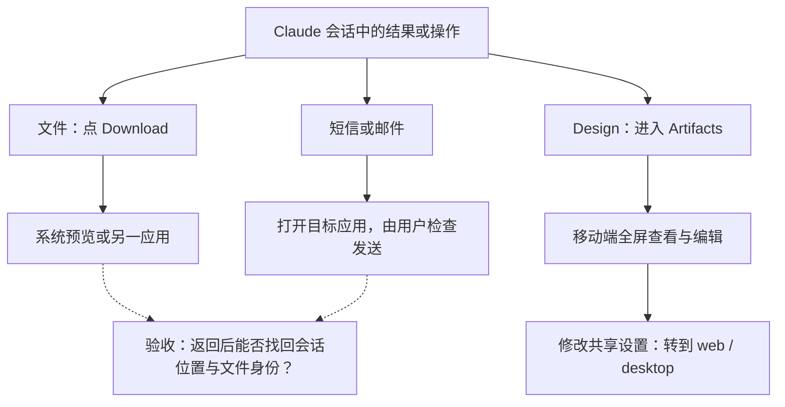
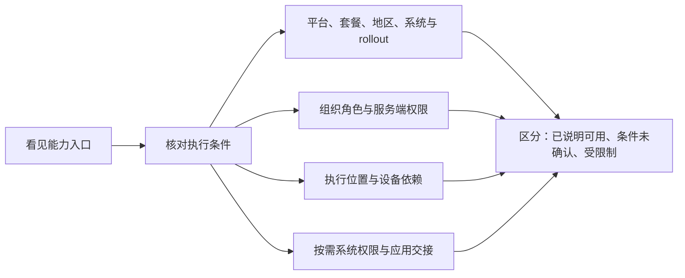

# 第 19 卷：Claude iOS / Android 的界面与交互边界

手机上的 Claude 不只是缩窄的聊天窗口。一次操作可能从桌面 widget 开始，在会话中组织输入，再交给系统预览或另一个应用；一张看似可用的工具卡，也可能在调用时受到组织角色限制。理解移动端，要同时看清三件事：**界面正在呈现什么、操作交给了谁、当前账户具备哪些条件。**

本章研究标准版 Claude iOS / Android，材料截止于 **2026-10-14（UTC）**，包括官方文档、13 张商店宣传图和 2 张官方移动语音界面裁切。商店宣传图用来读产品表达，帮助文档用来读操作路径与能力条件。本章补充 Desktop **2.37337.1** 的静态研究，移动端结论使用独立证据。

下文先建立阅读模型，再在第 6、7 节集中列出证据缺口与验收方法。文档提到某项能力，不代表每个账户已经获得它。[完整证据账本](../../04-Extracted-Core-Code-And-Scripts/evidence/data/mobile-surfaces.json)保留图片地址、SHA-256、尺寸及观察边界；原图仅供私下核验，不随出版物分发。

从入口走向结果：上半部按动作分三条交接路径，下半部列出相关能力条件。两张分解图见第 2、3 节。

## 1. 先把“输入”和“工作成果”分开

设想你在手机上拍了一张照片，围绕它提问，再让 Claude 生成一份演示文稿。照片是输入上下文，回答是会话内容，PPTX 是可打开的工作成果。三者即使都表现为卡片，也承担不同的任务：输入卡片帮助确认“送进去了什么”，输出卡片帮助找到“得到了什么”。这是一条用于理解界面层级的例子，不是已执行的产品测试。

### 1.1 Composer 把输入组织与发出动作放在一起

浅色商店切片（MS-IOS-05 / MS-AND-06）把文字行放在上方，工具行放在下方：左侧有加号和模型胶囊，右侧有麦克风与暖色圆形发送箭头。按功能阅读，可以分成“组织输入”和“发出输入”两组。照片缩略项与 DOC/PDF 文件项靠近用户消息，回答里的 PPTX 则带标题和文件类型，延续了输入附件与交付物的区分。

官方帮助文章中的暗色输入框裁切（MS-VOICE-01，原证据 OV08-IMG3）提供了另一种组合：左侧为加号和调节图标，右侧同时出现麦克风与高对比圆形波形按钮。这里需要区分**听写与双向语音两种入口**。两份图没有共同的版本与账户条件，因此本章分别阅读它们，不把模型胶囊与调节图标拼成同一条标准工具栏，也不将差异归为 iOS / Android 差异。来源：[Use voice mode](https://support.claude.com/en/articles/11101966-use-voice-mode)。

### 1.2 语音给活动会话增加一层控制

语音文档描述了连续免手持、按住说话两种方式，同一会话可以在文字与语音之间切换。移动端从语音状态的左下角进入设置，选择 voice 和 pace。设置裁切（MS-VOICE-02，原证据 OV08-IMG4）可见顶部拖动条、分组圆角选项、亮边框选中项和底部指示条；文章把它标为 mobile，没有细分平台。

这层控制解决的是三个不同问题：如何输入、采用哪种声音、以什么节奏说话。把设置放在活动会话附近，也让用户在调整声音时仍围绕当前交谈工作。这里可迁移的是控制对象的划分；动效、手势和音频生命周期留到验收时逐项检查。

### 1.3 导航负责找上下文，任务列表负责找状态

聊天切片显示左上菜单，以及右上的新建样式图标和省略号（MS-IOS-01/04/05、MS-AND-02/05/06）。[文件创建文档](https://support.claude.com/en/articles/12111783-create-and-edit-files-with-claude)还给出一条明确路径：从左侧栏的姓名/首字母进入 Settings，设置文件能力。前者呈现入口，后者说明路径，两种证据共同帮助理解导航，却没有给出完整导航树。

任务宣传图 MS-AND-08 则用 All / Blocked / In progress / Done 胶囊、任务卡和 Approve 按钮表达“按状态查看工作”。这和查找某个会话是两个阅读角度：会话组织上下文，状态筛选帮助寻找正在进行或需要决定的工作。此处读的是宣传图的表达方式，实际状态转换见第 7 节的验收问题。

## 2. 跟着一次操作走到系统边界

移动端交互的重要分界不总在卡片之间，也可能在应用之间。[文件创建文档](https://support.claude.com/en/articles/12111783-create-and-edit-files-with-claude)明确说明：点 Download 会打开系统预览或另一个应用。相比之下，[Claude Design 文档](https://support.claude.com/en/articles/14604416-get-started-with-claude-design)描述的是在 Artifacts 中全屏查看并编辑设计；修改共享设置需要转到 web/desktop。

因此，“打开一个结果”至少有两种含义：把文件交给系统，或进入应用内的作品界面。设计中的颜色、闪卡里的深色背景和紫色反馈按钮，可能属于生成内容；地图颜色可能属于第三方内容。读取品牌 token 时，需要先分清宿主应用、生成作品与第三方内容的归属。

图 19-1：系统交接的原创阅读模型。实线概括文档中的路径，虚线提出返回路径的验收问题；这不是从应用提取的真实状态机，也不表示一次操作会经过全部分支。

### 2.1 两端共享目的，交接工具各有差异

| 能力边界 | iOS 文档 | Android 文档 | 如何阅读界面 |
|---|---|---|---|
| 短信与邮件 | 预览后打开目标应用，由用户检查发送 | 通过系统分享/intent 打开目标应用，由用户检查发送 | 会话中的卡片是交接入口，最终发送在目标应用中检查 |
| 提醒与时间工具 | 支持已有列表中的提醒事项 | 列出闹钟、计时器；不支持 iOS 提醒事项功能 | 按各自系统能力组织工具目录 |
| 应用外启动 | Ask Claude intent、Siri、Spotlight、Share、Shortcuts，以及系统相机入口 | 主屏 widget 的聊天、拍照、听写入口 | 操作的起点可以在 Claude 窗口之外 |
| Widget | 新聊天、听写、拍照 | 新聊天、听写、拍照，可调整 widget 大小 | 保留听写与双向语音的区别 |
| 权限与交接 | 系统分享及按需系统权限 | 系统分享/intent 及按需系统权限 | 权限拒绝和回到 Claude 都应作为完整路径验收 |

来源：[iOS 系统应用](https://support.claude.com/en/articles/11869619-use-claude-with-ios-apps)、[Android 系统应用](https://support.claude.com/en/articles/11869629-use-claude-with-android-apps)、[iOS intents / widgets](https://support.claude.com/en/articles/10263469-use-claude-app-intents-shortcuts-and-widgets-on-ios)、[Android widget](https://support.claude.com/en/articles/10534883-use-the-claude-widget-on-android)。

两端系统应用文档均说明不直接访问通讯录，Team/Enterprise 的 location tool 也有当前限制。两端另有健康数据集成说明，但附带套餐、地区和系统条件。这些条件属于能力模型的一部分：看到健康场景的商店介绍，还需要核对具体账户是否满足条件；本章没有实测健康功能或数据访问。

## 3. 看得见入口之后，还要检查哪些条件

移动端能力可以从四个问题阅读：这个功能是否覆盖当前平台和账户？当前角色是否获准调用？执行需要的设备是否在线？涉及的系统权限和交接条件是否满足？这些是检查维度，不是声称产品内部按固定顺序执行四次判断。

图 19-2：能力条件的原创阅读模型。末端是本章整理证据的分类，不是 Claude 的真实运行状态或已提取状态机；不同功能只需核对各自相关的条件。

### 3.1 “移动工作区”包含不同对象

把项目、组织账户、Code 仓库和设备本地目录都叫作 workspace，很容易混淆上下文与访问权。沿着执行对象逐个看，边界就清楚了。

1. **会话与任务。** 2026-09-16 的[发布说明](https://support.claude.com/en/articles/12138966-release-notes)记录了合并 Chat/Cowork 的分批推出。[统一体验文档](https://support.claude.com/en/articles/16761823-claude-cowork-and-chat-are-one-claude)强调，同一套餐的账户也可能处在不同阶段。文档描述手机可查看、继续或发起云端任务；涉及用户电脑文件、浏览器或 computer use 的任务仍依赖运行中的 Desktop。手机提供任务入口，不会消除执行设备的依赖。
2. **项目。** 统一体验文档把项目描述为文件、指令及相关工作上下文的集合。理解这个对象，有助于分清“当前在哪个项目里工作”与“任务在哪台设备上执行”。移动端创建、移动/归档项目和组织切换的具体界面列入后续验收。
3. **Code 会话。** [移动深链接](https://support.claude.com/en/articles/14898120-open-the-claude-mobile-app-with-a-link)支持会话列表、已有会话和新会话预填，前提是账户有 Code 权限。问题、仓库、分支与模式属于文档化参数；桌面的 folder/file 参数会被忽略。打开会话与获得手机或桌面的本地目录访问权，是两回事。
4. **组织能力。** [Enterprise 自定义角色文档](https://support.claude.com/en/articles/13930452-manage-custom-roles-on-enterprise-plans)指出，限制在服务端执行；移动端被禁用的 connector tool 可能仍显示为可用，调用时才被拒绝。这给出了一个具体反例：入口可见，并不足以确认执行权限。

### 3.2 同一个功能名，也要区分查看、设置与执行

以下差异以 **2026-10-14** 打开的官方文档为准。它们描述不同动作的范围，不是所有账户的可用性承诺。

| 对象 | 移动端文档范围 | 另一侧边界 | 来源 |
|---|---|---|---|
| Enterprise search | 专用搜索项目不能在 iOS/Android 使用 | 此限制不覆盖所有连接器搜索 | [Enterprise search](https://support.claude.com/en/articles/12489464-use-enterprise-search) |
| 指定人员聊天共享 | 可以打开收到的共享会话 | 给指定人员发起聊天共享仍限 web | [指定人员共享](https://support.claude.com/en/articles/16762496-share-a-chat-with-specific-people) |
| Connectors | 手机可使用 web connectors；移动端新装连接器为 beta | 自定义连接器主要在 web/desktop 设置；Desktop extensions 是另一层 | [连接器](https://support.claude.com/en/articles/11176164-use-connectors-to-extend-claude-s-capabilities) |
| Design | 在 Artifacts 中全屏查看、编辑设计 | 修改共享设置需 web/desktop | [Claude Design](https://support.claude.com/en/articles/14604416-get-started-with-claude-design) |

这张表适合用来拆分需求。例如，“手机支持共享”还不够明确，应追问是打开别人分享的会话，还是配置新的共享对象。动作拆开以后，导航入口、权限提示与跨端路径才有明确的设计对象。

## 4. 从桌面带走概念，在移动端重做交互检查

桌面研究提供了一套有用的对象关系：用户输入、模型回答、工具结果与交付物各有层级；账户、项目与会话承担不同的上下文职责。移动端仍可借这套关系组织阅读，但键盘、音频中断与系统交接会改变用户完成操作的方式。

| 可迁移的研究模型 | 移动端需要检查的具体实现 |
|---|---|
| 输入、回答、工具结果、交付物的层级 | 原生字体、缩放、内边距、圆角、精确颜色 |
| 组织输入与发送/语音动作的分组 | 键盘、输入法、safe-area、硬件返回键与手势 |
| 附件身份、文件类型、打开/下载的语义 | 系统照片/文件选择器、预览与分享的返回路径 |
| 同一会话延续不同输入模式 | 音频中断、蓝牙切换、后台与锁屏恢复 |
| 任务状态与需要人决定的动作 | 通知深链接、权限拒绝、离线与重连恢复 |
| 账户、项目、会话的概念区分 | 原生导航层级与各账户的 rollout 状态 |

例如，文件交接的验收不能在“点到了 Download”时结束。还要检查用户返回后能否找到原会话、辨认刚才打开的文件。语音也一样：设置页上的选中项只是一个观察点，来电或蓝牙切换之后能否继续当前会话，属于另一层问题。

## 5. 资料索引：我们实际看到了什么

### 5.1 应用身份与时间

- **标准 iOS 应用：** [Claude by Anthropic，App Store ID 6473753684](https://apps.apple.com/us/app/claude-by-anthropic/id6473753684)。观察日页面显示版本 **1.261012.20**，未标明商店图片对应的版本。
- **Android 应用：** [Claude by Anthropic，包标识 com.anthropic.claude](https://play.google.com/store/apps/details?id=com.anthropic.claude&hl=en_US)。观察日英文页面显示更新时间 **2026-10-13**，Android version code 尚未核验。
- **系统与分发对象：** 当时帮助文档要求 iOS/iPadOS **18+**、Android **8.0+**。iOS 另有组织管理用 Claude for Intune，应与标准应用分开。来源：[iOS 安装说明](https://support.claude.com/en/articles/9266462-install-claude-for-ios)、[Android 安装说明](https://support.claude.com/en/articles/9612887-install-claude-for-android)。

页面观察日、文章发布日期、商店当前版本、截图拍摄日期是四个独立字段。本章所有图片的拍摄日期与应用 build 均未知，CDN 路径、文件修改时间、下载时间或当前版本号都不能填补这两个字段。

官方 2024 年的 [iOS 发布文章](https://claude.com/resources/articles/team-plan-and-ios)与 [Android 发布文章](https://claude.com/resources/articles/android-app)保留了历史线索：跨设备会话、拍照与文件输入在早期已经存在。它们用于交代功能沿革，不用于定位 2026 年的控件；返回 HTTP 403 的历史图片没有进入本章视觉证据。

### 5.2 商店图的主题与证据编号

App Store 五张图的下载文件尺寸均为 **600 × 1300**；Google Play 八张所下载图片为 **333 × 592**。这些数字是文件像素，不是逻辑点、dp 或 CSS px，两组也不是能直接叠加的等比例截屏。

| 主题 | iOS 证据 | Android 商店证据 | 图中呈现 |
|---|---|---|---|
| 地图回答 | MS-IOS-01 | MS-AND-02 | 浅色聊天切片、用户消息块、地图与场所卡 |
| 语音 | MS-IOS-02 | MS-AND-03 | 人物照片与独立波形符号 |
| 连接工具 | MS-IOS-03 | MS-AND-04 | 服务标识与宣传排布 |
| 交互作品 | MS-IOS-04 | MS-AND-05 | 聊天与作品的分层表达、作品切片的关闭/更多入口 |
| 附件与文件 | MS-IOS-05 | MS-AND-06 | 图片/文档缩略项、带类型的交付物卡、输入控件分组 |
| 任务通知 | 所查 iPhone 图集中未出现 | MS-AND-07 | 设备照片中的多条通知 |
| 任务审批 | 所查 iPhone 图集中未出现 | MS-AND-08 | 状态筛选、任务卡与 Approve 按钮 |

来源：[App Store](https://apps.apple.com/us/app/claude-by-anthropic/id6473753684)、[Google Play](https://play.google.com/store/apps/details?id=com.anthropic.claude&hl=en_US)。五组主题在两家商店高度相近；多张图把卡片放大、移出聊天框，叠在真实场景照片上。Google Play 图中还有具有 iPhone 风格锁屏线索的设备照片。因此，本表的“Android 商店证据”标记发布渠道，不能直接作为原生平台归属；某主题未出现在所查 iPhone 图集，也不表示 iOS 没有该能力。

## 6. 证据止于哪里

本章没有安装或运行目标移动应用、登录账户或提取 IPA/APK。原生尺寸、实现与运行行为尚无实测；后续取样按下面三类补齐。

| 要得出的结论 | 当前材料的缺口 | 下一步需要的证据 |
|---|---|---|
| 原生页面的尺寸与视觉规范 | 宣传拼贴不提供真实卡片尺寸、浮层尺寸、按钮 dp、字体名、字号、基线、safe-area 或触控命中区；帮助图的底部指示条也没有给出设备型号、比例或 inset | 明确设备、OS 与 app build 的受控原生记录 |
| 完整页面与行为 | 图集中没有导航抽屉展开、组织切换、项目列表、完整底部导航、当前系统键盘、中文组合输入、光标、键盘收起或 Android 返回键；也未记录语音手势、录音动效与中断 | 真机逐状态操作及录屏；iPad、Intune、折叠屏需独立取样 |
| 功能归属与实现 | 商店波形不是监听/说话状态记录；服务标识不是连接器授权页或原生网格；地图切片不确定每次运行的提供商；共享构图不证明组件库、渲染技术或代码共用；任务宣传图不证明 Android 独占或真实审批状态机 | 对应账户的功能记录，必要时补充独立实现证据 |

原生运行不能由桌面响应式 CSS、移动网页或 claude.ai 的移动浏览器测试代替。账户的 rollout 状态、以及 Desktop 2.37337.1 静态 bundle 中相应路径是否实际生效，也各自需要证据。商店评论不作为本章能力判定依据；功能与限制均保留观察日期，供后续更新时重新核对。

## 7. 可复用的下一轮原生验证清单

下面是**待执行的原创验证计划**。取得合适授权与可用设备后，使用合成消息、测试文件和测试账户，记录 app build、OS、设备、语言、套餐及 rollout 状态。验收目标是补齐前面的交互模型，不是把这些待验问题当作产品已有缺陷。

| 场景 | 应记录的状态 | 要回答的问题 |
|---|---|---|
| 中英文长输入 | 空白、聚焦、输入法组合、换行、发送后 | Enter 是发送还是换行？确认中文候选词会否误发？输入框随键盘如何移动，是否遮挡消息尾部、丢失草稿或滚动锚点？ |
| 键盘收起与旋转 | 键盘打开、关闭、横屏、回到竖屏、Android 返回键 | 输入与消息尾部是否可达？草稿是否保留？safe-area、键盘动画与手势是否冲突？ |
| 附件 | 拒绝照片权限、多选、取消、上传中、失败 | 用户能否确认哪些附件真正进入消息？系统选择器返回路径是否清楚？ |
| 语音 | 未授权、免手持、按住说话、切换文字、音频中断、蓝牙切换、后台/锁屏恢复 | 录音与输入模式是否清楚？设置的拖动关闭、横向滚动、触觉与录音动效如何工作？打断延迟及恢复表现如何？ |
| 输出文件 | 文件卡、系统预览、外部打开、返回 Claude | 是否保留会话位置与文件身份？ |
| 项目、组织与 Code | 创建/移动/归档项目、组织切换、无权限、失效会话、预填仓库 | 能否辨认当前上下文与执行位置？入口与服务端权限是否一致？ |
| 任务审批 | 通知深链接、等待决定、同意、拒绝、过期、断网与重连 | 是否出现重复动作或过时批准？用户是否知道正在处理哪个任务？ |
| 访问性与视觉 | 大字、读屏、深浅主题、外接键盘 | 控件名称、焦点顺序与触摸区域是否可用？实际字体、缩放、基线与尺寸如何记录？ |

读完本卷，应能沿着一个移动入口，分清输入对象、会话上下文、系统交接与执行条件。上表明确了原生控件规格与运行结果的取样要求。本卷没有原生实现或已执行的移动端测试；[19 卷代码与测试导航](../../04-Extracted-Core-Code-And-Scripts/book-code-navigation.md)用于查其他卷的模型与输入要求，[原创代码实验室](../../04-Extracted-Core-Code-And-Scripts/core-code-lab/README.md)是桌面机制参考，不是本卷的真机验收结果。

[返回全书目录](../README.md) · [阅读前提与术语](../README.md#一页阅读准备)
