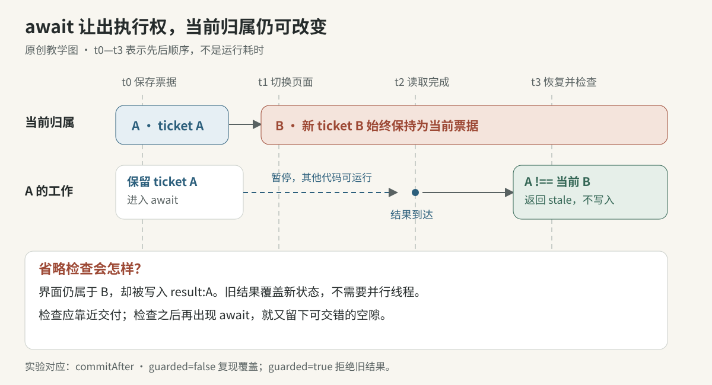
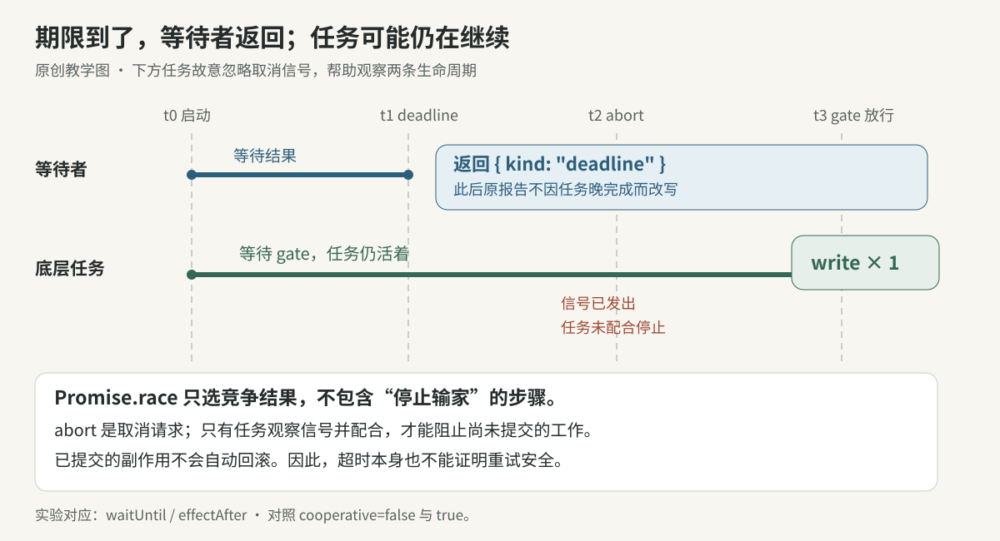
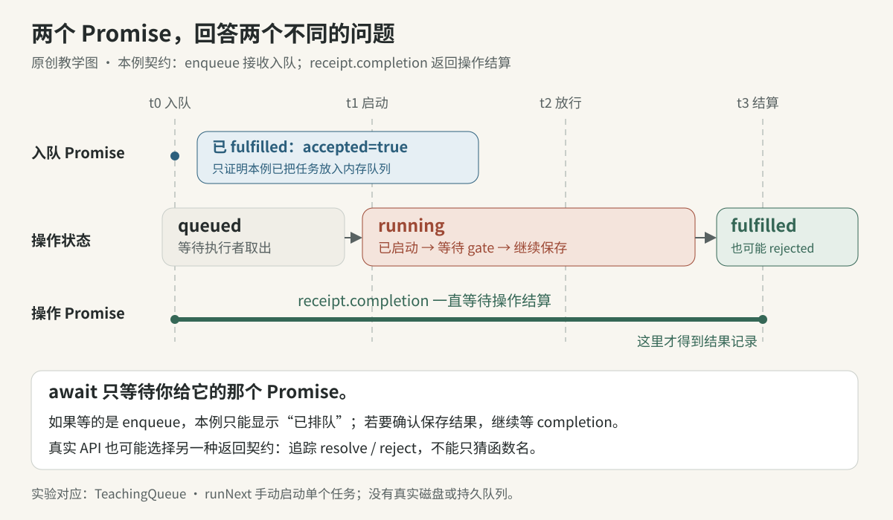

# 阅读准备 先读懂异步边界

本页补齐阅读全书所需的三个基础：等待期间状态会变，等待结束不等于工作停止，入队完成不等于操作完成。只需认识 JavaScript 函数、对象和 Promise。图、时间线与代码都是原创教学例子，不是 Claude 的实现声明。

Promise 是“一次异步结果”的容器：pending 表示未结算，fulfilled 表示成功结算，rejected 表示失败结算；后二者合称 settled。关键是先问：这个 Promise 承诺的是哪件事？写了 await，不会自动把它扩大成“整个业务完成”。

## await 前后的世界可能不同



读成“暂停当前函数，让其他代码继续执行”。即使等待的 Promise 已成功，await 后面的语句也要稍后恢复。单个 JavaScript 执行线程仍可出现这种交错，不需要两个线程同时修改内存。[语言说明](https://developer.mozilla.org/en-US/docs/Web/JavaScript/Reference/Operators/await#control_flow_effects_of_await)

| 顺序 | 当前页面 | A 的工作 | 能否交付 A 的结果 |
|---|---|---|---|
| t0 | A | 保存 A 的 ticket，开始等待 | 尚无结果 |
| t1 | B | 仍在等待；用户已切换页面 | 已失去当前归属 |
| t2 | B | A 的读取结束，恢复执行 | 要重新核对 |
| t3 | B | 比较原 ticket 与当前 ticket | 不匹配，丢弃旧结果 |

这里 t0 到 t3 是事件先后，不是实测毫秒。ticket 是本次操作的凭据；generation 是每次替换递增的代次。把 ticket 保存为 const，只固定这个引用，不会冻结“当前页面”。本例用对象身份比较，重新打开同名 A 也会拿到新 ticket。

下面是可运行实验中的关键路径；完整定义在[配套代码](../../04-Extracted-Core-Code-And-Scripts/async-reading-primer/async-boundaries.mjs)：

```js
export async function commitAfter(owner, ticket, ready) {
  const result = await ready;
  if (!owner.owns(ticket)) return 'stale';
  owner.value = result;
  return 'committed';
}
```

只在 await 前检查，证明的是过去。检查应靠近真正交付或提交的位置；检查后若又 await，就又出现可交错的空隙。代次解决“属于谁”，不替代资源权限检查。外部写入还需由执行边界保证授权与提交之间的约束。

## deadline 结束的是哪一段等待



把任务和到期通知交给 Promise.race，得到的是两者竞争后的结果。它没有“停止输家”这一操作。实验用手动放行的 Promise 代表到期通知，避免机器快慢影响顺序。[规范中的 race 算法](https://tc39.es/ecma262/multipage/control-abstraction-objects.html#sec-performpromiserace)

| 顺序 | 等待者 | 底层工作 | 内存写入次数 |
|---|---|---|---|
| t0 | 等工作或期限 | 已启动，等待 gate | 0 |
| t1 | 收到 deadline 并返回 | 仍未结束 | 0 |
| t2 | 已不再等待 | 收到 abort，但本例故意忽略 | 0 |
| t3 | 原报告仍为 deadline | gate 放行，写入完成 | 1 |

因此“超时”不能推导“没有副作用”，也不能直接推导“重试安全”。AbortController 发出取消信号；任务必须观察它并配合停止。实验的 cooperative 分支只在写入前检查信号，不会立即唤醒挂起的等待，也不会撤回已完成的写入。[取消信号的接口契约](https://dom.spec.whatwg.org/#aborting-ongoing-activities)

阅读退出代码时，把“停止继续等”“任务确认停止”“资源实际释放”分别记下来。shell-lifecycle 的 cleanup deadline 也只覆盖清理等待，后续 flush 仍需单独读；不能把该期限算作整个退出过程的总上限。

## 入队的收据与操作的收据



设想保存操作被放进队列。队列接收了它，只能说明任务进入本例的内存队列。执行者何时取出、保存是否成功，是后续事件。本例故意返回两个层次：enqueue 的结果是入队收据，其中 completion 才等待操作结算。

| 顺序 | 发生的事 | 已知结论 | 仍未知的事 |
|---|---|---|---|
| t0 | await enqueue 返回 | accepted=true，状态 queued | 是否会成功执行 |
| t1 | 执行者调用 runNext | 状态 running | 保存结果 |
| t2 | gate 放行 | 保存函数可以继续 | 最终成功或失败 |
| t3 | await receipt.completion 返回 | 得到 fulfilled 或 rejected 记录 | 真实系统的持久性仍取决于保存契约 |

```js
const receipt = await queue.enqueue(save);
// 此时只知道本例已入队。
const outcome = await receipt.completion;
// 本例用 outcome.state 表示操作成功或失败。
```

真实 API 可能让 enqueue 返回“接收成功”，也可能直接返回“操作完成”。名称无法决定语义，要跟到 resolve/reject 的位置。即使操作完成，若 save 只写缓存，仍不能宣称已落盘。本实验只有内存，没有网络确认、磁盘、跨进程队列或崩溃恢复。

## 先预测 再运行 再回到正文

从本书根目录 `books/claude-app/` 执行，需 Node.js 20+，无需安装依赖或提供产品文件：

```sh
node 04-Extracted-Core-Code-And-Scripts/async-reading-primer/demo.mjs
node --test 04-Extracted-Core-Code-And-Scripts/async-reading-primer/async-boundaries.test.mjs
```

先写下三个预测：不检查 ticket 时 B 会显示什么？deadline 后再 abort 能否保证零写入？await enqueue 后能否显示“保存成功”？演示依次给出：B 被旧结果覆盖；忽略信号的任务仍写一次；操作仍在 queued。守卫版本会拒绝旧结果，任务完成收据才能给出操作结算。全部逐字输出、可复制 import 和变体练习见[实验说明](../../04-Extracted-Core-Code-And-Scripts/async-reading-primer/README.md)。

再读 [shell-lifecycle](../../04-Extracted-Core-Code-And-Scripts/shell-lifecycle/README.md) 的 ticket 与清理快照，以及 [secure-preview 的适配合同](../../03-Ready-To-Use-Agent-Skills/secure-preview-sandbox/references/boundary-contract.md)中的 receipt、guard、signal。先用本页的时间线定位“谁在等、归属是否变了、哪个 Promise 完成”，再进入各卷的具体设计。
