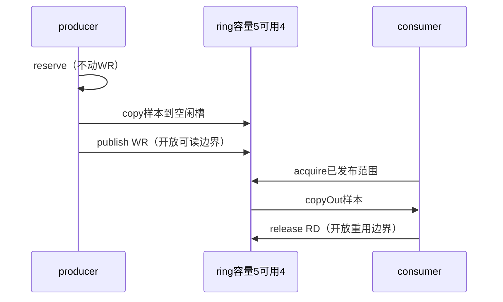
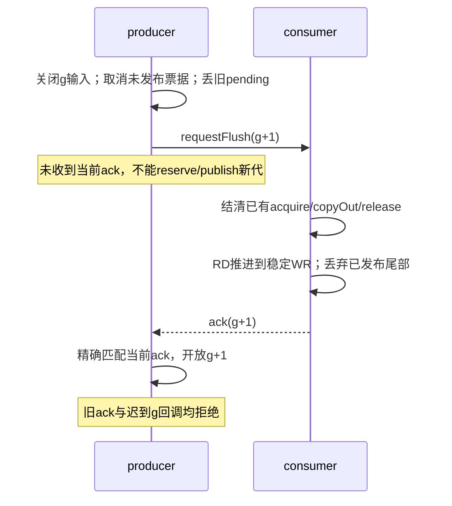

# 原创确定性 SPSC：发布边界与跨代握手

这是可运行的小教学实验，不是 Claude 的音频实现，不执行任何目标代码。SPSC 指一个 producer（生产者）、一个 consumer（消费者）；这里由同一个 JavaScript 调用栈手动安排两端步骤，不创建真实线程。

目标静态样本的 overflow 策略是“接纳前缀、丢弃剩余样本”；**本实验刻意选择不同的原创 retain-tail（保留尾部）政策**。本实验的 generation / ack / end 序号合同也是原创加强协议，不是从目标中恢复出的既有功能。

## 运行与文件

需要 Node.js 22+，零依赖，不联网，不用 SAB、Atomics、worker 或 AudioWorklet。

```sh
node --test *.test.mjs
node example.mjs
```

- `ring-lesson.mjs`：唯一模型类，私有状态；没有绕过发布/释放检查的开关。
- `ring-lesson.test.mjs`：正向轨迹、生命周期与反例断言。
- `unsafe-fixtures.mjs`：独立的故意错误演练，不继承模型，也不是可部署实现。
- `example.mjs`：顺序、自然跨代边界、flush与余额的可见日志。

本次实际执行环境为 Node.js v24.19.0。使用的语法/API支持Node 22；未声称已在Node 22二进制上测试。

## 先讲合同：两个索引、两道门

默认物理容量 N=5，始终留一个槽，因此可用4。WR是“已经复制完、消费者可读”的边界；RD是“已经取出、生产者可重用”的边界。

- readable = (WR − RD + N) % N
- free = N − 1 − readable
- producer唯一推进WR；consumer的release或consumerFlush唯一推进RD
- reserve只圈定本批大小，不推进WR；copy写槽，仍不可见；publish才推进WR
- acquire圈定已发布区；copyOut得到副本，仍不释放槽；release才推进RD
- 两端各至多一个未结票据；外部得到的是不透明对象，不能改内部计数。重复、伪造、取消后使用票据均拒绝



“acquire / release”在此是教学方法名，不表示实现了CPU acquire/release内存序。普通数组没有真实共享内存可见性问题，测试只能揭示逻辑上的先后依赖。

## 最小 API

创建 `new RingLesson(5)`，当前generation初始为0。输入是有限数值的普通数组，样本的整数值只是为了人能读懂顺序，不代表某种PCM编码。

| 方法 | 结果与合同 |
|---|---|
| enqueue(g, samples) | 将本代输入放入producer pending；成功true，迟到/封口/flush等待时false；不是ring接纳数 |
| reserve() → ticket/null | 按空位预留pending前缀；满或无pending返回null；有未结批次或门关闭则抛错 |
| copy(ticket), publish(ticket) | 先复制后发布；publish返回本次accepted数量，并移除pending前缀 |
| cancel(ticket) | 取消未发布批次；pending保留，可重新reserve；旧票据失效 |
| acquire(max) → ticket/null | 获取至多max个可读样本；空返回null |
| copyOut(ticket) | 返回冻结的样本记录副本：value、generation、sequence；尚未增加consumed |
| release(ticket) | 完成读取、释放槽，返回output及本次到达的自然done边界 |
| end(g) | 要求pending和写票据均清空；封口该代，记录accepted序号；空队列立即done |
| nextTurn() | 仅自然end后可调用；开启g+1，不清旧队列，允许一个读取批次跨自然边界 |
| requestFlush() | 取消未发布写批次、丢旧pending、关闭producer；返回request与abandonedPending数量 |
| consumerFlush(request) | 无未释放读批次时，丢已发布区并RD=WR；返回ack，仍不开放producer |
| acknowledge(ack) | 只认当前consumer返回的精确ack票据，成功后开放下一代；旧/伪造ack返回false |
| snapshot() | 冻结快照：索引、容量、代次、phase、pending、accepted、consumed、discarded与balanceOK |

方法抛错表示调用顺序/输入违约；正常空满用null，过期外部回调用false。一个对象是持续会话，generation单调前进；每代只能自然end一次。end不是flush，不能重复end或在end后继续送本代数据。下一代要显式nextTurn，或完成flush握手。没有重置序号或双端清零接口。

## partial：保留尾部就必须先重试尾部

1. enqueue `[1,2,3,4,5]`，reserve/copy/publish只接纳4个。WR=4，pending=`[5]`。
2. consumer取走`[1,2]`，RD=2，空出两个槽。
3. enqueue `[6,7]`；pending成为`[5,6,7]`，下一次只发布`[5,6]`。WR从4回绕到1。
4. consumer接下来必须得到`[3,4,5,6]`。7还在pending，等下一次发布。

enqueue只是接到待入队数据；accepted只在publish增长；consumed只在release增长。flush丢掉已发布区计入discarded；丢弃尚未接纳的pending只返回abandonedPending，不伪装成accepted后又播放。

每个步骤保持：`accepted = consumed + discarded + readable`。pending不在这个余额中；已经copy尚未publish的前缀仍在pending中，只计一次。样本sequence是跨代单调的accepted位置，flush不归零。留尾部会累积内存，本实验没有内存上限/流控，不能直接当无损实时缓冲引擎。

## flush：先关门，消费者确认后再开门



requestFlush统一选择“取消”当前尚未发布批次，即使它已copy。那些槽不在可读边界内，之后的新写可重用。不是先偷偷把它publish再flush。开始等待后，producer无法再写，所以consumer看见的WR稳定。

如果consumer已acquire，即使还未copyOut，也必须先完成copyOut/release；consumerFlush拒绝夹在读批次中间。请求与实际处理之间仍可能完成旧数据的正常消费，这不是即时静音保证。

处理flush只推进RD，WR不归零。处理返回ack以后，producer仍处于waiting，直至acknowledge明确收下当前票据。旧ack、重复ack、手造相同generation的对象都不能开门。这里用对象身份模拟可信控制消息关联，**没有实现跨线程消息序列化**。若确认丢失或一直不处理，门永远关闭；没有超时自动放行、重传或恢复引擎。

## 自然end：数量边界不等于丢弃

end(g)先要求当前pending与未发布批次全部结清；调用方还必须保证该turn的异步输出已经交齐。模型不能从pending为空推断外部解码任务全部完成。封口后迟到g回调会被拒绝，因此调用方过早end可能丢内容，这不是本模型能自动修复的条件。

边界为`{generation: g, sequence: accepted}`。nextTurn可在旧尾消费完之前开启新代；旧尾仍按FIFO自然排在前面。

例如旧代边界#5，已消费#1–2，队列为旧代#3–5与新代#6。一次copyOut(4)横跨边界；release后返回done(g,#5)，并保留#6属于新代的信息。边界前不发done；恰好达到或越过时只发一次。无可读样本的空边界在end返回时立即done。done只说明模型消费合同完成，绝不是扬声器已经声学播放完毕。

flush对尚未完成的自然边界返回canceledEnds；不会把discarded冒充自然done。已消费、已返回done的边界不追溯撤销。accepted序号只增长，丢弃产生的空洞不会当成“自然播放”。

## 两个专用错误演练

- earlyPublish：先WR=1，再填槽0。consumer在中间读到undefined，随后槽才变为101。
- earlyRelease：满队列`[101,102,103,104]`，先把RD从0推进到2，却还没取槽0；producer写入105、106，回绕覆盖槽0。迟来的copyOut读到106而不是101。

这些失败是我们故意编排的错误合同后果，不是Claude缺陷复现。正确类没有对应的unsafe选项。

## 覆盖与边界

测试覆盖wrap、满/空、partial顺序与余额、copy未发布不可见、未release不可覆盖、取消票据、copied未published时flush、等待ack门禁、旧ack/旧请求/旧输入拒绝、flush与未释放消费交错、自然跨代边界及恰好命中、空end、flush取消end和两条错误演练。

未覆盖：真实shared-memory的happens-before证明、硬件内存模型、真正的并行调度或穷尽所有交错、AudioWorklet接线、线程间控制消息损坏/丢失恢复、网络与decoder流水线、60FPS、实时期限、声卡延迟、重采样、codec、声音质量及Claude完整实现。数值序号采用JS安全整数范围，accepted溢出前拒绝reserve；generation溢出前拒绝nextTurn或requestFlush，且在任何状态变更之前拒绝，不主张无限运行。容量还受JavaScript数组长度及可用内存限制，不承诺任意安全整数容量均可分配。输入面向教学可信普通数组，不是任意恶意对象的安全边界。

与[第15卷的静态队列研究](../../02-Illustrated-Deep-Dive-Book/15-Voice-And-Vision-Math/audio-ring-publication/README.md)对照阅读：前者解释所选产品路径，本实验把不同的保尾与代次确认合同变成可逐步调用的代码。

## 独立复核

作者16项与独立5项，共21项测试通过。独立参考账本使用80条种子轨迹，每条2000次调度选择，共160,000次选择，其中包含因前置条件不成立而不执行动作的步骤。这是有限确定性探索，不是160,000个测试，也不是穷尽全部交错。另有输入getter重入、旧票据与跨实例票据、空自然代次边界检查。
